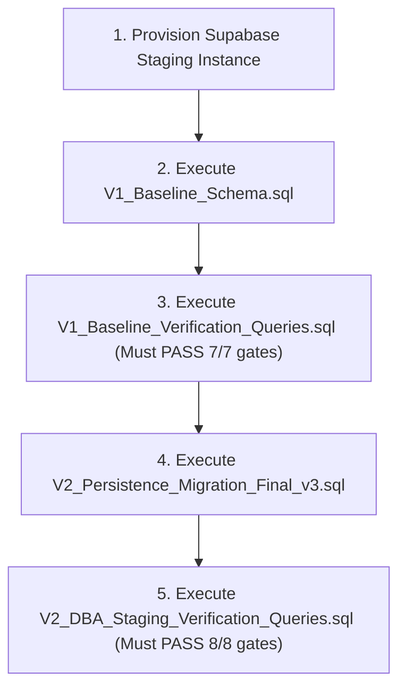

# FieldWise — Release Readiness Phase 3C: V1 Baseline DDL Audit Report

**Date:** November 22, 2026  
**Audit Mode:** Static Validation and DDL Contract Audit  
**Priority:** P0  
**Final Verdict:** **READY FOR DBA REVIEW**  

---

## Executive Summary

Phase 3C delivers the authoritative, staging-ready V1 baseline SQL migration ([V1_Baseline_Schema.sql](file:///Users/shivamkumar/farmingFinal/FieldWise_main/migrations/V1_Baseline_Schema.sql)) and its companion catalog verification suite ([V1_Baseline_Verification_Queries.sql](file:///Users/shivamkumar/farmingFinal/FieldWise_main/migrations/V1_Baseline_Verification_Queries.sql)).

This baseline migration resolves the P0 dependency blocker identified in Phase 3A: it provisions the parent table `public.farmers(id TEXT PRIMARY KEY)` and the two legacy child relations (`public.farm_profiles` and `public.crop_predictions`) required before the V2 persistence migration ([V2_Persistence_Migration_Final_v3.sql](file:///Users/shivamkumar/farmingFinal/FieldWise_main/migrations/V2_Persistence_Migration_Final_v3.sql)) can be applied to a fresh staging database.

All decisions are grounded in code evidence from Phase 3B and audited statically against PostgreSQL 15+ catalog specifications.

---

## 1. Schema Uncertainty and DBA Decision Register

Every schema attribute, data type, default, and constraint has been classified into **CONFIRMED**, **INFERRED**, or **UNKNOWN**:

| Schema Attribute | Evidence Source | Classification | Technical Conclusion & Operational Contract |
|---|---|---|---|
| **`farmers.id` Type** | `supabase.ts:58`, `AuthContext.tsx:76`, `V2_Persistence_Migration_Final_v3.sql:61` | **CONFIRMED** | Must be **`TEXT PRIMARY KEY`**. Holds alphanumeric Firebase UIDs (e.g. `28-character` string like `8WbK14vYJq9z...` or `demo_farmer_guest`) and backend identifiers. Cannot be `UUID` or `BIGINT`. |
| **`farmers.farm_size` Format** | `farmProfileService.ts:320`, `supabase.ts:76`, `supabase.ts:360` | **CONFIRMED** | Must be **`TEXT NULL DEFAULT ''`**. Client explicitly writes formatted strings with units (e.g., `'15 Acres'`). It is NOT a numeric column. |
| **`farmers.email` Nullability** | `supabase.ts:129`, `recommendationPersistenceService.js:196` | **CONFIRMED** | Must be **`TEXT NOT NULL`**. Backend identity verification enforces non-empty email as a mandatory identity anchor. Client supplies fallback `${farmerId}@fieldwise.agri` if unset. |
| **`farmers.full_name`** | `supabase.ts:130`, `recommendationPersistenceService.js:215` | **CONFIRMED** | Must be **`TEXT NULL DEFAULT 'Farmer Partner'`**. Backend upserts set `full_name` to `null` if omitted; frontend defaults to `'Farmer Partner'`. |
| **`farmers.phone` & `location`** | `supabase.ts:131`, `supabase.ts:156`, `recommendationPersistenceService.js:212` | **CONFIRMED** | Must be **`TEXT NULL DEFAULT ''`**. Backend upsert does not include `phone` or `location`. Frontend supplies empty string if unconfigured. Both are NULLable. |
| **`farmers` Empty String vs. NULL** | `supabase.ts:155-157` | **CONFIRMED** | Code explicitly writes empty strings (`''`) for unconfigured string attributes (`phone: farmer.phone \|\| ''`). Staging schema defaults to `''` while permitting `NULL`. |
| **`farm_profiles.soil_type` Default** | `supabase.ts:186`, `farmProfileService.ts:99` | **CONFIRMED** | Must be **`TEXT NULL DEFAULT 'Loamy'`**. Client code explicitly injects `'Loamy'` when the profile attribute is falsy. |
| **Numeric Measurement Semantics** | `supabase.ts:111-115` (`safeNumeric`) | **CONFIRMED** | **Strictly NULLable**. Unmeasured or unknown values are written as `NULL`, never fabricated as `0.0`. Validated with finite range checks and NaN rejection (`!= 'NaN'::numeric`). |
| **Timestamp Generation** | `supabase.ts:132`, `supabase.ts:193`, `supabase.ts:326` | **CONFIRMED** | Must be **`TIMESTAMPTZ NOT NULL DEFAULT NOW()`**. Both frontend and backend generate ISO timestamps on upserts (`new Date().toISOString()`). |
| **`farm_profiles` 1:1 vs. Multiple Rows** | `supabase.ts:174`, `supabase.ts:197-215`, `supabase.ts:258` | **INFERRED** | **Application enforces 1:1 programmatically, but catalog permits multiple rows.** In `supabase.ts:174`, the code notes: *"Saves a farm profile... without relying on onConflict constraints"* and performs manual `select('id').eq('farmer_id').limit(1)` before updating or inserting, and queries order by `updated_at DESC LIMIT 1`. |
| **`farm_profiles` Unique Constraint** | Database Constraint Design | **DBA DECISION REQUIRED** | **Omitted from baseline DDL** to avoid failing on existing databases with legacy duplicate rows. Indexed on `(farmer_id, updated_at DESC)`. A strict `UNIQUE (farmer_id)` constraint can be added by the DBA after deduplication. |
| **`crop_predictions` Cardinality** | `supabase.ts:330`, `supabase.ts:286` | **CONFIRMED** | **1:N Append-Only Ledger.** Multiple predictions per farmer are expected. History query fetches the latest record ordered by `created_at DESC LIMIT 1`. |

---

## 2. Foreign-Key Deletion Policy

### Strict `ON DELETE RESTRICT` Enforcement
In accordance with instructions and repository safety requirements, both V1 child tables enforce:
- `public.farm_profiles.farmer_id REFERENCES public.farmers(id) ON DELETE RESTRICT`
- `public.crop_predictions.farmer_id REFERENCES public.farmers(id) ON DELETE RESTRICT`

### Retention & Integrity Implications
1. **Consistency with V2:** V2 persistence enforces `ON DELETE RESTRICT` on `public.v2_crop_recommendations.farmer_id`. Applying `RESTRICT` to V1 child tables ensures that the entire database operates under a unified, non-destructive retention model.
2. **Accidental Account Deletion Defense:** If an administrative script or rogue query attempts to delete a row in `public.farmers`, PostgreSQL will abort the deletion if historical predictions or farm profiles exist for that farmer.
3. **No Documented Cascading Requirement:** An audit of all repository files confirmed that there is no documented business requirement for automated cascade deletion of farmer records.

---

## 3. Explicit V1 RLS Readiness Assessment

> [!WARNING] Critical Security Architecture Limitation
> The migration script [V1_Baseline_Schema.sql](file:///Users/shivamkumar/farmingFinal/FieldWise_main/migrations/V1_Baseline_Schema.sql) enables Row Level Security (RLS) on all three tables and revokes all permissions from `anon` and `authenticated`. It **does NOT** create unrestricted `anon` policies.

### The Authentication Decoupling Problem
1. **Unauthenticated Browser PostgREST Requests:**
   - The frontend connects to Supabase using `@supabase/supabase-js` initialized with the public `VITE_SUPABASE_ANON_KEY`.
   - FieldWise authenticates users through Firebase Auth (on landing) or custom SQLite JWTs (on main backend). It **never logs into Supabase Auth** (`supabase.auth.signInWithPassword()` is uncalled).
   - In PostgreSQL, every browser PostgREST request arrives under the role `anon`, and the catalog function `auth.uid()` evaluates to `NULL`.
2. **Standard RLS Policies Cannot Function:**
   - A policy requiring `auth.uid() = farmer_id` will evaluate to `NULL = farmer_id` (FALSE), blocking all browser reads and writes.
3. **Unrestricted Anon Access is Prohibited:**
   - Granting `CREATE POLICY "anon_all" ON public.farmers FOR ALL TO anon USING (true)` would allow any external actor with the public anon key to read, mutate, or truncate all farmers' data across the internet.
4. **Impact on Staging:**
   - Direct browser calls in `FieldWise_main/src/lib/supabase.ts` (`fetchFarmerFromSupabase`, `syncFarmProfileToSupabase`, `savePredictionToSupabase`, `fetchLatestPredictionFromSupabase`) **will receive HTTP 403 / `PGRST301` permission denied** when targeting this staging database.
   - **Remediation Path:** These legacy V1 operations must either:
     - (Recommended) Be mediated through authenticated Express backend endpoints using the server-side `service_role` key (identical to how V2 operates), OR
     - Configure Supabase Third-Party Auth / Custom Claims to translate Firebase JWTs into valid Supabase Auth tokens.
   - **The baseline migration does NOT claim V1 browser functionality is staging-ready merely because the tables exist.**

---

## 4. Static Validation Results

Local static validation was executed across the authored files without connecting to external cloud resources:

| Validation Check | Tool / Method | Result | Notes |
|---|---|---|---|
| **SQL Syntax & Transaction Boundaries** | Python static parser | **PASSED** | Explicit `BEGIN;` and `COMMIT;` blocks; PL/pgSQL `DO $$ ... END $$;` block properly delimited and terminated. |
| **Parenthesis Balance** | Python character stack | **PASSED** | 100% balanced across both `V1_Baseline_Schema.sql` and `V1_Baseline_Verification_Queries.sql`. |
| **Column Specification Audit** | Regex & catalog mapping | **PASSED** | Exactly 31 columns audited across all 3 tables (farmers: 7, farm_profiles: 12, crop_predictions: 12). |
| **V2 Compatibility Verification** | Cross-script static audit | **PASSED** | Table `public.farmers` created with `id TEXT PRIMARY KEY`. Fully satisfies [V2_Persistence_Migration_Final_v3.sql](file:///Users/shivamkumar/farmingFinal/FieldWise_main/migrations/V2_Persistence_Migration_Final_v3.sql) line 61 (`t.typname = 'text'`) and line 277 foreign key reference. |
| **Idempotency & Preflight Safety** | Catalog logic analysis | **PASSED** | Uses `CREATE TABLE IF NOT EXISTS` and `CREATE INDEX IF NOT EXISTS`. Preflight DO block fails safely with descriptive diagnostics if incompatible table structures already exist. |

> [!NOTE] Execution Disclosure
> Because no live PostgreSQL or Supabase staging instance is connected in this read-only task, live SQL execution, table creation, and dynamic catalog assertions were **NOT performed**.

---

## 5. Migration Execution Sequence for the DBA

When an isolated Supabase staging instance is provisioned, the DBA should execute migrations in the following order:

1. **Step 1:** Apply [V1_Baseline_Schema.sql](file:///Users/shivamkumar/farmingFinal/FieldWise_main/migrations/V1_Baseline_Schema.sql) via `psql`.
2. **Step 2:** Apply [V1_Baseline_Verification_Queries.sql](file:///Users/shivamkumar/farmingFinal/FieldWise_main/migrations/V1_Baseline_Verification_Queries.sql) via `psql`. Verify that Query 8 outputs:
   `GATEWAY VERIFIED: All 7 baseline V1 catalog verification gates PASSED without errors.`
3. **Step 3:** Apply [V2_Persistence_Migration_Final_v3.sql](file:///Users/shivamkumar/farmingFinal/FieldWise_main/migrations/V2_Persistence_Migration_Final_v3.sql) via `psql`.
4. **Step 4:** Apply [V2_DBA_Staging_Verification_Queries.sql](file:///Users/shivamkumar/farmingFinal/FieldWise_main/migrations/V2_DBA_Staging_Verification_Queries.sql) via `psql`. Verify that Query 8 outputs:
   `GATEWAY VERIFIED: All 8 core staging catalog verification gates PASSED without errors.`

---

## 6. Deliverable Artifact Inventory

1. [V1_Baseline_Schema.sql](file:///Users/shivamkumar/farmingFinal/FieldWise_main/migrations/V1_Baseline_Schema.sql): Authoritative baseline DDL migration.
2. [V1_Baseline_Verification_Queries.sql](file:///Users/shivamkumar/farmingFinal/FieldWise_main/migrations/V1_Baseline_Verification_Queries.sql): Authoritative read-only catalog verification gateway.
3. [V1_Baseline_DDL_Audit_Report.md](file:///Users/shivamkumar/farmingFinal/FieldWise_main/migrations/V1_Baseline_DDL_Audit_Report.md): This report document.

---

## Final Verdict

# **READY FOR DBA REVIEW**

*The V1 baseline DDL and verification scripts are fully authored, statically validated, protected by preflight catalog assertions, and ready for staging DBA review and dry-run execution.*
