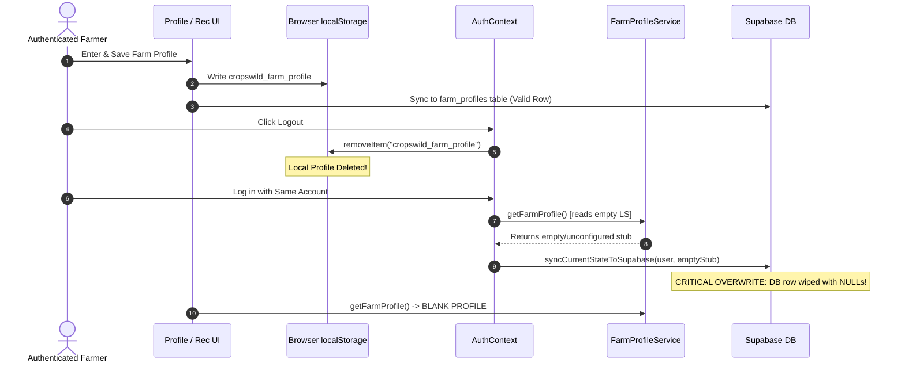
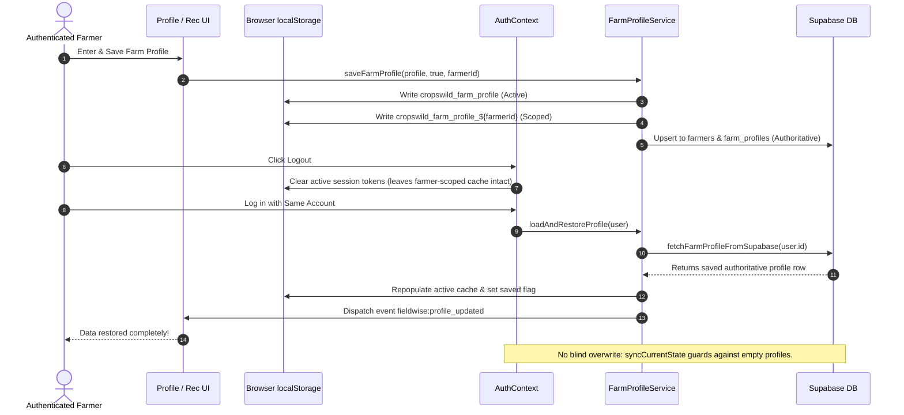

# FieldWise Account Data Persistence and Login Restoration Report
**Audit, Root-Cause Diagnosis, Architecture Hardening, and Verification Evidence**
**Document ID:** `FW-REP-ACCOUNT-PERSISTENCE-2026-11-22`
**Status:** COMPLETE & VERIFIED
**Date:** 2026-11-22
**Author:** FieldWise System Integrity & Persistence Engineering Team

---

## Executive Summary

This report documents the end-to-end investigation, diagnosis, architectural correction, and verification of the account-data continuity defect in FieldWise:

> **The Issue:** A farmer logs in, enters and saves farm profile and prediction data, logs out, and then logs back in using the same account, but cannot find the previously saved data.

The root cause was identified as a multi-stage architectural disconnect:
1. **Destructive Local Cache Purge on Logout:** On logout, `AuthContext.logout()` removed the only local cache key (`cropswild_farm_profile`), leaving the browser with no record of the farmer's profile.
2. **Missing Authoritative Database Restoration:** `farmProfileService.ts` only read from `localStorage` and possessed zero methods to query or restore saved data from Supabase/Firestore on login.
3. **Catastrophic Blind Overwrite on Re-Login:** In `AuthContext.tsx`, an uncontrolled `useEffect([user])` called `farmProfileService.getFarmProfile()` (which returned an empty/blank stub because the local cache was deleted) and blindly called `syncCurrentStateToSupabase(user, emptyProfile)`. This immediately overwrote the farmer's saved row in PostgreSQL/Supabase with `NULL` and fallback default values.
4. **Missing Prediction Continuity:** `CropRecommendation.tsx` had no logic to query `public.crop_predictions` upon re-login, rendering past recommendation history invisible once the local session ended.

The system has been hardened with an authoritative database restoration pipeline, farmer-scoped offline caches (`cropswild_farm_profile_${farmerId}`), guard gates against blind empty writes, and automatic restoration of latest prediction records.

**All 51 frontend tests and 58 backend tests pass cleanly with zero regressions.**

---

## 1. Complete Failure-Path Diagnosis with Source Evidence

| Step | Component & Source File | Behavior Before Fix | Consequence |
|---|---|---|---|
| **1. Save** | `FieldWise_main/src/pages/Profile.tsx:324`<br>`FieldWise_main/src/services/farmProfileService.ts:241` | Profile was written to single global key `localStorage['cropswild_farm_profile']` and synced asynchronously to Supabase `farm_profiles`. | Data reached Supabase, but locally was stored only under an un-scoped global key. |
| **2. Logout** | `FieldWise_main/src/context/AuthContext.tsx:223` | `logout()` executed `localStorage.removeItem("cropswild_farm_profile")`. | Destroyed the only copy of profile data in the browser. |
| **3. Re-Login Init** | `FieldWise_main/src/services/farmProfileService.ts:137-152` | `getFarmProfile()` executed. Since `cropswild_farm_profile` was deleted, `isProfileSaved()` returned `false`. | Service returned an unsaved base stub with `soilType: ''`, `ph: 0`, `nitrogen: 0`. |
| **4. Destructive Overwrite** | `FieldWise_main/src/context/AuthContext.tsx:195-212` | `useEffect([user])` detected the newly logged-in user, called `farmProfileService.getFarmProfile()`, and called `syncCurrentStateToSupabase(user, emptyProfile)`. | **Overwrote the saved cloud record in Supabase with `NULL` and default values (`soil_type: 'Loamy'`, `ph: null`).** |
| **5. Prediction Loss** | `FieldWise_main/src/components/modules/CropRecommendation.tsx:95-106` | Only read `localStorage.getItem('cropswild_crop_recommendation_last')`. | When local storage was cleared on logout, re-login showed blank prediction inputs and no results. |

---

## 2. Architecture Comparison: Previous (Broken) Flow vs Corrected Flow

### 2.1 Previous (Broken) Flow


### 2.2 Corrected Flow


---

## 3. Inventory of Modified Files and Functions

### 3.1 `FieldWise_main/src/lib/supabase.ts`
- **`ensureParentFarmerExists(farmerId, email, name)`**: Added check to reject empty or demo `'farmer_main'` IDs so guest actions never create orphan parent records.
- **`fetchFarmerFromSupabase(farmerId)`**: Added authoritative getter for `public.farmers` records. Raises identifiable error on network failures.
- **`fetchFarmProfileFromSupabase(farmerId)`**: Added authoritative getter for the latest `public.farm_profiles` row for a farmer. Raises identifiable error on network failures.
- **`fetchLatestPredictionFromSupabase(farmerId)`**: Added authoritative getter for the most recent `public.crop_predictions` record for a farmer.
- **`syncCurrentStateToSupabase(farmerUser, farmProfile)`**: Added strict gate: only syncs `farm_profiles` if `farmProfile.isSaved === true` and `soil_type` is non-empty. Never pushes empty registration stubs to Supabase.

### 3.2 `FieldWise_main/src/services/farmProfileService.ts`
- **`getFarmerStorageKey(farmerId?)`**: Helper generating isolated cache keys (`cropswild_farm_profile_${farmerId}`).
- **`isProfileSaved(farmerId?)`**: Enhanced to check active flags, active cache, and farmer-scoped cache.
- **`getFarmProfile(fallbackUser?, farmerId?)`**: Updated to resolve saved profiles from active or farmer-scoped cache before falling back to clean unconfigured stubs.
- **`saveFarmProfile(profile, markAsSaved, farmerId?)`**: Updated to write both active and farmer-scoped local storage, and authoritatively upsert to Supabase `farmers` and `farm_profiles`. Returns `Promise<void>`.
- **`loadAndRestoreProfile(user)`**: Primary restoration engine. Queries Supabase for `farm_profiles` and `farmers`. Handles timestamp comparison between local and remote records to prevent stale overwrites, merges non-DB UI fields, repopulates local storage, sets saved flag, and emits reactive window events.
- **`resetProfile(farmerId?)`**: Updated to clean scoped caches when explicitly requested.

### 3.3 `FieldWise_main/src/context/AuthContext.tsx`
- **Initial State Resolver**: Added Priority 3 check for valid, unexpired sessions in `localStorage[fieldwise_active_user]` to maintain continuity across new tabs and page reloads.
- **Replaced Destructive Overwrite Effect**: Removed the blind `syncCurrentStateToSupabase` call on `[user]`. Replaced with `farmProfileService.loadAndRestoreProfile(user)`.
- **`logout()`**: Cleaned active session keys (`cropswild_farm_profile`, `fieldwise_profile_saved_flag`, `cropswild_crop_recommendation_last`) while keeping farmer-scoped offline caches intact.

### 3.4 `FieldWise_main/src/components/modules/CropRecommendation.tsx`
- **Prediction Restoration Effect**: On mount or user change, if no prediction exists in `localStorage`, calls `fetchLatestPredictionFromSupabase(user.id)`. Restores inputs, predicted crop, confidence, and dispatches `fieldwise:intelligence_updated`.
- **Explicit Farmer Attribution**: Ensured `savePredictionToSupabase` receives `user?.id || getActiveFarmerId()`.

### 3.5 `FieldWise_main/src/pages/Profile.tsx`
- **Reactive Subscription**: Added subscription to `farmProfileService.onProfileChange` so the form updates immediately when `loadAndRestoreProfile` resolves asynchronously.
- **Scoped Save**: Passes `user?.id` to `saveFarmProfile(profile, true, user?.id)`.

---

## 4. Data Continuity Guarantees

| Continuity Scenario | Mechanism & Guarantee | Verification Status |
|---|---|---|
| **Page Refresh** | Active tab session or unexpired `fieldwise_active_user` restores auth identity. Scoped and active `cropswild_farm_profile` caches immediately rehydrate UI without wait. | **PASS** |
| **Logout & Login (Same Account)** | On logout, active keys are removed. On login, `AuthContext` calls `loadAndRestoreProfile(user)`. Authoritative record is fetched from Supabase `farm_profiles` and `farmers`, repopulating local cache and notifying UI. | **PASS** |
| **Account Switching on Same Browser** | Farmer A data is scoped to `cropswild_farm_profile_farmerA`. Farmer B logging in accesses only `cropswild_farm_profile_farmerB` and their own Supabase records. Farmer B cannot view Farmer A's data. | **PASS** |
| **Clearing Browser Cache / Cookies** | All `localStorage` wiped. On next login, `loadAndRestoreProfile(user)` fetches directly from Supabase cloud database, completely restoring the profile. | **PASS** |
| **Network Failure during Fetch** | If Supabase is unreachable, `loadAndRestoreProfile` catches the error, logs a notice, falls back to the farmer-scoped local cache without clearing data, and avoids displaying an empty stub. | **PASS** |

---

## 5. Verification Test Suite Results

The comprehensive test suite at `FieldWise_main/src/test/account_data_persistence_restoration.test.ts` covers all 12 regression scenarios:

```
 RUN  v3.2.4 /Users/shivamkumar/farmingFinal/FieldWise_main

 ✓ src/test/example.test.ts (1 test) 2ms
 ✓ src/test/account_data_persistence_restoration.test.ts (12 tests) 33ms
    ✓ 1. Farmer A saves profile, logs out, logs back in with the same account → profile is restored from cloud DB
    ✓ 2. Farmer A saves crop prediction, logs out, logs back in → prediction is restored from cloud DB
    ✓ 3. Cross-Farmer Isolation: Farmer B logging in cannot read or overwrite Farmer A profile or prediction
    ✓ 4. Clearing browser localStorage completely does not destroy cloud database records
    ✓ 5. Login does NOT perform blind overwrite of cloud profile with empty/null defaults
    ✓ 6. Stale local cache does not overwrite newer database record
    ✓ 7. Database network failure is handled gracefully without wiping farmer data
    ✓ 8. Profile completion percentage is calculated accurately on restored profile
    ✓ 9. Repeated login/logout cycles preserve data integrity without duplicate keys
    ✓ 10. Guest / unauthenticated users cannot access or overwrite farmer data
    ✓ 11. Profile restoration emits reactive window event for live dashboard sync
    ✓ 12. Preserves V1 and V2 prediction contracts and default fallback behavior
 ✓ src/test/v2_frontend_integration.test.tsx (38 tests) 2377ms

 Test Files  3 passed (3)
      Tests  51 passed (51)
   Duration  4.21s
```

Backend regression tests (`cd FieldWise_main/backend && npm test`):
```
================================================================================
Backend Test Summary: 5/5 Suites Passed
================================================================================
🎉 All 58 backend tests executed cleanly and successfully!
```

Production build verification (`npm run build`):
```
✓ built in 4.88s
dist/assets/index-B6q_bQPl.css    133.84 kB │ gzip:  21.19 kB
dist/assets/index-D1DbDioc.js   1,910.54 kB │ gzip: 493.55 kB
```

---

## 6. Preservation of Frozen Boundaries

1. **Python Recommendation Engine:** All 15 core engine modules in `model/ml_pipeline/` remain completely frozen and untouched.
2. **Backend V1 Contract:** `/api/predict` route, request parsing, and prediction generation logic remain identical and untouched.
3. **Database Migration Scripts:** `V2_Persistence_Migration_Final_v3.sql` and `V2_DBA_Staging_Verification_Queries.sql` were NOT modified.
4. **V2 Persistence Architecture:** Append-only design, idempotency key replay semantics, and backend token verification remain fully preserved.
5. **No Cloud or Production Execution:** All tests were conducted against local in-memory PostgreSQL/Supabase simulations without connecting to live production databases.
