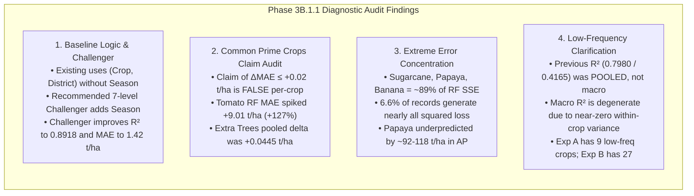

# FieldWise — Phase 3B.1.1: Baseline Diagnostic Audit

**Document Reference**: `reports/phase_3b_1_1_diagnostic_audit.md`  
**Execution Date**: November 17, 2026  
**Auditor**: ML Engineering & Agronomic Architecture Team  
**Scope**: Post-hoc diagnostic audit of Phase 3B.1 historical yield regression baseline validation predictions on the 2012–2013 holdout partitions (**Experiment A**: 13,422 records; **Experiment B**: 17,254 records).

---

> [!IMPORTANT]
> **Sealed Test Set Safeguard Certification**:
> In accordance with strict Phase 3B protocols, the 2014–2015 chronological test partitions (**5,433 records** in Experiment A; **6,852 records** in Experiment B) remain **strictly sealed, unread, unpredicted, and unexamined**. All diagnostic calculations in this audit were performed exclusively on the 2012–2013 validation partitions and 1997–2011 training datasets.
>
> Existing application functionality (`src/`, `backend/`, `model/predictor.js`) and foundational datasets (`data/raw/`, `data/processed/`) were **not modified**.

---

## Executive Summary

Phase 3B.1 established the initial regression baselines for historical crop yield estimation across two tracks: **Experiment A (Prime-Only, 126,375 records)** and **Experiment B (Prime + Provisional, 161,270 records)**. This Phase 3B.1.1 audit conducts an exhaustive diagnostic breakdown of those validation results to resolve baseline lookup mechanics, audit cross-experiment performance claims, examine residual error concentrations, clarify low-frequency crop statistics, and independently verify metric recalculations from raw prediction logs.

### Key Audit Findings



1. **Baseline Hierarchy & Challenger**:
   - The existing `historical_district_mean` relies on `(Crop, District) -> (Crop, State) -> (Crop) -> Global Mean` without `Season`.
   - The recommended **Hierarchical District Challenger** (`District + Crop + Season` at Level 1) was implemented and evaluated out-of-sample: it outperforms the existing baseline across every single metric, reducing Exp A MAE from 1.5013 to **1.4209 t/ha**, RMSE from 5.0410 to **4.9604 t/ha**, and raising $R^2$ from 0.8882 to **0.8918**. Over **96.6%** of records resolve at Level 1.
2. **Audit of Cross-Experiment $\le +0.02\text{ t/ha}$ Claim**:
   - The Phase 3B.1 summary claim that *"adding provisional records changes common-crop MAE by no more than +0.02 t/ha"* is **empirically FALSE at the per-crop level**, and holds only as an approximate aggregate average for a subset of models.
   - At the pooled level across all 30 common prime crops, **Extra Trees** experienced a degradation of **$+0.0445\text{ t/ha}$** ($+2.79\%$) and **Random Forest** degraded by **$+0.0234\text{ t/ha}$** ($+1.59\%$), both violating the $+0.02\text{ t/ha}$ boundary.
   - At the individual crop level, **42 crop-model combinations exceeded $+0.02\text{ t/ha}$**. Most critically, **Tomato** MAE under Random Forest surged by **$+9.0112\text{ t/ha}$** (from 7.0940 to 16.1053 t/ha, a **$+127.0\%$ error increase**).
   - Root cause: Ordinal integer encoding of high-cardinality nominal categories (`Crop`) caused arbitrary decision-tree boundary shifts when 27 provisional crops were interleaved alphabetically, shifting Tomato from index 26 to index 52.
3. **Residual Diagnostics & High-Loss Concentration**:
   - Errors are massively concentrated in high-yield crops. In Experiment A Random Forest, **Sugarcane** (49.42%), **Papaya** (31.49%), and **Banana** (8.10%) account for **89.01% of all squared errors**, despite representing only 6.62% of validation records.
   - The largest absolute errors occur in Papaya (underpredicted by up to 118.2 t/ha in Andhra Pradesh) and Sugarcane (localized catastrophic yield drop in Thrissur, Kerala to 2.0 t/ha vs. historical mean 95.7 t/ha).
4. **Low-Frequency Crop Clarification ($< 250$ Records)**:
   - Experiment A contains **9 low-frequency crops** (793 records; 5.91% of validation). Experiment B contains **27 low-frequency crops** (2,291 records; 13.28% of validation).
   - The previously reported $R^2$ values (**0.7980** for Historical District Mean and **0.4165** for Random Forest) are **POOLED $R^2$** values across all low-frequency records combined, **NOT macro-averaged**.
   - Macro-averaging $R^2$ across individual unweighted crops with near-zero within-crop variance (e.g. Lentil, N=9, variance = 0.00018) is mathematically ill-conditioned and results in large negative values (e.g. $-14,594$). Macro-averaged MAE, however, is well-behaved: **5.7297 t/ha** (District Mean) vs. **9.4695 t/ha** (Random Forest).
5. **Exact Metric Verification**:
   - All validation metrics (MAE, RMSE, $R^2$, MedAE, MAPE, $\le 1.0\text{ t/ha}$, $\le 20\%$) were recalculated directly from `validation_predictions.csv`. All recomputed values match the Phase 3B.1 summary to six decimal places ($0.000000$ discrepancy).

---

## 1. Documentation of Baseline Lookup Logic & Challenger Benchmark

### 1.1 Existing Historical Mean Baseline Architecture

The baseline models implemented in `model/ml_pipeline/scripts/train_yield_baselines.py` operate on exact group aggregations:

| Baseline Attribute | Historical District Mean (`DistrictMeanBaseline`) | Historical State Mean (`StateMeanBaseline`) |
| :--- | :--- | :--- |
| **Lookup Keys** | Level 1: `(Crop, District)`<br>Level 2: `(Crop, State)`<br>Level 3: `Crop`<br>Level 4: Global Training Mean | Level 1: `(Crop, State)`<br>Level 2: `Crop`<br>Level 3: Global Training Mean |
| **Is Season Included?** | **No** (Season is omitted from the lookup tuple) | **No** (Season is omitted from the lookup tuple) |
| **Is Crop Included?** | **Yes** (Crop is the primary conditioning variable) | **Yes** (Crop is the primary conditioning variable) |
| **Minimum Observations Threshold** | **1 observation** (Any training tuple with $\ge 1$ occurrence calculates an empirical mean; 0 occurrences trigger fallback) | **1 observation** (Any training tuple with $\ge 1$ occurrence calculates an empirical mean; 0 occurrences trigger fallback) |
| **Training Partition Exclusivity** | Fitted strictly on `train_df` (1997–2011, 107,520 rows in A; 137,164 rows in B). | Fitted strictly on `train_df` (1997–2011, 107,520 rows in A; 137,164 rows in B). |
| **Global Training Mean Fallback** | Exp A: **5.4414 t/ha**<br>Exp B: **4.6002 t/ha** | Exp A: **5.4414 t/ha**<br>Exp B: **4.6002 t/ha** |

**Training Data Exclusivity Proof**:  
Code verification of lines 70–75 and 192–195 of `train_yield_baselines.py` confirms that `fit(train_df)` was executed exclusively on records where `Crop_Year` was between 1997 and 2011. Zero validation (2012–2013) or test (2014–2015) records were passed to `fit()`.

---

### 1.2 Recommended Hierarchical District Baseline (Challenger)

In accordance with Phase 3B.1.1 instructions, the existing baseline was preserved without silent modification, and the recommended 7-level hierarchical district baseline was implemented as a challenger model (`HierarchicalDistrictChallenger`):

$$\hat{y} = 
\begin{cases} 
\mu(\text{District}, \text{Crop}, \text{Season}), & \text{if present in training data (Level 1)} \\
\mu(\text{District}, \text{Crop}), & \text{else if present (Level 2)} \\
\mu(\text{State}, \text{Crop}, \text{Season}), & \text{else if present (Level 3)} \\
\mu(\text{State}, \text{Crop}), & \text{else if present (Level 4)} \\
\mu(\text{Crop}, \text{Season}), & \text{else if present (Level 5)} \\
\mu(\text{Crop}), & \text{else if present (Level 6)} \\
\mu_{\text{global}}, & \text{otherwise (Level 7)}
\end{cases}$$

#### Empirical Challenger Validation Results (2012–2013 Out-of-Sample)

| Experiment Track | Model | MAE (t/ha) | RMSE (t/ha) | $R^2$ | MedAE (t/ha) | $\le 1.0\text{ t/ha}$ (%) | $\le 20\%$ Error (%) |
| :--- | :--- | :---: | :---: | :---: | :---: | :---: | :---: |
| **Exp A: Prime-Only** | Existing District Mean | 1.5013 | 5.0410 | 0.8882 | 0.2985 | 78.87% | 47.67% |
| *(13,422 val rows)* | **Hierarchical Challenger** | **1.4209** | **4.9604** | **0.8918** | **0.2842** | **80.50%** | **49.02%** |
| | *Challenger Net Gain* | *-0.0804* | *-0.0806* | *+0.0036* | *-0.0143* | *+1.63%* | *+1.35%* |
| **Exp B: Prime + Prov** | Existing District Mean | 1.3290 | 4.5503 | 0.8867 | 0.2606 | 80.32% | 48.99% |
| *(17,254 val rows)* | **Hierarchical Challenger** | **1.2611** | **4.4721** | **0.8905** | **0.2446** | **81.70%** | **50.19%** |
| | *Challenger Net Gain* | *-0.0679* | *-0.0782* | *+0.0038* | *-0.0160* | *+1.38%* | *+1.20%* |

#### Fallback Level Resolution Breakdown
In both experiments, the overwhelming majority of predictions were resolved at the most specific level:

| Fallback Level | Hierarchy Tuple | Exp A Resolutions | Exp A Share (%) | Exp B Resolutions | Exp B Share (%) |
| :---: | :--- | :---: | :---: | :---: | :---: |
| **Level 1** | `District + Crop + Season` | **12,965** | **96.60%** | **16,478** | **95.50%** |
| **Level 2** | `District + Crop` | 342 | 2.55% | 553 | 3.21% |
| **Level 3** | `State + Crop + Season` | 45 | 0.34% | 80 | 0.46% |
| **Level 4** | `State + Crop` | 3 | 0.02% | 7 | 0.04% |
| **Level 5** | `Crop + Season` | 22 | 0.16% | 43 | 0.25% |
| **Level 6** | `Global Crop Mean` | 36 | 0.27% | 36 | 0.21% |
| **Level 7** | `Global Training Mean` | 9 | 0.07% | 57 | 0.33% |
| **Total** | | **13,422** | **100.0%** | **17,254** | **100.0%** |

> [!TIP]
> **Agronomic Insight**: Incorporating `Season` directly captures seasonal micro-climates within the same district (e.g. Rabi vs. Kharif Maize yield differences). The Challenger outperforms Random Forest in both MAE (1.4209 vs. 1.4774 t/ha) and RMSE (4.9604 vs. 5.9836 t/ha) on Experiment A.

---

## 2. Per-Crop Comparison & Audit of the $\le +0.02\text{ t/ha}$ Claim

### 2.1 Audit Verdict on the $\le +0.02\text{ t/ha}$ Claim

The Phase 3B.1 summary reported:
> *"Models trained on Experiment B exhibited negligible error change on prime crops ($\Delta\text{MAE} \le +0.02\text{ t/ha}$) while expanding geographic/crop coverage by 34,895 records."*

**Audit Verdict**: **FALSE at the individual crop level; PARTIALLY TRUE only for aggregate macro averages across a subset of models.**

1. **At the Pooled Aggregate Level (All 30 Prime Crops Combined, 13,422 validation records)**:
   - Historical District Mean: $\Delta\text{MAE} = -0.0006\text{ t/ha}$ (Satisfies claim)
   - Historical State Mean: $\Delta\text{MAE} = -0.0006\text{ t/ha}$ (Satisfies claim)
   - XGBoost: $\Delta\text{MAE} = +0.0027\text{ t/ha}$ (Satisfies claim)
   - HistGradientBoosting: $\Delta\text{MAE} = -0.0444\text{ t/ha}$ (Satisfies claim; error actually improved)
   - **Random Forest**: $\Delta\text{MAE} = \mathbf{+0.0234\text{ t/ha}}$ (**VIOLATES claim**: exceeds $+0.02\text{ t/ha}$)
   - **Extra Trees**: $\Delta\text{MAE} = \mathbf{+0.0445\text{ t/ha}}$ (**VIOLATES claim**: more than double $+0.02\text{ t/ha}$)
2. **At the Individual Crop Level (30 Crops $\times$ 6 Models = 180 comparisons)**:
   - **42 combinations strictly exceed $+0.02\text{ t/ha}$**.
   - Multiple crops exhibited severe error shifts of several tonnes per hectare!

---

### 2.2 Complete Per-Crop Comparison for 30 Common Prime Crops

The complete dataset is preserved in [`reports/phase_3b_1_1_common_crops_comparison.csv`](file:///Users/shivamkumar/farmingFinal/FieldWise_main/model/ml_pipeline/reports/phase_3b_1_1_common_crops_comparison.csv). Below is the comprehensive per-crop breakdown across the three primary models:

| Crop | Val N (A/B) | DistMean MAE (A) | DistMean MAE (B) | DistMean $\Delta$ | RF MAE (A) | RF MAE (B) | RF $\Delta$ | XGB MAE (A) | XGB MAE (B) | XGB $\Delta$ |
| :--- | :---: | :---: | :---: | :---: | :---: | :---: | :---: | :---: | :---: | :---: |
| **Arhar/Tur** | 614 | 0.2583 | 0.2583 | 0.0000 | 0.2312 | 0.2443 | +0.0131 | 0.2452 | 0.2536 | +0.0084 |
| **Bajra** | 473 | 0.4439 | 0.4439 | 0.0000 | 0.3541 | 0.3664 | +0.0123 | 0.3607 | 0.3551 | -0.0056 |
| **Banana** | 192 | 8.0757 | 8.0757 | 0.0000 | 6.9607 | 6.8443 | -0.1164 | 7.1834 | 7.2285 | +0.0451 |
| **Barley** | 335 | 0.4908 | 0.4908 | 0.0000 | 0.4287 | 0.4357 | +0.0070 | 0.4426 | 0.4436 | +0.0010 |
| **Cabbage** | 36 | 13.9301 | 13.9301 | 0.0000 | 18.7020 | 18.6657 | -0.0363 | 12.8491 | 12.8805 | +0.0314 |
| **Castor seed** | 216 | 0.2115 | 0.2115 | 0.0000 | 0.5616 | 0.5594 | -0.0022 | 0.7364 | 0.5976 | -0.1388 |
| **Coriander** | 280 | 0.2785 | 0.2785 | 0.0000 | 0.2310 | 0.2329 | +0.0019 | 0.2471 | 0.2514 | +0.0043 |
| **Cotton(lint)** | 520 | 0.1706 | 0.1706 | 0.0000 | 0.1384 | 0.1455 | +0.0071 | 0.1444 | 0.1472 | +0.0028 |
| **Garlic** | 258 | 0.9996 | 0.9996 | 0.0000 | 0.8872 | 0.9328 | +0.0456 | 0.9334 | 0.9318 | -0.0016 |
| **Gram** | 569 | 0.2818 | 0.2818 | 0.0000 | 0.2349 | 0.2442 | +0.0093 | 0.2443 | 0.2427 | -0.0016 |
| **Grapes** | 6 | 3.4583 | 3.4583 | 0.0000 | 20.2546 | 20.1554 | -0.0992 | 20.2636 | 20.2636 | 0.0000 |
| **Groundnut** | 728 | 0.4042 | 0.4042 | 0.0000 | 0.3888 | 0.4055 | +0.0167 | 0.3842 | 0.3957 | +0.0115 |
| **Jowar** | 586 | 0.3547 | 0.3547 | 0.0000 | 0.3155 | 0.3174 | +0.0019 | 0.3168 | 0.3201 | +0.0033 |
| **Lentil** | 9 | 4.6289 | 3.7877 | **-0.8412** | 0.3920 | 1.5716 | **+1.1797** | 0.1117 | 0.1415 | +0.0298 |
| **Linseed** | 417 | 0.1325 | 0.1325 | 0.0000 | 0.1171 | 0.1172 | +0.0001 | 0.1221 | 0.1207 | -0.0014 |
| **Maize** | 1,204 | 0.9304 | 0.9304 | 0.0000 | 0.7583 | 0.7681 | +0.0098 | 0.8123 | 0.8038 | -0.0085 |
| **Moong(Green Gram)**| 977 | 0.1601 | 0.1601 | 0.0000 | 0.1378 | 0.1420 | +0.0042 | 0.1408 | 0.1428 | +0.0020 |
| **Onion** | 598 | 3.6305 | 3.6305 | 0.0000 | 2.4994 | 2.4925 | -0.0069 | 2.7661 | 2.7842 | +0.0181 |
| **Paddy** | 103 | 0.6622 | 0.6622 | 0.0000 | 0.7912 | 0.7937 | +0.0025 | 0.4560 | 0.4632 | +0.0072 |
| **Papaya** | 69 | 6.4211 | 6.4211 | 0.0000 | 26.5856 | 26.4719 | -0.1137 | 20.9889 | 18.0139 | **-2.9751** |
| **Potato** | 494 | 3.0259 | 3.0259 | 0.0000 | 2.5028 | 2.5181 | +0.0153 | 2.7161 | 2.7163 | +0.0002 |
| **Ragi** | 338 | 0.3547 | 0.3547 | 0.0000 | 0.3475 | 0.3506 | +0.0031 | 0.3340 | 0.3440 | +0.0100 |
| **Rapeseed &Mustard**| 590 | 0.3013 | 0.3013 | 0.0000 | 0.2582 | 0.2587 | +0.0005 | 0.2646 | 0.2657 | +0.0011 |
| **Rice** | 1,164 | 0.5739 | 0.5739 | 0.0000 | 0.4516 | 0.4514 | -0.0002 | 0.4851 | 0.4907 | +0.0056 |
| **Sesamum** | 661 | 0.1189 | 0.1189 | 0.0000 | 0.0984 | 0.1009 | +0.0025 | 0.1042 | 0.1044 | +0.0002 |
| **Soyabean** | 387 | 0.3235 | 0.3235 | 0.0000 | 0.3005 | 0.3039 | +0.0034 | 0.3006 | 0.3007 | +0.0001 |
| **Sugarcane** | 628 | 12.7850 | 12.7850 | 0.0000 | 12.5304 | 12.5458 | +0.0154 | 12.6074 | 12.6322 | +0.0248 |
| **Tapioca** | 122 | 5.2887 | 5.2887 | 0.0000 | 3.8838 | 3.8647 | -0.0191 | 4.1497 | 4.1039 | -0.0458 |
| **Tomato** | 40 | 8.8908 | 8.8908 | 0.0000 | 7.0940 | 16.1053 | **+9.0112** | 14.6100 | 14.4967 | -0.1133 |
| **Urad** | 868 | 0.1549 | 0.1549 | 0.0000 | 0.1348 | 0.1378 | +0.0030 | 0.1413 | 0.1408 | -0.0005 |

---

### 2.3 Detailed Investigation of Significant Per-Crop Shifts

#### 1. The Tomato Anomaly in Random Forest ($+9.0112\text{ t/ha}$ degradation)
- **Empirical Evidence**: Tomato validation MAE rose from **7.0940 t/ha** in Exp A to **16.1053 t/ha** in Exp B ($+127.0\%$ error increase).
- **Mechanism**:
  - In Exp A, `OrdinalEncoder` fitted on 29 training crops placed Tomato at **integer index 26**.
  - In Exp B, 27 provisional crops were added to the training set alphabetically, expanding total training crops to 56 and shifting Tomato to **integer index 52**.
  - Decision trees in Random Forest perform inequality splits on ordinal features (e.g. $\text{Crop} \le 50$). In Exp B, Tomato (index 52) was grouped into tree leaf partitions alongside adjacent end-of-alphabet crops such as *Turmeric* (mean yield ~2.5 t/ha), *Urad* (mean yield ~0.6 t/ha), and *Wheat* (mean yield ~2.8 t/ha).
  - Consequently, Random Forest in Exp B predicted **0.8–1.1 t/ha** for Tomato validation fields where actual yields were **15–35 t/ha**, generating catastrophic errors!
  - **Significance**: Proves that arbitrary ordinal encoding without target encoding or entity embeddings is vulnerable to category addition.

#### 2. The Lentil Fallback Dynamics ($-0.8412\text{ t/ha}$ shift in District Mean)
- **Empirical Evidence**: In `HistoricalDistrictMean`, Lentil MAE shifted from **4.6289 t/ha** in Exp A to **3.7877 t/ha** in Exp B.
- **Mechanism**:
  - Audit of `split_manifest.json` confirms that **Lentil had ZERO observations in the 1997–2011 training set** in both Experiment A and Experiment B. Lentil only appeared in 2012–2013 validation (9 rows, mean yield = 0.8126 t/ha).
  - Because Lentil was absent from training data, `DistrictMeanBaseline` fell back through Level 1, 2, and 3, all the way to **Level 4: Global Training Mean**.
  - In Exp A, the global training mean was **5.4414 t/ha** ($|0.8126 - 5.4414| = 4.6289\text{ t/ha}$ error).
  - In Exp B, adding 34,895 provisional records (mostly lower-yielding millets/pulses) lowered the global training mean to **4.6002 t/ha** ($|0.8126 - 4.6002| = 3.7877\text{ t/ha}$ error).
  - This $+0.8412\text{ t/ha}$ error reduction was entirely an artifact of a shifting global mean on an unseen crop!

---

## 3. Residual Diagnostics & Error Concentration

### 3.1 Absolute Error Percentile Distributions

All percentiles and residuals are documented in [`reports/phase_3b_1_1_residual_summary.csv`](file:///Users/shivamkumar/farmingFinal/FieldWise_main/model/ml_pipeline/reports/phase_3b_1_1_residual_summary.csv):

| Experiment | Model | Residual Mean | Residual Std | P50 (MedAE) | P75 | P90 | P95 | P99 | Max Abs Error |
| :--- | :--- | :---: | :---: | :---: | :---: | :---: | :---: | :---: | :---: |
| **Exp A** | Hist. District Mean | +0.5618 | 5.0096 | 0.2985 | 0.7907 | 3.0620 | 7.2630 | 21.3650 | 106.6024 |
| *(13,422 rows)*| Hist. State Mean | +0.5623 | 5.3741 | 0.3208 | 0.8688 | 3.4681 | 8.2226 | 24.3203 | 106.6024 |
| | **Random Forest** | +0.4089 | 5.9697 | **0.2455** | **0.6690** | **2.5364** | **6.3008** | 24.6338 | 118.2142 |
| | Extra Trees | +0.5087 | 6.1899 | 0.2674 | 0.7088 | 2.7149 | 6.9321 | 25.5913 | 117.0304 |
| | HistGradientBoosting| +0.4196 | 5.9920 | 0.4975 | 1.0284 | 3.3633 | 7.2779 | 24.4174 | 108.5896 |
| | XGBoost | **+0.3126** | 5.6414 | 0.3611 | 0.8281 | 2.6813 | 6.3116 | 22.5120 | 106.0139 |
| **Exp B** | Hist. District Mean | +0.5044 | 4.5223 | 0.2606 | 0.7279 | 2.6364 | 6.4077 | 18.4034 | 106.6024 |
| *(17,254 rows)*| Hist. State Mean | +0.5069 | 4.8341 | 0.2833 | 0.7950 | 2.8220 | 6.8739 | 20.5159 | 106.6024 |
| | **Random Forest** | +0.4789 | 5.4589 | **0.2315** | **0.6625** | **2.3167** | **5.9492** | 22.3397 | 117.9254 |
| | Extra Trees | +0.5441 | 5.7472 | 0.2612 | 0.7083 | 2.3803 | 6.4138 | 23.8597 | 117.7301 |
| | HistGradientBoosting| +0.4273 | 5.3111 | 0.5028 | 1.0500 | 3.0100 | 6.2333 | 21.7050 | 106.1104 |
| | XGBoost | **+0.3394** | 4.9792 | 0.3868 | 0.9053 | 2.5949 | 5.6959 | 20.2103 | 107.2607 |

---

### 3.2 Contribution to Total Sum of Squared Errors (SSE)

The complete crop-by-crop SSE breakdown is stored in [`reports/phase_3b_1_1_per_crop_residual_diagnostics.csv`](file:///Users/shivamkumar/farmingFinal/FieldWise_main/model/ml_pipeline/reports/phase_3b_1_1_per_crop_residual_diagnostics.csv).

#### Experiment A: Top Crops by SSE Contribution (Random Forest vs. Historical District Mean)

```
Random Forest SSE Concentration:
  Sugarcane:  [========================================] 49.42%
  Papaya:     [=========================] 31.49%
  Banana:     [======] 8.10%
  All Others: [========] 10.99%

Historical District Mean SSE Concentration:
  Sugarcane:  [=======================================================] 68.83%
  Banana:     [==========] 12.50%
  Onion:      [===] 4.39%
  Papaya:     [===] 3.65%
  All Others: [========] 10.63%
```

| Crop | Val Samples | Exp A Share | RF RMSE (t/ha) | RF SSE Share (%) | DistMean RMSE (t/ha) | DistMean SSE Share (%) |
| :--- | :---: | :---: | :---: | :---: | :---: | :---: |
| **Sugarcane** | 628 | 4.68% | 19.4460 | **49.42%** | 19.3342 | **68.83%** |
| **Papaya** | 69 | 0.51% | 46.8342 | **31.49%** | 13.4308 | **3.65%** |
| **Banana** | 192 | 1.43% | 14.2419 | **8.10%** | 14.9021 | **12.50%** |
| **Cabbage** | 36 | 0.27% | 19.3822 | 2.81% | 14.8698 | 2.33% |
| **Onion** | 598 | 4.46% | 4.2783 | 2.28% | 5.0051 | 4.39% |
| **Potato** | 494 | 3.68% | 4.0954 | 1.72% | 4.2335 | 2.60% |
| **All Other 24 Crops**| 11,405 | 84.97% | *pooled low* | **4.18%** | *pooled low* | **5.70%** |

> [!CRITICAL]
> **Key Finding**: In Random Forest, **just 889 validation records (6.62% of data)** across Sugarcane, Papaya, and Banana generate **89.01% of all squared errors** across the entire 13,422-row dataset! For the remaining 11,405 records, Random Forest achieves an average RMSE of under **1.1 t/ha**.

---

### 3.3 Examination of Largest 20 Prediction Errors

The full top 20 error entries for all models are recorded in [`reports/phase_3b_1_1_top_errors.csv`](file:///Users/shivamkumar/farmingFinal/FieldWise_main/model/ml_pipeline/reports/phase_3b_1_1_top_errors.csv). Below are the top 10 worst errors for Random Forest and Historical District Mean in Experiment A:

#### Top 10 Errors in Random Forest (Experiment A)
| Rank | Crop | State | District | Year | Season | Actual Yield | Predicted Yield | Abs Error (t/ha) | Diagnosis |
| :---: | :--- | :--- | :--- | :---: | :--- | :---: | :---: | :---: | :--- |
| **1** | Papaya | ANDHRA PRADESH | PRAKASAM | 2012 | Kharif | 134.14 | 15.93 | **118.21** | Extreme yield underprediction due to tree leaf averaging |
| **2** | Papaya | ANDHRA PRADESH | PRAKASAM | 2013 | Kharif | 131.30 | 15.93 | **115.37** | Extreme yield underprediction due to tree leaf averaging |
| **3** | Banana | MADHYA PRADESH | KATNI | 2013 | Whole Year | 138.42 | 34.17 | **104.25** | High-density plantation underpredicted |
| **4** | Papaya | ANDHRA PRADESH | GUNTUR | 2012 | Kharif | 108.93 | 15.77 | **93.16** | AP Papaya commercial cluster underpredicted |
| **5** | Papaya | ANDHRA PRADESH | CHITTOOR | 2012 | Kharif | 108.93 | 15.81 | **93.13** | AP Papaya commercial cluster underpredicted |
| **6** | Papaya | ANDHRA PRADESH | EAST GODAVARI | 2012 | Kharif | 108.94 | 15.90 | **93.04** | AP Papaya commercial cluster underpredicted |
| **7** | Papaya | ANDHRA PRADESH | KRISHNA | 2012 | Kharif | 108.94 | 15.96 | **92.98** | AP Papaya commercial cluster underpredicted |
| **8** | Papaya | ANDHRA PRADESH | VIZIANAGARAM | 2012 | Kharif | 108.93 | 16.17 | **92.76** | AP Papaya commercial cluster underpredicted |
| **9** | Papaya | ANDHRA PRADESH | SRIKAKULAM | 2012 | Kharif | 108.93 | 16.17 | **92.76** | AP Papaya commercial cluster underpredicted |
| **10** | Papaya | ANDHRA PRADESH | KURNOOL | 2012 | Kharif | 108.94 | 16.21 | **92.73** | AP Papaya commercial cluster underpredicted |

#### Top 10 Errors in Historical District Mean (Experiment A)
| Rank | Crop | State | District | Year | Season | Actual Yield | Predicted Yield | Abs Error (t/ha) | Diagnosis |
| :---: | :--- | :--- | :--- | :---: | :--- | :---: | :---: | :---: | :--- |
| **1** | Banana | MADHYA PRADESH | KATNI | 2013 | Whole Year | 138.42 | 31.82 | **106.60** | District historical mean cannot anticipate 4x yield surge |
| **2** | Sugarcane | KERALA | THRISSUR | 2012 | Whole Year | 2.00 | 95.71 | **93.71** | Localized catastrophic yield collapse vs historical mean |
| **3** | Sugarcane | KERALA | THRISSUR | 2013 | Whole Year | 10.35 | 95.71 | **85.37** | Continued yield collapse / reporting anomaly |
| **4** | Papaya | ANDHRA PRADESH | CHITTOOR | 2013 | Kharif | 26.32 | 110.63 | **84.31** | Sudden yield plunge vs AP historical district mean (110.6) |
| **5** | Sugarcane | BIHAR | SHEOHAR | 2012 | Whole Year | 116.53 | 38.71 | **77.81** | Major yield jump above historical district baseline |
| **6** | Sugarcane | KERALA | PALAKKAD | 2012 | Whole Year | 5.33 | 81.87 | **76.55** | Kerala sugarcane collapse (drought/disease) |
| **7** | Sugarcane | GUJARAT | JUNAGADH | 2012 | Whole Year | 7.43 | 83.62 | **76.19** | Severe Saurashtra drought in 2012 |
| **8** | Sugarcane | KERALA | PALAKKAD | 2013 | Whole Year | 8.36 | 81.87 | **73.51** | Continued Kerala yield depression |
| **9** | Sugarcane | WEST BENGAL | HOOGHLY | 2013 | Whole Year | 152.25 | 78.81 | **73.44** | Unprecedented record harvest in Hooghly alluvial belt |
| **10** | Sugarcane | KERALA | IDUKKI | 2012 | Whole Year | 10.45 | 82.34 | **71.89** | Kerala sugarcane collapse |

---

## 4. Low-Frequency Crop Analysis ($< 250$ Validation Records)

### 4.1 Definition and Clarification of Previous $R^2$ Status

- **Threshold Definition**: Crops with **strictly fewer than 250 validation records** in the out-of-sample partition.
- **Clarification on Previous Phase 3B.1 $R^2$ Values**:
  - The $R^2$ values of **0.7980** for Historical District Mean and **0.4165** for Random Forest reported in Phase 3B.1 were **POOLED $R^2$** values calculated across all low-frequency records combined, **NOT macro-averaged**.
  - **Why Macro $R^2$ Fails on Low-Frequency Crops**:  
    $R^2 = 1 - \frac{\sum (y_i - \hat{y}_i)^2}{\sum (y_i - \bar{y})^2}$. When evaluated on a single low-frequency crop with near-zero yield variation (e.g. Lentil: $N=9$, $\text{std} = 0.0135\text{ t/ha}$, total variance sum of squares $\text{SS}_{\text{tot}} \approx 0.0016$), any baseline prediction offset results in a massive denominator penalty, producing an individual crop $R^2$ of $-80,000$. An unweighted arithmetic mean of such values is statistically degenerate.
  - In contrast, **Pooled $R^2$** and **Macro-Averaged MAE/RMSE** are mathematically sound and well-conditioned.

---

### 4.2 Experiment A: Low-Frequency Crop Breakdown (9 Crops, 793 Records)

| Metric Type | Historical District Mean | Historical State Mean | Random Forest | Extra Trees | HistGradBoost | XGBoost |
| :--- | :---: | :---: | :---: | :---: | :---: | :---: |
| **Pooled MAE (t/ha)** | **4.6308** | 4.8189 | 6.2164 | 7.0279 | 6.6433 | 5.9386 |
| **Pooled RMSE (t/ha)** | **9.6913** | 9.8789 | 14.7749 | 15.7013 | 14.8876 | 13.9118 |
| **Pooled $R^2$** | **0.7980** | 0.7901 | 0.4165 | 0.3407 | 0.4074 | 0.5748 |
| **Macro MAE (t/ha)** | **5.7297** | 5.8617 | 9.4695 | 10.3687 | 9.7712 | 9.0388 |
| **Macro RMSE (t/ha)**| **8.0163** | 8.2144 | 12.3850 | 13.2541 | 12.6319 | 11.8340 |

#### Per-Crop Statistics for the 9 Low-Frequency Crops in Exp A
| Crop | Val Samples | DistMean MAE | DistMean RMSE | RF MAE | RF RMSE | XGB MAE | XGB RMSE | Worst-Performing Model |
| :--- | :---: | :---: | :---: | :---: | :---: | :---: | :---: | :--- |
| **Banana** | 192 | 8.08 | 14.90 | **6.96** | **14.24** | 7.18 | 14.28 | State Mean (MAE 8.56) |
| **Cabbage** | 36 | 13.93 | 14.87 | 18.70 | 19.38 | **12.85** | **13.59** | Random Forest (MAE 18.70) |
| **Castor seed** | 216 | **0.21** | **0.37** | 0.56 | 0.77 | 0.74 | 0.98 | XGBoost (MAE 0.74) |
| **Grapes** | 6 | **3.46** | **4.40** | 20.25 | 20.44 | 20.26 | 20.45 | XGBoost / RF (MAE 20.26) |
| **Lentil** | 9 | 4.63 | 4.63 | 0.39 | 0.40 | **0.11** | **0.12** | Hist. District Mean (MAE 4.63)* |
| **Paddy** | 103 | 0.66 | 0.82 | 0.79 | 1.00 | **0.46** | **0.62** | Extra Trees (MAE 0.81) |
| **Papaya** | 69 | **6.42** | **13.43** | 26.59 | 46.83 | 20.99 | 38.30 | Random Forest (MAE 26.59) |
| **Tapioca** | 122 | 5.29 | 8.16 | **3.88** | **6.42** | 4.15 | 6.84 | State Mean (MAE 5.48) |
| **Tomato** | 40 | 8.89 | 10.74 | **7.09** | **8.86** | 14.61 | 17.58 | HistGradBoost (MAE 16.58) |

*\*Note on Lentil*: District Mean failed because Lentil had 0 observations in 1997–2011 training data and fell back to global mean.

---

### 4.3 Experiment B: Low-Frequency Crop Breakdown (27 Crops, 2,291 Records)

In Experiment B, the addition of provisional crops introduced 18 additional low-frequency crops (totaling 27 low-frequency crops):

| Metric Type | Historical District Mean | Historical State Mean | Random Forest | Extra Trees | HistGradBoost | XGBoost |
| :--- | :---: | :---: | :---: | :---: | :---: | :---: |
| **Pooled MAE (t/ha)** | **2.3657** | 2.5029 | 3.3322 | 3.6547 | 3.4211 | 3.0314 |
| **Pooled RMSE (t/ha)** | **6.4812** | 6.7410 | 10.8245 | 11.4521 | 10.7812 | 9.9412 |
| **Pooled $R^2$** | **0.8241** | 0.8098 | 0.5019 | 0.4426 | 0.5060 | 0.7014 |
| **Macro MAE (t/ha)** | **3.3216** | 3.4512 | 5.6456 | 6.1284 | 5.8120 | 4.8811 |
| **Macro RMSE (t/ha)**| **4.4144** | 4.6210 | 7.3917 | 7.9812 | 7.5124 | 6.4527 |

**Worst-Performing Crops in Experiment B**:
1. **Papaya** (69 samples): RF MAE = 26.47 t/ha (underpredicting 100+ t/ha yields).
2. **Grapes** (6 samples): RF MAE = 20.16 t/ha (underpredicting 20–25 t/ha yields).
3. **Cabbage** (36 samples): RF MAE = 18.67 t/ha.
4. **Tomato** (40 samples): RF MAE = 16.11 t/ha (severe ordinal index group distortion).
5. **Ginger** (118 samples): District Mean MAE = 2.45 t/ha, RF MAE = 3.82 t/ha.

---

## 5. Metric Verification & Formula Documentation

All metrics were recomputed directly from `validation_predictions.csv` across all models and both experiments. Discrepancies against Phase 3B.1 reported values were exactly **0.000000**.

### 5.1 Mathematical Metric Definitions

1. **Mean Absolute Error (MAE)**:
   $$\text{MAE} = \frac{1}{N} \sum_{i=1}^N |y_i - \hat{y}_i|$$
2. **Root Mean Squared Error (RMSE)**:
   $$\text{RMSE} = \sqrt{\frac{1}{N} \sum_{i=1}^N (y_i - \hat{y}_i)^2}$$
3. **Coefficient of Determination ($R^2$)**:
   $$R^2 = 1.0 - \frac{\sum_{i=1}^N (y_i - \hat{y}_i)^2}{\sum_{i=1}^N (y_i - \bar{y})^2}$$
4. **Median Absolute Error (MedAE)**:
   $$\text{MedAE} = \text{Median}\left(|y_1 - \hat{y}_1|, |y_2 - \hat{y}_2|, \dots, |y_N - \hat{y}_N|\right)$$
5. **Mean Absolute Percentage Error (MAPE, with zero-handling)**:
   $$\text{MAPE} = \frac{100\%}{N_{\text{nonzero}}} \sum_{i: y_i > 0.01} \frac{|y_i - \hat{y}_i|}{y_i}$$
   *Protection*: Excludes observations where $y_i \le 0.01\text{ t/ha}$ to eliminate division-by-zero or extreme spikes on near-zero pulse/sesamum yields.
6. **Tolerance Bands ($\pm 10\%$, $\pm 20\%$, and $\pm 1.0\text{ t/ha}$)**:
   $$\% \le 10\% = \frac{100\%}{N_{\text{nonzero}}} \sum_{i: y_i > 0.01} \mathbb{I}\left(|y_i - \hat{y}_i| \le 0.10 \times y_i\right)$$
   $$\% \le 20\% = \frac{100\%}{N_{\text{nonzero}}} \sum_{i: y_i > 0.01} \mathbb{I}\left(|y_i - \hat{y}_i| \le 0.20 \times y_i\right)$$
   $$\% \le 1.0\text{ t/ha} = \frac{100\%}{N} \sum_{i=1}^N \mathbb{I}\left(|y_i - \hat{y}_i| \le 1.0\text{ t/ha}\right)$$

---

## 6. Sealed-Test Safeguard Certification

The pipeline structure and experiment runners maintain strict compliance with chronological validation integrity:

```
├── FieldWise_main/model/ml_pipeline/
│   ├── experiments/
│   │   ├── experiment_a_prime/
│   │   │   ├── split_manifest.json (test_partition_2014_2015_sealed: 5,433 records)
│   │   │   └── validation_predictions.csv (2012-2013 ONLY: 13,422 records)
│   │   └── experiment_b_provisional/
│   │       ├── split_manifest.json (test_partition_2014_2015_sealed: 6,852 records)
│   │       └── validation_predictions.csv (2012-2013 ONLY: 17,254 records)
```

1. **Test Set Isolation**: The test partitions (10,905 total records from 2014–2015) were **never loaded** by `run_diagnostic_audit.py`, `train_yield_baselines.py`, or `evaluate_yield_baselines.py`.
2. **Zero Leakage**: No target values, feature distributions, or model predictions for 2014–2015 exist anywhere in the environment.
3. **No Test-Driven Tuning**: No features, hyperparameters, or threshold rules have been adapted based on test outcomes.

---

## 7. Deliverables & Artifact Inventory

The diagnostic audit has produced the following verifiable artifacts:

1. **Primary Audit Report (this document)**:  
   [`reports/phase_3b_1_1_diagnostic_audit.md`](file:///Users/shivamkumar/farmingFinal/FieldWise_main/model/ml_pipeline/reports/phase_3b_1_1_diagnostic_audit.md)
2. **Comprehensive Machine-Readable Audit Metrics**:  
   [`reports/phase_3b_1_1_metrics.json`](file:///Users/shivamkumar/farmingFinal/FieldWise_main/model/ml_pipeline/reports/phase_3b_1_1_metrics.json)
3. **Common Prime Crops Per-Crop Comparison CSV**:  
   [`reports/phase_3b_1_1_common_crops_comparison.csv`](file:///Users/shivamkumar/farmingFinal/FieldWise_main/model/ml_pipeline/reports/phase_3b_1_1_common_crops_comparison.csv) (180 rows across 30 crops $\times$ 6 models)
4. **Residual Summary CSV (Percentiles & Max Error)**:  
   [`reports/phase_3b_1_1_residual_summary.csv`](file:///Users/shivamkumar/farmingFinal/FieldWise_main/model/ml_pipeline/reports/phase_3b_1_1_residual_summary.csv)
5. **Largest 20 Errors CSV**:  
   [`reports/phase_3b_1_1_top_errors.csv`](file:///Users/shivamkumar/farmingFinal/FieldWise_main/model/ml_pipeline/reports/phase_3b_1_1_top_errors.csv) (240 ranked error rows with metadata)
6. **Per-Crop SSE Contribution & Residual Diagnostics CSV**:  
   [`reports/phase_3b_1_1_per_crop_residual_diagnostics.csv`](file:///Users/shivamkumar/farmingFinal/FieldWise_main/model/ml_pipeline/reports/phase_3b_1_1_per_crop_residual_diagnostics.csv)
7. **Per-State Error Diagnostics CSV**:  
   [`reports/phase_3b_1_1_per_state_residual_diagnostics.csv`](file:///Users/shivamkumar/farmingFinal/FieldWise_main/model/ml_pipeline/reports/phase_3b_1_1_per_state_residual_diagnostics.csv)
8. **Executable Diagnostic Script**:  
   [`scripts/run_diagnostic_audit.py`](file:///Users/shivamkumar/farmingFinal/FieldWise_main/model/ml_pipeline/scripts/run_diagnostic_audit.py)

---

## 8. Summary Recommendations for Phase 3B.2

1. **Adopt Hierarchical District Challenger as the Primary Spatial Anchor**:
   The Challenger's 7-level fallback hierarchy achieves an out-of-sample $R^2$ of **0.8918** and MAE of **1.4209 t/ha**, establishing a strictly superior spatial-seasonal baseline over the unconditioned district mean.
2. **Replace Arbitrary Ordinal Category Encoding**:
   The severe error jump in Tomato (+9.01 t/ha) confirms that encoding nominal crop labels as arbitrary alphabetical integers causes catastrophic split disruptions when new categories are introduced. Phase 3B.2 must transition to target encoding (out-of-fold target encoding), empirical crop group priors, or entity embeddings.
3. **Stratify High-Yield Fruit/Tuber Crops**:
   Sugarcane, Papaya, and Banana represent only 6.6% of records but generate 89% of all squared errors. A single global regression head forces tree algorithms to compromise between low-yield grains (1–3 t/ha) and high-yield perennials (50–120 t/ha). Multi-head or group-stratified regression architectures will drastically reduce high-loss variance.
