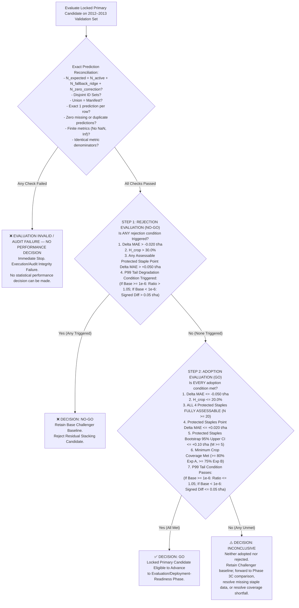

# FieldWise — Phase 3B.2: Leakage-Safe Residual Stacking Technical Design (Revision 3.5)

**Document Reference**: `model/ml_pipeline/reports/phase_3b_2_design.md`  
**Execution Date**: November 18, 2026  
**Auditor & Modeling Team**: ML Engineering, Statistical Architecture & Agronomic Data Science  
**Status**: Technical Design Specification (Pre-Implementation Architecture — Revision 3.5 Hardened Specification)  
**Primary Target Base Model**: 7-Level Seasonal Hierarchical Challenger Baseline ($N_{\\min}=1$)  
**Secondary Sensitivity Base Models**: Seasonal Hierarchical Challenger ($N_{\\min}=3, N_{\\min}=5$) — Fully Separated Tracks  
**Holdout Partitions**: Training (1997–2011) | Development Validation Partition (2012–2013, Previously Exposed Base Holdout; Locked One-Time Stacking Assessment) | Sealed Test Holdout (2014–2015, Untouched)

---

## 1. Executive Summary & Objective

The objective of **Phase 3B.2** is to specify a mathematically rigorous, leakage-proof technical design for evaluating whether **residual stacking** can improve upon the primary historical baseline—the **Seasonal Hierarchical Challenger Baseline** ($N_{\min}=1$)—for district-level crop yield prediction ($\text{Tonnes/Hectare}$).

### Administrative District-Level Operational Scope
The FieldWise modeling platform operates exclusively at the **administrative district level** using aggregated historical agricultural statistics from Directorate of Economics and Statistics (DES) ministry records. Residual stacking is designed to capture macro-level secular yield trends and continuous spatial climatological sensitivities at the district scale. It is **not** an individual farm-level, parcel-level, or field-level precision agronomic advisory engine, and must never be characterized as providing farm-specific recommendations.

In Phase 3B.1.3, the Seasonal Hierarchical Challenger ($N_{\min}=1$) established a strong localized prior, resolving 96.60% of validation records at Level 1 (`District + Crop + Season`) in Experiment A and 95.50% in Experiment B.

However, the base Challenger model operates strictly as a conditional lookup table. It possesses three structural limitations:
1. **Inability to Learn Secular Time Trends**: It cannot adjust for technological yield drift (e.g. progressive adoption of hybrid seeds, mechanized harvesting, micro-irrigation) across the 15-year training horizon (`Crop_Year` integer: 1997–2011). *(Note: Linear regression against `Crop_Year` captures strictly a linear residual trend over time, not arbitrary non-linear technological change or structural breaks).*
2. **Inability to Ingest Continuous Climatological Normals**: It cannot utilize `district_normal_annual_rainfall_mm` or `district_normal_monsoon_rainfall_mm` to modulate expectations across agro-climatic boundaries. *(Note: These rainfall fields represent long-term spatial climatological normals, not annual weather realizations or weather anomalies).*
3. **Discrete Fallback Step Discontinuities**: When a district-crop-season cell is unseen or has fewer than $N_{\min}$ records, it falls back to broader geographic/taxonomic aggregates (e.g. Level 2 District+Crop or Level 3 State+Crop+Season) via discrete step changes rather than smooth regression adjustments.

**Residual Stacking Hypothesis**:
A second-stage (Level-1) machine learning model trained to predict the residual error ($r_i = y_i - \hat{y}_{\text{base}, i}$) of the base Challenger model could potentially capture secular yield drift and regional climate sensitivities, refining base predictions without compromising localized accuracy:
$$\mathbf{\hat{y}_{\text{stacked}, i} = \hat{y}_{\text{base}, i} + \alpha \cdot \hat{r}_i}$$

### 1.1 The Locked Validation Assessment Paradigm & Revision 3.5 Hardened Safeguards

#### Accurate Validation Exposure Status
The 2012–2013 development validation partition was previously examined and reported during the Phase 3B.1 baseline Challenger evaluation (e.g. Table 2.2). It is **not** an untouched holdout, an independent external validation set, or a previously unseen dataset.
Phase 3B.2 is strictly a **locked, one-time stacking assessment on previously exposed validation data**:
- To prevent post-hoc tuning or iterative optimization drift, the entire residual-stacking pipeline, winning primary candidate, regularization parameters, and decision thresholds must be deterministically selected via Level-1 residual cross-validation alone.
- All candidate settings, hyperparameter values, transformers, and code hashes must be cryptographically locked **before executing residual-stacking inference on the 2012–2013 validation partition**.
- The final residual-stacking validation assessment is strictly a **one-time assessment**. No post-assessment candidate swapping, retuning, or threshold alteration is permitted.
- The **2014–2015 chronological test holdout remains completely sealed, untouched, uninspected, and unread**.

#### Seven Revision 3.5 Hardened Safeguards
Revision 3.5 resolves all remaining structural, mathematical, cryptographic, and operational governance ambiguities:
1. **P99 Machine-Checkable Type Invariants & Serialization Finiteness (§13.3, §14.2.1)**: Formalized strict machine-checkable type and finiteness assertions for both Case A and Case B. Enforced `allow_nan=False` during canonical JSON serialization to guarantee strict compliance. Prohibited silent replacement of invalid metrics with zero.
2. **Defensible Bootstrap Governance & 3-Tier Cluster Sensitivity (§13.2)**: Established formal 3-tier cluster sensitivity analysis ($M=5, 10, 20$). Reaffirmed that $B=2,000$ draws do not increase degrees of freedom. Preserved $M_c < 5$ as unable to pass GO (forcing INCONCLUSIVE). Documented spatial autocorrelation (Moran's $I$) and national common shocks as structural limitations.
3. **Decoupled HMAC Shared-Secret Security & Key Custody (§14.2.1)**: Clarified that symmetric HMAC authenticates possession of a pre-shared secret, not a unique individual identity, and provides no non-repudiation. Defined signer/verifier roles, runtime key injection (`FIELDWISE_AUDIT_HMAC_KEY`), key rotation (`key_id`), revocation, and described asymmetric signatures (Ed25519) as an explicit architectural alternative. Prohibited secrets in source code, `.env`, ZIPs, and manifests.
4. **Scoped Canonical JSON & Pinned Reproducibility Boundaries (§11.2, §14.2.1)**: Scoped bit-exact reproducibility claims strictly to the pinned software stack (Python 3.11.7, scikit-learn 1.3.2) under single-threaded CPU execution. Clarified that artifact checksums and HMAC signatures prove file integrity and key possession, not scientific truth or empirical generalizability.
5. **Decision Framework Reconciliation & Unassessable Staple Inconclusive Rule (§14.1, §14.2)**: Explicitly affirmed that missing, non-finite, or unreliable protected-staple intervals ($M_c < 5$) cannot pass GO. Clarified that an unassessable staple does not trigger NO-GO; it prevents GO and leads to INCONCLUSIVE unless a rejection trigger applies. Flowchart, prose, truth table, and schema fully aligned.
6. **Hardened Decision Manifest Schema & Branch-Derived Gates (§14.2.1)**: Required `p99_tail_gate_passed` to be derived from the active conditional branch. Enforced that GO requires all adoption gates to pass, NO-GO requires at least one rejection trigger, and audit-failure manifests do not fabricate performance metrics or performance decisions.
7. **Carry-Forward Invariants (§5.1, §5.2, §7.3, §10.3, §10.6)**: Enforced that observed evaluation yield never determines inference-time routing (ceilings are offline diagnostics only); defined validity-mask ordering relative to training-fitted rainfall imputation; confirmed $N_{\text{cell}}$ counts historical records, not calendar years; explicitly included correction multiplier $\alpha$ across all equations; and preserved district-level operational scope.

---

## 2. Reconciled Baseline Metrics & Freezing of Base Configuration

### 2.1 Freezing the Primary Base Configuration ($N_{\\min}=1$)
- **Primary Base Model**: The primary Level-0 baseline across all Phase 3B.2 experiments is declared strictly as the **Seasonal Hierarchical Challenger Baseline with $N_{\\min}=1$**.
- **Secondary Sensitivity Baselines ($N_{\\min}=3, N_{\\min}=5$)**:
  - $N_{\\min}=3$ and $N_{\\min}=5$ are treated strictly as **secondary sensitivity experiments**.
  - **Prohibition on Target Pooling**: OOF residuals generated from different $N_{\\min}$ settings must **NEVER be pooled or combined**. Each sensitivity experiment maintains its own independent base predictions, residual targets, meta-features, CV tuning, and validation metrics.
- **Base Hierarchy Preservation**: The 7-level hierarchy keys and fallback logic established in Phase 3B.1.2 remain strictly frozen and unmodified.

### 2.2 Reconciled Baseline Metrics Table (Validation 2012–2013)

The baseline metrics have been independently verified against the physical validation prediction CSV files:
1. `model/ml_pipeline/experiments/phase_3b_1_2/experiment_a_prime/validation_predictions.csv` (13,422 rows).
2. `model/ml_pipeline/experiments/phase_3b_1_2/experiment_b_provisional/validation_predictions.csv` (17,254 rows).

| Experiment Track | Configuration Role | Model / Setting | Validation Rows ($N$) | Reconciled MAE (t/ha) | Reconciled RMSE (t/ha) | Reconciled $R^2$ | Reconciled MedAE (t/ha) | Audit Status | Source Prediction File |
| :--- | :--- | :--- | :---: | :---: | :---: | :---: | :---: | :---: | :--- |
| **Experiment A (Prime-Only)** | **PRIMARY BASELINE** | Challenger ($N_{\\min}=1$) | 13,422 | **1.4209** | **4.9604** | **0.8918** | **0.2842** | ✅ **VERIFIED** | `experiments/phase_3b_1_2/experiment_a_prime/validation_predictions.csv` |
| **Experiment A (Prime-Only)** | Sensitivity Check | Challenger ($N_{\\min}=3$) | 13,422 | **1.4334** | **4.9548** | **0.8920** | **0.2882** | ✅ **VERIFIED** | `experiments/phase_3b_1_2/experiment_a_prime/validation_predictions.csv` |
| **Experiment A (Prime-Only)** | Sensitivity Check | Challenger ($N_{\\min}=5$) | 13,422 | **1.4349** | **4.9535** | **0.8921** | **0.2887** | ✅ **VERIFIED** | `experiments/phase_3b_1_2/experiment_a_prime/validation_predictions.csv` |
| **Experiment A (Prime-Only)** | Reference ML | Native Cat. XGBoost | 13,422 | **1.4464** | **5.8524** | **0.8494** | **0.2528** | ✅ **VERIFIED** | `experiments/phase_3b_1_2/experiment_a_prime/validation_predictions.csv` |
| **Experiment B (Prime+Prov)** | **PRIMARY BASELINE** | Challenger ($N_{\\min}=1$) | 17,254 | **1.2611** | **4.4721** | **0.8905** | **0.2446** | ✅ **VERIFIED** | `experiments/phase_3b_1_2/experiment_b_provisional/validation_predictions.csv` |
| **Experiment B (Prime+Prov)** | Sensitivity Check | Challenger ($N_{\\min}=3$) | 17,254 | **1.2675** | **4.4583** | **0.8912** | **0.2493** | ✅ **VERIFIED** | `experiments/phase_3b_1_2/experiment_b_provisional/validation_predictions.csv` |
| **Experiment B (Prime+Prov)** | Sensitivity Check | Challenger ($N_{\\min}=5$) | 17,254 | **1.2660** | **4.4568** | **0.8913** | **0.2507** | ✅ **VERIFIED** | `experiments/phase_3b_1_2/experiment_b_provisional/validation_predictions.csv` |
| **Experiment B (Prime+Prov)** | Reference ML | Native Cat. XGBoost | 17,254 | **1.5201** | **6.8505** | **0.7432** | **0.2422** | ✅ **VERIFIED** | `experiments/phase_3b_1_2/experiment_b_provisional/validation_predictions.csv` |

All acceptance criteria in Section 14 are formulated strictly against the primary verified baselines: **Exp A MAE = 1.4209 t/ha**, **Exp B MAE = 1.2611 t/ha**.

---

## 3. Level-0 Out-of-Time Residual Generation (Base Folds)

### 3.1 Purpose & Temporal Invariant
Level-0 out-of-time generation serves exclusively to produce historical base predictions $\\hat{y}_{\\text{base}, i}^{\\text{OOF}}$ and training residual targets ($r_i = y_i - \\hat{y}_{\\text{base}, i}^{\\text{OOF}}$).
- **Earlier historical observations** ($t < Y$) are permitted in the base model's training partition.
- **Concurrent and future observations** ($t \\ge Y$) are strictly prohibited.

### 3.2 Exact Manifest Folds and Dynamic Row Counts
The 15-year historical training horizon (1997–2011) begins with an initial **warm-up window of exactly six calendar years** (1997–2002).

#### Experiment A (Prime-Only: 107,520 Total Training Rows)
- **Warm-Up Base (1997–2002, 6 Calendar Years)**: **40,146 rows** (not used for residual training).
- **Base Fold 1**: Train 1997–2002 (40,146 rows) | Predict 2003–2005 | OOF Residual Rows: **22,663** (21.08% coverage)
- **Base Fold 2**: Train 1997–2005 (62,809 rows) | Predict 2006–2007 | OOF Residual Rows: **15,363** (14.29% coverage)
- **Base Fold 3**: Train 1997–2007 (78,172 rows) | Predict 2008–2009 | OOF Residual Rows: **14,901** (13.86% coverage)
- **Base Fold 4**: Train 1997–2009 (93,073 rows) | Predict 2010–2011 | OOF Residual Rows: **14,447** (13.44% coverage)
- **Total Experiment A OOF Residual Rows**: Exactly **67,374 rows** (**62.66% coverage** of training partition).

#### Experiment B (Prime + Provisional: 137,164 Total Training Rows)
- **Warm-Up Base (1997–2002, 6 Calendar Years)**: **51,081 rows** (not used for residual training).
- **Base Fold 1**: Train 1997–2002 (51,081 rows) | Predict 2003–2005 | OOF Residual Rows: **29,307** (21.37%)
- **Base Fold 2**: Train 1997–2005 (80,388 rows) | Predict 2006–2007 | OOF Residual Rows: **19,547** (14.25%)
- **Base Fold 3**: Train 1997–2007 (99,935 rows) | Predict 2008–2009 | OOF Residual Rows: **19,064** (13.90%)
- **Base Fold 4**: Train 1997–2009 (118,999 rows) | Predict 2010–2011 | OOF Residual Rows: **18,165** (13.24%)
- **Total Experiment B OOF Residual Rows**: Exactly **86,083 rows** (**62.76% coverage** of training partition).

---

## 4. Level-1 Residual-Model Forward-Chaining Temporal Cross-Validation

### 4.1 Separation from Level-0 Base Generation
The four expanding base folds described in Section 3 generate OOF residual targets across calendar years 2003–2011. **They must not be confused with or substituted for the residual model's own cross-validation protocol.**

To tune residual model hyperparameters ($\\lambda$, shrinkage coefficients $q$, $\\alpha$) and select the primary candidate without data snooping, a dedicated **forward-chaining temporal cross-validation protocol** is executed over the chronologically ordered OOF residual dataset ($D_{\\text{OOF}}$).

### 4.2 Separation of Operational Cross-Validation Levels & Exact Split Boundaries
To eliminate methodological ambiguity, Phase 3B.2 strictly separates three distinct operational levels:
- **Level A (Split-Specific Model Fitting Row Order)**:
  Within each residual CV split $k \in \{1, 2, 3\}$, all fitted training rows strictly precede evaluation rows chronologically. The residual estimator, encoders, scalers, and learned statistics are fitted strictly on that split's permitted residual training rows. Zero evaluation-block information is leaked into preprocessing or model training.
- **Level B (Hyperparameter & Candidate Selection via Pooled Evaluation Score)**:
  Hyperparameter and candidate selection scores are computed by pooling evaluation predictions across all three splits:
  $$\text{CV\_MAE}(\theta) = \frac{\sum_{k=1}^3 \sum_{i \in \text{Eval}^{(k)}} |y_i - (\hat{y}_{\text{base}, i} + \alpha \cdot \hat{r}_i^{(k)}(\theta))|}{\sum_{k=1}^3 N_{\text{eval}}^{(k)}}$$
  Averaging split-level MAEs is strictly prohibited to prevent smaller evaluation blocks from exerting disproportionate influence.
- **Level C (One-Time Validation Assessment)**:
  The single winning primary candidate, fitted on all training residuals (2003–2011), is evaluated exactly once against the 2012–2013 validation holdout. Validation results are final; no retuning, hyperparameter swapping, or threshold alteration is permitted based on validation data.

- **Minimum-History Rule**: The residual model requires at least **three calendar years of OOF residual history** (2003–2005) before evaluating the first evaluation block (2006–2007).

#### Residual-Model Temporal Cross-Validation Splits Table

| Split Identifier | Training Block Years | Training Source | Exp A Train Rows | Exp B Train Rows | Evaluation Block Years | Evaluation Source | Exp A Eval Rows | Exp B Eval Rows |
| :--- | :--- | :--- | :---: | :---: | :--- | :--- | :---: | :---: |
| **Residual Split 1** | **2003–2005** (3 yrs) | Base Fold 1 OOF | **22,663** | **29,307** | **2006–2007** (2 yrs) | Base Fold 2 OOF | **15,363** | **19,547** |
| **Residual Split 2** | **2003–2007** (5 yrs) | Base Folds 1+2 OOF | **38,026** | **48,854** | **2008–2009** (2 yrs) | Base Fold 3 OOF | **14,901** | **19,064** |
| **Residual Split 3** | **2003–2009** (7 yrs) | Base Folds 1+2+3 OOF| **52,927** | **67,918** | **2010–2011** (2 yrs) | Base Fold 4 OOF | **14,447** | **18,165** |
| **Final Residual Fit** | **2003–2011** (9 yrs) | Full Permitted OOF | **67,374** | **86,083** | **2012–2013** (2 yrs) | Dev Validation Holdout| **13,422** | **17,254** |

### 4.3 Deterministic Selection of Primary Candidate via Mean CV MAE
The primary candidate pipeline, primary weighting objective, optimal regularization parameter $\\lambda^*$, and optimal shrinkage coefficient ($q^*$ or $\\alpha^*$) are selected strictly by minimizing the **unweighted Mean Out-of-Time CV MAE** across the three evaluation blocks:
$$\\mathbf{\\text{CV\\_MAE} = \\frac{1}{\\sum_{s=1}^3 N_{\\text{eval}}^{(s)}} \\sum_{s=1}^3 \\sum_{i \\in \\text{Eval}^{(s)}} \\left|y_i - \\left(\\hat{y}_{\\text{base}, i} + \\hat{r}_i^{(s)}\\right)\\right|}$$
The winning configuration is **locked as the Sole Primary Candidate**. Development validation data (2012–2013) is strictly forbidden from participating in this selection.

---

## 5. Independent Preprocessing & Feature Construction Boundaries

Two independent fitting boundaries are strictly enforced:

### 5.1 Boundary 1: Level-0 Base-Model Feature Construction
- **Scope**: Calculation of $\hat{y}_{\text{base}}$, $\text{Level}_{\text{base}}$, $N_{\text{cell}}$, $\sigma_{\text{cell}}^2$, `base_key_cross_state_collision`, and `base_key_state_count`.
- **Allowed Data**: Exclusively the base training partition for that temporal fold ($D_{k,\text{train}}^{\text{base}} = \{j \mid \text{Crop\_Year}_j \le Y_{k,\text{base\_end}}\}$).
- **Target Invariant**: Evaluated observation $i$ and all concurrent/future records ($t \ge Y_{k,\text{base\_end}}+1$) are strictly excluded.
- **Cell vs. Collision Metric Clarification**: $N_{\text{cell}}$ and $\sigma_{\text{cell}}^2$ describe the **actual hierarchy cell** that resolved the base prediction (which may be Level 1, 2, 3, etc.). In contrast, `base_key_cross_state_collision` and `base_key_state_count` describe the **Level-1 key specifically**.
- **Record Count vs. Calendar Years Definition of $N_{\text{cell}}$**:
  $N_{\text{cell}}$ strictly counts the **total number of historical observation records** matching the resolving hierarchy cell key in the Level-0 base training partition ($D_{k,\text{train}}^{\text{base}}$). Because a district may report multiple records per year (across crop types, seasons, or local administrative subdivisions), $N_{\text{cell}}$ is a record count, **not** a count of distinct calendar years. Annualized cell support $\tilde{N}_{\text{cell}} = N_{\text{cell}} / H_k$ normalizes this record count by the calendar year span $H_k$.
- **Exact Base Training Horizon Denominator**:
  $$\mathbf{H_k = Y_{\text{base\_end}, k} - 1997 + 1}$$
  $$\mathbf{\tilde{N}_{\text{cell}} = \frac{N_{\text{cell}}}{H_k}}$$
  The denominator $H_k$ is the number of calendar years in the Level-0 base training partition:
  - Base Fold 1: $H_1 = 2002 - 1997 + 1 = \mathbf{6\text{ years}}$.
  - Base Fold 2: $H_2 = 2005 - 1997 + 1 = \mathbf{9\text{ years}}$.
  - Base Fold 3: $H_3 = 2007 - 1997 + 1 = \mathbf{11\text{ years}}$.
  - Base Fold 4: $H_4 = 2009 - 1997 + 1 = \mathbf{13\text{ years}}$.
  - Final Validation Base Model: $H_{\text{final}} = 2011 - 1997 + 1 = \mathbf{15\text{ years}}$.
  $H_k$ must **never** use the residual model's training duration or residual CV split length.

### 5.2 Boundary 2: Level-1 Residual-Model Preprocessing
- **Scope**: OneHotEncoder category vocabularies, StandardScaler means and standard deviations, missing-value imputers, and sample weight normalizations.
- **Allowed Data**: Exclusively earlier OOF residual rows within the specific residual training block ($D_{s,\text{train}}^{\text{resid}}$).

#### 5.2.1 Explicit Valid-Feature Training Mask ($M_{\text{train}}$)
To prevent numerical corruption, NaN propagation, or uncalibrated weights during model fitting, an explicit boolean feature-eligibility training mask $M_{\text{train}}$ is constructed independently within each residual training split and for the final validation fit:
$$\mathbf{M_{\text{train}, i} = \prod_{f \in \mathcal{F}_{\text{req}}} \mathbb{I}\left(\text{feature } f \text{ is valid, non-null, and finite for observation } i\right)}$$
where $\mathcal{F}_{\text{req}}$ denotes the set of required model features.

**Mandatory Consistent Application**:
The mask $M_{\text{train}}$ must be used consistently across all training-time procedures:
1. **Stratum Support Calculation**: Stratum training support is calculated exclusively on valid training rows:
   $$\mathbf{N_{\text{stratum\_train}} = \sum_{i \in \text{Train}, s(i)=s} M_{\text{train}, i}}$$
2. **Active Stratum Ridge Fitting**: Active stratum models are fitted strictly on valid stratum training observations: $\{i \in \text{Train} \mid s(i)=s \land M_{\text{train}, i} = 1\}$.
3. **Fallback Ridge Fitting**: `Candidate2_Fallback_Ridge` is fitted strictly on valid pooled training observations: $\{i \in \text{Train} \mid M_{\text{train}, i} = 1\}$.
4. **Fallback Preprocessing Transformers**: Preprocessing encoders and scalers are fitted strictly on valid pooled training rows ($M_{\text{train}} = 1$).
5. **Training-Only Feature Statistics**: Means, standard deviations, and state medians are computed exclusively across valid training rows ($M_{\text{train}} = 1$).

**Zero Valid Training Observations Rule**:
- **Stratum Model**: If an active stratum contains zero valid training observations ($\sum_{i \in s} M_{\text{train}, i} = 0$), its support is $0 < 500$. The stratum is deactivated to FALLBACK; all its evaluation observations route to `Candidate2_Fallback_Ridge`.
- **Pooled Fallback Model**: If the pooled residual training partition contains zero valid training observations ($\sum_{i \in \text{Train}} M_{\text{train}, i} = 0$), fitting cannot proceed. The pipeline triggers an immediate fatal halt: **`EVALUATION INVALID / AUDIT FAILURE`**. No model training or evaluation may occur.

#### 5.2.2 Validity-Mask Ordering Relative to Training-Fitted Rainfall Imputation
To eliminate any ambiguity regarding the sequence of mask formation and missing-value imputation:
- **Step 1 (Raw Identification & Base Outputs Validation)**:
  Evaluate raw input features (`State`, `DistrictID`, `Crop`, `Season`, `Crop_Year`), Level-0 base model outputs ($\hat{y}_{\text{base}}$, `Level_base`, $\tilde{N}_{\text{cell}}$, $\sigma_{\text{cell}}^2$), and collision diagnostic features. Observations failing basic non-null or non-corrupted checks receive raw mask $M_{\text{raw}, i} = 0$.
- **Step 2 (Training-Fitted Rainfall Normal Median Calculation)**:
  Compute district rainfall normal state medians and global medians strictly across training observations satisfying $M_{\text{raw}, i} = 1$ within the permitted residual training partition $D_{k,\text{train}}^{\text{resid}}$:
  $$\text{Median}_{\text{state}}(f) = \text{median}\left(\{x_{j, f} \mid j \in D_{k,\text{train}}^{\text{resid}}, \text{State}_j = \text{State}_i, M_{\text{raw}, j} = 1\}\right)$$
- **Step 3 (Imputation Execution & Final Mask Formation)**:
  Impute missing rainfall normal values using the training-fitted medians from Step 2 (state median $\to$ global median). If an observation's rainfall normal is successfully imputed, and all required model features are finite and valid, assign final mask $M_{\text{train}, i} = 1$. If an observation cannot be imputed (e.g. global median missing across the entire training partition) or contains remaining non-finite values, assign $M_{\text{train}, i} = 0$ (for training) or route to Case 5 `ZERO_RESIDUAL_INVALID_FEATURE` (for evaluation).
- **Inference Invariant**:
  Imputation medians fitted strictly on training data are stored in the locked preprocessing artifact and applied directly to evaluation rows without refitting or validation leakage.

### 5.3 Complete Feature & Preprocessing Master Table

The following master table defines the exact preprocessing, scaling, missing-value imputation, unseen-level handling, and validation criteria for every feature evaluated across Candidate 1 (Global Ridge) and Candidate 2 (Crop-Stratified Ridge):

| Feature Name | Source & Construction Boundary | Data Type | Transformation | Scaling Method | Missing-Value Handling | Unseen-Level Handling | Non-Finite Handling | Candidate 1 Inclusion | Candidate 2 Inclusion |
| :--- | :--- | :--- | :--- | :--- | :--- | :--- | :--- | :---: | :---: |
| `State` | Observation Attribute | String / Category | One-Hot Encoding | None (binary dummies) | None (always present in manifest) | `handle_unknown='ignore'` (all-zero vector) | Null/Blank $\to M_{\text{train}}=0$ (Train) / Case 5 (Eval) | **Yes** | **Yes** |
| `DistrictID` (`State__District`) | Observation Attribute | String / Category | One-Hot Encoding | None (binary dummies) | None (always present in manifest) | `handle_unknown='ignore'` (all-zero vector) | Null/Blank $\to M_{\text{train}}=0$ (Train) / Case 5 (Eval) | **Yes** | **Yes** |
| `Crop` | Observation Attribute | String / Category | One-Hot Encoding | None (binary dummies) | None (always present in manifest) | `handle_unknown='ignore'` (all-zero vector; routed to Case 3 if unseen) | Null/Blank $\to M_{\text{train}}=0$ (Train) / Case 5 (Eval) | **Yes** | **Yes** (within stratum) |
| `Season` | Observation Attribute | String / Category | One-Hot Encoding | None (binary dummies) | None (always present in manifest) | `handle_unknown='ignore'` (all-zero vector) | Null/Blank $\to M_{\text{train}}=0$ (Train) / Case 5 (Eval) | **Yes** | **Yes** |
| `Crop_Year` | Observation Attribute | Integer | Identity (linear residual trend) | `StandardScaler` (fit on $M_{\text{train}}=1$) | None (always present in manifest) | Handled linearly by scaled coefficient | Non-integer $\to M_{\text{train}}=0$ (Train) / Case 5 (Eval) | **Yes** | **Yes** |
| `district_normal_annual_rainfall_mm` | Climatological Spatial Attribute | Continuous Float | Identity (spatial baseline climate) | `StandardScaler` (fit on $M_{\text{train}}=1$) | State median $\to$ Global median $\to$ Fatal Halt | Handled continuously by scaler | NaN/Inf $\to$ Imputed via median; if un-imputable $\to M_{\text{train}}=0$ | **Yes** | **Yes** |
| `district_normal_monsoon_rainfall_mm` | Climatological Spatial Attribute | Continuous Float | Identity (spatial baseline climate) | `StandardScaler` (fit on $M_{\text{train}}=1$) | State median $\to$ Global median $\to$ Fatal Halt | Handled continuously by scaler | NaN/Inf $\to$ Imputed via median; if un-imputable $\to M_{\text{train}}=0$ | **Yes** | **Yes** |
| $\hat{y}_{\text{base}}$ | Level-0 Model Output | Continuous Float | Identity (base prediction anchor) | `StandardScaler` (fit on $M_{\text{train}}=1$) | None (always present in OOF/manifest) | Subject to out-of-support screening (§7.3) | NaN/Inf $\to M_{\text{train}}=0$ (Train) / Case 5 (Eval) | **Yes** | **Yes** |
| `Level_base` | Level-0 Model Output | Integer Categorical | One-Hot Encoding (Levels 1–7) | None (binary dummies) | None (always present) | Handled as Level 6/7 fallback | Non-integer $\to M_{\text{train}}=0$ (Train) / Case 5 (Eval) | **Yes** | **Yes** |
| $\tilde{N}_{\text{cell}} = \frac{N_{\text{cell}}}{H_k}$ | Level-0 Model Output | Continuous Float | Annualized support ($N_{\text{cell}} / H_k$) | `StandardScaler` (fit on $M_{\text{train}}=1$) | None (always present) | Handled continuously by scaler | NaN/Inf $\to M_{\text{train}}=0$ (Train) / Case 5 (Eval) | **Yes** | **Yes** |
| $\sigma_{\text{cell}}^2$ | Level-0 Model Output | Continuous Float | Log transform $\ln(\sigma_{\text{cell}}^2 + 10^{-4})$ | `StandardScaler` (fit on $M_{\text{train}}=1$) | Zero variance mapped to $\ln(10^{-4})$ | Handled continuously by scaler | Negative/NaN $\to M_{\text{train}}=0$ (Train) / Case 5 (Eval) | **Yes** | **Yes** |
| `base_key_cross_state_collision` | Diagnostic Attribute | Binary $\{0, 1\}$ | Identity flag | None (binary dummy) | None (deterministic lookup) | Preserved as $\{0, 1\}$ | Non-binary $\to M_{\text{train}}=0$ (Train) / Case 5 (Eval) | **Yes** | **Yes** |
| `base_key_state_count` | Diagnostic Attribute | Integer | Identity count | `StandardScaler` (fit on $M_{\text{train}}=1$) | None (deterministic lookup) | Preserved as integer count | $<1$ or NaN $\to M_{\text{train}}=0$ (Train) / Case 5 (Eval) | **Yes** | **Yes** |

---

## 6. District-Name Collision Diagnostics (Level-1 Cross-State Homonyms)

### 6.1 State-Qualified District Feature (`DistrictID`)
To distinguish district fixed effects across homonymous districts in different states (e.g. Aurangabad in MH vs. BH; Balrampur in UP vs. CT; Hamirpur in UP vs. HP), the residual model uses the **state-qualified district identifier**:
$$\\mathbf{\\text{DistrictID} = \\text{State} + \\text{\\"\\_\\_\\"} + \\text{District}}$$
Replacing raw `District` with `DistrictID` in the residual model ensures homonyms receive separate categorical dummies.

### 6.2 Structural Collision Acknowledgment in Base Model
The frozen Level-1 base lookup key is `District + Crop + Season` (without State). Homonymous districts pool historical records in the base lookup table. This base hierarchy remains strictly frozen and unmodified.

### 6.3 Collision Feature Construction with Zero-Support Handling
- **Case 1: Level-1 Base Key Has Supporting Historical Records ($N_{\\text{cell}} \\ge 1$ in $D_{k,\\text{train}}^{\\text{base}}$)**:
  - `base_key_state_count` = number of distinct states supporting that resolving Level-1 key ($|\\text{unique\\_states}(S_K^{(k)})|$).
  - `base_key_cross_state_collision` = $1$ if `base_key_state_count` $> 1$; otherwise $0$.
- **Case 2: Level-1 Base Key Has Zero Supporting Historical Records ($N_{\\text{cell}} = 0$ at Level 1)**:
  - `base_key_state_count = 0`.
  - `base_key_cross_state_collision = 0`.
  *(The assertion that `base_key_state_count` is always $\\ge 1$ is explicitly rejected).*

---

## 7. Distribution-Shift Diagnostics & Explicit Out-of-Support Screening

### 7.1 Pooled vs. Fold-by-Fold Distribution Comparisons
Dividing $N_{\\text{cell}}$ by horizon length ($\\tilde{N}_{\\text{cell}} = N_{\\text{cell}} / H_k$) is an **engineered feature adjustment heuristic**, not an assumed proof of invariant distribution.

Diagnostics must be reported **both pooled across all OOF folds and separately fold-by-fold** (Residual Splits 1–3 and Final Fit vs. Validation). Effect sizes (1-Wasserstein distance, standardized mean difference, Cramér's V, and quantile shifts) serve as primary criteria over unadjusted $p$-values.
*(Note on Implementation: These distribution-shift metrics will be computed and reported as empirical measured results when execution occurs in Phase 3B.2; they are not simulated or hardcoded in this design specification).*

### 7.2 Cross-Sectional Climatology Outlier Check (Diagnostic Only)
A cross-sectional climatology outlier check flags districts where long-term rainfall normals deviate by $> 3.5\\sigma$ from the national mean. 
- **Analytical Nature**: District rainfall normals (`district_normal_annual_rainfall_mm` and `district_normal_monsoon_rainfall_mm`) are **long-term spatial climatological descriptors**, not annual weather observations, extreme weather shocks, or rainfall anomalies.
- **Informational Diagnostic**: This check is strictly informational; it does **not** bypass or truncate residual stacking predictions.

### 7.3 Explicit Out-of-Support Screening Rules & Screening Ceiling Governance

#### Screening Ceilings as Screening Rules, Not Physical Impossibility Limits
Biological screening ceilings (e.g. 15.0 t/ha for Rice/Paddy, 180.0 t/ha for Sugarcane, 140.0 t/ha for Banana) are **operational screening rules**, not proof that a reported observation is physically impossible or synthetic.

#### Offline-Only Role of Observed-Yield Screening Ceilings
- **Offline Validation Audit Diagnostic Only**: Biological screening ceilings ($T_c$) applied to observed validation yields ($y_i > T_c$) are strictly **offline audit diagnostics**. Observed yields are unknown at inference time.
- **Prohibition on Inference Routing**: An observed yield exceeding $T_c$ must **never** govern inference-time model routing, residual activation, or prediction equations. Inference-time screening rules (Rules 1 & 2 below) evaluate strictly Level-0 base predictions $\hat{y}_{\text{base}, i}$ against split-local training-derived ranges $[\hat{y}_{\min, c}^{(k)}, \hat{y}_{\max, c}^{(k)}]$ and regional base fallback levels.
- **No Silent Deletions**: Observations reporting yields above biological screening ceilings must **never be silently deleted or omitted** from evaluation manifests.
- **Operational Action for Offline Ceilings**: In offline diagnostic evaluations, an observation exceeding its crop screening ceiling triggers the **Extreme Base Prediction Check**. The residual correction is forced to zero ($\hat{r}_i = 0.0$), preserving the Level-0 base prediction: $\hat{y}_{\text{stacked}, i} = \hat{y}_{\text{base}, i}$.
- **Audit Logging**: Every ceiling breach is logged to the audit manifest under `ZERO_RESIDUAL_EXTREME_BASE_PREDICTION` with the observed yield, base prediction, and screening ceiling value.

#### Elimination of Temporal Leakage in Out-of-Support Screening
The operational screening rules are **conservative screening heuristics**, not a mathematical guarantee of finding an empirical multivariate convex hull:
1. **Rule 1: Unseen Regional Categorical Tuple (Level $\ge 6$)**:
   The evaluated record resolves at base fallback Level 6 (Global Crop Mean) or Level 7 (Global Dataset Mean).
2. **Rule 2: Split-Local Base Prediction Extrapolation (Zero Future Leakage)**:
   The evaluated record's base prediction $\hat{y}_{\text{base}, i}$ falls strictly outside the crop-specific base-prediction reference range observed across that split's permitted historical residual training rows:
   $$\mathbf{\hat{y}_{\text{base}, i} < \hat{y}_{\min, c}^{(k)} \quad \text{or} \quad \hat{y}_{\text{base}, i} > \hat{y}_{\max, c}^{(k)}}$$
   where:
   $$\mathbf{\hat{y}_{\min, c}^{(k)} = \min_{j \in D_{k,\text{train}}^{\text{resid}}, c(j)=c} \hat{y}_{\text{base}, j} \quad \text{and} \quad \hat{y}_{\max, c}^{(k)} = \max_{j \in D_{k,\text{train}}^{\text{resid}}, c(j)=c} \hat{y}_{\text{base}, j}}$$
   - **Split-Local Strict Enforcement**: For Residual CV Split 1, limits are calculated strictly on Split 1 training rows (2003–2005). For Split 2, strictly on Split 2 training rows (2003–2007). For Split 3, strictly on Split 3 training rows (2003–2009).
   - **Zero Future Leakage**: Future OOF evaluation periods ($t > \max(\text{Train}^{(k)})$) must **never** be used to determine an earlier split's support limits.
   - **Final Validation Limits**: For the 2012–2013 validation holdout, reference limits are calculated strictly from the complete permitted 2003–2011 OOF residual training rows ($D_{\text{train}}^{\text{resid}}$):
     $$\mathbf{\hat{y}_{\min, c}^{\text{val\_ref}} = \min_{j \in D_{\text{train}}^{\text{resid}}, c(j)=c} \hat{y}_{\text{base}, j} \quad \text{and} \quad \hat{y}_{\max, c}^{\text{val\_ref}} = \max_{j \in D_{\text{train}}^{\text{resid}}, c(j)=c} \hat{y}_{\text{base}, j}}$$
   - **Missing Reference Fallback**: If a crop has zero valid training observations in a split ($N_{c, \text{train}} = 0$), the range is undefined, and Rule 2 triggers automatically. Validation targets or validation-derived prediction ranges are strictly prohibited from defining the reference.
   - **Audit Manifest Logging**: For every split and final validation, the audit manifest records: crop label, minimum base prediction, maximum base prediction, reference row IDs/counts, and the exact reference period.

#### Operational Fallback Action & Limited Scope of Guarantee
Whenever an observation triggers Rule 1 or Rule 2:
$$\mathbf{\hat{r}_i = 0.0} \implies \mathbf{\hat{y}_{\text{stacked}, i} = \hat{y}_{\text{base}, i}}$$
The observation receives zero residual correction and retains its base Challenger prediction.

**Limited Scope of Guarantee**:
- This rule guarantees that stacking **cannot modify or distort predictions on novel, unrepresented, or extrapolated records**.
- It does **not** constitute a mathematical convex hull guarantee, nor does it guarantee that stacking cannot degrade other in-support observations. Overall in-support performance and risk of harm are governed by the audit metrics in Section 14.

---

## 8. Crop Weighting Mathematics, Normalization & Objectives

### 8.1 Three Distinct Weighting Objectives
1. **Unweighted Sample-Level Loss ($w_i = 1.0$)**: Minimizes global sample tonnes/ha MSE; directly targets aggregate platform MAE.
2. **Equal-Total-Weight-Per-Crop Loss ($w_i \propto \frac{1}{N_{c(i)}}$)**: Minimizes macro-averaged MSE across species ($\frac{1}{C}\sum \text{MSE}_c$); **enforces equal total crop influence in Ridge training loss** ($\sum_{i \in c} w_i = \text{const}$).
3. **Threshold-Derived Scale Sensitivity Weighting ($w_i \propto f(T_{c(i)})$)**: Strictly a sensitivity experiment. Thresholds reflect heterogeneous product moisture contents (fresh stalk at 75% water vs. dry grain at 12% moisture) and are not directly comparable biological yield measures.

### 8.2 Critical Clarification: Ridge Training Loss vs. Unweighted Evaluation Metrics
To eliminate any ambiguity between model training and performance assessment:
1. **Sample Weights Affect Ridge Training Loss Only**:
   Sample weights $w_i$ modify the empirical risk objective minimized during Ridge regression fitting:
   $$\mathcal{L}_{\text{Ridge}}(\beta) = \sum_{i \in \text{Train}} w_i \left(r_i - x_i^\top \beta\right)^2 + \lambda_{\text{math}} \|\beta\|_2^2$$
2. **Primary Residual CV MAE is Strictly Unweighted Observation-Level Pooled MAE**:
   Across ALL candidate models and weighting schemes, the primary model selection metric across the three residual CV splits is **unweighted observation-level pooled CV MAE**:
   $$\mathbf{\text{CV\_MAE} = \frac{1}{\sum_{s=1}^3 N_{\text{eval}}^{(s)}} \sum_{s=1}^3 \sum_{i \in \text{Eval}^{(s)}} \left|y_i - \hat{y}_{\text{stacked}, i}^{(s)}\right|}$$
3. **Final Validation MAE is Strictly Unweighted Observation-Level MAE**:
   The final validation performance metric governing the locked primary candidate is **unweighted observation-level MAE**:
   $$\mathbf{\text{Val\_MAE} = \frac{1}{N_{\text{val}}} \sum_{i \in \text{Val}} \left|y_i - \hat{y}_{\text{stacked}, i}\right|}$$
4. **Strict Prohibition on Evaluation Weighting**:
   **Evaluation sample weights are NEVER applied to primary selection metrics, decision thresholds, or metric denominators.**
5. **Equal-Crop Weighting Scope**: Equal-crop weighting means equal total crop influence **in the Ridge regression loss function during training**, not equal weighting of the primary evaluation metric.
6. **Supplementary Reporting Only**: Any weighted evaluation metric (e.g. macro-averaged crop MAE $\frac{1}{C}\sum \text{MAE}_c$ or scale-weighted MAE) must be clearly labeled as **supplementary, report-only diagnostics**.
7. **Deterministic Neutral Fallback Weights**: Assigned neutral unit weight $w_i = 1.0$ to unseen evaluation crops *only* where needed for explicitly weighted supplementary diagnostics.

### 8.3 Strict Sample Weight Normalization & Library Conversion
Across all weighted linear models, sample weights must be normalized such that the **mean sample weight across the training partition is strictly 1.0**:
$$\mathbf{\bar{w} = \frac{1}{N_{\text{train}}} \sum_{i=1}^{N_{\text{train}}} w_i = 1.0}$$

**Exact Conversion to Scikit-Learn `Ridge(alpha=alpha_sklearn)`**:
$$\mathbf{\alpha_{\text{sklearn}} = N_{\text{train}} \cdot \lambda_{\text{math}}}$$
This exact formula guarantees complete reproducibility across libraries.

### 8.4 Equal-Crop Weighting Fallback for Unseen Evaluation Crops (Diagnostic Metrics Only)
> [!NOTE]
> **Loss Weighting vs. Inference Routing Boundary**:
> Sample weights apply strictly to empirical risk minimization during training and supplementary weighted diagnostic metrics. For all model inference and final prediction generation, unseen evaluation crops receive an explicit zero residual correction ($\hat{r}_i = 0.0$) per the authoritative routing table in Section 10.3, completely preserving the Level-0 base prediction.

In equal-crop weighting ($w_i \propto \frac{1}{N_{c,\text{train}}}$):
- If an evaluation observation belongs to a crop with zero observations in that residual training block ($N_{c,\text{train}} = 0$):
  - Assigned **deterministic neutral fallback weight**: $\mathbf{w_i = 1.0}$.
- The number of training and evaluation observations affected by this fallback must be reported in the diagnostic log.

### 8.5 Bounded Scale Weighting Formulas
For scale sensitivity weighting:
$$w_i = \frac{1}{\min(T_{c(i)}, 5.0)}$$
Normalized to mean 1.0 across the training set.

### 8.6 Crop-Label-Level Weighting & Botanical Representation Disclosures
To ensure complete transparency in multi-crop evaluations:
1. **Equal-Crop Weighting Operates on Dataset Crop Labels**:
   In Candidate 1 Equal-Crop Weighted Ridge, sample weights are inversely proportional to observations per **dataset crop label**: $w_i \propto 1 / N_{\text{label}(i)}$.
2. **Administrative Labels vs. Botanical Species**:
   The 60 eligible crop labels in Experiment B represent administrative and commodity classifications in historical ministry records. They do **not** necessarily represent 60 distinct biological species. Several crops are reported under separate labels reflecting differing processing forms, harvest bases, or regional vernacular reporting:
   - `Rice` / `Paddy` (milled clean dry grain vs unmilled rough grain with husk).
   - `Lentil` / `Masoor` (botanical red lentil vs regional Hindi nomenclature).
   - `Cashewnut` / `Cashewnut Raw` (commercial nut vs raw unshelled nut in shell).
   - `Ginger` / `Dry ginger` (fresh edible rhizome vs cured dry spice rhizome).
3. **Disclosure Mandate**:
   All performance reports must disclose that equal-crop weighting balances dataset crop labels rather than botanical taxa. Historical dataset labels must **never be silently merged or collapsed** without explicit stakeholder approval.

---

## 9. Prediction Clipping Terminology & Ablation Protocol

### 9.1 Non-Negativity Constraint (Zero Yield Reality)
Total crop failure does occur in Indian agriculture due to severe drought, flood, or pestilence. Setting a lower bound at $0.0\text{ t/ha}$ is designated strictly as a **non-negativity constraint**, preventing linear models from predicting unphysical negative yield.

### 9.2 Clipping Protocol: Three Pre-Registered Ablations
- **Ablation 0: Unclipped Raw Stacking (PRIMARY BENCHMARK)**:
  $$\mathbf{\hat{y}_{\text{stacked}, i} = \hat{y}_{\text{base}, i} + \alpha^* \cdot \hat{r}_i}$$
  **Unclipped raw stacking is the authoritative primary benchmark.** All primary model comparisons, candidate rankings, CV MAE calculations, and Go/No-Go decisions are governed strictly by Ablation 0. No clipping or bounding of any kind is applied to primary predictions.
- **Ablation 1: Non-Negativity Constraint (Report-Only Ablation)**:
  $$\mathbf{\hat{y}_{\text{stacked}, i} = \max\left(0.0, \; \hat{y}_{\text{base}, i} + \alpha^* \cdot \hat{r}_i\right)}$$
  *Role*: Evaluated strictly as a supplementary diagnostic to quantify the frequency and impact of negative predictions in linear stacking. Ablation 1 outputs must **never** replace primary metrics or govern the primary decision.
- **Ablation 1b: Positive Numerical Floor Sensitivity (Report-Only Sensitivity)**:
  $$\mathbf{\hat{y}_{\text{stacked}, i} = \max\left(0.001, \; \hat{y}_{\text{base}, i} + \alpha^* \cdot \hat{r}_i\right)}$$
  *Role*: Evaluated strictly as a numerical stability sensitivity for logarithmic or percentage error metrics requiring strictly positive denominators. It must **not** be described as a non-negativity constraint.
- **Ablation 2: Bounded Screening Ablation (Report-Only Ablation)**:
  $$\mathbf{\hat{y}_{\text{stacked}, i} = \max\left(0.0, \; \min\left(2T_c, \; \hat{y}_{\text{base}, i} + \alpha^* \cdot \hat{r}_i\right)\right)}$$
  *Role*: Evaluated strictly as an exploratory diagnostic examining the effect of clipping extreme upper predictions at twice the screening ceiling.

### 9.3 Prohibition of Upper Clipping for Provisional Crops
Because provisional thresholds have high estimation uncertainty, **upper screening bound clipping at $2T_c$ is strictly prohibited for provisional crops throughout Phase 3B.2.**

---

## 10. Pre-Registered Candidate Registry & Hyperparameter Specifications

### 10.1 Candidate 0: Mean Residual Shrinkage Baselines (Single Shrinkage Parameter $q$)
To remove parameter redundancy, Candidate 0 uses **a single effective shrinkage coefficient $q$** (no secondary $\\alpha$):

- **Candidate 0A (Global Constant Residual Shrinkage)**:
  $$\\mathbf{\\hat{y}_{\\text{stacked}, i} = \\hat{y}_{\\text{base}, i} + q \\cdot \\bar{r}_{\\text{global}}^{\\text{train}}}$$
  where $\\bar{r}_{\\text{global}}^{\\text{train}} = \\frac{1}{|D_{s,\\text{train}}^{\\text{resid}}|} \\sum_{j \\in D_{s,\\text{train}}^{\\text{resid}}} r_j$.
- **Candidate 0B (Crop-Stratified Residual Shrinkage)**:
  $$\\mathbf{\\hat{y}_{\\text{stacked}, i} = \\hat{y}_{\\text{base}, i} + q \\cdot \\bar{r}_{c(i)}^{\\text{train}}}$$
  where $\\bar{r}_{c(i)}^{\\text{train}} = \\frac{1}{|S_{c(i)}^{\\text{train}}|} \\sum_{j \\in S_{c(i)}^{\\text{train}}} r_j$ calculated strictly from earlier residual training rows.
- **Fallback Hierarchy for Candidate 0B**:
  1. If crop $c$ has $\\ge 1$ observation in $D_{s,\\text{train}}^{\\text{resid}}$: use crop mean residual $\\bar{r}_{c}^{\\text{train}}$.
  2. If crop $c$ has 0 observations in $D_{s,\\text{train}}^{\\text{resid}}$: fall back to global mean residual $\\bar{r}_{\\text{global}}^{\\text{train}}$.
  3. If residual training block is empty: $\\hat{r}_i = 0.0 \\implies \\hat{y}_{\\text{stacked}, i} = \\hat{y}_{\\text{base}, i}$.
- **Tuning Grid**: $q \\in \\{0.0, 0.25, 0.50, 0.75, 1.00\\}$ tuned strictly on residual temporal CV.

### 10.2 Candidate 1: Regularized Ridge Regression
- **Features**: Master feature set from Section 5.3 (incorporating `DistrictID = State__District`).
- **Prediction Formula**:
  $$\\mathbf{\\hat{y}_{\\text{stacked}, i} = \\hat{y}_{\\text{base}, i} + \\alpha \\cdot \\left(x_i^\\top \\hat{\\beta}_{\\lambda^*}\\right)}$$
- **Grids Selected via Residual Temporal CV**:
  - $\\lambda_{\\text{math}} \\in \\{0.0001, \\; 0.001, \\; 0.01, \\; 0.1, \\; 1.0, \\; 10.0, \\; 100.0\\}$
  - $\\alpha \\in \\{0.0, \\; 0.25, \\; 0.50, \\; 0.75, \\; 1.00\\}$

### 10.3 Candidate 2: Crop-Stratified Ridge Regression

#### Authoritative 5-Case Inference Routing Table
To eliminate any ambiguity regarding stratum support, representation in residual training, taxonomy eligibility, and input feature validity, Candidate 2 enforces one authoritative routing rule:

| Case | Operational State / Category | Mathematical Condition | Execution Engine / Model | Primary Prediction Equation (Unclipped) | Audit Manifest Status |
|:---:|:---|:---|:---|:---|:---|
| **1** | **Mapped, Supported & Represented Crop** | Crop $c \in C_{\text{tax}}$ mapped to stratum $s$; $N_{\text{stratum\_train}} \ge 500$; $N_{c, \text{train}} > 0$; all required features valid ($M_{\text{train}}=1$). | Active Stratum Ridge Model ($\hat{\beta}_{s, \lambda_s^*}$) | $\hat{y}_i = \hat{y}_{\text{base}, i} + \alpha_{\text{Candidate 2}}^* \cdot x_{i, s}^\top \hat{\beta}_{s, \lambda_s^*}$ | `ACTIVE_STRATUM_PREDICTION` |
| **2** | **Mapped, Under-Supported but Represented Crop** | Crop $c \in C_{\text{tax}}$ mapped to stratum $s$; $N_{\text{stratum\_train}} < 500$; $N_{c, \text{train}} > 0$; all required features valid ($M_{\text{train}}=1$). | Split-Specific Fallback Ridge Model (`Candidate2_Fallback_Ridge`, $\lambda=1.0$) | $\hat{y}_i = \hat{y}_{\text{base}, i} + \alpha_{\text{Candidate 2}}^* \cdot x_{i, \text{master}}^\top \hat{\beta}_{\text{fallback}}$ | `FALLBACK_RIDGE_PREDICTION` |
| **3** | **Mapped Crop Absent from Training (Unseen Mapped)** | Crop $c \in C_{\text{tax}}$ mapped to stratum $s$; but $N_{c, \text{train}} = 0$ in that split's residual training data. | Zero Residual Correction (Base Challenger Preserved) | $\hat{r}_i = 0.0 \implies \hat{y}_i = \hat{y}_{\text{base}, i}$ | `ZERO_RESIDUAL_UNSEEN_CROP` |
| **4** | **Unmapped Crop** | Crop $c \notin C_{\text{tax}}$ (e.g. minor, conditional, or excluded crop). | Zero Residual Correction (Base Challenger Preserved) | $\hat{r}_i = 0.0 \implies \hat{y}_i = \hat{y}_{\text{base}, i}$ | `ZERO_RESIDUAL_UNMAPPED_CROP` |
| **5** | **Invalid or Missing Required Features** | Any missing non-imputable identifier, corrupted input value, or non-finite feature ($M_{\text{train}, i}=0$). | Zero Residual Correction (Base Challenger Preserved) | $\hat{r}_i = 0.0 \implies \hat{y}_i = \hat{y}_{\text{base}, i}$ | `ZERO_RESIDUAL_INVALID_FEATURE` |

#### Explicit Distinction Between Fallback Mechanisms
- **Low-Support Fallback (Case 2)**:
  Applies **only** when a mapped crop is represented in residual training ($N_{c, \text{train}} > 0$), but its stratum has insufficient total sample size ($N_{\text{stratum\_train}} < 500$). The observation is routed to the split-specific `Candidate2_Fallback_Ridge` model, which uses the master feature space and fixed $\lambda_{\text{fallback}} = 1.0$.
- **Zero-Residual Fallback (Cases 3, 4, 5)**:
  Applies to unseen crops ($N_{c, \text{train}} = 0$), unmapped crops ($c \notin C_{\text{tax}}$), or observations with invalid/missing required features. These observations **never** enter a linear Ridge model (preventing uncalibrated all-zero dummy extrapolation or numerical failure); instead, they receive an explicit zero residual correction ($\hat{r}_i = 0.0$), ensuring that the robust Level-0 Challenger prediction $\hat{y}_{\text{base}, i}$ is completely preserved.
- **Auditable Policy for Invalid Features (Case 5)**:
  Observations with missing or invalid required features are **never silently dropped**. They are retained in the evaluation manifest, assigned zero residual correction ($\hat{r}_i = 0.0$), and flagged in the audit manifest under `ZERO_RESIDUAL_INVALID_FEATURE` with the exact missing feature name.

#### Precision Support Calculation & Mask Application
For each residual CV split and the final validation fit, stratum support $N_{\text{stratum\_train}}$ is defined strictly via the valid-feature training mask:
$$N_{\text{stratum\_train}} = \sum_{i \in \text{Train}, s(i)=s} M_{\text{train}, i}$$
Support is calculated on the actual rows eligible for fitting **after** excluding rows with invalid or missing required features ($M_{\text{train}}=0$). Support must never be calculated using full OOF data, evaluation rows, validation rows, or future years.
- **Activation Rule**: Stratum model $s$ is activated if and only if $N_{\text{stratum\_train}} \ge 500$.
- **Fallback Rule**: If $N_{\text{stratum\_train}} < 500$, stratum model $s$ is not fitted, and all represented evaluation observations belonging to stratum $s$ route to `Candidate2_Fallback_Ridge`.
- **Final Validation Support**: Calculated strictly using valid final permitted residual training observations (2003–2011).

#### Candidate 2 Fallback Model Specification (`Candidate2_Fallback_Ridge`)
The fallback model is an isolated, unweighted pooled Ridge regressor:
- **Model Name**: `Candidate2_Fallback_Ridge`.
- **Feature Space**: Master feature space $X_{\text{master}}$ (Candidate 1 feature definition).
- **Target**: Raw residual $r_i = y_i - \hat{y}_{\text{base}, i}$.
- **Weighting**: Unweighted ($w_i = 1.0$).
- **Deterministic Settings**: `fit_intercept=True`, `solver='auto'`, `random_state=42`.
- **Pre-Registered Regularization**: Fixed $\lambda_{\text{fallback}} = 1.0$ (corresponding to $\alpha_{\text{sklearn}} = N_{\text{train\_resid, valid}} \cdot 1.0$).
- **Fitting Boundary**: Fitted strictly on that split's permitted, valid residual training rows ($M_{\text{train}}=1$). It does **not** inherit Candidate 1's independently selected $\lambda^*$, $\alpha^*$, or preprocessing transformers.
- **Correction Multiplier**: Predictions receive Candidate 2's shared multiplier $\alpha_{\text{Candidate 2}}^*$.

#### Exact Scoring Boundaries, Two-Stage Tuning & Zero-Observation Resolution
Candidate 2 uses two-stage tuning across Level-1 forward-chaining residual cross-validation:
- **Stage 1 (Stratum Lambda Selection)**:
  Each active stratum model selects its optimal regularization parameter $\lambda_s^*$ from the exact finite grid $\Lambda = [0.0001, 0.001, 0.01, 0.1, 1, 10, 100]$ using **only observations actively predicted by that stratum model** (fallback-routed observations strictly excluded). Absolute errors and observation counts are pooled across all three evaluation blocks:
  $$\text{MAE}_s(\lambda) = \frac{\sum_{k=1}^3 \sum_{i \in \text{Eval}_{s, \text{active}}^{(k)}} \left|y_i - (\hat{y}_{\text{base}, i} + 1.0 \cdot x_{i, s}^\top \hat{\beta}_{s, \lambda}^{(k)})\right|}{\sum_{k=1}^3 N_{\text{eval}, s, \text{active}}^{(k)}}$$
- **Authoritative Resolution of Zero Evaluation Observations**:
  If an active stratum has final training support $N_{\text{stratum\_train}} \ge 500$ in 2003–2011, but had zero active evaluation observations across all three residual CV splits ($\sum_{k=1}^3 N_{\text{eval}, s, \text{active}}^{(k)} = 0$):
  1. The active stratum Ridge model **IS fitted** on its final valid training rows using the pre-registered default regularization parameter: $\mathbf{\lambda_s^* = 1.0}$ (corresponding to $\alpha_{s, \text{sklearn}} = N_{s, \text{train\_valid}} \cdot 1.0$).
  2. Validation observations belonging to this stratum **ARE routed to this active stratum model** (Case 1 in the Authoritative 5-Case Table).
  3. The audit manifest and evaluation report must explicitly distinguish this default parameter from an empirically selected parameter by recording:
     `LAMBDA_NOT_EMPIRICALLY_SELECTED (DEFAULT_LAMBDA_APPLIED: 1.0)`.
  4. The evaluation report must **never silently claim that $\lambda_s^*$ was empirically tuned or optimized**.
- **Stage 2 (Shared Correction Multiplier Selection)**:
  Select one shared Candidate 2 correction multiplier $\alpha_{\text{Candidate 2}}^* \in [0.0, 0.25, 0.50, 0.75, 1.0]$ across **all expected evaluation observations** (combining active-stratum, fallback-routed, and zero-residual predictions):
  $$\text{CV\_MAE}(\alpha) = \frac{\sum_{k=1}^3 \sum_{i \in \text{Eval}^{(k)}} \left|y_i - (\hat{y}_{\text{base}, i} + \alpha \cdot \hat{r}_i^{(k)})\right|}{\sum_{k=1}^3 N_{\text{eval, expected}}^{(k)}}$$
  Requires exactly one Candidate 2 prediction per expected evaluation row.

#### Candidate 2 Executable 10-Step Algorithm
1. **Apply Valid-Feature Mask**: Compute $M_{\text{train}}$ across permitted residual training rows $D_{\text{train}}^{\text{resid}}$. Retain only valid rows ($M_{\text{train}}=1$).
2. **Calculate Stratum Support**: For each stratum $s \in \{1, 2, 3, 4\}$, calculate valid training support $N_{s, \text{train}} = \sum_{i \in \text{Train}, s(i)=s} M_{\text{train}, i}$.
3. **Determine Active vs. Fallback Status**: If $N_{s, \text{train}} \ge 500$, mark stratum $s$ as ACTIVE; otherwise mark as FALLBACK.
4. **Fit Active Stratum Preprocessing & Ridge Models**: For each ACTIVE stratum, fit stratum-specific `StandardScaler` and `OneHotEncoder` strictly on valid stratum training rows. Fit Ridge models for every registered $\lambda \in [0.0001, 0.001, 0.01, 0.1, 1, 10, 100]$.
5. **Fit Candidate 2 Fallback Model**: Fit `Candidate2_Fallback_Ridge` and its master preprocessing transformers on all valid pooled training rows ($M_{\text{train}}=1$) with fixed $\lambda_{\text{fallback}} = 1.0$.
6. **Generate Row-Level Evaluation Predictions**: For each expected evaluation row $i \in D_{\text{eval}}^{\text{resid}}$, route through the Authoritative 5-Case Table:
   - Case 5: If required features invalid/missing, assign $\hat{r}_i = 0.0$ and log `ZERO_RESIDUAL_INVALID_FEATURE`.
   - Case 4: If crop unmapped ($c \notin C_{\text{tax}}$), assign $\hat{r}_i = 0.0$ and log `ZERO_RESIDUAL_UNMAPPED_CROP`.
   - Case 3: If crop unseen in training ($N_{c, \text{train}} = 0$), assign $\hat{r}_i = 0.0$ and log `ZERO_RESIDUAL_UNSEEN_CROP`.
   - Case 2: If stratum is FALLBACK ($N_{s, \text{train}} < 500$), predict via `Candidate2_Fallback_Ridge` and log `FALLBACK_RIDGE_PREDICTION`.
   - Case 1: If stratum is ACTIVE ($N_{s, \text{train}} \ge 500$), predict via active stratum model $\hat{r}_{i, \lambda} = x_{i, s}^\top \hat{\beta}_{s, \lambda}$ for each $\lambda$ and log `ACTIVE_STRATUM_PREDICTION`.
7. **Stage 1 Parameter Selection**: For each ACTIVE stratum, select $\lambda_s^*$ minimizing $\text{MAE}_s(\lambda)$ across active evaluation rows. If an active stratum has zero active evaluation rows, set $\lambda_s^* = 1.0$ and log `LAMBDA_NOT_EMPIRICALLY_SELECTED`.
8. **Assemble Unified Residual Vector**: Using selected $\lambda_s^*$, fallback predictions, and zero corrections, assemble unscaled residual vector $\hat{r}_i$ covering every expected evaluation row.
9. **Stage 2 Multiplier Selection**: Select $\alpha_{\text{Candidate 2}}^* \in [0.0, 0.25, 0.50, 0.75, 1.0]$ minimizing pooled CV MAE across all expected evaluation rows using deterministic tie-breaking.
10. **Final Refit for Validation Holdout**: Fit active stratum models and fallback model on the complete valid 2003–2011 residual dataset ($M_{\text{train}}=1$) using locked $\lambda_s^*$ and $\alpha^*$. Evaluate strictly once on the 2012–2013 validation holdout.

#### Architectural Specification & Stratum Definitions
Candidate 2 trains **four independent broad-stratum Ridge regression models**:
1. **Cereals & Millets Model**: Poaceae family cultivated for starchy edible grain.
2. **Pulses & Legumes Model**: Fabaceae family harvested for dry grain/dal.
3. **Oilseeds Model**: Crops cultivated for edible or industrial vegetable oil.
4. **Commercial & Horticultural Model**: High-value cash crops, fruits, vegetables, spices, plantation crops, and fibers.

### 10.3.1 Machine-Readable Crop Taxonomy Generation Specification (`crop_stratum_taxonomy.json`)

To prevent divergence between design documentation and pipeline code, the crop-to-stratum mapping must be stored in a versioned machine-readable JSON artifact:
`model/ml_pipeline/reports/crop_stratum_taxonomy.json`

#### Three-Set Universe Reconciliation
To prevent taxonomic divergence, the pipeline rigorously separates three distinct sets:
1. **Taxonomy Universe ($C_{\text{tax}}$)**: Exactly **60 unique eligible Experiment B crop labels** formally defined in `model/ml_pipeline/reports/crop_stratum_taxonomy.json`.
2. **Experiment Eligibility Universe ($C_{\text{eligible}}$)**:
   - Experiment A: exactly **30 Prime crop labels**.
   - Experiment B: exactly **60 Prime + Provisional crop labels**.
3. **Validation-Observed Universe ($C_{\text{obs, val}}$)**:
   The exact unique crop labels dynamically extracted from the physical validation prediction manifests:
   - Experiment A Manifest: `experiments/phase_3b_1_2/experiment_a_prime/validation_predictions.csv` (13,422 records).
   - Experiment B Manifest: `experiments/phase_3b_1_2/experiment_b_provisional/validation_predictions.csv` (17,254 records).

#### Documented Empirical Manifest Reconciliation Reality
Dynamic extraction of validation manifests confirms:
- **Experiment A Validation**: Contains exactly **30 observed crops**. All 30 belong to the Prime eligibility universe ($C_{\text{obs, val, A}} \equiv C_{\text{prime}}$). Absent crops: **0**.
- **Experiment B Validation**: Contains exactly **55 observed crops**. All 55 belong to the Experiment B eligibility universe ($C_{\text{obs, val, B}} \subset C_{\text{exp\_b\_eligible}}$).
- **Experiment B Absent Validation Crops (5 crops)**:
  `['Bhindi', 'Cashewnut Raw', 'Coffee', 'Rubber', 'Tea']`
  These 5 crops have zero validation records ($N_{c, \text{val}} = 0$) in 2012–2013. The pipeline must report them as **Absent Validation Crops**, not treat their absence as taxonomic corruption or audit failure.

#### Non-Target Validation Loading Invariant
To prevent any possibility of validation data leakage during taxonomy initialization:
- Taxonomy auditing and manifest verification scripts must read **strictly non-target columns**: `Crop`, `Season`, `State_Name`, `District_Name`, and `raw_row_id`.
- Actual validation target yields ($y$), Level-0 base predictions ($\hat{y}_{\text{base}}$), residuals, and error metrics must **never be loaded into memory during taxonomy initialization or validation manifest auditing**.

#### Mandatory Runtime Assertions & Invariants
Initialization must assert the following invariants against `crop_stratum_taxonomy.json`:
1. **Strict Duplicate Key Rejection**: The JSON parser must use `object_pairs_hook` to detect and raise an immediate fatal exception on duplicate JSON keys.
2. **Taxonomy Completeness**: Contains exactly **60 unique exact-string crop labels**.
3. **Bijective Stratum Mapping**: Every label maps to exactly one stratum. Stratum counts must equal:
   $$\text{Cereals & Millets} = 9, \quad \text{Pulses & Legumes} = 7, \quad \text{Oilseeds} = 9, \quad \text{Commercial & Horticultural} = 35 \quad (9+7+9+35=60)$$
4. **Eligibility Universe Reconciliation**: Experiment A's 30 labels reconcile with approved Prime inventory; Experiment B's 60 labels reconcile with Prime + Provisional inventory.
5. **Validation Set Inclusion**: Every observed validation label must belong to its experiment's eligibility universe ($C_{\text{obs, val}} \subseteq C_{\text{eligible}}$).
6. **Fatal Audit Failure Conditions**: Unexpected crop labels, duplicate labels, ambiguous assignments, or missing eligibility mappings cause an immediate fatal `AUDIT FAILURE`.
7. **Strict Exact-String Matching**: Zero silent trimming, fuzzy matching, case normalization, or alias merging. Distinct dataset labels (`Rice`/`Paddy`, `Lentil`/`Masoor`, `Ginger`/`Dry ginger`, `Cashewnut`/`Cashewnut Raw`) must never be merged.

#### Multi-Dimensional Taxonomy Provenance & Evidence Verification
To ensure scientific rigor and institutional integrity, provenance is explicitly decoupled across **five distinct dimensions**:
1. **Botanical / Stratum Classification**: Taxonomic assignment to one of the four project strata.
2. **Dataset-Label Interpretation**: Mapping specific administrative dataset labels to commodity definitions.
3. **Harvest Form / Product Basis**: Defining the biological/commercial product basis (e.g., fresh fruit bunch, cured rhizome, dry seed).
4. **Commercial Moisture Standard**: Commercial equilibrium moisture content (e.g., 10–12% for dry grain, 75% for fresh stalk).
5. **Operational Screening Ceiling**: Operational screening cutoffs ($T_c$) applied to filter extreme base prediction extrapolation.

**Claim-Level Evidence Statuses**:
- `SOURCE_VERIFIED`: Confirmed by exact document, publication year, page/table/section, URL/document identifier, and specific claim supported.
- `PROJECT_CLASSIFICATION`: Project-defined agronomic grouping adopted where direct national commodity tables are absent or resolving dual labels.
- `PROVISIONAL`: Secondary agronomic estimates requiring primary field verification.

**Institutional Verification Decoupling Rule**:
A source supporting botanical classification (e.g., an ICAR or DES crop report) verifies only the agronomic/botanical stratum assignment and product form; it does **not** automatically confer verified status onto commercial moisture standards or operational screening ceilings, which are documented as separate claims.

**Artifact Versioning & SHA-256 Hashes**:
Approved inventories are versioned and verified via local cryptographic SHA-256 hashes:
- `threshold_provenance.json`: SHA-256 `ca249067a44b0b52c72a185f765c99468c1652772854a9a3b5d6bbc1936ea99c`
- `crop_exclusion_and_mapping_inventory.json`: SHA-256 `70ba782e5a6ce0630dbe135102351de2792435a8cd32596d04d5bff9e1aee48a`
A local SHA-256 hash confirms **local file integrity only**; it does not confer institutional external verification onto provisional claims.

#### 60 Eligible Dataset Crop Labels Taxonomy Reference Table

| Crop Label | Stratum Category | Provenance Status | Primary Citation / Documentation | Harvest Form / Product Basis | Moisture / Commercial Notes | Screening Ceiling ($t/\text{ha}$) |
|:---|:---|:---|:---|:---|:---|:---:|
| `Arhar/Tur` | Pulses & Legumes | `SOURCE_VERIFIED` | IIPR Pigeonpea Production Guide 2019, Section 3.2 | air dry clean pulse seed 10 pct moisture | Clean dry pigeonpea seed at 10-12% moisture. | 4.5 |
| `Bajra` | Cereals & Millets | `SOURCE_VERIFIED` | AICRP on Pearl Millet Annual Report 2019, Table 3.4 | air dry pearl millet grain 12 pct moisture | Clean pearl millet grain at 12% moisture. | 7.0 |
| `Banana` | Commercial & Horticultural | `SOURCE_VERIFIED` | NRCB Annual Report & Crop Production Guide 2018, Section 4.2 | fresh fruit bunch 75 pct moisture | Whole fresh fruit bunches. Edible pulp-to-peel ratio ~2:1. | 140.0 |
| `Barley` | Cereals & Millets | `SOURCE_VERIFIED` | IIWBR Barley Crop Management Bulletin 2019, pp. 10-14 | air dry clean grain 12 pct moisture | Clean threshed barley grain at 12% moisture. | 8.0 |
| `Bhindi` | Commercial & Horticultural | `PROVISIONAL` | IIVR Technical Bulletin on Okra Hybrid Seed and Crop Production, pp. 19-24 | fresh tender pod 89 pct moisture | Fresh tender edible pods (~88-90% moisture). | 25.0 |
| `Black pepper` | Commercial & Horticultural | `PROVISIONAL` | IISR Black Pepper Cultivation Manual, pp. 22-26 | sun dried black peppercorn 11 pct moisture | Sun-dried black peppercorns (~11% moisture). Green-to-dry ratio ~3:1. | 10.0 |
| `Brinjal` | Commercial & Horticultural | `PROVISIONAL` | IIVR Technical Bulletin on Solanaceous Vegetable Production, pp. 28-32 | fresh fruit 92 pct moisture | Fresh tender marketable eggplant fruit (~92% water). | 35.0 |
| `Cabbage` | Commercial & Horticultural | `SOURCE_VERIFIED` | IIVR Technical Bulletin No. 42 (Cole Crop Production Technologies), pp. 34-38 | fresh compact head 92 pct moisture | Fresh trimmed marketable heads containing ~90-93% moisture. | 70.0 |
| `Cardamom` | Commercial & Horticultural | `PROVISIONAL` | Spices Board Production Guide: Small Cardamom (Elettaria cardamomum) | cured dry capsule 10 pct moisture | Commercial cured green cardamom capsules at 10-12% moisture. Fresh green capsule weight is ~5x dry capsule. | 3.0 |
| `Cashewnut` | Commercial & Horticultural | `PROVISIONAL` | DCR Cashew Production Technology Manual, Table 2.2 | raw unshelled nut in shell 8 pct moisture | Raw unshelled cashew nuts with pericarp (~8% moisture). Kernel recovery ~25-28%. | 4.0 |
| `Cashewnut Raw` | Commercial & Horticultural | `PROJECT_CLASSIFICATION` | Identical commercial product as Cashewnut in raw unprocessed nut form | raw unshelled nut in shell 8 pct moisture | Raw unshelled cashew nuts (alias of Cashewnut in DAC&FW records). | 4.0 |
| `Castor seed` | Oilseeds | `SOURCE_VERIFIED` | IIOR Castor Production Technologies, Bulletin 22 | dry clean seed 6 pct moisture | Clean dehulled castor seed (~6% moisture). | 8.0 |
| `Coffee` | Commercial & Horticultural | `PROVISIONAL` | Coffee Board Technical Bulletin on Arabica & Robusta Productivity | cured clean green coffee bean 11 pct moisture | Clean cured green coffee beans (Arabica/Robusta) at 10-11% moisture. Fresh cherry is ~5-6x bean weight. | 4.0 |
| `Coriander` | Commercial & Horticultural | `PROVISIONAL` | NRCSS Package of Practices for Coriander, Technical Bulletin 14 | dry clean seed 9 pct moisture | Dry clean coriander seeds (schizocarps) at 9-10% moisture. | 4.0 |
| `Drum Stick` | Commercial & Horticultural | `PROVISIONAL` | TNAU Agritech Portal: Moringa Cultivation (PKM-1 / PKM-2 Annual Moringa) | fresh tender pod 87 pct moisture | Fresh green moringa pods (~85-88% moisture). | 10.0 |
| `Dry chillies` | Commercial & Horticultural | `PROVISIONAL` | Spices Board Package of Practices for Chillies; IIHR Chilli Production Guide | sun dried cured red pod 10 pct moisture | Sun-dried cured ripe chillies (~10% moisture). Caution: fresh green chilli yield is ~3.5-4x dry yield. | 12.0 |
| `Dry ginger` | Commercial & Horticultural | `PROJECT_CLASSIFICATION` | IISR Package of Practices: Ginger, pp. 14-18 | sun dried cured rhizome 10 pct moisture | Sun-dried cured rhizomes (~10-12% moisture). Fresh-to-dry conversion ratio ~4.5:1. | 40.0 |
| `Garlic` | Commercial & Horticultural | `PROVISIONAL` | DOGR Bulletin on High-Yielding Garlic Varieties (Bhima Purple / Yamuna Safed-3) | cured dry bulb 65 pct moisture | Cured dry bulbs with papery scales (~62-66% moisture). | 25.0 |
| `Ginger` | Commercial & Horticultural | `PROVISIONAL` | IISR Package of Practices: Ginger, Extension Pamphlet No. 12 | fresh green rhizome 80 pct moisture | Fresh green unpeeled rhizomes (~78-82% water content). | 25.0 |
| `Gram` | Pulses & Legumes | `SOURCE_VERIFIED` | IIPR Pulses in India: Varietal Profile and Technologies 2018, Gram Chapter | air dry clean pulse seed 10 pct moisture | Clean threshed chickpea seed at 10-12% moisture content. | 5.0 |
| `Grapes` | Commercial & Horticultural | `SOURCE_VERIFIED` | NRCG Viticulture in India Technical Guide, Section 5.3 (Table Grape Productivity) | fresh table grape 80 pct moisture | Fresh marketable table/wine grape clusters (~78-82% water). | 45.0 |
| `Groundnut` | Oilseeds | `SOURCE_VERIFIED` | DGR Groundnut in India: Research Highlights, Technical Bulletin 36 | dry pod in shell 7 pct moisture | Clean sun-dried pods in shell (~7-8% moisture). Shelling turnover ~70%. | 8.0 |
| `Guar seed` | Commercial & Horticultural | `PROJECT_CLASSIFICATION` | CAZRI Technical Bulletin on Clusterbean Technologies for Arid Regions, pp. 15-20 | dry clean seed 10 pct moisture | Air-dry clean cluster bean seed (~10% moisture). Pod yield is ~4x seed yield. | 15.0 |
| `Horse-gram` | Pulses & Legumes | `PROVISIONAL` | CRIDA Technical Bulletin on Rainfed Horse-Gram (Macrotyloma uniflorum) | air dry clean pulse seed 10 pct moisture | Clean dry kulthi pulse seed at 10% moisture. | 4.0 |
| `Jowar` | Cereals & Millets | `SOURCE_VERIFIED` | IIMR Sorghum Technology Bulletin 2018, Table 4.1 | air dry sorghum grain 12 pct moisture | Clean grain sorghum at 12% moisture content. | 8.0 |
| `Lemon` | Commercial & Horticultural | `PROVISIONAL` | CCRI Acid Lime Cultivation Manual, pp. 24-28 | fresh citrus fruit 89 pct moisture | Fresh acid lime/lemon fruit (~88-90% water). | 20.0 |
| `Lentil` | Pulses & Legumes | `SOURCE_VERIFIED` | IIPR Technical Bulletin on Lentil Varieties (L-4076, DPL-62), pp. 10-14 | air dry clean pulse seed 10 pct moisture | Clean dry lentil seed at 10-12% moisture. | 4.0 |
| `Linseed` | Oilseeds | `PROVISIONAL` | IIOR Linseed Technical Bulletin No. 19, Table 3.1 | dry clean seed 7 pct moisture | Clean flaxseed/linseed at 7% moisture. | 5.5 |
| `Maize` | Cereals & Millets | `SOURCE_VERIFIED` | IIMR Maize Production Technologies in India, Table 3.1; AICRP Annual Report 2019 | air dry shelled grain 14 pct moisture | Clean shelled dry grain normalized to 14% moisture content. | 16.0 |
| `Mango` | Commercial & Horticultural | `PROVISIONAL` | CISH Mango Cultivation Bulletin No. 28, High Density Orchard Management | fresh fruit 83 pct moisture | Fresh mature harvest fruit (~80-84% moisture). | 25.0 |
| `Masoor` | Pulses & Legumes | `PROJECT_CLASSIFICATION` | Identical botanical species (Lens culinaris) as Lentil; regional Hindi nomenclature | air dry clean pulse seed 10 pct moisture | Clean dry red lentil seed at 10-12% moisture (botanically identical to Lentil). | 4.0 |
| `Moong(Green Gram)` | Pulses & Legumes | `SOURCE_VERIFIED` | IIPR Green Gram Production Bulletin (IPM-02-03, Samrat), pp. 12-16 | air dry clean pulse seed 10 pct moisture | Clean dry mungbean seed at 10-12% moisture. | 3.5 |
| `Niger seed` | Oilseeds | `PROVISIONAL` | IIOR Niger Production Technologies, Table 1.3 | dry clean seed 7 pct moisture | Clean dry niger seed at 7-8% moisture. | 3.0 |
| `Onion` | Commercial & Horticultural | `SOURCE_VERIFIED` | DOGR Bulletin No. 18 (Varietal Performance and Production Technologies), pp. 12-16 | cured dry bulb 85 pct moisture | Field-cured dry bulbs with tops trimmed (~84-86% moisture). | 55.0 |
| `Orange` | Commercial & Horticultural | `PROVISIONAL` | CCRI Nagpur Mandarin Production Guide, Technical Bulletin 58 | fresh citrus fruit 87 pct moisture | Fresh whole fruit (~86-88% water). | 25.0 |
| `Paddy` | Cereals & Millets | `PROJECT_CLASSIFICATION` | Identical agronomic species (Oryza sativa) as Rice; unhusked grain equivalent | unmilled rough grain with husk 13 pct moisture | Rough paddy grain with husk (~13% moisture). Hull-to-rice ratio ~66%. | 15.0 |
| `Papaya` | Commercial & Horticultural | `SOURCE_VERIFIED` | NHB Indian Horticulture Database 2014, Fruit Productivity: Papaya, pp. 78-82 | fresh fruit 88 pct moisture | Fresh commercial whole fruit at table-ripe maturity. | 140.0 |
| `Pineapple` | Commercial & Horticultural | `PROVISIONAL` | NHB Indian Horticulture Database, Commercial Pineapple Cultivation, pp. 112-116 | fresh fruit 86 pct moisture | Fresh mature fruit with crown (~85-87% moisture). | 35.0 |
| `Pome Granet` | Commercial & Horticultural | `PROVISIONAL` | NRCP Pomegranate Production Guide, Table 4.1 (Bhagwa Variety Performance) | fresh fruit 78 pct moisture | Fresh whole pomegranate fruit (~76-80% moisture). | 20.0 |
| `Potato` | Commercial & Horticultural | `SOURCE_VERIFIED` | CPRI Technical Bulletin No. 102 (Potato in India: 75 Years of Research, 2020), Table 6.1 | fresh unpeeled tuber 78 pct moisture | Fresh marketable ware tubers (~78% water, ~20-22% dry matter). | 60.0 |
| `Ragi` | Cereals & Millets | `SOURCE_VERIFIED` | AICRP on Small Millets Annual Report 2019, Table 2.4 | air dry finger millet grain 12 pct moisture | Clean finger millet grain at 12% standard moisture content. | 10.0 |
| `Rapeseed &Mustard` | Oilseeds | `SOURCE_VERIFIED` | DRMR Technical Bulletin on Mustard Varieties (Giriraj / NRCHB-101), pp. 14-18 | dry clean seed 6 pct moisture | Clean dry oilseed (Brassica juncea / campestris) at 6-8% moisture. | 5.5 |
| `Rice` | Cereals & Millets | `SOURCE_VERIFIED` | IIRR Progress Report 2018 (Agronomy Section); Handbook of Agriculture, Rice Chapter | milled or clean grain 12 pct moisture | Clean dry grain at 12-14% moisture (DAC&FW state reported series). | 15.0 |
| `Rubber` | Commercial & Horticultural | `PROVISIONAL` | Rubber Board of India Rubber Growers' Companion, Table on Clone Yields (RRII-105) | dry rubber content drc | Commercial Dry Rubber Content (DRC) coagulated sheet/crepe (~1-2% moisture). Raw latex is ~30-35% DRC. | 4.0 |
| `Safflower` | Oilseeds | `PROVISIONAL` | IIOR Safflower Production Technology Bulletin, Table 2.1 | dry clean seed 6 pct moisture | Clean dry spiny/non-spiny safflower seed at 6-7% moisture. | 4.0 |
| `Sannhamp` | Commercial & Horticultural | `PROVISIONAL` | CRIJAF Technical Bulletin on Sunnhemp (Crotalaria juncea) Fiber & Green Manure | air dry retted fiber 12 pct moisture | Air-dry extracted bast fiber (~12% moisture). Total dry stem biomass is ~4x fiber yield. | 10.0 |
| `Sapota` | Commercial & Horticultural | `PROVISIONAL` | NHB Indian Horticulture Database, Sapota Production Bulletin | fresh fruit 72 pct moisture | Fresh ripe sapodilla fruit (~70-74% moisture). | 20.0 |
| `Sesamum` | Oilseeds | `SOURCE_VERIFIED` | IIOR Sesame Production Manual, Technical Bulletin 28 | dry clean seed 6 pct moisture | Clean dry sesame seeds at 6% moisture content. | 3.0 |
| `Small millets` | Cereals & Millets | `PROVISIONAL` | IIMR Small Millets Production Package (Kodo, Foxtail, Proso, Little millets) | air dry grain 12 pct moisture | Clean grain of minor millets (kodo, foxtail, proso, barnyard, little) at 12% moisture. | 6.0 |
| `Soyabean` | Oilseeds | `SOURCE_VERIFIED` | IISR Soybean Production Guide 2020, Table 2.1 | dry clean seed 8 pct moisture | Clean threshed dry soybeans at 8-10% moisture. | 6.0 |
| `Sugarcane` | Commercial & Horticultural | `SOURCE_VERIFIED` | ICAR Handbook of Agriculture (6th ed., 2011, pp. 1184-1192); Agricultural Statistics at a Glance 2021 Table 4.15 | fresh vegetative stalk | Fresh millable cane containing ~70-75% water. Commercial sucrose recovery 9-11%. | 180.0 |
| `Sunflower` | Oilseeds | `SOURCE_VERIFIED` | IIOR Sunflower Production Technologies Bulletin, pp. 12-16 | dry clean seed 7 pct moisture | Clean sun-dried sunflower achenes (~7-8% moisture). | 5.0 |
| `Sweet potato` | Commercial & Horticultural | `SOURCE_VERIFIED` | CTCRI Extension Bulletin on Biofortified Sweet Potato, pp. 22-26 | fresh storage tuber 72 pct moisture | Fresh marketable storage roots (~70-74% moisture). | 45.0 |
| `Tapioca` | Commercial & Horticultural | `SOURCE_VERIFIED` | CTCRI Package of Practices for Cassava, Technical Bulletin 45, Table 3.2 | fresh storage root 65 pct moisture | Fresh harvested cassava roots containing ~60-65% moisture and ~30-35% starch. | 75.0 |
| `Tea` | Commercial & Horticultural | `PROVISIONAL` | Tea Board of India Tea Statistics; UPASI Package of Practices | made tea processed dry leaf 3 pct moisture | Commercial made black tea (~3% moisture). Green leaf weight is ~4.5x made tea. | 9.0 |
| `Tobacco` | Commercial & Horticultural | `PROVISIONAL` | CTRI Annual Report 2019, Table 3.2; Tobacco in India Monograph | farm cured dry leaf 12 pct moisture | Barn-cured or sun-cured dry leaf (~10-12% moisture). | 8.0 |
| `Tomato` | Commercial & Horticultural | `SOURCE_VERIFIED` | IIHR Extension Bulletin on High Yielding F1 Tomato Hybrids (Arka Rakshak / Samrat), 2017 | fresh fruit 94 pct moisture | Fresh ripe salad/processing fruit with ~93-95% water content. | 80.0 |
| `Turmeric` | Commercial & Horticultural | `PROVISIONAL` | IISR Package of Practices: Turmeric (IISR Pratibha / IISR Kedaram), Bulletin 16 | cured dry rhizome 10 pct moisture | Officially cured dry rhizome (Spice Board standard). Caution: local district figures occasionally conflate with green rhizome (15-25 t/ha). | 20.0 |
| `Urad` | Pulses & Legumes | `SOURCE_VERIFIED` | IIPR Black Gram Technologies Bulletin (Pant U-31, Shekhar-2), Table 2.2 | air dry clean pulse seed 10 pct moisture | Clean dry blackgram seed at 10-12% moisture. | 3.5 |
| `Wheat` | Cereals & Millets | `SOURCE_VERIFIED` | IIWBR Wheat Crop Management Bulletin 2020, Table 2; Progress Report 2019-20 | air dry clean grain 12 pct moisture | Clean threshed wheat grain at 12% moisture. Distinct from total biological biomass. | 12.0 |

---

### 10.4 Candidate 3: LightGBM (Formally DEFERRED to Phase 3C)
- **Resolution**: To maintain strict linear-only interpretability, preserve convex optimization guarantees, and avoid confounding residual stacking gains with non-linear interaction artifacts, **Candidate 3 (LightGBM) is formally DEFERRED from Phase 3B.2 to Phase 3C**.

---

### 10.5 Deterministic Tie-Breaking Rules for Every Hyperparameter Grid

To eliminate evaluation-order dependency, tie resolution follows a strict set-based protocol:

#### 1. Parameter Grid Tie-Breaking
For every parameter grid (Candidate 1, Candidate 0, Candidate 2 Stage 1, Candidate 2 Stage 2):
1. Find the minimum finite score: $S_{\min} = \min_{\theta} \text{MAE}(\theta)$.
2. Form the tied set of configurations whose score is no more than $10^{-7}\text{ t/ha}$ (1e-7 t/ha) above that minimum:
   $$\Theta_{\text{tied}} = \{\theta \mid \text{MAE}(\theta) \le S_{\min} + 10^{-7}\text{ t/ha}\}.$$
3. Apply pre-registered parameter preferences within $\Theta_{\text{tied}}$:
   - For regularization $\lambda$: choose the **highest $\lambda$** (maximum shrinkage/regularization).
   - For correction multiplier $\alpha$: choose the **lowest $\alpha$** (most conservative scaling toward base).
   - For clipping quantile $q$: choose the **lowest $q$** (most conservative tail protection).

#### 2. Overall Candidate Selection Tie-Breaking
1. Compute pooled CV MAE for each candidate: Candidate 0A, 0B, 1 Unweighted, 1 Equal-Crop, Candidate 2.
2. Find minimum finite CV MAE: $M_{\min} = \min_C \text{CV\_MAE}(C)$.
3. Form the tied candidate set within $10^{-7}\text{ t/ha}$ (1e-7 t/ha) of that minimum:
   $$\mathcal{C}_{\text{tied}} = \{C \mid \text{CV\_MAE}(C) \le M_{\min} + 10^{-7}\text{ t/ha}\}$$
4. Apply the pre-registered model hierarchy within $\mathcal{C}_{\text{tied}}$:
   $$\text{Candidate 0A} \;\succ\; \text{Candidate 0B} \;\succ\; \text{Candidate 1 Unweighted} \;\succ\; \text{Candidate 1 Equal-Crop} \;\succ\; \text{Candidate 2}$$
   *Rationale*: Simpler pooled models are strictly preferred over complex stratified estimators when empirical validation gain is negligible ($\le 10^{-7}\text{ t/ha}$).
5. Record the complete score table and tie resolution in the audit manifest.

### 10.6 Exact Fallback Prediction Reconciliation & Denominator Parity

To prevent silent observation dropouts, double-counting, or denominator distortion, every evaluation split and validation assessment must execute candidate-specific prediction reconciliation:

#### 10.6.1 Candidate 2: Three-Branch Disjoint Additive Reconciliation Identity
For Candidate 2 (Crop-Stratified Ridge), predictions are partitioned into three mutually disjoint branches:
1. **Additive Row Count Identity**:
   $$\mathbf{N_{\text{eval, expected}} = N_{\text{eval, active}} + N_{\text{eval, fallback\_ridge}} + N_{\text{eval, zero\_correction}}}$$
   where:
   - $N_{\text{eval, active}}$: Observations predicted by an active stratum model (Case 1).
   - $N_{\text{eval, fallback\_ridge}}$: Observations predicted by `Candidate2_Fallback_Ridge` due to low stratum support (Case 2).
   - $N_{\text{eval, zero\_correction}}$: Observations receiving zero residual correction due to unseen crop ($N_{\text{unseen}}$, Case 3), unmapped crop ($N_{\text{unmapped}}$, Case 4), or invalid feature ($N_{\text{invalid\_feat}}$, Case 5):
     $$N_{\text{eval, zero\_correction}} = N_{\text{unseen}} + N_{\text{unmapped}} + N_{\text{invalid\_feat}}$$
2. **Disjoint Prediction Sets**:
   $$\mathbf{\text{ID}_{\text{active}} \cap \text{ID}_{\text{fallback\_ridge}} = \emptyset, \quad \text{ID}_{\text{active}} \cap \text{ID}_{\text{zero\_correction}} = \emptyset, \quad \text{ID}_{\text{fallback\_ridge}} \cap \text{ID}_{\text{zero\_correction}} = \emptyset}$$
   An observation can be processed by exactly one routing branch, never multiple branches.
3. **Exact Manifest Equivalence**:
   $$\mathbf{\text{ID}_{\text{active}} \cup \text{ID}_{\text{fallback\_ridge}} \cup \text{ID}_{\text{zero\_correction}} = \text{Manifest}_{\text{eval}}}$$

#### 10.6.2 Candidate 0 and Candidate 1: Evaluation Reconciliation
For Candidate 0 (Shrunk Mean Baselines) and Candidate 1 (Global Pooled Ridge), models do not use stratum-level routing branches. Reconciliation enforces:
1. **Exact 1-to-1 Mapping**: Exactly one prediction is generated per expected evaluation `raw_row_id`.
2. **Zero Missing IDs**: $\text{Manifest}_{\text{eval}} \subseteq \text{ID}_{\text{pred}}$.
3. **Zero Unexpected IDs**: $\text{ID}_{\text{pred}} \subseteq \text{Manifest}_{\text{eval}}$.
4. **Zero Duplicate Predictions**: $|\text{ID}_{\text{pred}}| = N_{\text{eval, expected}}$.

#### 10.6.3 Cross-Candidate Metric Denominator Parity
To guarantee valid statistical comparisons:
- The metric denominator $N_{\text{eval, expected}}$ is **strictly identical across all competing candidates** (Candidate 0A, 0B, Candidate 1 Unweighted, Candidate 1 Equal-Crop, Candidate 2).
- No candidate may drop, skip, or selectively filter evaluation observations. Any row with invalid features receives $\hat{r}_i = 0.0$ and is retained in the denominator.

**Fatal Audit Trigger**:
Any failure of these reconciliation checks halts evaluation immediately and produces an **`EVALUATION INVALID / AUDIT FAILURE`** (Section 14). No performance conclusion or Go/No-Go decision can be drawn from an un-reconciled run.

---

## 11. Primary vs. Secondary Candidate Execution Matrix

| Track / Candidate ID | Model Description | Weighting Scheme | Pre-Registration Role | Parameters Selected via Residual CV ($D_{\text{OOF}}$) | Validation Assessment Role |
| :--- | :--- | :--- | :--- | :--- | :--- |
| **Candidate 1 (Unweighted)** | Global Ridge Regression | Unweighted ($w_i = 1.0$) | **Primary Candidate Grid** | $\lambda_{\text{math}}^* \in \{10^{-4} \dots 10^2\}$, $\alpha^* \in \{0.0 \dots 1.0\}$ | Competes on CV; lowest CV MAE locks as Sole Primary |
| **Candidate 1 (Equal-Crop)**| Global Ridge Regression | Equal-Total-Weight ($w_i \propto \frac{1}{N_c}$) | **Primary Candidate Grid** | $\lambda_{\text{math}}^* \in \{10^{-4} \dots 10^2\}$, $\alpha^* \in \{0.0 \dots 1.0\}$ | Competes on CV; lowest CV MAE locks as Sole Primary |
| **Candidate 1 (Scale-Weight)**| Global Ridge Regression | Scale-Normalized ($w_i \propto f(T_c)$) | Sensitivity Track | $\lambda_{\text{math}}^* \in \{10^{-4} \dots 10^2\}$, $\alpha^* \in \{0.0 \dots 1.0\}$ | Report-only secondary analysis |
| **Candidate 0A** | Global Constant Shrinkage | Unweighted | **Primary Candidate Grid** | $q^* \in \{0.0, 0.25, 0.50, 0.75, 1.00\}$ | Competes on CV; lowest CV MAE locks as Sole Primary |
| **Candidate 0B** | Crop-Stratified Shrinkage | Unweighted | **Primary Candidate Grid** | $q^* \in \{0.0, 0.25, 0.50, 0.75, 1.00\}$ | Competes on CV; lowest CV MAE locks as Sole Primary |
| **Candidate 2** | Crop-Stratified Ridge | Unweighted ($w_i = 1.0$) | **Primary Candidate Grid** | $\lambda_{\text{math}, \text{cat}}^*$, $\alpha^* \in \{0.0 \dots 1.0\}$ | Competes on CV; lowest CV MAE locks as Sole Primary |
| **Ablation 1 (Non-Neg)** | Locked Primary Pipeline | Primary Weighting | Report-Only Ablation | Inherited from locked primary pipeline | Evaluated on validation for diagnostic report |
| **Ablation 1b (0.001 Floor)**| Locked Primary Pipeline | Primary Weighting | Report-Only Sensitivity | Inherited from locked primary pipeline | Evaluated on validation for diagnostic report |
| **Ablation 2 (Screening)**| Locked Primary Pipeline | Primary Weighting | Report-Only Ablation | Inherited from locked primary pipeline | Evaluated on validation for diagnostic report |
| **Collision Ablation** | Locked Primary Pipeline | Primary Weighting | Report-Only Ablation | Fit without collision features | Evaluated on validation for diagnostic report |
| **Sensitivity $N_{\min}=3, 5$**| Separate Base Models | Primary Weighting | Fully Separated Tracks | Tuned independently on their own OOF residuals | Fully separated reports; cannot displace primary |

**Deterministic Lock Rule**:
The configuration among Candidates 0A, 0B, 1 (Unweighted), 1 (Equal-Crop), and 2 that achieves the lowest Mean Out-of-Time CV MAE across Residual Splits 1–3 on $D_{\text{OOF}}$ is **locked as the Sole Primary Pipeline**. Only this locked candidate governs the Go/No-Go decision on the 2012–2013 validation holdout.

### 11.2 Pinned Computational Reproducibility & Implementation Boundaries
To ensure bit-exact reproducibility under the locked evaluation harness while avoiding unsupportable claims of cross-platform invariance:
- **Pinned Software Stack**:
  - Python: `3.11.7`
  - scikit-learn: `1.3.2`
  - NumPy: `1.26.2`
  - pandas: `2.1.4`
  - SciPy: `1.11.4`
  - Environment Lockfile: `requirements-lock.txt` (verified via SHA-256 hash).
- **Single-Threaded Deterministic Numerical Settings**:
  To eliminate floating-point non-associativity across multi-threaded SIMD reductions, all execution scripts must enforce single-threaded operation before importing NumPy or SciPy:
  ```bash
  export OMP_NUM_THREADS=1
  export OPENBLAS_NUM_THREADS=1
  export MKL_NUM_THREADS=1
  export VECLIB_MAXIMUM_THREADS=1
  export NUMEXPR_NUM_THREADS=1
  export PYTHONHASHSEED=42
  ```
- **Deterministic Random Seeds**:
  All stochastic components (including bootstrap resampling) must explicitly set `random_state=42`.
- **Scope of Reproducibility Claim**:
  Bit-exact numerical reproducibility is scoped specifically to the **pinned software implementation on standard IEEE 754 POSIX x86_64 / arm64 architectures under single-threaded CPU execution**. Universal cross-language or arbitrary hardware bit-exact reproducibility is **not** claimed, as differing underlying BLAS libraries, SIMD instruction sets, or compiler optimizations may introduce least-significant-bit floating-point divergence.
- **Strict JSON Serialization Invariant**:
  All emitted JSON artifacts must enforce `allow_nan=False` during serialization to prevent the emission of non-standard `NaN` or `Infinity` tokens.

---

## 12. Standardized Crop Protection Rules & Assessability Framework

### 12.1 Protected Food-Security Staples Table
The protected staples are restricted strictly to India's foundational food-security crops:

| Protected Staple Crop | Botanical Name | Season / Classification | Agronomic & Food Security Rationale |
|:---|:---|:---|:---|
| **1. Rice** | *Oryza sativa* | Primary Kharif Cereal | Foundational national caloric staple; feeds $>60\%$ of India's population; primary crop of eastern, southern, and northern river basins. |
| **2. Wheat** | *Triticum aestivum* | Primary Rabi Cereal | Essential national rabi staple; primary source of dietary calories and protein across northern/central India; central to the Public Distribution System (PDS). |
| **3. Gram (Chickpea)** | *Cicer arietinum* | Primary Rabi Pulse | India's largest pulse crop by acreage and output; foundational dietary protein source; highly sensitive to market price volatility. |
| **4. Arhar/Tur (Pigeon Pea)** | *Cajanus cajan* | Primary Kharif Pulse | Major kharif protein staple; critical component of national food security baskets; subject to severe supply shortfalls and inflation spikes. |

### 12.2 Mandatory Protected-Crop Validation Assessability Table
Only the four protected food-security staples govern the mandatory Protected Staple Safety Gates (Gate 3 in Section 14):

```
Protected Staple Crop Governance Table:
```
| Protected Crop Label | Agronomic Category | Production Importance | Historical Benchmark Role | Validation Assessability Status | Validation Records ($N_{c, \text{val}}$) | District Clusters ($M_{c, \text{val}}$) |
|:---|:---|:---|:---|:---|:---:|:---:|
| `Rice` | Cereals & Millets | National Caloric Staple | Mandatory Gate 3 Governance | `PENDING — DERIVE FROM VALIDATION MANIFEST` | Dynamic | Dynamic |
| `Wheat` | Cereals & Millets | National Caloric Staple | Mandatory Gate 3 Governance | `PENDING — DERIVE FROM VALIDATION MANIFEST` | Dynamic | Dynamic |
| `Gram` | Pulses & Legumes | Primary Rabi Dietary Pulse | Mandatory Gate 3 Governance | `PENDING — DERIVE FROM VALIDATION MANIFEST` | Dynamic | Dynamic |
| `Arhar/Tur` | Pulses & Legumes | Primary Kharif Dietary Pulse | Mandatory Gate 3 Governance | `PENDING — DERIVE FROM VALIDATION MANIFEST` | Dynamic | Dynamic |

#### Assessability Rules & Dynamic Derivation
At report generation time, status is evaluated dynamically from actual validation manifest records:
- $N_{c, \text{val}} > 0 \implies \text{ASSESSABLE}$.
- $N_{c, \text{val}} = 0 \implies \text{NOT ASSESSABLE}$.
- Sample counts $N_{c, \text{val}}$ and distinct state-qualified district clusters $M_{c, \text{val}}$ are computed directly from validation records.
- **Mandatory Four-Staple Assessability Invariant**: If **ANY** of the four protected staples is absent ($N_{c, \text{val}} = 0$), unconditional **GO** is strictly prohibited (the run defaults to **INCONCLUSIVE**).
- If no crops are assessable ($|C_{\text{assessable}}| = 0$), macro aggregate $H_{\text{crop}}$ is undefined and **GO** is prohibited.

### 12.2.1 Priority Benchmark Crops Table (Secondary Diagnostic Tracking)
To ensure broad agronomic visibility without conflating national food security with commercial cash crops, the following major commercial crops are tracked as **Priority Benchmark Crops**:

```
Priority Benchmark Crop Governance Table:
```
| Priority Benchmark Crop Label | Agronomic Category | Commercial Role | Diagnostic Tracking Purpose | Validation Records ($N_{c, \text{val}}$) | District Clusters ($M_{c, \text{val}}$) |
|:---|:---|:---|:---|:---:|:---:|
| `Maize` | Cereals & Millets | Coarse Cereal / Poultry Feed | Secondary Diagnostic Benchmark | Dynamic | Dynamic |
| `Soyabean` | Oilseeds | Major Commercial Oilseed | Secondary Diagnostic Benchmark | Dynamic | Dynamic |
| `Groundnut` | Oilseeds | Major Commercial Oilseed | Secondary Diagnostic Benchmark | Dynamic | Dynamic |
| `Sugarcane` | Commercial & Horticultural | High-Tonnage Cash Crop | Secondary Diagnostic Benchmark | Dynamic | Dynamic |

> [!IMPORTANT]
> **Separation of Governance Roles**:
> Priority Benchmark Crops are reported for diagnostic transparency and advisory evaluation. They **DO NOT** govern the mandatory Protected Staple Safety Gates (Gate 3 in Section 14). Gate 3 is governed strictly and exclusively by the four food-security staples (`Rice`, `Wheat`, `Gram`, `Arhar/Tur`).

### 12.3 Formal Crop Harm Metric ($H_{\text{crop}}$) Formulation & Label-Level Evaluation

#### Mathematical Definition
$$H_{\text{crop}} = \frac{1}{|C_{\text{assessable}}|} \sum_{c \in C_{\text{assessable}}} \mathbb{I}\left( \Delta\text{MAE}_c > +0.020\text{ t/ha} \right)$$
where:
- $\Delta\text{MAE}_c = \text{MAE}_{\text{stacked}, c} - \text{MAE}_{\text{base}, c}$.
- A crop is classified as **harmed** if its MAE increases by $> +0.020\text{ t/ha}$ ($+20\text{ kg/ha}$).
- $C_{\text{assessable}} = \{c \in C_{\text{eligible}} \mid N_{c, \text{val}} \ge 1\}$.

#### Crop-Label-Level Evaluation Clarification
The taxonomy retains separate dataset labels for related or overlapping biological crops and product bases:
- `Rice` / `Paddy` (Milled clean grain vs unmilled rough grain with husk)
- `Lentil` / `Masoor` (Botanical red lentil vs regional Hindi reporting nomenclature)
- `Cashewnut` / `Cashewnut Raw` (Standard processed nut vs raw unshelled nut)
- `Ginger` / `Dry ginger` (Fresh rhizome vs cured dry spice)

**Explicit Reporting Guidelines**:
1. **Label-Level Metric**: $H_{\text{crop}}$ is evaluated as a **crop-label-level harm rate** across dataset crop labels. The 60 eligible crop labels in Experiment B are not necessarily 60 independent biological species.
2. **Equal-Crop Weighting**: Equal-crop weighting in Candidate 1 applies equal weight across **dataset crop labels** ($w_i \propto 1 / N_{\text{label}}$).
3. **Disclosed Reporting**: All validation reports must disclose related labels and product-basis distinctions explicitly. Historical labels must never be silently merged or collapsed without formal stakeholder approval.

#### Minimum Crop Coverage Invariant
To ensure minimum coverage across the eligible crop taxonomy, Phase 3B.2 enforces a minimum assessable crop coverage threshold:
- **Experiment A (Prime)**: At least **80.0%** of eligible crops must be assessable:
  $$\frac{|C_{\text{assessable, A}}|}{|C_{\text{eligible, A}}|} \ge 80.0\% \quad (\ge 24 / 30\text{ crops})$$
- **Experiment B (Prime + Provisional)**: At least **75.0%** of eligible crops must be assessable:
  $$\frac{|C_{\text{assessable, B}}|}{|C_{\text{eligible, B}}|} \ge 75.0\% \quad (\ge 45 / 60\text{ crops})$$

> [!IMPORTANT]
> **Scope of Coverage Guarantee**:
> These coverage thresholds establish taxonomy label representation across the approved crop inventories. They do **not** establish national macroeconomic, production, cultivated-area, or food-system representativeness, as minor horticultural crops (e.g. `Cardamom`, `Black pepper`) and dominant national food staples (e.g. `Rice`, `Wheat`) are treated equally as single taxonomic labels in the unweighted count $|C_{\text{assessable}}|$.

**Consequence of Shortfall**:
If assessable crop coverage falls below these thresholds due to validation data sparsity or missing district records, the validation assessment cannot grant an unconditional **GO**. The outcome defaults to **`INCONCLUSIVE`** pending resolution of validation data coverage.

---

## 13. Cluster-Aware Uncertainty Estimation for Clustered Observations

### 13.1 Crop-Specific Cluster Universe & Resampling Design
To account for spatial clustering within districts and temporal autocorrelation across years without risking zero-denominator bootstrap samples:
1. **Cluster Unit**: Primary sampling unit is the **State-Qualified District $(d_{\\text{state}} = \\text{State} + \\text{\\"\\_\\_\\"} + \\text{District})$**.
2. **Crop-Specific Sampling Universe ($U_c$)**:
   For each crop $c$, define the sampling universe $U_c$ as the set of state-qualified district clusters containing **at least one validation observation for that crop**:
   $$\\mathbf{U_c = \\{u \\in \\text{Districts} \\mid N_{c, u, \\text{val}} \\ge 1\\}}$$
   Let $M_c = |U_c|$ be the number of contributing district clusters.
3. **Resampling with Replacement from $U_c$**:
   For $b = 1, \\dots, B$ ($B = 2,000$ replicates, fixed seed `random_state = 42`):
   - Sample exactly $M_c$ clusters with replacement from $U_c$.
   - Retain all validation observations for crop $c$ within every selected cluster.
   - Let $k_j$ be the integer multiplicity of cluster $u_j$ in replicate $b$ (the number of times cluster $u_j$ was sampled).
   - Let $n_j = N_{c, u_j, \\text{val}} \\ge 1$ be the number of validation observations for crop $c$ in cluster $u_j$.
4. **Exact Observation-Weighted Paired Multiplicity Formula**:
   $$\\mathbf{\\Delta\\text{MAE}_c^{(b)} = \\frac{\\sum_{j=1}^{M_c} k_j \\sum_{i \\in u_j, c(i)=c} \\left(|y_i - \\hat{y}_{\\text{stacked}, i}| - |y_i - \\hat{y}_{\\text{base}, i}|\\right)}{\\sum_{j=1}^{M_c} k_j \\cdot n_j}}$$
   - **Guaranteed Non-Zero Denominator**: Because every cluster in $U_c$ satisfies $n_j \\ge 1$ and $\\sum_{j=1}^{M_c} k_j = M_c \\ge 1$, the denominator $\\sum k_j n_j \\ge M_c \\cdot 1 > 0$ strictly holds in every replicate, eliminating zero-denominator collapse.
   - **Multiplicity Invariant**: The identical sampled clusters and observation multiplicities $k_j$ apply simultaneously to both base and stacked errors for every observation $i \\in u_j$.
5. **Confidence Interval**: Percentile bootstrap 95% confidence interval across $B = 2,000$ replicates:
   $$\\text{CI}_{95\\%}^{\\text{cluster-paired}} = \\left[\\Delta\\text{MAE}_{c, 2.5\\%}^*, \\; \\Delta\\text{MAE}_{c, 97.5\\%}^*\\right]$$

### 13.2 Small-Cluster Handling & Estimability Rules

#### Metric Definitions & Delta MAE Sign Convention
- **Delta MAE Sign Convention**:
  $$\Delta\text{MAE} = \text{MAE}_{\text{stacked}} - \text{MAE}_{\text{base}}$$
  - $\Delta\text{MAE} < 0$: Error reduction (Model Improvement / Gain).
  - $\Delta\text{MAE} > 0$: Error inflation (Model Degradation).
- **Formal Decisions**: Point estimates determine formal GO/NO-GO/INCONCLUSIVE determinations. Bootstrap confidence intervals communicate statistical estimation uncertainty and risk of tail harm.

#### Critical Statistical Limitations of Cluster Bootstrap
1. **Replicate vs. Cluster Invariant**:
   Generating $B = 2,000$ bootstrap draws does **not** increase the number of independent clusters ($M_c$) or resolve fundamental degrees-of-freedom limitations. Resampling with replacement from small cluster counts repeatedly draws the identical cluster realizations.
2. **Defensible Cluster-Count Categorization**:
   - **$M_c = 1$ Cluster**: **`NOT ESTIMABLE`**. A single cluster provides zero between-cluster variance information; the cluster bootstrap variance collapses to zero or produces degenerate samples.
   - **$2 \le M_c < 5$ Clusters**: **`UNRELIABLE / INSUFFICIENT CLUSTERS`**. Extreme cluster sparsity produces severe downward bias in bootstrap standard errors and erratic percentile intervals.
   - **$M_c \ge 5$ Clusters**: **Operational Assessability Floor**. Permits computation of percentile confidence intervals, but does **not** automatically guarantee asymptotic validity or calibrated coverage.
3. **Formal Three-Tier Cluster Sensitivity Analysis ($M=5, 10, 20$)**:
   To assess conclusion sensitivity across differing cluster-sample depths, the evaluation pipeline computes and reports confidence intervals across three pre-registered tiers:
   - **Tier 1 ($M_{\min} = 5$, Operational Assessability Floor)**:
     - *Role*: The mandatory operational floor for the Step 2 GO adoption gate.
     - *Capabilities*: Prevents single-cluster collapse and extreme variance degeneracy.
     - *Limitations*: Empirical coverage of the 95% percentile bootstrap interval can be heavily undercovered (true empirical coverage often 75%–85% under moderate-to-high intra-cluster correlation).
     - *Governance Rule*: Any assessable protected staple with $M_c < 5$ **cannot pass the GO gate** and immediately forces the outcome to **`INCONCLUSIVE`** (unless a Step 1 rejection condition triggers **`NO-GO`**).
   - **Tier 2 ($M_{\min} = 10$, Moderate Stability Diagnostic)**:
     - *Role*: Secondary diagnostic sensitivity tracking.
     - *Capabilities*: Substantially stabilizes bootstrap percentile endpoints and reduces resampling variance across draws.
     - *Limitations*: Remains vulnerable to downward coverage bias when cluster sizes ($n_j$) are highly unbalanced across districts.
     - *Governance Rule*: Diagnostic reporting only; cannot override the primary Tier 1 gate.
   - **Tier 3 ($M_{\min} = 20$, Econometric Benchmark Standard)**:
     - *Role*: Gold-standard econometric benchmark for cluster-robust inference (Cameron, Gelbach & Miller 2008; Carter, Schnepel & Steigerwald 2017).
     - *Capabilities*: Provides well-calibrated asymptotic coverage probabilities and robust standard errors.
     - *Limitations*: Certain specialized or minor regional staple distributions may not achieve $M_c \ge 20$ in a two-year validation partition.
     - *Governance Rule*: Benchmark reporting only; crops satisfying $M_c \ge 20$ are labeled `"RELIABLE_ROBUST"`.
4. **What the Sensitivity Tiers Can and Cannot Establish**:
   - **What They Can Establish**: They demonstrate whether statistical conclusions regarding staple safety are robust when restricting to deeply sampled regions vs. driven by sparse, high-leverage small-cluster districts.
   - **What They Cannot Establish**: They cannot create independent statistical degrees of freedom that do not exist in the underlying data, nor can they eliminate spatial autocorrelation across geographic district borders.
5. **Spatial Autocorrelation & Macroeconomic Common Shocks**:
   - **Spatial Dependence**: Neighbouring districts share agro-ecological zones, river basins, weather systems, and pest outbreaks. Spatial autocorrelation (non-zero Moran's $I$ in residuals) violates cross-cluster independence and causes the cluster bootstrap variance to understate true uncertainty.
   - **Common National Shocks**: All-India drought years (e.g. 2002, 2009 monsoon failures), national MSP policy revisions, and fertilizer import bottlenecks affect all districts simultaneously, violating cluster independence.
6. **Pre-Registered Protected-Staple GO-Gate Policy**:
   To ensure food-security safety without creating an impossible statistical hurdle for minor geographic subsets:
   - **Mandatory Minimum Cluster Floor**: Each assessable protected staple (`Rice`, `Wheat`, `Gram`, `Arhar/Tur`) must have **$M_c \ge 5$ contributing district clusters** in the validation partition.
   - **Gate Pass Criterion**: For staples with $M_c \ge 5$, the bootstrap 95% upper confidence limit of $\Delta\text{MAE}_c$ must satisfy:
     $$\mathbf{\Delta\text{MAE}_{c, 97.5\%}^* \le +0.100\text{ t/ha}}$$
   - **Inconclusive Default**: Any assessable protected staple with $M_c < 5$ (falling into `NOT ESTIMABLE` or `UNRELIABLE / INSUFFICIENT CLUSTERS`) **cannot count as a pass**. It immediately forces the final evaluation to **`INCONCLUSIVE`** (unless a Step 1 rejection condition triggers **`NO-GO`**).
   - **Cluster Tiers in Manifest**:
     - $M_c \ge 20$: Manifest status `"RELIABLE_ROBUST"` (`cluster_tier: "ROBUST_CLUSTER_COUNT"`).
     - $5 \le M_c < 20$: Manifest status `"RELIABLE_QUALIFIED"` (`cluster_tier: "LOW_TO_MODERATE_CLUSTER_COUNT"`).
     - $2 \le M_c < 5$: Manifest status `"UNRELIABLE_INSUFFICIENT_CLUSTERS"` (`cluster_tier: "INSUFFICIENT_CLUSTERS"`).
     - $M_c \le 1$: Manifest status `"NOT_ESTIMABLE"` (`cluster_tier: "DEGENERATE_SINGLE_CLUSTER"`).
   - **Report-Only Sensitivity**: Small-cluster sensitivity evaluations ($M < 5$) are strictly report-only diagnostics and can never relax the primary GO gate.

### 13.3 Safe P99 Tail Metric Computation
The pipeline tracks 99th percentile absolute prediction errors: $P_{99}(|y - \hat{y}|)$. To eliminate mathematical contradictions between ratio and difference metrics, the evaluation enforces a strict **two-case conditional decision rule**:

#### Case A: Standard Error Tail Regime ($P_{99, \text{base}} \ge 10^{-6}\text{ t/ha}$)
1. Compute the tail-risk error ratio:
   $$\mathbf{\text{P99\_ratio} = \frac{P_{99, \text{stacked}}}{P_{99, \text{base}}}}$$
2. **Decision Rule**:
   - **Tail Degradation Failure (Step 1 NO-GO)**: Triggers if $\mathbf{\text{P99\_ratio} > 1.05}$ ($> 5\%$ tail error expansion).
   - **Tail Safety Pass (Step 2 GO Requirement)**: Requires $\mathbf{\text{P99\_ratio} \le 1.05}$.
3. **Supplementary Signed Difference**:
   The signed difference $\text{P99\_signed\_difference} = P_{99, \text{stacked}} - P_{99, \text{base}}$ is recorded in the manifest as a supplementary diagnostic, but does **not** override or replace the ratio rule in Case A.

#### Case B: Near-Zero Base Error Tail Regime ($P_{99, \text{base}} < 10^{-6}\text{ t/ha}$)
When the base Challenger achieves near-zero tail error ($P_{99, \text{base}} < 10^{-6}\text{ t/ha}$), the ratio is mathematically undefined (division by zero). In this scenario:
1. **P99 Ratio Representation**: Set $\text{P99\_ratio}$ strictly to JSON **`null`**.
2. **Compute Signed Difference**:
   $$\mathbf{\text{P99\_signed\_difference} = P_{99, \text{stacked}} - P_{99, \text{base}}}$$
   *(Note: This is a signed difference in tonnes/ha, not an absolute difference $|P_{99, \text{stacked}} - P_{99, \text{base}}|$.)*
3. **Decision Rule**:
   - **Tail Degradation Failure (Step 1 NO-GO)**: Triggers if $\mathbf{\text{P99\_signed\_difference} > +0.050\text{ t/ha}}$.
   - **Tail Safety Pass (Step 2 GO Requirement)**: Requires $\mathbf{\text{P99\_signed\_difference} \le +0.050\text{ t/ha}}$.
4. **Legitimate Null Ratio Rule**:
   An undefined $\text{P99\_ratio}$ resulting strictly from $P_{99, \text{base}} < 10^{-6}\text{ t/ha}$ is a mathematically legitimate condition and does **not** trigger an audit failure.

#### Machine-Checkable Type & Finiteness Assertions
The validation evaluation code must execute the following machine-checkable type assertions for both branches:
```python
import math

# Strict finiteness and non-negativity checks on input percentiles
assert isinstance(p99_base, float) and math.isfinite(p99_base) and p99_base >= 0.0, "p99_base must be non-negative finite float"
assert isinstance(p99_stacked, float) and math.isfinite(p99_stacked) and p99_stacked >= 0.0, "p99_stacked must be non-negative finite float"
assert isinstance(p99_signed_difference_t_ha, float) and math.isfinite(p99_signed_difference_t_ha), "p99_signed_difference must be finite float"

if p99_base >= 1e-6:
    # Case A: Standard Error Tail Regime
    assert isinstance(p99_ratio, float) and math.isfinite(p99_ratio) and p99_ratio >= 0.0, "Case A p99_ratio must be non-negative finite float"
    p99_ratio_is_null = False
    p99_tail_gate_passed = bool(p99_ratio <= 1.05)
else:
    # Case B: Near-Zero Base Error Tail Regime
    assert p99_ratio is None, "Case B p99_ratio must be strictly JSON null"
    p99_ratio_is_null = True
    p99_tail_gate_passed = bool(p99_signed_difference_t_ha <= 0.050)
```

#### Finiteness Invariant & Zero-Replacement Prohibition
- **Immediate Fatal Halt on Non-Finite Metric**: If either $P_{99, \text{base}}$, $P_{99, \text{stacked}}$, or any error metric evaluates to `NaN`, `Inf`, or `-Inf`, the evaluation immediately halts with **`EVALUATION INVALID / AUDIT FAILURE — NO PERFORMANCE DECISION`**.
- **Zero-Replacement Prohibition**: The pipeline must **NEVER** silently replace missing, non-finite, or invalid metrics with zero (`0.0`) or any arbitrary constant. Any metric corruption must produce an explicit audit failure.

---

## 14. Exhaustive Decision Framework & Formal Outcome Taxonomy

### 14.1 Four Formally Separated Outcomes
To avoid conflating execution failures with statistical modeling outcomes, the evaluation process distinguishes four mutually exclusive and exhaustive results:



#### Outcome 1: Evaluation Invalid / Audit Failure
- **Trigger**: Any violation of prediction reconciliation, missing/duplicate row IDs, non-finite metric values (NaN/Inf in MAE or P99), unmapped crop presence without zero-correction, or code hash mismatch.
- **Action**: Immediate execution halt. Emits `decision_manifest.json` with `"final_decision": "EVALUATION_INVALID_AUDIT_FAILURE"`. Metrics and governance blocks are set to `null`, ensuring audit-failure manifests do **not** fabricate performance metrics or performance decisions.

#### Outcome 2: Rejection Decision (NO-GO)
- **Precedence Rule**: Evaluated **strictly before** Step 2 adoption conditions.
- **Trigger**: Audit passes, but AT LEAST ONE Step 1 rejection condition triggers:
  1. Primary $\Delta\text{MAE} > -0.020\text{ t/ha}$.
  2. Crop harm rate $H_{\text{crop}} > 30.0\%$.
  3. Any assessable protected staple point $\Delta\text{MAE}_c > +0.050\text{ t/ha}$.
  4. P99 tail error condition triggered:
     - If $P_{99, \text{base}} \ge 10^{-6}\text{ t/ha}$: $\text{P99\_ratio} > 1.05$.
     - If $P_{99, \text{base}} < 10^{-6}\text{ t/ha}$: $\text{P99\_signed\_difference} > +0.050\text{ t/ha}$.
- **Action**: Reject residual stacking. Retain frozen 7-level seasonal hierarchical Challenger baseline ($N_{\min}=1$).

#### Outcome 3: Adoption Decision (GO)
- **Precedence Rule**: Evaluated **strictly after** verifying that zero Step 1 rejection conditions were triggered.
- **Trigger**: Audit passes, NO Step 1 rejection condition triggers, and ALL Step 2 adoption conditions are satisfied:
  1. Primary $\Delta\text{MAE} \le -0.050\text{ t/ha}$.
  2. Crop harm rate $H_{\text{crop}} \le 20.0\%$.
  3. ALL 4 Protected Staples (`Rice`, `Wheat`, `Gram`, `Arhar/Tur`) are FULLY ASSESSABLE ($N_{c,\text{val}} \ge 20$).
  4. Each protected staple point $\Delta\text{MAE}_c \le +0.020\text{ t/ha}$.
  5. Each protected staple 95% bootstrap upper CI $\le +0.100\text{ t/ha}$ (with $M_c \ge 5$ district clusters).
  6. Minimum crop coverage satisfied ($\ge 80.0\%$ for Experiment A, $\ge 75.0\%$ for Experiment B).
  7. P99 tail error condition satisfied:
     - If $P_{99, \text{base}} \ge 10^{-6}\text{ t/ha}$: $\text{P99\_ratio} \le 1.05$.
     - If $P_{99, \text{base}} < 10^{-6}\text{ t/ha}$: $\text{P99\_signed\_difference} \le +0.050\text{ t/ha}$.
- **Action**: Locked primary residual stacking candidate is eligible to advance to a separately approved evaluation/deployment-readiness phase.

#### Outcome 4: Residual Category (INCONCLUSIVE)
- **Trigger**: Audit passes, NO Step 1 rejection condition triggers, but ONE OR MORE Step 2 adoption conditions remain unsatisfied:
  - Modest error reduction ($-0.050 < \Delta\text{MAE} \le -0.020\text{ t/ha}$).
  - Protected staple is unassessable ($N_{c,\text{val}} < 20$ or absent). *(Note: An unassessable staple does NOT automatically trigger NO-GO; it prevents GO and leads to INCONCLUSIVE unless a separate rejection condition triggers).*
  - Protected staple interval is `NOT ESTIMABLE`, `UNRELIABLE / INSUFFICIENT CLUSTERS` ($M_c < 5$), non-finite, or exceeds $+0.100\text{ t/ha}$.
  - Crop coverage shortfall ($< 80.0\%$ Exp A, $< 75.0\%$ Exp B).
- **Action**: Retain Challenger baseline; forward to Phase 3C comparison, resolve missing staple data, or resolve coverage shortfall.

### 14.2 Truth-Table Walkthrough Across Explicit Scenarios

In every scenario below, the denominator of $H_{\text{crop}}$ is **strictly equal to the number of assessable crops**: $|C_{\text{assessable}}|$.

| Scenario Description | $\Delta\text{MAE}$ (t/ha) | $H_{\text{crop}}$ | Worst Staple Point $\Delta\text{MAE}$ | Staple Bootstrap 95% Upper CI | Crop Coverage ($|C_{\text{val}}|/|C_{\text{elig}}|$) | P99 Regime & Metric | Audit Check | Step 1 Check | Step 2 Check | Final Decision | Detailed Rationale |
| :--- | :---: | :---: | :---: | :---: | :---: | :---: | :---: | :--- | :--- | :---: | :--- |
| **0. Manifest Row Mismatch** | N/A | N/A | N/A | N/A | N/A | N/A | **FAILED** | *Bypassed* | *Bypassed* | ❌ **EVALUATION INVALID** | Row mismatch or reconciliation failure invalidates denominator; immediate audit halt. Metrics set to null. |
| **0b. Non-Finite P99 Input** | N/A | N/A | N/A | N/A | N/A | $\text{P99}_{\text{base}} = \text{NaN}$ | **FAILED** | *Bypassed* | *Bypassed* | ❌ **EVALUATION INVALID** | Non-finite P99 metric triggers immediate audit failure; zero-replacement prohibited; metrics set to null. |
| **1. Strong gain, unacceptable harm** | **$-0.080$** | **$36.7\%$** ($11/30$) | $+0.015$ | $\le +0.050$ | $100.0\%$ ($30/30$) | Case A: Ratio $= 1.01$ | **PASSED** | **Triggered** ($H > 30\%$) | *Bypassed* | ❌ **NO-GO** | High-yield crops mask widespread degradation across $>1/3$ of crops. Rejected. |
| **2. Modest gain, acceptable harm** | **$-0.035$** | **$16.7\%$** ($5/30$) | $+0.018$ | $\le +0.070$ | $100.0\%$ ($30/30$) | Case A: Ratio $= 1.02$ | **PASSED** | **Not Triggered** | **Not Met** ($\Delta\text{MAE} > -0.05$) | ⚠️ **INCONCLUSIVE** | Genuine gain with safe harm profile; forwarded to Phase 3C comparison. |
| **3. Negligible gain, low harm** | **$-0.010$** | **$10.0\%$** ($3/30$) | $+0.008$ | $\le +0.040$ | $100.0\%$ ($30/30$) | Case A: Ratio $= 1.00$ | **PASSED** | **Triggered** ($\Delta\text{MAE} > -0.02$) | *Bypassed* | ❌ **NO-GO** | Gain of $0.010\text{ t/ha}$ is below practical improvement threshold. |
| **4. Substantial gain, staple degradation** | **$-0.070$** | **$13.3\%$** ($4/30$) | **$+0.085$** (Wheat) | $+0.120$ | $100.0\%$ ($30/30$) | Case A: Ratio $= 1.02$ | **PASSED** | **Triggered** (Wheat $> +0.05$) | *Bypassed* | ❌ **NO-GO** | Violates national food-security constraint. Immediately rejected. |
| **5. Substantial gain, standard P99 ratio failure** | **$-0.065$** | **$16.7\%$** ($5/30$) | $+0.015$ | $\le +0.060$ | $100.0\%$ ($30/30$) | **Case A: Ratio $= 1.14$** ($> 1.05$) | **PASSED** | **Triggered** (P99 Ratio $> 1.05$) | *Bypassed* | ❌ **NO-GO** | Standard tail blowout ($+14\%$) violates tail-risk gate in Case A. |
| **5b. Near-zero base P99, failing signed diff** | **$-0.065$** | **$16.7\%$** ($5/30$) | $+0.015$ | $\le +0.060$ | $100.0\%$ ($30/30$) | **Case B: Ratio=null; Diff $= +0.080$** | **PASSED** | **Triggered** (Signed Diff $> 0.05$) | *Bypassed* | ❌ **NO-GO** | Base P99 $< 10^{-6}$; signed difference $+0.080\text{ t/ha} > 0.050\text{ t/ha}$ triggers NO-GO. |
| **6. Substantial gain, staple absent** | **$-0.065$** | **$10.3\%$** ($3/29$) | $+0.010$ | N/A ($N=0$) | **$96.7\%$** ($29/30$, Arhar/Tur Absent) | Case A: Ratio $= 1.01$ | **PASSED** | **Not Triggered** | **Not Met** (Staple Not Assessable) | ⚠️ **INCONCLUSIVE** | Arhar/Tur unassessable; does not trigger NO-GO; prevents GO $\to$ defaults to INCONCLUSIVE. |
| **7. Substantial gain, insufficient clusters** | **$-0.065$** | **$13.3\%$** ($4/30$) | $+0.012$ | **UNRELIABLE** ($M=3 < 5$) | $100.0\%$ ($30/30$) | Case A: Ratio $= 1.01$ | **PASSED** | **Not Triggered** | **Not Met** (Bootstrap Unreliable) | ⚠️ **INCONCLUSIVE** | Gram has $M=3 < 5$ clusters; bootstrap CI unreliable; cannot count as pass $\to$ INCONCLUSIVE. |
| **7b. Substantial gain, single-cluster staple** | **$-0.065$** | **$13.3\%$** ($4/30$) | $+0.012$ | **NOT ESTIMABLE** ($M=1$) | $100.0\%$ ($30/30$) | Case A: Ratio $= 1.01$ | **PASSED** | **Not Triggered** | **Not Met** (Single Cluster) | ⚠️ **INCONCLUSIVE** | Arhar/Tur has $M=1$ cluster; interval is not estimable; forces INCONCLUSIVE. |
| **8. Substantial gain, staple bootstrap upper CI failure** | **$-0.062$** | **$16.7\%$** ($5/30$) | $+0.018$ | **$+0.125$** (Rice, $M=142$) | $100.0\%$ ($30/30$) | Case A: Ratio $= 1.02$ | **PASSED** | **Not Triggered** | **Not Met** (Upper CI $> +0.10$) | ⚠️ **INCONCLUSIVE** | Rice point estimate safe ($+0.018$), but bootstrap upper CI exceeds $+0.100\text{ t/ha}$. |
| **9. Substantial gain, crop coverage shortfall** | **$-0.068$** | **$14.3\%$** ($3/21$) | $+0.014$ | $\le +0.065$ | **$70.0\%$** ($21/30$ Assessable) | Case A: Ratio $= 1.01$ | **PASSED** | **Not Triggered** | **Not Met** (Coverage $< 80\%$) | ⚠️ **INCONCLUSIVE** | Experiment A has $21/30$ assessable crops ($70.0\% < 80.0\%$ threshold); denominator is 21. |
| **10. Unambiguous Adoption Candidate (Case A)** | **$-0.062$** | **$13.3\%$** ($4/30$) | $+0.015$ | $\le +0.075$ ($M \ge 20$) | **$100.0\%$** ($30/30$) | **Case A: Ratio $= 0.98$** ($-2\%$) | **PASSED** | **Not Triggered** | **All Met** | ✅ **GO** | Significant error reduction, low harm, all staples assessable & safe, tail compressed. |
| **11. Near-zero base P99, passing signed diff** | **$-0.055$** | **$13.3\%$** ($4/30$) | $+0.012$ | $\le +0.060$ ($M \ge 20$) | **$100.0\%$** ($30/30$) | **Case B: Ratio=null; Diff $= +0.030$** | **PASSED** | **Not Triggered** (Diff $\le 0.05$) | **All Met** (Diff $\le 0.05$) | ✅ **GO** | Legitimate null ratio under Case B; signed diff $+0.030\text{ t/ha} \le 0.050\text{ t/ha}$ passes gate. |

---

### 14.2.1 Machine-Readable Decision Output Specification (`decision_manifest.json`)
The validation evaluation script must emit a cryptographically authenticated, machine-readable JSON decision manifest:
`model/ml_pipeline/reports/decision_manifest.json`

#### Cryptographic Architecture, Key Custody & Symmetric MAC Reality
To ensure rigorous institutional security without conflating symmetric MAC capabilities with asymmetric digital signatures:
1. **Symmetric HMAC Shared-Secret Security & Authentication Scope**:
   - **Authentication of Secret Possession**: HMAC-SHA256 computes a message authentication code using a pre-shared secret key. It proves that the artifact was generated by an entity possessing the shared secret.
   - **No Unique Signer Identity**: HMAC **does not** prove a unique individual or machine identity; any entity possessing the shared secret key can compute an identical, valid MAC.
   - **No Non-Repudiation**: Because both the generator and any verifier possessing the shared secret key have the mathematical capability to generate valid signatures, symmetric HMAC **does not provide cryptographic non-repudiation**.
2. **Asymmetric Digital Signatures as Architectural Alternative**:
   - If stakeholders require **unique signer attribution and non-repudiation**, the architecture supports upgrading to **asymmetric digital signatures (Ed25519 or ECDSA P-256)**. Under this alternative, the automated execution environment holds a private signing key in a dedicated Key Management Service (KMS) or Hardware Security Module (HSM), while public verification keys are distributed to verifiers and auditors.
3. **Key Custody, Provisioning & Strict Isolation**:
   - **Runtime Injection**: The HMAC shared secret must be provisioned strictly at runtime via the environment variable `FIELDWISE_AUDIT_HMAC_KEY`.
   - **Absolute Storage Restriction**: The HMAC secret key must **NEVER be committed to Git, stored in repository files, packaged into project ZIP archives, included in `.env` files, or printed into output logs or manifests**.
4. **Key Rotation, Revocation, Unknown Keys & Compromise Handling**:
   - **Key Identifiers**: Every manifest includes `hmac_metadata.key_id` (e.g. `"fieldwise_2026_q4"`).
   - **Scheduled Rotation**: Keys are rotated on a scheduled cadence (e.g. quarterly). Historical keys are retained in read-only mode in the secure vault to allow verification of historical manifests.
   - **Unknown Key IDs**: If a manifest specifies an unrecognized or missing `key_id`, verification immediately halts with `AUTHENTICATION_ERROR_UNKNOWN_KEY_ID`.
   - **Key Revocation & Compromise Response**: If a key is suspected compromised, it is immediately marked `REVOKED` in the key vault. Any decision manifest signed with a revoked key is classified as `AUTHENTICATION_UNTRUSTED_KEY_REVOKED`, requiring pipeline re-execution under a newly provisioned key.
5. **Separation of Verification Roles**:
   - **Signer**: The automated, trusted execution environment running `validate_stacking.py` has read-only access to `FIELDWISE_AUDIT_HMAC_KEY`.
   - **Verifier**: The external audit harness verifies signatures using the key retrieved from its secure vault.
   - **Public Distribution Verification**: In distributed project packages (e.g. submission ZIPs), external reviewers verify internal file integrity using detached SHA-256 checksums (`decision_manifest.json.sha256`). HMAC verification is executed exclusively by authorized stakeholders possessing vault credentials.
   - **No Claim of Scientific Correctness**: Cryptographic artifact authentication (SHA-256 and HMAC) proves bit-level integrity and key possession; it does **not** prove scientific correctness, agronomic validity, or empirical generalizability.

#### Deterministic Canonical JSON Serialization
To guarantee bit-exact cryptographic reproducibility within the pinned environment:
- **Canonical Serialization Implementation**:
  ```python
  import json
  import hashlib
  import hmac

  canonical_json_str = json.dumps(
      manifest_dict,
      sort_keys=True,
      separators=(',', ':'),
      ensure_ascii=True,
      allow_nan=False
  )
  canonical_bytes = canonical_json_str.encode('utf-8')
  ```
- **Serialization Rules & Numeric Finiteness**:
  - `allow_nan=False` is strictly enforced: any accidental `NaN`, `Infinity`, or `-Infinity` immediately raises a `ValueError`.
  - Allowed JSON types: `dict`, `list`, `str`, `int`, `float` (strictly finite), `bool`, `null`.
  - Mathematically undefined quantities (such as Case B `p99_ratio`) must be explicitly assigned Python `None` (serializing to JSON `null`).
- **Exact Hashing & Signing Bytes**:
  - Detached SHA-256 checksum: `hashlib.sha256(canonical_bytes).hexdigest()` written to `decision_manifest.json.sha256`.
  - Detached HMAC signature: `hmac.new(hmac_secret_bytes, canonical_bytes, hashlib.sha256).hexdigest()` written to `decision_manifest.json.sig`.

#### Decision Manifest Governance Rules
1. **Adoption (GO) Restriction**: The manifest must **never** report `"final_decision": "GO"` unless `all_step2_adoption_conditions_met == True`.
2. **Rejection (NO-GO) Restriction**: The manifest must **never** report `"final_decision": "NO_GO"` unless `any_step1_rejection_condition_triggered == True`.
3. **Audit Failure Invariant**: If an audit failure occurs (`reconciliation_passed == False` or non-finite metric), the manifest emits `"final_decision": "EVALUATION_INVALID_AUDIT_FAILURE"` and sets `overall_metrics`, `crop_harm`, and `protected_staples_governance` to `null` to prevent fabricating performance numbers.

#### Illustrative Decision Manifest Template

```json
{
  "is_illustrative_schema_example": true,
  "manifest_version": "3.5",
  "execution_timestamp": "2026-11-18T12:00:00Z",
  "experiment_id": "experiment_a_prime",
  "git_commit_hash": "a1b2c3d4e5f67890abcdef1234567890abcdef12",
  "hmac_metadata": {
    "signature_algorithm": "HMAC-SHA256",
    "key_id": "fieldwise_2026_q4",
    "detached_signature_file": "decision_manifest.json.sig",
    "detached_checksum_file": "decision_manifest.json.sha256"
  },
  "artifact_integrity": {
    "taxonomy_file_sha256": "ca249067a44b0b52c72a185f765c99468c1652772854a9a3b5d6bbc1936ea99c",
    "inventory_file_sha256": "70ba782e5a6ce0630dbe135102351de2792435a8cd32596d04d5bff9e1aee48a",
    "environment_lock_sha256": "e3b0c44298fc1c149afbf4c8996fb92427ae41e4649b934ca495991b7852b855"
  },
  "primary_candidate_selected": "Candidate 1 Unweighted",
  "audit_reconciliation": {
    "expected_rows": 13422,
    "active_predictions": 13422,
    "fallback_ridge_predictions": 0,
    "zero_correction_predictions": 0,
    "reconciliation_passed": true,
    "finite_metrics_verified": true
  },
  "overall_metrics": {
    "base_mae": 0.3542,
    "stacked_mae": 0.2891,
    "delta_mae_t_ha": -0.0651,
    "p99_base_t_ha": 1.4520,
    "p99_stacked_t_ha": 1.4110,
    "p99_ratio": 0.9718,
    "p99_ratio_is_null": false,
    "p99_signed_difference_t_ha": -0.0410,
    "p99_tail_gate_passed": true
  },
  "crop_coverage": {
    "eligible_crops_count": 30,
    "assessable_crops_count": 30,
    "coverage_percentage": 100.0,
    "minimum_coverage_required_percentage": 80.0,
    "coverage_gate_passed": true
  },
  "crop_harm": {
    "h_crop_percentage": 13.33,
    "harmed_crops_count": 4,
    "assessable_crops_count": 30,
    "h_crop_gate_passed": true
  },
  "protected_staples_governance": {
    "Rice": {
      "assessable": true,
      "records_count": 1820,
      "district_clusters_count": 142,
      "point_delta_mae_t_ha": -0.0320,
      "bootstrap_95_upper_ci_t_ha": 0.0150,
      "bootstrap_status": "RELIABLE_ROBUST",
      "cluster_tier": "ROBUST_CLUSTER_COUNT",
      "point_gate_passed": true,
      "bootstrap_gate_passed": true
    },
    "Wheat": {
      "assessable": true,
      "records_count": 1640,
      "district_clusters_count": 118,
      "point_delta_mae_t_ha": -0.0280,
      "bootstrap_95_upper_ci_t_ha": 0.0210,
      "bootstrap_status": "RELIABLE_ROBUST",
      "cluster_tier": "ROBUST_CLUSTER_COUNT",
      "point_gate_passed": true,
      "bootstrap_gate_passed": true
    },
    "Gram": {
      "assessable": true,
      "records_count": 920,
      "district_clusters_count": 84,
      "point_delta_mae_t_ha": -0.0150,
      "bootstrap_95_upper_ci_t_ha": 0.0350,
      "bootstrap_status": "RELIABLE_ROBUST",
      "cluster_tier": "ROBUST_CLUSTER_COUNT",
      "point_gate_passed": true,
      "bootstrap_gate_passed": true
    },
    "Arhar/Tur": {
      "assessable": true,
      "records_count": 780,
      "district_clusters_count": 72,
      "point_delta_mae_t_ha": -0.0110,
      "bootstrap_95_upper_ci_t_ha": 0.0420,
      "bootstrap_status": "RELIABLE_ROBUST",
      "cluster_tier": "ROBUST_CLUSTER_COUNT",
      "point_gate_passed": true,
      "bootstrap_gate_passed": true
    },
    "all_protected_staples_passed": true
  },
  "priority_benchmarks_tracking": {
    "Maize": {"assessable": true, "records_count": 850, "delta_mae_t_ha": -0.0420},
    "Soyabean": {"assessable": true, "records_count": 620, "delta_mae_t_ha": -0.0310},
    "Groundnut": {"assessable": true, "records_count": 710, "delta_mae_t_ha": -0.0240},
    "Sugarcane": {"assessable": true, "records_count": 480, "delta_mae_t_ha": -0.0850}
  },
  "decision_summary": {
    "any_step1_rejection_condition_triggered": false,
    "all_step2_adoption_conditions_met": true,
    "final_decision": "GO",
    "decision_rationale": "Audit passed, all Step 1 rejection conditions false, all Step 2 adoption conditions satisfied."
  }
}
```

### 14.3 Final Validation Freeze Protocol
Before running validation evaluation against the 2012–2013 partition:
1. **Pre-Evaluation Locking**: The complete winning residual-stacking pipeline, chosen weighting objective, selected hyperparameters ($\lambda^*, \alpha^*$), preprocessing encoders/scalers, and audit configurations must be finalized, serialized to disk, and cryptographically hashed.
2. **Prior Exposure Acknowledgment**: The validation assessment is conducted on the 2012–2013 partition, which was previously examined during Phase 3B.1 base-model evaluation. It is strictly a **locked, one-time stacking assessment on previously exposed validation data**, not an untouched holdout or independent external validation.
3. **Execution Integrity**: The validation inference script must verify that all pipeline code, taxonomy files, and model weights match the locked hashes before evaluating against the 2012–2013 validation set.
4. **One-Time Evaluation Commitment**:
   - The validation assessment is strictly a **one-time assessment**.
   - No post-assessment hyperparameter tuning, model swapping, or threshold alteration is permitted.
   - Any runtime failure, mismatch, or data corruption yields **`EVALUATION INVALID / AUDIT FAILURE`**, halting the pipeline without generating performance metrics.

---

## 15. Preservation of the Sealed 2014–2015 Test Holdout

- **Test Manifest Partitions**: Experiment A ($N=5,433$) and Experiment B ($N=6,852$) test partitions represent the sealed chronological holdout.
- **Strict Invariants**:
  - Zero test-set target values will be loaded into memory.
  - Zero test-set predictions will be generated.
  - Zero test-set error metrics will be computed.
  - Hyperparameters, pre-processing encoders, and candidate models will never be selected or tuned against test data.

---

## 16. Summary of Corrections, Revision 3.5 Change Log & Compliance Statement

### 16.1 Revision 3.4 → Revision 3.5 Comprehensive Change Log

| Item | Focus Area | Revision 3.4 State | Revision 3.5 Hardened Design | Section |
|:---:|:---|:---|:---|:---:|
| **1** | **P99 Validation & Serialization** | P99 assertions lacked explicit machine-checkable Python statements; `allow_nan=False` was not explicitly mandated. | **Machine-Checkable Assertions & `allow_nan=False` (§13.3, §14.2.1)**: Defined explicit Python assert statements for Case A and Case B. Enforced `allow_nan=False` during canonical JSON serialization. Formally prohibited silent zero-replacement for invalid metrics. | §13.3, §14.2.1 |
| **2** | **Bootstrap Governance & Sensitivity Tiers** | Cluster threshold sensitivity analysis ($M=5, 10, 20$) was mentioned without fully formalizing each tier's econometric scope. | **Formal 3-Tier Sensitivity Governance (§13.2)**: Fully specified Tier 1 ($M_{\min}=5$, operational floor), Tier 2 ($M_{\min}=10$, moderate stability), and Tier 3 ($M_{\min}=20$, benchmark). Clarified what tiers can and cannot establish. Preserved $M < 5$ as unable to pass GO. Reaffirmed replicate invariant and spatial shock limits. | §13.2 |
| **3** | **HMAC Claims & Key Custody** | Text claimed HMAC authenticates execution origin without fully clarifying that symmetric keys lack non-repudiation and unique identity. | **Symmetric Key Custody & Asymmetric Option (§14.2.1)**: Clarified HMAC authenticates possession of shared secret, not unique identity; prohibited non-repudiation claims. Defined signer/verifier roles, runtime injection (`FIELDWISE_AUDIT_HMAC_KEY`), key rotation (`key_id`), revocation, and presented asymmetric signatures (Ed25519) as architectural alternative. | §14.2.1 |
| **4** | **Canonical JSON & Reproducibility Scoping** | Reproducibility claims risked being interpreted as universal cross-language bit-exact invariance. | **Scoped Implementation Reproducibility (§11.2, §14.2.1)**: Scoped bit-exact numerical reproducibility strictly to the pinned software stack (Python 3.11.7, scikit-learn 1.3.2) under single-threaded CPU execution. Clarified artifact checksums and HMAC do not prove scientific correctness. | §11.2, §14.2.1 |
| **5** | **Decision Framework & Unassessable Staples** | Unassessable staple consequences were clear in the truth table but needed explicit textual rule alignment. | **Explicit Decision Precedence & Inconclusive Safeguards (§14.1, §14.2)**: Stated explicitly that unassessable staples do not trigger NO-GO; they prevent GO and lead to INCONCLUSIVE unless a separate rejection condition triggers. Reaffirmed Step 1 NO-GO precedence and audit failure decoupling. | §14.1, §14.2 |
| **6** | **Decision Manifest Hardening** | Manifest schema lacked explicit `decision_summary` boolean gates and audit failure metric suppression rules. | **Hardened Schema & Metric Suppression (§14.2.1)**: Added `any_step1_rejection_condition_triggered` and `all_step2_adoption_conditions_met` booleans. Mandated `p99_tail_gate_passed` derivation from active branch. Required audit failure manifests to set metrics to null. | §14.2.1 |
| **7** | **Carry-Forward Invariants** | Ceilings, mask ordering, $N_{\text{cell}}$ definition, and district scope were distributed across sections. | **Reaffirmed Invariant Consolidation (§1.0, §5.1, §5.2.2, §7.3, §10.3)**: Confirmed observed-yield ceilings are offline audit diagnostics only; defined validity-mask ordering relative to training-fitted rainfall imputation; affirmed $N_{\text{cell}}$ counts historical records; explicitly included multiplier $\alpha$ across all equations; preserved district-level scope. | §1.0, §5.1, §5.2.2, §7.3, §10.3 |

---

### 16.2 Table of Architecture Specifications & Runtime Assertions (Table 16.2)

| Architectural Decision / Specification | Specification Status in Revision 3.5 | Runtime Assertion / Governance Status |
|:---|:---|:---|
| **Base Challenger Baseline ($N_{\min}=1$)** | Frozen (Phase 3B.1.2) | Fully audited and benchmarked |
| **Base Challenger Sensitivities ($N_{\min}=3, 5$)** | Frozen (Phase 3B.1.2) | Fully separated sensitivity tracks |
| **Level-0 OOF Generation Protocol** | Frozen (4 Expanding Folds) | Execution pending pipeline run |
| **Level-1 Residual Cross-Validation Protocol** | Specified: 3 forward-chaining splits | Execution pending pipeline run |
| **Candidate 0 (Shrunk Mean Baselines)** | Specified: 0A pooled, 0B crop-specific | Execution pending pipeline run |
| **Candidate 1 (Pooled Ridge Regressors)** | Specified: Unweighted & Equal-Crop | Execution pending pipeline run |
| **Candidate 2 (Stratified Ridge & Fallback)** | Specified: 4 strata, $N_{\text{stratum\_train}} \ge 500$, `Candidate2_Fallback_Ridge` | Execution pending pipeline run |
| **Authoritative 5-Case Routing Table** | Specified: 5-case routing covering supported, low-support, unseen, unmapped, and invalid | Execution pending pipeline run |
| **Conditional P99 Tail Governance Rule** | Specified: Case A (Ratio $\le 1.05$); Case B ($\text{P99\_ratio}=\text{null}$, Signed Diff $\le 0.05\text{ t/ha}$) | Execution pending pipeline run |
| **Machine-Checkable P99 Assertions** | Specified: Explicit type & finiteness checks; `allow_nan=False`; no zero-replacement | Execution pending pipeline run |
| **3-Tier Bootstrap Sensitivity Governance** | Specified: Tier 1 ($M \ge 5$ GO floor), Tier 2 ($M \ge 10$), Tier 3 ($M \ge 20$ benchmark) | Execution pending pipeline run |
| **HMAC Key Custody & Asymmetric Option** | Specified: Shared-secret scope (no unique identity/non-repudiation); KMS/Ed25519 option | Execution pending pipeline run |
| **Scoped Implementation Reproducibility** | Specified: Pinned Python 3.11.7/sklearn 1.3.2; single-thread; scoped bit-exact claims | Execution pending pipeline run |
| **Decision Framework Precedence & Inconclusive** | Specified: Step 1 NO-GO before Step 2 GO; unassessable staples force INCONCLUSIVE | Execution pending pipeline run |
| **Hardened Decision Manifest Schema** | Specified: Schema booleans; active branch gate derivation; audit metric suppression | Execution pending pipeline run |
| **Validity-Mask Imputation Ordering** | Specified: Raw validation $\to$ Training median calculation $\to$ Imputation & mask assembly | Execution pending pipeline run |
| **Offline-Only Observed Ceilings** | Specified: Ceilings are offline diagnostics only; never govern inference routing | Execution pending pipeline run |
| **Record-Based $N_{\text{cell}}$ Definition** | Specified: $N_{\text{cell}}$ counts historical records, not calendar years | Execution pending pipeline run |
| **District-Level Platform Scope** | Specified: Aggregate administrative district modeling; not farm-level precision | Execution pending pipeline run |
| **Taxonomic Crop Coverage Definition** | Specified: $\ge 80\%$ Exp A, $\ge 75\%$ Exp B taxonomy label coverage (not macroeconomic) | Execution pending pipeline run |
| **Locked Stacking on Exposed Validation Data** | Specified: 2012–2013 exposed data evaluated once; sealed 2014–2015 test untouched | Execution pending pipeline run |
| **Split-Local Screening Rules** | Specified: Split-local training-only reference ranges (Zero Future Leakage) | Execution pending pipeline run |
| **Valid-Feature Training Mask ($M_{\text{train}}$)** | Specified: Explicit mask applied across all training, support, and preprocessing | Execution pending pipeline run |
| **Zero-Observation Final Validation Routing** | Specified: Active stratum fitted with default $\lambda=1.0$, logged to manifest | Execution pending pipeline run |
| **Unclipped Primary Prediction Benchmark** | Specified: $\hat{y} = \hat{y}_{\text{base}} + \alpha^* \hat{r}$; `Clamp(...)` removed; ablations report-only | Execution pending pipeline run |
| **Candidate 2 10-Step Algorithm & Grid** | Specified: Exact 10 steps, $\Lambda=[0.0001, 0.001, 0.01, 0.1, 1, 10, 100]$ | Execution pending pipeline run |
| **Candidate-Specific Reconciliation** | Specified: 3-branch identity for Cand 2; raw ID reconciliation for Cand 0/1; denominator parity | Execution pending pipeline run |
| **Decoupled Audit Failure Governance** | Specified: `EVALUATION INVALID / AUDIT FAILURE — NO PERFORMANCE DECISION` | Execution pending pipeline run |
| **Aligned $H_{\text{crop}}$ Denominators** | Specified: Denominator strictly equals assessable crops count in all truth-table rows | Execution pending pipeline run |
| **Candidate 3 (LightGBM Nonlinear Regressor)** | Formally Deferred to Phase 3C | Excluded from Phase 3B.2 |
| **Open Stakeholder Review Boundary** | **Architectural specification complete; awaiting formal stakeholder approval** | **Phase 3B.2 code execution paused** |

---

### 16.3 Compliance Statement
- **Strictly Design-Only Document**: Revision 3.5 is exclusively an architectural, mathematical, and procedural design specification.
- **Zero Models Trained**: No machine learning, statistical, baseline, or residual models were trained, tuned, or fit.
- **Zero Predictions Generated**: No out-of-fold, validation, or test predictions were computed or generated.
- **Zero Test Targets Accessed**: The sealed 2014–2015 test set remains completely unread, unloaded, uninspected, and preserved.
- **Zero Pipeline or Application Code Modified**: No pipeline scripts, predictor engines, frontend files, backend APIs, or database schemas were altered.

Execution is paused at the design stage pending your review and formal approval of Revision 3.5.
