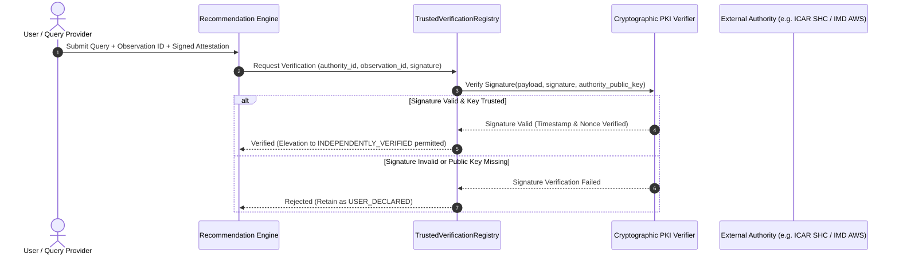

# FieldWise — Phase 3C.5.2.2.1: Epistemic Provenance Verification Limitations & PKI Requirements

## 1. Executive Summary & Epistemic Rationale

Data Completeness and Confidence Index (DCI) evaluation assigns confidence ratings to recommendations based on input provenance and measurement fidelity. In Phase 3C.5.2.2, a verification module was drafted that matched user-supplied observation IDs against a local authority allowlist (`AUTH-ICAR-SHC-REGISTRY`, `AUTH-IMD-AWS-NETWORK`, etc.) and promoted inputs to `ProvenanceTier.INDEPENDENTLY_VERIFIED`.

The independent review of Phase 3C.5.2.2 identified a critical epistemic defect: **matching an unauthenticated user-supplied ID against an authority dictionary does NOT constitute independent verification.**

Anyone can send an observation ID formatted as `OBS-IMD-001` with an authority ID `AUTH-IMD-AWS-NETWORK`. Without an active, operational cryptographic Public Key Infrastructure (PKI) digital signature verification mechanism, claiming that such an observation is `INDEPENDENTLY_VERIFIED` is an epistemic falsehood.

---

## 2. Strict Verification Invariants (Phase 3C.5.2.2.1)

In Phase 3C.5.2.2.1, the provenance evaluation architecture was fundamentally corrected:

1. **No Unauthenticated Elevation**: An authority allowlist, station ID, lab accreditation code, or matching sample ID alone **never** elevates an observation to `INDEPENDENTLY_VERIFIED`.
2. **Prohibition of Fake Verification**: All mock tokens, string-matching shortcuts, and simulated verification paths have been removed.
3. **Honest Provenance Retention**: In the absence of an operational cryptographic verification mechanism, observations strictly retain their genuine epistemic status:
   - `SOURCE_REFERENCED`: When grounded in a verifiable, external citation, portal URL, or public dataset identifier.
   - `USER_DECLARED`: When entered by the user without third-party cryptographic attestation.
   - `PROVISIONAL`: When derived from regional tables, interpolated grids, or estimates.
   - `UNKNOWN`: When measurement provenance or method metadata is absent.
4. **No False Cryptographic Claims**: The system never claims cryptographic validation unless an authentic digital signature (e.g. Ed25519 or ECDSA SHA-256) is mathematically checked against a trusted authority public key.

---

## 3. Provenance Tier Classification Matrix

The six epistemic provenance tiers operate under the following strict boundaries:

| Provenance Tier | Operational Definition | Minimum Evidentiary Requirement | Engine Evaluation Outcome |
| :--- | :--- | :--- | :--- |
| **`INDEPENDENTLY_VERIFIED`** | Observation authenticated via cryptographically signed attestation issued by an accredited authority. | Cryptographic digital signature verified against a pinned trusted authority public key. | **Currently Withheld**: No active PKI signature verification operational. |
| **`SOURCE_REFERENCED`** | Observation linked to a verifiable external data source, research report, or published official dataset. | Documented `source_reference` (DOI, portal dataset ID, or ICAR publication citation). | Assigned to verifiable external data sources. |
| **`USER_DECLARED`** | Quantitative value supplied directly by user or farmer without external attestation. | Direct user input (e.g. farmer-reported rainfall, soil test card numbers). | Standard tier for user inputs with declared values. |
| **`ESTIMATED`** | Value derived via empirical agronomic modeling, regression, or soil texture class midpoints. | Documented estimation algorithm or pedotransfer function. | Assigned to calculated water balance or texture averages. |
| **`PROVISIONAL`** | Value inferred from broad regional soil maps or temporal climate normals. | Regional map lookup or district-level averages. | Assigned to regional texture/pH estimates. |
| **`UNKNOWN`** | Input value or measurement provenance completely absent. | Missing metadata or unstated measurement method. | Assigned when required fields are missing. |

---

## 4. Architectural Requirements for Future PKI Verification

To legitimately enable `ProvenanceTier.INDEPENDENTLY_VERIFIED` in future phases, the following infrastructure must be implemented:

### 4.1 Mandatory Implementation Specifications
1. **Public Key Infrastructure (PKI)**: Pinned public certificates for accredited national agencies (DAC&FW Soil Health Card Portal, India Meteorological Department, Central Water Commission).
2. **Cryptographic Standards**: Use of standardized signature algorithms (e.g. Ed25519 or ECDSA with SHA-256 / SHA-384).
3. **Payload Canonicalization**: Strict JSON canonicalization (RFC 8785) before hashing and signature verification to prevent whitespace/ordering tampering.
4. **Timestamp & Nonce Verification**: Freshness checks to prevent replay attacks on expired soil test cards or historic weather observations.
