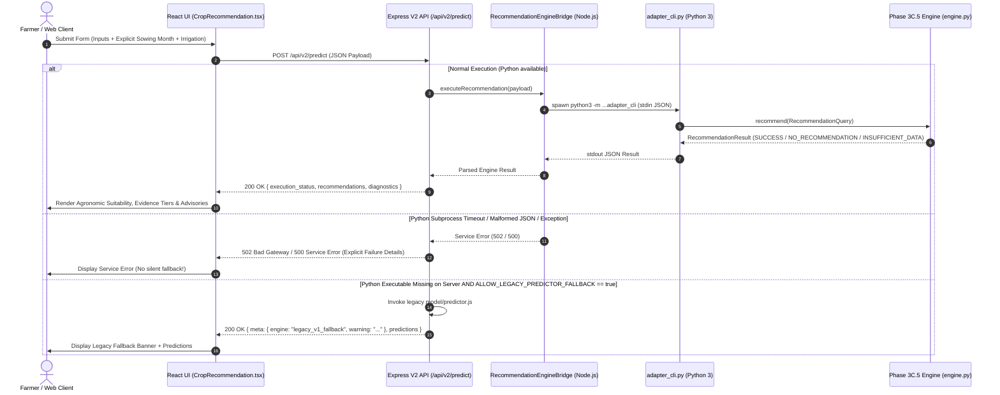

# FieldWise — Phase 3C.6.1.3: Integration Architecture and Implementation Strategy

**Document Reference**: `FieldWise_main/model/ml_pipeline/reports/phase_3c_6_1_integration_architecture.md`  
**Phase**: 3C.6.1.3 Final Safety Amendment (Read-Only)  
**Execution Mode**: READ-ONLY Architectural Design  
**Date**: November 2026  
**Status**: APPROVED RECONCILED INTEGRATION ARCHITECTURE  

---

## 1. Architectural Mission & Reconciled Principles

The primary objective of Phase 3C.6 is to integrate the frozen Phase 3C.5 Python recommendation engine into the production FieldWise Node.js / React application. In accordance with Phase 3C.6.1.3 review findings, the integration architecture enforces strict safety, provenance, routing, and fallback consistency rules across the entire stack.

### Core Architectural Principles
1. **Engine Immutability**: The frozen engine package (`FieldWise_main/model/ml_pipeline/recommendation_engine/`) remains 100% untouched. All integration logic resides in external adapters.
2. **Explicit Route Separation**:
   - `POST /api/predict`: Preserved **100% unchanged** as the V1 route, executing `model/predictor.js` and returning legacy semantics.
   - `POST /api/v2/predict`: Dedicated new route implemented via `routes/predictV2.js` and `controllers/predictV2Controller.js`, executing the frozen Phase 3C.5 engine.
3. **Strict Fallback Consistency**:
   - `INSUFFICIENT_DATA` & `NO_RECOMMENDATION_SUITABLE`: Return the engine result to the client; **never** trigger fallback.
   - Backend HTTP 4xx / 5xx: Surface the exact error to the UI; **do not** silently invoke offline predictions.
   - Genuine browser network disconnection (`!navigator.onLine`): Offline legacy mode may run, with a visible warning and explicit engine attribution (`offline_legacy_engine`).
   - Python runtime unavailable on server: Server-side legacy fallback occurs **only** when `ALLOW_LEGACY_PREDICTOR_FALLBACK=true` is explicitly enabled, returning explicit metadata (`engine: "legacy_v1_fallback"`).
   - Python timeout, malformed JSON, engine exception or other runtime failure: Return an **explicit service error** (HTTP 500 / 502); do not silently invoke the legacy predictor.
4. **Explicit Farmer Input (No Silently Inferred Context)**:
   - Planned sowing month must start **unselected** in the UI and require explicit farmer input. It must **never** default to the current calendar month.
   - Missing irrigation access must remain **`UNKNOWN`** (`None`); it must **never** be silently converted to rainfed. Explicit `None_Rainfed` represents farmer-declared rainfed.
   - Frozen constructor override: The frozen `ClimateWaterInput` constructor defaults `irrigation_access` to `"None_Rainfed"`. The adapter must explicitly override this default by passing `irrigation_access=None` when unselected.
   - Annual vs. seasonal rainfall: `farmProfile.conditions.rainfall (annual mm)` must **NEVER** be mapped directly into `seasonal_rainfall_amount`. It is preserved as annual-period information only. `seasonal_rainfall_amount` is set to Unknown (`None`) unless a genuine crop-season measurement or seasonal estimate is supplied. Monthly USDA-SCS equation is never applied to annual totals.
   - User declarations (e.g. form checkboxes) must be clearly distinguished from independent laboratory verification.
   - `has_soil_test=True` must **never** be inferred from `lastTestedDate`.

---

## 2. Adapter and Service Boundary Architecture



### 2.1 The Python Subprocess Bridge (`recommendation_engine/adapter_cli.py`)
In Phase 3C.6.2, a standalone CLI runner will be created outside the frozen engine core:
- **Location**: `FieldWise_main/model/ml_pipeline/recommendation_engine/adapter_cli.py`
- **Verified Execution Command**:
  ```bash
  python3 -m FieldWise_main.model.ml_pipeline.recommendation_engine.adapter_cli
  ```
  Or from `FieldWise_main`:
  ```bash
  PYTHONPATH=FieldWise_main python3 -m model.ml_pipeline.recommendation_engine.adapter_cli
  ```
- **Execution Protocol**:
  - `stdin`: Reads raw JSON query matching `RecommendationQuery` schema.
  - `stdout`: Emits raw JSON result matching `RecommendationResult` schema.
  - `stderr`: Emits operational logs and diagnostics.
  - Exit code `0` on completed execution (including `SUCCESS`, `NO_RECOMMENDATION_SUITABLE`, and `INSUFFICIENT_DATA`).
  - Non-zero exit code only on unhandled syntax errors or interpreter crashes.

### 2.2 Node.js Bridge Service (`FieldWise_main/backend/src/services/recommendationEngineBridge.js`)
- Spawns `python3` with a **5000 ms timeout**.
- If the child process times out, terminates the process and rejects with an explicit `ETIMEDOUT` error.
- If stdout is not valid JSON, rejects with an explicit `MALFORMED_OUTPUT` error.
- If stderr reports an exception, returns an explicit `ENGINE_EXCEPTION` error.
- Under **no circumstances** does the bridge silently swallow errors and invoke the legacy predictor.

---

## 3. Strict Reconciled Fallback Policy

| Failure Condition | Layer | Behavior | Client Presentation & Attribution |
| :--- | :--- | :--- | :--- |
| **`INSUFFICIENT_DATA`** (e.g. missing sowing month or rainfed water) | Backend | Return HTTP 200 with engine result (`execution_status: "INSUFFICIENT_DATA"`). | Display actionable data requirement notice. **Zero fallback.** |
| **`NO_RECOMMENDATION_SUITABLE`** (e.g. severe sodicity pH 9.2) | Backend | Return HTTP 200 with engine result (`execution_status: "NO_RECOMMENDATION_SUITABLE"`). | Display **Agronomic Remediation & Soil Health Advisory** card. **Zero fallback.** |
| **Backend HTTP 4xx / 5xx** | Client API | Surface error directly to UI state; throw error. | Display red server error banner. **Zero silent offline fallback.** |
| **Subprocess Timeout (>5000 ms) or Engine Crash** | Backend | Return HTTP 502 / 500 with explicit error message. | Display server service error: *"Agronomic engine timed out or encountered an internal exception."* **Zero fallback.** |
| **Python Missing on Server** AND `ALLOW_LEGACY_PREDICTOR_FALLBACK=false` | Backend | Return HTTP 500: `"Python 3 runtime not installed on host"`. | Display server configuration error. |
| **Python Missing on Server** AND `ALLOW_LEGACY_PREDICTOR_FALLBACK=true` | Backend | Execute `model/predictor.js`. Return payload with `meta.engine = "legacy_v1_fallback"`. | Display prominent amber banner: *"Operating in Legacy Fallback Mode. Python runtime unavailable on server."* |
| **Genuine Browser Offline Disconnection** (`!navigator.onLine`) | Client API | Execute `src/lib/predictorEngine.ts`. Return payload with `mode = "offline_legacy_engine"`. | Display prominent amber banner: *"Offline Mode: Showing basic browser estimations. Reconnect for verified agronomic gating."* |

---

## 4. Input Requirements and User Declaration Semantics

### 4.1 Sowing Month Explicit Input Policy
- In `PredictionForm.tsx` and `CropRecommendation.tsx`, the Planned Sowing Month dropdown will start **unselected** (placeholder: `"Select planned sowing month..."`).
- The "Analyze Farm & Recommend Crops" button will remain disabled until a valid month (1–12) is explicitly selected.
- The system will **NEVER** default this field to the current calendar month.

### 4.2 Irrigation Access & Constructor Default Safety
- In `PredictionForm.tsx`, an explicit **Irrigation Water Source** selector will be provided:
  - Options: `"None (Strictly Rainfed)"`, `"Tubewell / Borewell"`, `"Canal Gravity"`, `"Drip Micro-irrigation"`, `"Sprinkler"`, `"Open Well"`.
- It will start unselected. If the farmer declares `"None (Strictly Rainfed)"`, the payload sends `irrigation_access: "None_Rainfed"`.
- If the field is omitted, it will be treated as `None` / `UNKNOWN`.
- **Adapter Constructor Override**:
  Because the frozen `ClimateWaterInput` constructor defaults `irrigation_access` to `"None_Rainfed"`, the adapter must explicitly pass `irrigation_access=None` (or `"UNKNOWN"`) when the farmer has omitted or not selected irrigation access:
  ```python
  # Adapter explicit override of frozen constructor default:
  cw_input = ClimateWaterInput(
      irrigation_access=payload.get("irrigation_access", None),
      ...
  )
  ```
- **Documented Regression Test Case**:
  `test_adapter_omitted_irrigation_does_not_default_to_rainfed`:
  Verifies that when `irrigation_access` is omitted in the request payload, the adapter explicitly passes `irrigation_access=None`, ensuring the engine treats it as `UNKNOWN` rather than silently adopting the dataclass default `"None_Rainfed"`.

### 4.3 Annual vs. Seasonal Rainfall Safety
- `farmProfile.conditions.rainfall` represents average annual precipitation in mm. It must **NEVER** be mapped directly into `seasonal_rainfall_amount`.
- Annual rainfall is preserved strictly as annual-period context (`rainfall_period_type: "Annual_Estimated"`).
- `seasonal_rainfall_amount` is set to Unknown (`None`) unless a genuine crop-season measurement or valid seasonal estimate is supplied.
- Monthly USDA-SCS effective rainfall calculations are **never applied to annual totals**.

### 4.4 Soil Test Provenance and Checkbox Semantics
- A form toggle: `[ ] I have an official Soil Health Card / Lab Test Report`.
- **Epistemic Classification**:
  - Checking this box sets `has_soil_test=True`, but its epistemic tier in DCI is **`USER_DECLARED`**.
  - Fertilizer calculations are explicitly documented as based on **farmer-declared soil-test information and entered values**.
  - It does **not** grant `INDEPENDENTLY_VERIFIED` status (which strictly requires a verified `TrustedVerificationRecord`).
  - `lastTestedDate` from the farm profile must **never** automatically check this box.
- **Safety Gate**:
  - If unchecked (`has_soil_test=False`): Chemical fertilizer doses are **withheld for safety**, accompanied by state RDF baseline figures.
  - If checked (`has_soil_test=True`): Stoichiometric commercial fertilizer products (DAP, Urea, MOP) are calculated with mandatory **DAP Nitrogen credit**.

---

## 5. Frontend Presentation and Persistence Strategy

### 5.1 Presentation of Suitability Scores
- The crop card header in `PredictionResults.tsx` will display:
  - **"Agronomic Suitability: 88 / 100"** (Clean integer representation of ASI).
  - An adjacent **Evidence Quality Badge** (`High Evidence Confidence`, `Provisional Evidence`, `Unverified Soil Test`).
  - **Reference Yield Range**: Displayed as `"Reference Yield Range: 4.2 – 5.5 t/ha"` (accompanied by planting window citation e.g. `"ICAR-IIWBR Bull. 55/2022"` when present). **No point estimates.**
- The continuous percentage progress bar (`<Progress value={result.confidence} />`) will be replaced by an ASI scale indicator (`88/100`).

### 5.2 Environmental Hostility (`NO_RECOMMENDATION_SUITABLE`)
- Renders an informative, constructive **Land Reclamation & Soil Health Advisory** card (amber/violet styling).
- Explains why crops failed (e.g. *"Severe Sodicity: Soil pH 9.2 exceeds the critical tolerance of standard arable crops"*).
- Lists the specific `land_reclamation_advisory` provided by the engine.
- Displays evaluated depressed crops in an expandable accordion showing their achieved ASI and primary limiting factor.

### 5.3 Local Storage vs. Cloud Persistence
- **Local Storage**: The latest V2 result is stored in browser `localStorage['cropswild_crop_recommendation_last']`. Browser-local storage provides ephemeral client-side caching for the user's latest session; it is **not cloud backup or guaranteed durable storage**.
- **Supabase Cloud Sync**: V2 cloud database synchronization to `crop_predictions` is **formally deferred** until a dedicated schema migration is approved in a future phase.
