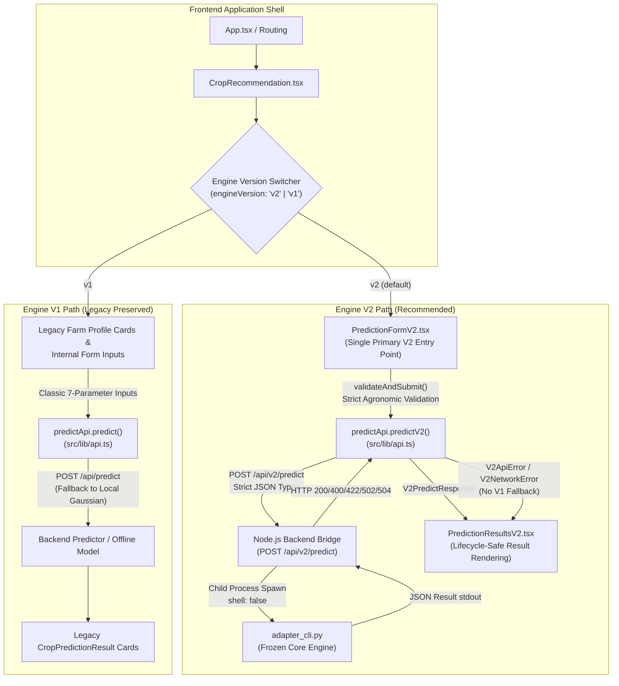

# FieldWise — Phase 3C.6.3: Frontend V2 Component Map & Integration Architecture

**Document Reference**: `FieldWise_main/model/ml_pipeline/reports/phase_3c_6_3_component_map.md`  
**Phase**: 3C.6.3 Frontend V2 Integration  
**Execution Timestamp**: November 2026  
**Status**: APPROVED IMPLEMENTATION SPECIFICATION  

---

## 1. Executive Summary

Phase 3C.6.3 bridges the FieldWise frontend application with the Phase 3C.6.2.2 Node.js backend bridge and the frozen Phase 3C.6.2.1 Python Recommendation Engine CLI. This phase delivers a dedicated, modern, agronomic decision-support user interface (`PredictionFormV2.tsx` and `PredictionResultsV2.tsx`), integrated via an **Engine Version Switcher** within `CropRecommendation.tsx`.

The implementation preserves 100% of the legacy V1 heuristic predictor, its offline Gaussian fallback engine, and its user interface, providing seamless toggle capability while strictly isolating V2 agronomic invariants, validation rules, error handling, and presentation contracts.

---

## 2. Component Hierarchy & Data Flow Map



---

## 3. Single Primary V2 Entry Point: `PredictionFormV2.tsx`

To eliminate input duplication and prevent ambiguous form state across multiple pages, `PredictionFormV2.tsx` serves as the single primary entry point for Engine V2 evaluation.

### 3.1 Input Mapping & Agronomic Semantics

| Parameter | UI Control | Default State | Submission Mapping & Agronomic Rule |
| :--- | :--- | :--- | :--- |
| **State / Region** | Select dropdown | Pre-filled from profile or unselected | Mandatory. Non-empty string. |
| **Planned Sowing Month** | Select dropdown (`1`–`12`) | **Unselected (`null`)** | **Mandatory**. Never defaults to the current calendar month. Form submission is disabled until explicitly chosen. |
| **District / Zone** | Text input | `null` (Optional) | Submits trimmed string or `null`. |
| **Cultivation Season** | Select dropdown | `null` (Optional) | User override or `null` (auto-derived by engine). |
| **Irrigation Access** | Select dropdown | **Unselected (`null`)** | **Missing irrigation remains `null` (UNKNOWN)**. Explicit rainfed cultivation maps to `"None_Rainfed"`. |
| **Irrigation Depth** | Number input (`mm`) | `null` (Optional) | Submits positive finite number or `null`. |
| **Irrigation Period** | Number input (`days`) | `null` (Optional) | Submits positive integer or `null`. Non-integer/zero values are rejected by client validation. |
| **Seasonal Rainfall** | Number input (`mm`) | `null` (Optional) | **Strictly separated from Annual Rainfall**. Represents moisture expected during the crop lifecycle. |
| **Annual Rainfall** | Number input (`mm`) | `null` (Optional) | Represents macro-climatic annual precipitation. Never conflated with seasonal rainfall. |
| **Soil Test Availability** | Checkbox | `false` (Unchecked) | **Farmer-Declared Soil Health Card**. Conveys `USER_DECLARED` provenance only; does not infer lab certification. |
| **Soil Reaction (pH)** | Number input (`2.0`–`12.0`) | `6.8` (or profile) | Strict numeric bound validation. Submits finite number. |
| **Available N, P, K** | Number inputs (`kg/ha`) | `80`, `40`, `40` (or profile) | Strict non-negative number validation with inline unit badges (`kg/ha`). |
| **Organic Carbon** | Number input (`%`) | `0.65` (Optional) | Optional soil health modifier (`%`). |

### 3.2 Client-Side Validation Rules
1. **Mandatory Guard**: Form submission is disabled when `state` is empty or `sowing_month` is `null`.
2. **Whole-Day Duration Validation**: `irrigation_period_days` and `rainfall_period_days` must be positive integers (`> 0`). Non-integers and non-positive numbers display localized field error notices.
3. **Edaphic Safety Bounds**: `soil_ph` must be between `2.0` and `12.0`. Nutrients (`nitrogen`, `phosphorus`, `potassium`, `organic_carbon`) and rainfall quantities cannot be negative.
4. **HTML5 Form Constraint Decoupling**: Form declares `noValidate` so React's custom validation executes deterministically in all browser and headless test environments.

---

## 4. API Client Integration: `predictApi.predictV2`

Located in `FieldWise_main/src/lib/api.ts`, `predictV2` provides a dedicated, type-safe client interface to the Node.js backend bridge:

```typescript
export class V2ApiError extends Error {
  status: number;
  code: string;
  details?: any;
  // ...
}

export class V2NetworkError extends Error {
  originalError: any;
  // ...
}
```

### 4.1 Strict Error Isolation Contract
- **No Silent Fallback**: On HTTP 400, 422, 500, 502, 503, 504, or network termination, `predictV2` throws a structured `V2ApiError` or `V2NetworkError`.
- **Zero Fallback to V1**: The client never calls legacy `/api/predict` or activates the offline Gaussian model when V2 encounters an error.
- **V1 Client Preserved**: The legacy `predictApi.predict` method remains 100% untouched and continues to provide offline Gaussian fallback for V1 consumers.

---

## 5. Recommendation Presentation Interface: `PredictionResultsV2.tsx`

`PredictionResultsV2.tsx` presents the structured agronomic output returned by Engine V2, supporting all three engine statuses without inventing fallback recommendations.

### 5.1 Status Presentation Matrix

| Engine Status | UI Presentation & Layout | Agronomic Contract Enforcement |
| :--- | :--- | :--- |
| **`SUCCESS`** | Ranked crop cards displaying suitability score (`0`–`100`), crop water balance breakdown, baseline RDF fertilizer guidance, and yield range. | - Suitability notice explicitly clarifies score represents multi-factorial agronomic compatibility, **not a statistical probability or confidence score**.<br>- Yield range rendered strictly as `[min, max] t/ha` (no point estimates).<br>- Fertilizer guidance displays prominent **Baseline RDF (Farmer-Declared)** warning banner.<br>- Excluded candidates rendered in an interactive accordion detailing physiological failure reasons. |
| **`INSUFFICIENT_DATA`** | Prominent amber advisory panel with diagnostic reason, missing parameters list, and suggestions. | Zero recommended crop cards rendered. No point estimates or fallback crops invented. |
| **`NO_RECOMMENDATION_SUITABLE`** | High-contrast warning panel with authoritative land reclamation advisory. | Displays specific limiting factors (e.g. extreme sodicity, severe acidity) and remediation guidance. Zero crops invented. |
| **Error State** | Structured error banner with HTTP status badge, error details, and "Retry Analysis" button. | Invokes previously submitted payload without forcing user to re-enter form parameters. |

### 5.2 Component Lifecycle Safety
- **Zero Render-Time State Mutations**: Synchronous calls to `setExpandedCrop()` inside the render body were eliminated.
- **Controlled `useEffect` Selection**: Crop expansion is initialized inside a `useEffect` hook listening to `[recommendations]`, preserving user selections across re-renders and handling empty recommendation sets safely.

---

## 6. Engine Version Switcher in `CropRecommendation.tsx`

The `CropRecommendation` module acts as the host container:
1. **Engine Version Switcher**: Positioned prominently below the module header, allowing the farmer to toggle between:
   - **Engine V2 (Recommended)**: Mounts `PredictionFormV2` and `PredictionResultsV2`.
   - **Engine V1 (Legacy)**: Preserves the entire legacy 7-parameter environmental model, farm profile summary cards, and legacy prediction results.
2. **State Isolation**: Switching between V1 and V2 does not clear farm profile data or create memory leaks.
3. **Default Behavior**: Engine V2 is the active default on initial load.
