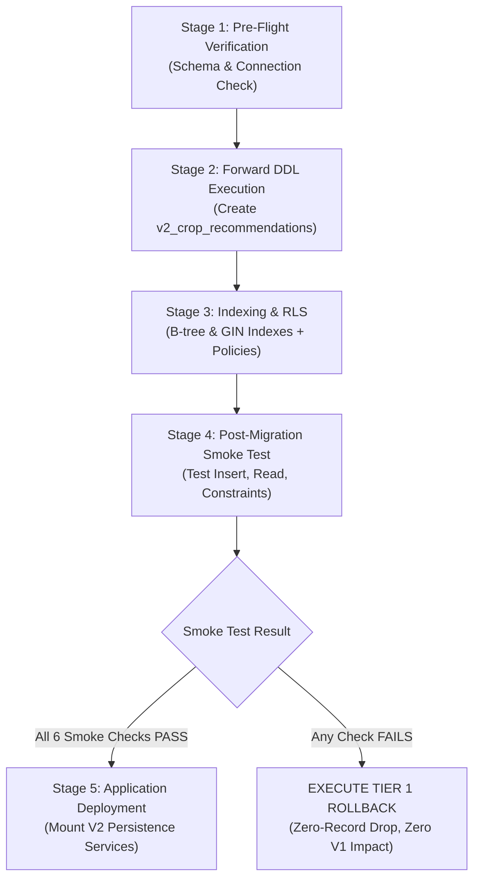

# FieldWise — Phase 3C.6.4.1.1: Migration Execution Plan & Multi-Tier Rollback Strategy

**Document Reference**: `FieldWise_main/model/ml_pipeline/reports/phase_3c_6_4_1_migration_and_rollback_proposal.md`  
**Phase**: 3C.6.4.1.1 Persistence Design Closure (Read-Only)  
**Execution Timestamp**: November 2026  
**Status**: APPROVED RECONCILED MIGRATION & ROLLBACK PROPOSAL  

---

## 1. Executive Summary & Critical Rollback Principle

In previous iterations, rolling back database changes was described via an unconditional `DROP TABLE public.v2_crop_recommendations CASCADE;`.

**Critical Operational Principle**:
**Never imply that dropping a table containing farmer history is a zero-risk rollback.**

Once farmers generate and store real-world crop recommendations, dropping the table results in **irreversible data loss** of historical agronomic decision records, violating agricultural auditability and farmer trust.

This document establishes a **multi-tier rollback architecture** distinguishing between:
1. **Pre-deployment rollback** (when zero farmer records exist).
2. **Post-deployment rollback** (when production farmer records exist).
3. **Application-level rollback** (decoupling code release from data destruction).
4. **Pre-flight dependency checks** and **data retention/recovery protocols**.

Because Phase 3C.6.4.1.1 is strictly **READ-ONLY**, **no DDL or database commands are executed at this time**.

---

## 2. Multi-Tier Rollback Strategy

```
                                ┌──────────────────────────────────────┐
                                │       TRIGGER ROLLBACK EVENT         │
                                └──────────────────┬───────────────────┘
                                                   │
                         ┌─────────────────────────┴─────────────────────────┐
                         ▼                                                   ▼
        ┌──────────────────────────────────┐               ┌──────────────────────────────────┐
        │     TIER 1: PRE-DEPLOYMENT       │               │     TIER 2: POST-DEPLOYMENT      │
        │    (Zero Farmer Records Exist)   │               │     (Farmer History Exists)      │
        ├──────────────────────────────────┤               ├──────────────────────────────────┤
        │ 1. Verify COUNT(*) === 0         │               │ 1. DO NOT DROP TABLE!            │
        │ 2. Check pg_depend dependencies  │               │ 2. Set ENABLE_V2_PERSISTENCE=0   │
        │ 3. Execute controlled DDL drop   │               │ 3. Table remains READ-ONLY       │
        │ 4. Zero farmer data lost         │               │ 4. Code reverts to previous SHA  │
        └──────────────────────────────────┘               └──────────────────────────────────┘
```

### 2.1 Tier 1: Pre-Deployment Rollback (Zero Records Exist)
If a failure occurs during schema provisioning (e.g. index creation fails, smoke test fails):
1. **Record Count Guard**: Verify that no records were created:
   ```sql
   DO $$
   DECLARE
     rec_count INTEGER;
   BEGIN
     SELECT COUNT(*) INTO rec_count FROM public.v2_crop_recommendations;
     IF rec_count > 0 THEN
       RAISE EXCEPTION 'CANNOT EXECUTE TIER 1 ROLLBACK: Table contains % production records. Execute Tier 2 rollback instead.', rec_count;
     END IF;
   END $$;
   ```
2. **Dependency Inspection**: Confirm no foreign keys or external views depend on the table:
   ```sql
   SELECT classid::regclass, objid, deptype
   FROM pg_depend
   WHERE refobjid = 'public.v2_crop_recommendations'::regclass;
   ```
3. **Controlled DDL Removal**:
   ```sql
   BEGIN;
   DROP TRIGGER IF EXISTS trg_v2_crop_recommendations_immutable ON public.v2_crop_recommendations;
   DROP FUNCTION IF EXISTS trg_prevent_v2_recommendations_mutation();
   DROP TABLE IF EXISTS public.v2_crop_recommendations CASCADE;
   COMMIT;
   ```

---

### 2.2 Tier 2: Post-Deployment Rollback (Production Records Exist)
Once farmers have generated recommendations, **dropping the table is strictly prohibited**. 

The post-deployment rollback must be an **Application-Level Rollback**:
1. **Deactivate Persistence Feature Flag**: Set `ENABLE_V2_CLOUD_PERSISTENCE=false` in the backend environment.
2. **Route Graceful Degradation**:
   - The Express route `POST /api/v2/predict` continues generating recommendations and streaming them to the client.
   - It bypasses the database write step without failing the prediction.
   - The frontend caches the recommendation in `localStorage['cropswild_v2_recommendation_last']`.
3. **Data Preservation**: Existing records in `public.v2_crop_recommendations` remain intact and readable for historical queries.
4. **Zero Regressions on Legacy V1**: The V1 table `public.crop_predictions` is completely isolated and continues operating normally.

---

### 2.3 Tier 3: Application Rollback while Preserving V2 History
If the backend application release must be rolled back to a previous Git commit:
1. Re-deploy the previously approved container or server build (e.g. Phase 3C.6.2.2.3 commit).
2. The database schema `v2_crop_recommendations` remains in PostgreSQL.
3. The legacy backend simply ignores `v2_crop_recommendations` because it contains no references to it.
4. When the fixed application build is deployed later, it reconnects to the existing table without data re-creation or migration loss.

---

## 3. Data Retention and Disaster Recovery Protocol

### 3.1 Pre-Migration Snapshot (Required Before Schema Application)
Before executing any DDL in future implementation phases:
1. Generate an explicit logical backup of the public schema:
   ```bash
   pg_dump -h $DB_HOST -U $DB_USER -d $DB_NAME -t 'public.farmers' -t 'public.farm_profiles' -t 'public.crop_predictions' > pre_v2_migration_backup_$(date +%Y%m%d_%H%M%S).sql
   ```
2. Compute and store SHA-256 checksum of the backup file:
   ```bash
   shasum -a 256 pre_v2_migration_backup_*.sql > pre_v2_migration_backup.sha256
   ```

### 3.2 Data Recovery Procedure
If accidental corruption or an unapproved drop occurs:
1. Stop all client traffic to the affected table.
2. Verify integrity of the latest snapshot against its SHA-256 hash.
3. Restore from backup in a dedicated maintenance transaction:
   ```bash
   psql -h $DB_HOST -U $DB_USER -d $DB_NAME -f pre_v2_migration_backup_*.sql
   ```
4. Execute automated verification queries confirming row counts match the pre-migration baseline.

---

## 4. Phased Migration Execution Blueprint (For Future Phase 3C.6.4.2)



### Stage 4 Post-Migration Smoke Test Suite
1. **Foreign Key Constraint**: Inserting with an invalid `farmer_id` must fail with foreign key violation.
2. **Sowing Month Range**: Inserting `sowing_month = 13` or `0` must be rejected.
3. **Status Enum Check**: Inserting `engine_status = 'INVALID'` must be rejected.
4. **Metric-Status Consistency**: Inserting `engine_status = 'INSUFFICIENT_DATA'` with a non-null `top_crop` must be rejected by `chk_status_metrics`.
5. **Zero Preservation**: Inserting `nitrogen = 0.0` and `temperature = 0.0` must persist numeric `0.0` and not convert to `NULL`.
6. **Immutability Trigger**: Attempting `UPDATE` or `DELETE` on a test row must raise an exception.
7. **Legacy V1 Isolation**: Verify `public.crop_predictions` count and records are completely identical before and after test execution.
