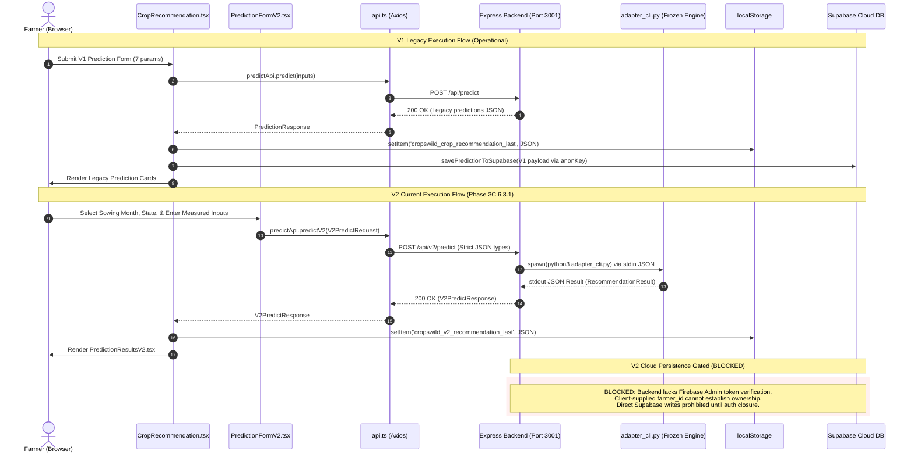

# FieldWise — Phase 3C.6.4.1.1: Existing Persistence Architecture Audit & Design Closure

**Document Reference**: `FieldWise_main/model/ml_pipeline/reports/phase_3c_6_4_1_persistence_architecture.md`  
**Phase**: 3C.6.4.1.1 Persistence Design Closure (Read-Only)  
**Execution Timestamp**: November 2026  
**Status**: APPROVED RECONCILED ARCHITECTURAL AUDIT  

---

## 1. Executive Summary & Verification Provenance

This document establishes the verified architectural baseline of the FieldWise persistence systems and evaluates the security, schema-integrity, and operational requirements for persisting Engine V2 recommendations.

In accordance with the Phase 3C.6.4.1.1 directives, this audit explicitly distinguishes between **verified source code implementations** in the repository and **proposed future designs**.

### 1.1 Critical Finding: Cloud Database Persistence is Gated (BLOCKED)
A rigorous inspection of the authentication and database connection layers reveals that:
1. The Express backend verifies only local HMAC JWTs against an embedded SQLite `users` table (`backend/src/middleware/auth.js:21`). It **does not** verify Firebase ID tokens or Supabase JWTs.
2. There is **no cryptographic identity mapping** between SQLite integer `users.id` and Supabase string `public.farmers.id`.
3. The backend currently contains **zero Supabase connections** (neither client nor service role).
4. In the frontend, Supabase writes are executed directly from the browser using the public `anonKey`, accepting a client-declared `farmer_id` from `localStorage`.

**Authoritative Design Determination**:
A client-supplied `farmer_id` must **never** establish database ownership. Because independent server-side token verification and farmer identity mapping are currently absent in the backend, **cloud database persistence for V2 recommendations is explicitly classified as BLOCKED pending implementation of server-side token verification and identity mapping**.

In the interim, local client-side persistence under the dedicated key `localStorage['cropswild_v2_recommendation_last']` serves as the safe, non-destructive bridge.

---

## 2. Verified Implementation vs. Proposed Design

| Architecture Element | Verified Source Reference | Current Repository Implementation | Proposed V2 Storage Design |
| :--- | :--- | :--- | :--- |
| **Backend Token Verification** | `backend/src/middleware/auth.js`, L8–36 | Decodes local HMAC JWT with `process.env.JWT_SECRET`. | Must verify Firebase ID tokens using Firebase Admin SDK or Supabase JWT. |
| **Identity Mapping** | `backend/src/controllers/authController.js`, L55 | Issues token with integer SQLite row ID (`users.id`). | Cryptographic mapping: `verified_token.uid` $\rightarrow$ `public.farmers.id`. |
| **Backend DB Connection** | `backend/src/config/database.js`, L18–48 | Connects exclusively to local `backend/data/croppredict.db` (SQLite). | Must configure server-side Supabase client with `SUPABASE_SERVICE_ROLE_KEY`. |
| **Route Authorization** | `backend/src/routes/v2/predict.js`, L18 | Mounts `optionalAuth`. Unauthenticated requests proceed as guest. | Require mandatory verified bearer token for cloud-persisted requests. |
| **V1 Cloud Persistence** | `src/lib/supabase.ts`, L201–235 | Client-side insert into `crop_predictions` via publishable `anonKey`. | Preserved 100% intact. Zero modifications to V1 table or client code. |
| **V2 Persistence Gating** | System Architecture | V2 recommendations reside in ephemeral React state (`v2Response`). | **BLOCKED** from cloud writes until backend token verification is implemented. |

---

## 3. Detailed Audit of Existing Subsystems

### 3.1 Supabase Cloud Database (PostgreSQL)

Located in `FieldWise_main/src/lib/supabase.ts`, Supabase serves as the primary cloud datastore.

```
                    ┌─────────────────────────┐
                    │      public.farmers     │
                    ├─────────────────────────┤
                    │ id (PK, TEXT/UUID)      │
                    │ email (TEXT)            │
                    │ full_name (TEXT)        │
                    │ phone (TEXT)            │
                    │ location (TEXT)         │
                    │ farm_size (TEXT)        │
                    │ created_at (TIMESTAMPTZ)│
                    └────────────┬────────────┘
                                 │ 1
                                 │
         ┌───────────────────────┴───────────────────────┐
         │ 1                                             │ 1..N
         ▼                                               ▼
┌─────────────────────────┐                   ┌─────────────────────────┐
│  public.farm_profiles   │                   │ public.crop_predictions │
├─────────────────────────┤                   ├─────────────────────────┤
│ id (PK, UUID/INT)       │                   │ id (PK, UUID/INT)       │
│ farmer_id (FK -> farmers)                   │ farmer_id (FK -> farmers)
│ state (TEXT)            │                   │ recommended_crop (TEXT) │
│ district (TEXT)         │                   │ confidence (TEXT: "95%")│
│ soil_type (TEXT)        │                   │ nitrogen (NUMERIC)      │
│ ph (NUMERIC)            │                   │ phosphorus (NUMERIC)    │
│ nitrogen (NUMERIC)      │                   │ potassium (NUMERIC)     │
│ phosphorus (NUMERIC)    │                   │ ph (NUMERIC)            │
│ potassium (NUMERIC)     │                   │ rainfall (NUMERIC)      │
│ rainfall (NUMERIC)      │                   │ temperature (NUMERIC)   │
│ irrigation_type (TEXT)  │                   │ humidity (NUMERIC)      │
│ updated_at (TIMESTAMPTZ)│                   │ created_at (TIMESTAMPTZ)│
└─────────────────────────┘                   └─────────────────────────┘
```

#### Foreign Key & Identity Invariants
1. **Parent Identity Invariant**: Both `farm_profiles` and `crop_predictions` contain a `farmer_id` column referencing `public.farmers(id)`.
2. **Pre-flight Parent Upsert**: Before inserting into either child table, `ensureParentFarmerExists(farmerId)` is invoked in `src/lib/supabase.ts` (L91–110):
   ```typescript
   await supabase.from('farmers').upsert({
     id: farmerId,
     email: email || `${farmerId}@fieldwise.agri`,
     full_name: name || 'Farmer Partner',
     location: 'Gujarat, India',
     created_at: new Date().toISOString()
   }, { onConflict: 'id', ignoreDuplicates: true });
   ```
3. **1:1 vs 1:N Semantics**:
   - `farm_profiles`: Managed as a 1:1 entity per farmer. In `syncFarmProfileToSupabase()`, the client explicitly checks `existingRows.length > 0` and issues an `UPDATE` if a row exists, or an `INSERT` if none exists.
   - `crop_predictions`: Managed as an immutable, append-only historical log (1:N). Every V1 prediction triggers an `INSERT`.

---

### 3.2 Local SQLite Database (`backend/data/croppredict.db`)

Managed by `FieldWise_main/backend/src/config/database.js`, the Express backend connects to a local SQLite database using Node 22's native `DatabaseSync` (`node:sqlite`) with fallback to `better-sqlite3`.

```sql
-- Table 1: Authentication Users (backend/src/config/database.js:22)
CREATE TABLE IF NOT EXISTS users (
  id          INTEGER PRIMARY KEY AUTOINCREMENT,
  name        TEXT    NOT NULL,
  email       TEXT    NOT NULL UNIQUE,
  password    TEXT    NOT NULL,
  created_at  DATETIME DEFAULT CURRENT_TIMESTAMP
);

-- Table 2: Expert Consultation Inquiries (backend/src/routes/expertSupport.js:19)
CREATE TABLE IF NOT EXISTS expert_inquiries (
  id                  INTEGER PRIMARY KEY AUTOINCREMENT,
  farmer_name         TEXT,
  phone               TEXT,
  state               TEXT,
  district            TEXT,
  crop                TEXT,
  category            TEXT NOT NULL,
  problem_description TEXT NOT NULL,
  image_url           TEXT,
  status              TEXT DEFAULT 'prepared',
  created_at          DATETIME DEFAULT CURRENT_TIMESTAMP
);
```

#### Key Findings Regarding SQLite
- **Zero Prediction Tables in SQLite**: Neither V1 (`predictController.js`) nor V2 (`v2/predictController.js`) accesses or writes to SQLite.
- **Backend Isolation**: SQLite is used solely for local username/password auth and KVK expert inquiry tickets.
- **Portability**: Database resides at `FieldWise_main/backend/data/croppredict.db`.

---

### 3.3 Browser Client Storage (`localStorage`) Keys

The frontend client utilizes `localStorage` as its local operational state store:

| Storage Key | Writing Module | Reading Modules | Payload Schema & Purpose |
| :--- | :--- | :--- | :--- |
| `cropswild_crop_recommendation_last` | `CropRecommendation.tsx` (V1 path) | `CropRecommendation.tsx`, `farmIntelligenceService.ts`, `DashboardMainContent.tsx`, `FarmIntelligence.tsx`, `supabase.ts` | **Legacy V1 Prediction Cache**. Contains: `{ predictions: [...], inputs: {...}, topCrop: string, cropName: string, confidence: number, suitabilityScore: number, analyzedAt: string }`. |
| `cropswild_farm_profile` | `farmProfileService.ts`, `Profile.tsx` | `farmProfileService.ts`, `PredictionFormV2.tsx`, `SoilEnvironmentIntelligence.tsx`, `FertilizerRecommendation.tsx` | **Complete Farm Profile**. Contains: `{ farmer: {...}, farm: {...}, conditions: {...}, soil: {...}, updatedAt: string }`. |
| `cropswild_farm_profile_saved` | `farmProfileService.ts` | `Profile.tsx` | Boolean flag (`"true"`) indicating if user clicked explicit "Save Profile". |
| `cropswild_fertilizer_recommendation_last` | `FertilizerRecommendation.tsx` | `FertilizerRecommendation.tsx`, `farmIntelligenceService.ts`, `DashboardMainContent.tsx` | **Fertilizer Formulations**. Contains: `{ cropName, cropId, fertilizers: [...], inputs: {...}, analyzedAt }`. |
| `cropswild_disease_detection_last` | `DiseaseDetection.tsx` | `DiseaseDetection.tsx`, `farmIntelligenceService.ts`, `DashboardMainContent.tsx` | **Plant Disease Result**. Contains: `{ cropName, diseaseName, confidenceScore, symptomsObserved, preventionTips, analyzedAt }`. |
| `fieldwise_active_user` | `FieldWise_landing/firebase.js`, `AuthContext.tsx` | `AuthContext.tsx`, `supabase.ts` | **Active Farmer Session Profile**. Contains: `{ uid, displayName, email, address, contact_no, farm_size }`. |
| `fieldwise_session_expiry` | `FieldWise_landing/firebase.js`, `AuthContext.tsx` | `AuthContext.tsx` | Unix epoch millisecond expiration stamp for session TTL (24h). |

---

## 4. End-to-End Persistence Data Flow & Gating State



---

## 5. Architectural Invariance & Safety Conclusions

1. **V1 Persistence Integrity**: The legacy `crop_predictions` table, client cache `cropswild_crop_recommendation_last`, and predictor controllers remain 100% untouched.
2. **Persistence Gating Invariant**: No cloud database writes for V2 recommendations will be enabled until verified token authentication and server-side farmer identity mapping are implemented and tested.
3. **Safe Local Bridge**: Local storage caching under `cropswild_v2_recommendation_last` provides non-destructive persistence for the active user session without violating database tenant boundaries.
