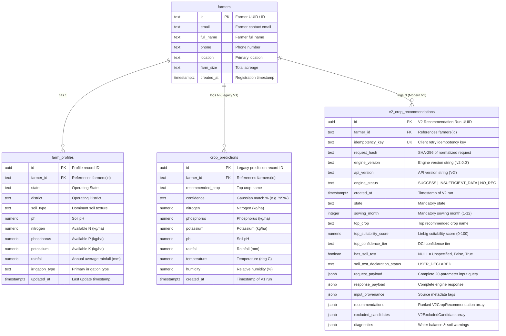

# FieldWise — Phase 3C.6.4.1.1: Proposed V2 Storage Schema & Relationship Diagram

**Document Reference**: `FieldWise_main/model/ml_pipeline/reports/phase_3c_6_4_1_proposed_schema_and_diagram.md`  
**Phase**: 3C.6.4.1.1 Persistence Design Closure (Read-Only)  
**Execution Timestamp**: November 2026  
**Status**: APPROVED RECONCILED DESIGN SPECIFICATION  

---

## 1. Executive Summary & Evaluation of Storage Options

To support the persistence of Engine V2 crop recommendations without modifying the legacy system, three architectural options were evaluated against the existing FieldWise persistence architecture:

- **Option A: Dedicated V2 Table (Hybrid Relational + Lossless JSONB)**: Introduces a dedicated `public.v2_crop_recommendations` table in Supabase. Relational columns capture query parameters, status, and summary metrics for fast indexing, filtering, and pagination, while verbatim `JSONB` columns store complete request snapshots, response payloads, water balance models, stoichiometric fertilizer prescriptions, and physiological exclusion reasons.
- **Option B: Versioned JSON in Existing Table (`crop_predictions`)**: Alters the legacy `crop_predictions` table by adding `engine_version`, `status`, and `result_payload` JSON columns.
- **Option C: Fully Normalized Dedicated Relational Tables**: Deconstructs V2 recommendations across 6 normalized tables (`v2_queries`, `v2_recommendations`, `v2_water_assessments`, `v2_nutrient_prescriptions`, `v2_excluded_candidates`, `v2_diagnostics`).

---

## 2. Comparative Evaluation Matrix

| Evaluation Criterion | Option A: Dedicated V2 Table (Hybrid Relational + JSONB) | Option B: Alter Existing `crop_predictions` Table | Option C: Fully Normalized 6-Table Relational Schema |
| :--- | :--- | :--- | :--- |
| **1. Schema Changes Required** | **Low**. Single `CREATE TABLE` and 4 indexes. Zero alterations to existing tables. | **High Risk**. Multiple `ALTER TABLE` statements modifying a live production table. | **Very High**. 6 `CREATE TABLE` statements, multiple foreign keys, composite indexes. |
| **2. Backward Compatibility** | **100% Perfect**. Legacy V1 code, queries, and consumers remain 100% isolated. | **Poor & Fragile**. Column nullability conflicts; risk of V1 queries reading V2 records. | **100% Isolated**. Zero interference with V1 table. |
| **3. Query Complexity** | **Low**. Single-table `SELECT` with fast B-Tree indexing on `(farmer_id, created_at DESC)`. | **Moderate**. Requires filtering `WHERE engine_version = 'v2'` on every query. | **Very High**. Requires 5-table joins or multiple sequential round-trips to reconstruct a single response. |
| **4. Data Integrity** | **Very High**. Column-level check constraints on status, sowing month; immutable JSONB for nested models. | **Low**. Weakened constraints due to column sharing between disparate V1 and V2 models. | **Extremely High**. Relational integrity enforced at every foreign key level. |
| **5. JSON Size & Indexing** | **Optimal**. V2 payload is 5–15 KB. PostgreSQL JSONB supports up to 255 MB. GIN indexing supported. | **Sub-optimal**. Mixes 200-byte V1 rows with 15 KB JSONB rows in the same table, causing page bloat. | **No JSON**. Normalized relational rows, but high index storage overhead across 6 tables. |
| **6. User / Farm Constraints** | **Enforced**. Foreign key `REFERENCES public.farmers(id) ON DELETE CASCADE`. | **Inherited**. Relies on existing `farmers(id)` constraint. | **Complex**. Cascading foreign keys across 6 child tables. |
| **7. Migration & Rollback Risks**| **Near Zero**. Rollback is non-destructive to existing tables. (See detailed multi-tier rollback plan). | **High**. Reversing `ALTER TABLE` on production tables risks data loss and locking. | **Moderate**. Rollback requires dropping 6 dependent tables in precise sequence. |

---

## 3. Definitive Architectural Recommendation

### **Recommendation: Option A (Dedicated `v2_crop_recommendations` Table)**

Option A is decisively recommended based on the actual FieldWise repository architecture:
1. **Zero Collision Risk**: It guarantees that the legacy V1 `crop_predictions` table remains completely untouched, preventing any possibility of regression.
2. **Lossless Agronomic Preservation**: The rich, hierarchical nature of V2 data (water balances with USDA-SCS effective rainfall, stoichiometric DAP/Urea/MOP prescriptions, excluded candidates with physiological reasons) maps naturally into structured `JSONB` without truncating nested arrays or forcing artificial relational normalization.
3. **High Query Performance**: Farmers typically query their recommendations by `"most recent analysis"` (`ORDER BY created_at DESC LIMIT 10`). Option A satisfies this with a single B-tree index scan on `(farmer_id, created_at DESC)` without costly multi-table joins.
4. **Agile Schema Evolution**: If the frozen recommendation engine introduces additional diagnostic metadata in future phases, the `JSONB` structure absorbs new fields without requiring disruptive database schema migrations.

---

## 4. Reconciled DDL Specification (Option A)

```sql
-- =============================================================================
-- FieldWise Phase 3C.6.4.1.2: Reconciled V2 Crop Recommendation Storage
-- Table: public.v2_crop_recommendations
-- =============================================================================

CREATE TABLE IF NOT EXISTS public.v2_crop_recommendations (
  -- Primary & Relational Keys
  id                          UUID PRIMARY KEY DEFAULT gen_random_uuid(),
  farmer_id                   TEXT NOT NULL REFERENCES public.farmers(id) ON DELETE RESTRICT,
  idempotency_key             TEXT NOT NULL,
  request_hash                TEXT NOT NULL,
  
  -- Engine Execution Metadata
  engine_version              TEXT NOT NULL DEFAULT 'v2.0.0',
  api_version                 TEXT NOT NULL DEFAULT 'v2',
  engine_status               TEXT NOT NULL CHECK (engine_status IN ('SUCCESS', 'INSUFFICIENT_DATA', 'NO_RECOMMENDATION_SUITABLE')),
  created_at                  TIMESTAMPTZ NOT NULL DEFAULT NOW(),
  execution_time_ms           INTEGER NULL,

  -- Primary Search & Indexing Columns (Relational Fast-Path)
  state                       TEXT NOT NULL,
  district                    TEXT NULL,
  sowing_month                INTEGER NOT NULL CHECK (sowing_month BETWEEN 1 AND 12),
  season                      TEXT NULL,
  irrigation_access           TEXT NULL,
  
  -- Soil-Test Status: NULL = Unspecified/Unknown, FALSE = Declared Absent, TRUE = Declared Available
  has_soil_test               BOOLEAN NULL,
  soil_test_declaration_status TEXT NOT NULL DEFAULT 'USER_DECLARED',

  -- Status-Gated Result Metrics
  -- In INSUFFICIENT_DATA or NO_RECOMMENDATION_SUITABLE, top metrics are strictly NULL
  top_crop                    TEXT NULL,
  top_suitability_score       NUMERIC(5, 2) NULL CHECK (top_suitability_score >= 0.0 AND top_suitability_score <= 100.0),
  top_confidence_tier         TEXT NULL,

  -- Measured Edaphic & Climatic Inputs (Documented Units & Grounded Bounds)
  seasonal_rainfall_amount    NUMERIC NULL CHECK (seasonal_rainfall_amount >= 0),         -- mm (Crop Season Lifecycle)
  annual_rainfall             NUMERIC NULL CHECK (annual_rainfall >= 0),                  -- mm (Macro-Climatic Annual)
  temperature                 NUMERIC NULL,                                               -- deg C (Negative finite allowed per contract)
  humidity                    NUMERIC NULL CHECK (humidity >= 0 AND humidity <= 100),     -- % (Relative Humidity)
  temperature_min_night       NUMERIC NULL,                                               -- deg C (Thermal Night Stress, negative allowed)
  temperature_max_day         NUMERIC NULL,                                               -- deg C (Thermal Day Stress, negative allowed)
  irrigation_depth_mm         NUMERIC NULL CHECK (irrigation_depth_mm >= 0),              -- mm (Gross Irrigation Depth)
  irrigation_period_days      INTEGER NULL CHECK (irrigation_period_days > 0),            -- whole days (Integer > 0)
  soil_texture                TEXT NULL,                                                  -- Soil texture class string
  soil_ph                     NUMERIC(4, 2) NULL CHECK (soil_ph >= 2.0 AND soil_ph <= 12.0), -- Standard pH scale
  nitrogen                    NUMERIC NULL CHECK (nitrogen >= 0),                         -- kg/ha (Available N)
  phosphorus                  NUMERIC NULL CHECK (phosphorus >= 0),                       -- kg/ha (Available P)
  potassium                   NUMERIC NULL CHECK (potassium >= 0),                        -- kg/ha (Available K)
  organic_carbon              NUMERIC(4, 2) NULL CHECK (organic_carbon >= 0.0 AND organic_carbon <= 10.0), -- % (Organic Carbon)
  nutrient_basis              TEXT NULL,                                                  -- Explicit reporting basis string

  -- Structured Lossless Agronomic Documents (Verbatim Snapshots)
  request_payload             JSONB NOT NULL,                                             -- Complete 20-parameter input snapshot
  response_payload            JSONB NOT NULL,                                             -- Complete engine response snapshot
  input_provenance            JSONB NOT NULL DEFAULT '{}'::jsonb,                         -- Source metadata tags
  recommendations             JSONB NOT NULL DEFAULT '[]'::jsonb,                         -- Full ranked V2CropRecommendation array
  excluded_candidates         JSONB NOT NULL DEFAULT '[]'::jsonb,                         -- Full V2ExcludedCandidate array
  diagnostics                 JSONB NOT NULL DEFAULT '{}'::jsonb,                         -- Water balance & edaphic warnings

  -- Status-to-Metric Consistency Constraint
  CONSTRAINT chk_status_metrics CHECK (
    (engine_status = 'SUCCESS' AND top_crop IS NOT NULL AND top_suitability_score IS NOT NULL) OR
    (engine_status IN ('INSUFFICIENT_DATA', 'NO_RECOMMENDATION_SUITABLE') AND top_crop IS NULL AND top_suitability_score IS NULL)
  ),

  -- Composite Idempotency Constraint: Unique per farmer per submission
  CONSTRAINT uq_v2_rec_farmer_idempotency UNIQUE (farmer_id, idempotency_key)
);

-- ── Performance & Search Indexes ──────────────────────────────────────────────
CREATE INDEX IF NOT EXISTS idx_v2_rec_farmer_created 
  ON public.v2_crop_recommendations (farmer_id, created_at DESC);

CREATE INDEX IF NOT EXISTS idx_v2_rec_status 
  ON public.v2_crop_recommendations (engine_status);

CREATE INDEX IF NOT EXISTS idx_v2_rec_state_month 
  ON public.v2_crop_recommendations (state, sowing_month);

CREATE INDEX IF NOT EXISTS idx_v2_rec_request_hash 
  ON public.v2_crop_recommendations (request_hash);

CREATE INDEX IF NOT EXISTS idx_v2_rec_recommendations_gin 
  ON public.v2_crop_recommendations USING GIN (recommendations);
```

---

## 5. Justification of CHECK Constraints Against Frozen Engine Contract

Every SQL `CHECK` constraint in the proposed schema is directly derived from the frozen recommendation engine contract (`input_validator.py`, `schemas.py`) and verified unit tests (`test_adapter_cli.py`):

1. **`sowing_month BETWEEN 1 AND 12`**:
   - *Source*: `input_validator.py`, lines 105–108; `test_adapter_cli.py`, `test_03_strict_sowing_month_validation`.
   - *Justification*: The engine models calendar agricultural seasons based on an integer month between 1 and 12. Values outside this range are rejected by engine validation.
2. **`soil_ph BETWEEN 2.0 AND 12.0`**:
   - *Source*: `input_validator.py`, line 127: `if query.edaphic.soil_ph < 2.0 or query.edaphic.soil_ph > 12.0: raise InputValidationError("Soil pH outside plausible agronomic range (2.0 - 12.0)")`.
   - *Justification*: pH values below 2.0 or above 12.0 represent chemical extremes unsuited for crop cultivation and are rejected by engine validation.
3. **`irrigation_period_days > 0`**:
   - *Source*: `test_adapter_cli.py`, `test_15_strict_whole_day_validation`.
   - *Justification*: Duration must be a positive integer whole number of days.
4. **`nitrogen >= 0`, `phosphorus >= 0`, `potassium >= 0`, `organic_carbon >= 0`**:
   - *Source*: `input_validator.py`, lines 132–136.
   - *Justification*: Physical mass concentrations cannot be negative.
5. **No Non-Negative Constraint on Temperatures (`temperature`, `temperature_min_night`, `temperature_max_day`)**:
   - *Source*: `test_adapter_cli.py`, `test_10_numeric_safety_nan_infinity_bounds`.
   - *Justification*: Winter temperatures in Northern India (e.g. Jammu & Kashmir, Himachal Pradesh, Punjab winter) can legitimately reach negative degrees Celsius (e.g. $-2^\circ\text{C}$). Adding `CHECK (temperature >= 0)` would violate the frozen engine contract and reject valid agricultural queries.

---

## 6. Append-Only Immutability & Audited Administrative Corrections

Because PostgreSQL `JSONB` columns can technically be updated by SQL `UPDATE` statements, database-level protections are mandated:

### 6.1 Privilege Revocation
```sql
-- Revoke all mutation privileges from application and public roles
REVOKE UPDATE, DELETE, TRUNCATE ON public.v2_crop_recommendations FROM anon, authenticated, public;
GRANT SELECT, INSERT ON public.v2_crop_recommendations TO authenticated;
```

### 6.2 Immutable Trigger Guard
```sql
CREATE OR REPLACE FUNCTION trg_prevent_v2_recommendations_mutation()
RETURNS TRIGGER AS $$
BEGIN
  RAISE EXCEPTION 'Table v2_crop_recommendations is strictly append-only. UPDATE and DELETE operations are prohibited.'
    USING ERRCODE = 'integrity_constraint_violation';
END;
$$ LANGUAGE plpgsql;

CREATE TRIGGER trg_v2_crop_recommendations_immutable
  BEFORE UPDATE OR DELETE ON public.v2_crop_recommendations
  FOR EACH ROW
  EXECUTE FUNCTION trg_prevent_v2_recommendations_mutation();
```

### 6.3 Audited Administrative Correction Procedure
If a record must be deleted for legal compliance (e.g. GDPR Right-to-Erasure):
1. Ordinary application APIs have no mechanism to execute the deletion.
2. A DBA executes a designated migration function that inserts a copy of the deleted record's metadata and SHA-256 hash into an immutable audit table:
   ```sql
   CREATE TABLE IF NOT EXISTS public.v2_persistence_audit_log (
     audit_id        UUID PRIMARY KEY DEFAULT gen_random_uuid(),
     action          TEXT NOT NULL CHECK (action IN ('ADMIN_DELETE', 'ADMIN_ARCHIVE')),
     record_id       UUID NOT NULL,
     farmer_id       TEXT NOT NULL,
     record_hash     TEXT NOT NULL,
     reason          TEXT NOT NULL,
     performed_by    TEXT NOT NULL,
     performed_at    TIMESTAMPTZ NOT NULL DEFAULT NOW()
   );
   ```
3. The DBA temporarily disables the trigger inside a single, strictly audited transaction, logs the deletion, and immediately re-enables the trigger.

---

## 7. Comprehensive Entity-Relationship Diagram (ERD)


