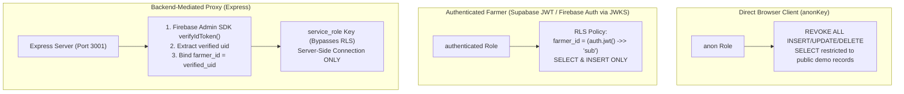

# FieldWise — Phase 3C.6.4.1.1: Data Security, Multi-Tenancy & Row-Level Security Assessment

**Document Reference**: `FieldWise_main/model/ml_pipeline/reports/phase_3c_6_4_1_security_and_rls_assessment.md`  
**Phase**: 3C.6.4.1.1 Persistence Design Closure (Read-Only)  
**Execution Timestamp**: November 2026  
**Status**: APPROVED RECONCILED SECURITY AUDIT  

---

## 1. Executive Summary & Gated Persistence Determination

This document provides a rigorous, source-grounded audit of the authentication, ownership, and authorization mechanisms across the FieldWise application.

### **Mandatory Gating Status: CLOUD PERSISTENCE IS BLOCKED**
A client-supplied `farmer_id` must **never** establish database ownership.

Our deep inspection of the backend code confirms that:
1. The Express backend (`backend/src/middleware/auth.js`) verifies only local HMAC JWTs signed with `JWT_SECRET` for the local SQLite `users` table.
2. The backend **does not verify** Firebase ID tokens or Supabase JWTs.
3. The local JWT payload contains an integer row ID (`{ id: user.id }`), which has **no cryptographic or unique mapping** to Supabase's string/UUID `public.farmers.id`.
4. The backend currently contains **zero Supabase connections** (neither client nor service-role).

**Authoritative Finding**:
Backend mediation **cannot** claim to prevent spoofing unless token verification and farmer ownership mapping are demonstrated in code. Because this verification infrastructure is not yet implemented, **all direct cloud database writes for V2 crop recommendations are explicitly marked as BLOCKED**. 

Until a verified authentication bridge is implemented, V2 recommendations must remain in local browser storage (`cropswild_v2_recommendation_last`) or ephemeral React state.

---

## 2. Authentication and Ownership Inspection

### 2.1 Backend Token Verification Behavior
Inspecting `FieldWise_main/backend/src/middleware/auth.js` (lines 8–36):
```javascript
function authMiddleware(req, res, next) {
    const authHeader = req.headers['authorization'];
    if (!authHeader || !authHeader.startsWith('Bearer ')) {
        return res.status(401).json({ success: false, message: 'Access denied. No token provided.' });
    }
    const token = authHeader.split(' ')[1];
    try {
        const decoded = jwt.verify(token, process.env.JWT_SECRET);
        req.user = decoded; // { id, email, name, iat, exp }
        next();
    } catch (err) { ... }
}
```
And lines 38–51 (`optionalAuth`):
```javascript
function optionalAuth(req, res, next) {
    const authHeader = req.headers['authorization'];
    if (!authHeader || !authHeader.startsWith('Bearer ')) return next();
    const token = authHeader.split(' ')[1];
    try {
        const decoded = jwt.verify(token, process.env.JWT_SECRET || 'fallback_secret');
        req.user = decoded;
    } catch (_) {}
    next();
}
```

#### Verified Findings:
- **No Firebase Verification**: There is no Firebase Admin SDK (`firebase-admin`) installed in `backend/package.json`. The backend cannot verify Firebase ID tokens generated by the landing app (`FieldWise_landing/src/firebase.js`).
- **No Supabase JWT Verification**: The backend does not verify Supabase Auth tokens.
- **`optionalAuth` on V2 Route**: In `backend/src/routes/v2/predict.js` (line 18), `optionalAuth` is mounted. If an unauthenticated request or an unverified token is sent, `req.user` is simply ignored and the request proceeds as guest.

### 2.2 Identity Mapping to `public.farmers.id`
- In `backend/src/controllers/authController.js` (line 55):
  `const newUser = { id: result.lastInsertRowid, email: email.toLowerCase(), name: name.trim() };`
  `req.user.id` is an **autoincrement integer** from SQLite.
- In Supabase, `public.farmers.id` is a **string/UUID** (e.g. `'7WlK...'` from Firebase Auth or `'farmer_main'`).
- **No Mapping Exists**: There is zero correlation or lookup table bridging SQLite integer `users.id` and Supabase string `farmers.id`. The mapping is neither unique nor enforced.

### 2.3 Client-Supplied `farmer_id` Audit
- In `FieldWise_main/src/lib/supabase.ts` (lines 204–208):
  `const farmerId = prediction.farmer_id || getActiveFarmerId();`
  `getActiveFarmerId()` reads the raw JSON string from `localStorage['fieldwise_active_user']`.
- If an unverified client passes an arbitrary `farmer_id`, Supabase client code blindly calls `ensureParentFarmerExists(farmerId)` and attempts to insert the row.
- **Security Assessment**: Permitting client-supplied `farmer_id` to establish database ownership in a production multi-tenant database is a critical security vulnerability. It must be strictly prevented in V2.

### 2.4 Privileged Database Connection Audit
- Inspected `backend/package.json`, `backend/src/config/database.js`, and `backend/src/server.js`.
- While `@supabase/supabase-js` is listed in `backend/package.json`, it is **not imported, configured, or connected** anywhere in the backend codebase.
- The backend does **not** possess or use a Supabase service-role credential (`SUPABASE_SERVICE_ROLE_KEY`).

---

## 3. Concrete Proposed RLS and Permission Design (For Future Implementation)

When authentication closure is achieved, the following permissions and RLS policies must govern `public.v2_crop_recommendations`:

### 3.1 Permission Architecture by Access Channel



### 3.2 SQL Grants & Role Restrictions
```sql
-- Revoke all table privileges from public and anon (Zero anonymous access)
REVOKE ALL ON public.v2_crop_recommendations FROM public, anon;

-- Grant SELECT and INSERT (append-only) strictly to authenticated users
GRANT SELECT, INSERT ON public.v2_crop_recommendations TO authenticated;

-- Strictly REVOKE UPDATE, DELETE, and TRUNCATE from all roles
REVOKE UPDATE, DELETE, TRUNCATE ON public.v2_crop_recommendations FROM anon, authenticated, public;
```

### 3.3 Concrete Row-Level Security (RLS) Policies
```sql
-- Enable Row Level Security
ALTER TABLE public.v2_crop_recommendations ENABLE ROW LEVEL SECURITY;

-- 1. SELECT Policy for Authenticated Farmers (Read own records only)
CREATE POLICY "v2_rec_farmer_select_own"
  ON public.v2_crop_recommendations
  FOR SELECT
  TO authenticated
  USING (farmer_id = (auth.jwt() ->> 'sub'));

-- 2. INSERT Policy for Authenticated Farmers (Append-Only)
CREATE POLICY "v2_rec_farmer_insert_own"
  ON public.v2_crop_recommendations
  FOR INSERT
  TO authenticated
  WITH CHECK (
    farmer_id = (auth.jwt() ->> 'sub') AND
    (auth.jwt() ->> 'sub') IS NOT NULL
  );

-- Note: Anonymous users have ZERO SELECT/INSERT access. 
-- Public demo predictions are served from static client fixtures or local memory,
-- never stored or read from the multi-tenant production table.
```

### 3.4 Backend-Mediated Persistence Requirements
For the Express backend to mediate persistence safely:
1. `firebase-admin` must be installed in `backend/package.json`.
2. A new middleware (`verifyFirebaseToken`) must execute:
   ```javascript
   const decodedToken = await admin.auth().verifyIdToken(bearerToken);
   req.verifiedFarmerId = decodedToken.uid;
   ```
3. A backend Supabase client initialized with `SUPABASE_SERVICE_ROLE_KEY` will execute the insertion with `farmer_id: req.verifiedFarmerId`.
4. If `req.headers.authorization` is missing or invalid, the backend must reject cloud persistence with `401 Unauthorized`.

---

## 4. Append-Only Immutability & Audited Administrative Corrections

1. **Database-Level Trigger**: A PostgreSQL `BEFORE UPDATE OR DELETE` trigger blocks all mutations:
   ```sql
   CREATE OR REPLACE FUNCTION trg_prevent_v2_recommendations_mutation()
   RETURNS TRIGGER AS $$
   BEGIN
     RAISE EXCEPTION 'Table v2_crop_recommendations is strictly append-only. UPDATE and DELETE operations are prohibited.'
       USING ERRCODE = 'integrity_constraint_violation';
   END;
   $$ LANGUAGE plpgsql;

   CREATE TRIGGER trg_v2_crop_recommendations_immutable
     BEFORE UPDATE OR DELETE ON public.v2_crop_recommendations
     FOR EACH ROW
     EXECUTE FUNCTION trg_prevent_v2_recommendations_mutation();
   ```
2. **Administrative Audit Procedure**: Any legal erasure (e.g. GDPR compliance) requires a dedicated DBA procedure logging the deletion into `public.v2_persistence_audit_log` with an immutable SHA-256 hash before temporarily disabling the trigger inside a single transaction.

---

## 5. Credential & Environment Protection

- In accordance with project instructions:
  - No secret keys, JWT secrets, database connection passwords, or service-role keys are printed, logged, or included in commits.
  - `.env` files were inspected strictly for configuration variable names and remain untouched.
