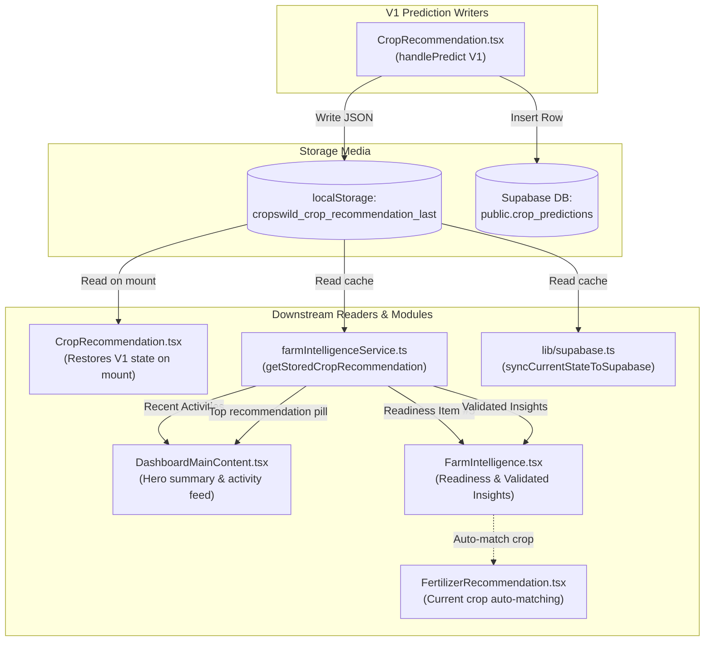

# FieldWise — Phase 3C.6.4.1: V1 Storage-Field Mapping & Downstream Consumers

**Document Reference**: `FieldWise_main/model/ml_pipeline/reports/phase_3c_6_4_1_v1_storage_mapping.md`  
**Phase**: 3C.6.4.1 Persistence and Storage Mapping (Read-Only)  
**Execution Timestamp**: November 2026  
**Status**: APPROVED RECONCILED V1 MAPPING  

---

## 1. Executive Summary

This document details the exact storage structure of legacy V1 crop predictions across Supabase and browser `localStorage`, identifies all downstream application consumers that read these records, and establishes strict invariants ensuring V1 records and their meanings remain 100% unchanged during and after V2 persistence integration.

---

## 2. V1 Storage Field Breakdown

### 2.1 Supabase Table: `public.crop_predictions`

Written by `savePredictionToSupabase()` in `FieldWise_main/src/lib/supabase.ts` (lines 201–235), every V1 submission logs a single row with the following column layout:

| Field Name | PostgreSQL Type | Nullable | Source in V1 Request / Engine | Semantic Meaning & Representation in V1 |
| :--- | :---: | :---: | :--- | :--- |
| `id` | `UUID` / `BIGINT` | No | Auto-generated PK (`DEFAULT gen_random_uuid()` or `SERIAL`) | Unique record identifier in Supabase. |
| `farmer_id` | `TEXT` | No | `prediction.farmer_id \|\| getActiveFarmerId()` | Foreign key referencing `public.farmers(id)`. |
| `recommended_crop` | `TEXT` | No | `topName \|\| 'Crop Recommendation'` | Single crop name string with highest Gaussian score (e.g. `"Rice"`, `"Wheat"`). |
| `confidence` | `TEXT` | Yes | `String(top?.confidence \|\| '95%')` | **Synthetic Gaussian Match Percentage** formatted as string with `%` sign (e.g. `"88.5%"` or default `"95%"`). |
| `nitrogen` | `NUMERIC` | Yes | `Number(inputs.nitrogen) \|\| null` | Soil available Nitrogen entered by user (`kg/ha`). |
| `phosphorus` | `NUMERIC` | Yes | `Number(inputs.phosphorus) \|\| null` | Soil available Phosphorus entered by user (`kg/ha`). |
| `potassium` | `NUMERIC` | Yes | `Number(inputs.potassium) \|\| null` | Soil available Potassium entered by user (`kg/ha`). |
| `ph` | `NUMERIC` | Yes | `Number(inputs.ph) \|\| null` | Soil reaction pH value entered by user (`2.0`–`12.0`). |
| `rainfall` | `NUMERIC` | Yes | `Number(inputs.rainfall) \|\| null` | Precipitation amount entered by user (`mm`). Conflates annual and seasonal moisture. |
| `temperature` | `NUMERIC` | Yes | `Number(inputs.temperature) \|\| null` | Mean temperature entered by user or weather context (`°C`). |
| `humidity` | `NUMERIC` | Yes | `Number(inputs.humidity) \|\| null` | Relative humidity percentage entered by user or weather context (`%`). |
| `created_at` | `TIMESTAMPTZ` | No | `new Date().toISOString()` | Timestamp when prediction record was generated. |

#### Critical V1 Omissions in Supabase
- **No `state` Column**: Although the user selects a state, `savePredictionToSupabase` does not persist state to `crop_predictions`.
- **No `sowing_month` Column**: V1 captures no temporal or planting calendar information.
- **No `irrigation_access` Column**: V1 assumes unmeasured ambient rainfall only; no irrigation accounting exists.
- **No Ranked List**: Only the single `#1` crop is stored; remaining candidate crops (ranks 2–6) are discarded.
- **No Yield or Fertilizer**: Point yield multipliers and static fertilizer recipes from `model/predictor.js` are never stored in Supabase.

---

### 2.2 Client Storage: `localStorage['cropswild_crop_recommendation_last']`

Written by `CropRecommendation.tsx` (lines 309–320), the client caches the full V1 result payload in browser local storage:

```json
{
  "predictions": [
    {
      "crop": {
        "id": "rice",
        "name": "Rice",
        "category": "Cereal",
        "season": "Kharif",
        "description": "Staple food crop requiring high moisture..."
      },
      "confidence": 88.5,
      "description": "High suitability based on soil & rainfall",
      "marketPrice": 2200,
      "season": "Kharif"
    },
    {
      "crop": { "id": "maize", "name": "Maize", "category": "Cereal" },
      "confidence": 76.2,
      "description": "Moderate suitability",
      "marketPrice": 1850,
      "season": "Kharif"
    }
  ],
  "inputs": {
    "rainfall": 1200,
    "temperature": 28,
    "humidity": 75,
    "soilType": "Clay",
    "nitrogen": 80,
    "phosphorus": 45,
    "potassium": 40,
    "ph": 6.5,
    "state": "Punjab"
  },
  "topCrop": "Rice",
  "cropName": "Rice",
  "confidence": 88.5,
  "suitabilityScore": 88.5,
  "analyzedAt": "2026-11-21T10:15:30.000Z"
}
```

Notice the semantic duplication in V1 client storage:
- `confidence`: Numeric Gaussian confidence (`88.5`).
- `suitabilityScore`: Explicitly set to `top?.confidence` (duplicating `confidence`).

---

## 3. Downstream Consumers of Stored V1 Records



### 3.1 Consumer Inventory & Dependencies

| Consumer File | Exact Lines | Consumed Fields | Purpose & Impact if Altered |
| :--- | :---: | :--- | :--- |
| `CropRecommendation.tsx` | L97–115 | `raw.predictions`, `raw.inputs` | Restores previous V1 form inputs and result cards on initial mount if V1 mode is chosen. |
| `farmIntelligenceService.ts` | L104–157 | `topCrop`, `cropName`, `predictions[0].crop`, `confidence`, `suitabilityScore`, `analyzedAt` | Resolves crop name and match % for cross-module intelligence. If structure changes, `resolveCropName()` falls back to `"Recommended Crop"`. |
| `farmIntelligenceService.ts` | L319–343 | `cropRec.predictions`, `cropRec.confidence` | Generates Data Readiness item #5: `"Crop Recommendation"` (`"Available"` vs `"No Recent Analysis"`). Displays: `Top recommendation: Rice (88.5%)`. |
| `DashboardMainContent.tsx` | L62–64, 302–312 | `cropRec.topCrop`, `cropRec.confidence`, `cropRec.suitabilityScore` | Renders the primary dashboard banner: `{topCrop} ({confidence}% match)`. |
| `FarmIntelligence.tsx` | L90–92, 680–715 | `cropRec.topCrop`, `cropRec.confidence`, `cropRec.predictions[0].description`, `cropRec.analyzedAt` | Renders Crop Recommendation Intelligence Card, match badge, agronomic description, and localized date string. |
| `supabase.ts` | L272–294 | `cached.topCrop`, `cached.inputs`, `cached.confidence` | Background synchronization helper (`syncCurrentStateToSupabase`) reads `cropswild_crop_recommendation_last` and writes to Supabase `crop_predictions`. |

---

## 4. Invariance & Preservation Mandates

To prevent breaking existing V1 features, the following invariants are strictly enforced:

1. **Zero V1 Overwriting**: Existing rows in Supabase `public.crop_predictions` must never be updated, overwritten, or deleted by V2 execution.
2. **Key Isolation in Client Storage**: V2 persistence must NOT overwrite `cropswild_crop_recommendation_last`. V2 will utilize a dedicated, isolated storage key (`cropswild_v2_recommendation_last`).
3. **No Semantic Inversion**: The V1 `confidence` field represents a Gaussian heuristic probability match (`35%`–`100%`). It must never be populated with a Liebig-calibrated V2 agronomic suitability score (`0`–`100`).
4. **Preserve V1 Fallback Engine**: The in-browser Gaussian predictor (`src/lib/predictorEngine.ts`) and Express controller (`backend/src/controllers/predictController.js`) remain completely untouched.
