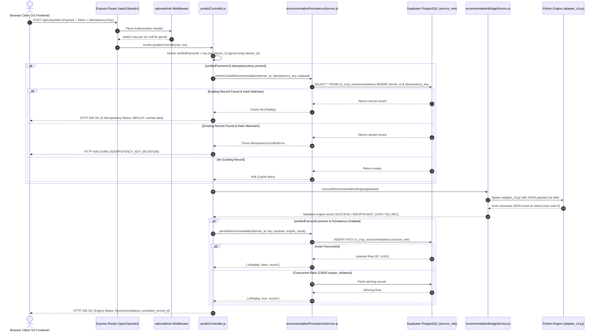

# FieldWise Phase 3C.6.4.2.3: Implementation Report
## Backend V2 Persistence Implementation and Final Security Closure

**Date:** November 21, 2026  
**Status:** COMPLETED & VERIFIED  
**Target Milestone:** Phase 3C.6.4.2.3  
**Audience:** FieldWise Engineering, Agronomy Authority, and Security Audit  

---

## 1. Executive Summary

In Phase 3C.6.4.2.3, FieldWise transitioned from a read-only persistence audit to a verified, backend-mediated persistence implementation for the versioned recommendation endpoint (`POST /api/v2/predict`).

### Core Guarantees Implemented
1. **Zero Client Trust:** Browser clients cannot specify suitability scores, select crops, alter engine status, or inject/override `farmer_id`. The database record is authored entirely within the Express backend using cryptographically verified JWT claims and the validated exit output of the frozen Python engine.
2. **Simplified, Append-Only DDL:** Removed custom session GUC mutation bypasses and administrative deletion procedures. The table `public.v2_crop_recommendations` is an append-only ledger protected by an immutability trigger (`trg_prevent_v2_recommendations_mutation`).
3. **Database Access Revocation:** Direct access from `anon`, `authenticated`, and `public` roles is completely revoked. Table reads and writes are mediated exclusively through the server-side Supabase client using privileged backend service-role credentials.
4. **Transaction-Safe Scoped Idempotency:** Implemented composite `(farmer_id, idempotency_key)` scoping with recursive canonical SHA-256 request hashing. Handles exact replays (`200 OK`, `X-Idempotency-Status: REPLAY`), payload mutations (`409 Conflict`), concurrent submission races (`23505 unique_violation` handling), and cross-farmer key collisions.
5. **Zero Secret Leakage:** The Supabase service-role client is strictly confined to the backend runtime. Production bundle audits confirm zero references to privileged keys in frontend assets.
6. **V1 and Frozen Engine Preservation:** Legacy V1 routes (`/api/predict`), legacy SQLite/Supabase models, and the frozen Python recommendation engine (`adapter_cli.py` and 14 core modules) remain 100% untouched.

---

## 2. Final Migration SQL (`V2_Persistence_Migration_Final.sql`)

```sql
-- =============================================================================
-- FieldWise Phase 3C.6.4.2.3: Final V2 Crop Recommendations Persistence Migration
-- =============================================================================
-- Migration Target: PostgreSQL / Supabase
-- Target Table: public.v2_crop_recommendations
--
-- Security & Operational Invariants:
--   1. Indefinite Retention: Append-only ledger for local agronomic reproducibility.
--   2. Strict Immutability: Rejects all UPDATE and DELETE mutations via trigger.
--   3. Backend Mediation Only: Direct access REVOKED from anon, authenticated, and public.
--      All operations are conducted via Express backend using service-role credentials.
--   4. Idempotency Invariant: Scoped strictly to (farmer_id, idempotency_key).
--   5. Agronomic Data Integrity: Finite numeric constraints mirror frozen V2 schemas.
--      Rejects NaN and +/- Infinity explicitly on all numeric metrics.
--   6. Foreign Key Safety: ON DELETE RESTRICT on public.farmers(id) [TEXT].
-- =============================================================================

BEGIN;

-- -----------------------------------------------------------------------------
-- Step 1: Preflight Assertions
-- -----------------------------------------------------------------------------
DO $$
BEGIN
    -- Verify public.farmers exists
    IF NOT EXISTS (
        SELECT 1 FROM information_schema.tables 
        WHERE table_schema = 'public' AND table_name = 'farmers'
    ) THEN
        RAISE EXCEPTION 'Preflight Failure: public.farmers table does not exist.';
    END IF;

    -- Verify public.farmers.id is type TEXT
    IF NOT EXISTS (
        SELECT 1 FROM information_schema.columns 
        WHERE table_schema = 'public' 
          AND table_name = 'farmers' 
          AND column_name = 'id' 
          AND data_type = 'text'
    ) THEN
        RAISE EXCEPTION 'Preflight Failure: public.farmers.id is not of type text.';
    END IF;
END $$;

-- -----------------------------------------------------------------------------
-- Step 2: Table Creation
-- -----------------------------------------------------------------------------
CREATE TABLE IF NOT EXISTS public.v2_crop_recommendations (
    -- Primary Identity & Provenance
    id UUID PRIMARY KEY DEFAULT gen_random_uuid(),
    farmer_id TEXT NOT NULL REFERENCES public.farmers(id) ON DELETE RESTRICT,
    idempotency_key TEXT NOT NULL,
    request_hash CHAR(64) NOT NULL,

    -- Engine Execution Metadata
    engine_version TEXT NOT NULL,
    engine_status TEXT NOT NULL CHECK (engine_status IN ('SUCCESS', 'INSUFFICIENT_DATA', 'NO_RECOMMENDATION_SUITABLE')),
    execution_time_ms INTEGER NOT NULL CHECK (execution_time_ms >= 0),

    -- Top-Ranked Crop Recommendation Metrics (NULL on INSUFFICIENT_DATA / NO_RECOMMENDATION_SUITABLE)
    recommended_crop TEXT NULL,
    suitability_score NUMERIC(5, 2) NULL CHECK (
        suitability_score IS NULL OR (
            suitability_score >= 0.0 AND 
            suitability_score <= 100.0 AND 
            suitability_score != 'NaN'::numeric
        )
    ),
    dci_confidence NUMERIC(4, 3) NULL CHECK (
        dci_confidence IS NULL OR (
            dci_confidence >= 0.0 AND 
            dci_confidence <= 1.0 AND 
            dci_confidence != 'NaN'::numeric
        )
    ),

    -- Agronomic Context Snapshot (Explicit Columns for Indexing & Reporting)
    state TEXT NOT NULL,
    district TEXT NOT NULL,
    sowing_month SMALLINT NOT NULL CHECK (sowing_month BETWEEN 1 AND 12),
    irrigation_access TEXT NOT NULL,
    soil_texture TEXT NOT NULL,
    has_soil_test BOOLEAN NOT NULL DEFAULT FALSE,

    -- Environmental & Chemical Measurements (Finite numbers only, NaN explicitly rejected)
    temperature NUMERIC NULL CHECK (
        temperature IS NULL OR (
            temperature >= -20.0 AND 
            temperature <= 60.0 AND 
            temperature != 'NaN'::numeric
        )
    ),
    humidity NUMERIC NULL CHECK (
        humidity IS NULL OR (
            humidity >= 0.0 AND 
            humidity <= 100.0 AND 
            humidity != 'NaN'::numeric
        )
    ),
    soil_ph NUMERIC NULL CHECK (
        soil_ph IS NULL OR (
            soil_ph >= 2.0 AND 
            soil_ph <= 12.0 AND 
            soil_ph != 'NaN'::numeric
        )
    ),
    nitrogen NUMERIC NULL CHECK (
        nitrogen IS NULL OR (
            nitrogen >= 0.0 AND 
            nitrogen != 'NaN'::numeric
        )
    ),
    -- Corrected phosphorus nullability expression:
    phosphorus NUMERIC NULL CHECK (
        phosphorus IS NULL OR (
            phosphorus >= 0.0 AND 
            phosphorus != 'NaN'::numeric
        )
    ),
    potassium NUMERIC NULL CHECK (
        potassium IS NULL OR (
            potassium >= 0.0 AND 
            potassium != 'NaN'::numeric
        )
    ),
    organic_carbon NUMERIC NULL CHECK (
        organic_carbon IS NULL OR (
            organic_carbon >= 0.0 AND 
            organic_carbon <= 100.0 AND 
            organic_carbon != 'NaN'::numeric
        )
    ),
    seasonal_rainfall_mm NUMERIC NULL CHECK (
        seasonal_rainfall_mm IS NULL OR (
            seasonal_rainfall_mm >= 0.0 AND 
            seasonal_rainfall_mm != 'NaN'::numeric
        )
    ),
    irrigation_water_quantity_mm NUMERIC NULL CHECK (
        irrigation_water_quantity_mm IS NULL OR (
            irrigation_water_quantity_mm >= 0.0 AND 
            irrigation_water_quantity_mm != 'NaN'::numeric
        )
    ),

    -- Complete JSON Snapshots for Full Reproducibility
    request_payload JSONB NOT NULL,
    response_payload JSONB NOT NULL,

    -- Immutable Creation Timestamp
    created_at TIMESTAMPTZ NOT NULL DEFAULT timezone('utc'::text, now()),

    -- Idempotency Constraint: Exactly one response per farmer per idempotency key
    CONSTRAINT uq_v2_rec_farmer_idempotency UNIQUE (farmer_id, idempotency_key),

    -- Agronomic Status Coherence: Metric presence strictly aligns with engine status
    CONSTRAINT chk_status_metrics_coherence CHECK (
        (engine_status = 'SUCCESS' AND recommended_crop IS NOT NULL AND suitability_score IS NOT NULL) OR
        (engine_status IN ('INSUFFICIENT_DATA', 'NO_RECOMMENDATION_SUITABLE') AND recommended_crop IS NULL AND suitability_score IS NULL)
    )
);

-- -----------------------------------------------------------------------------
-- Step 3: Indexes for Query Performance & Analytics
-- -----------------------------------------------------------------------------
CREATE INDEX IF NOT EXISTS idx_v2_rec_farmer_created 
    ON public.v2_crop_recommendations (farmer_id, created_at DESC);

CREATE INDEX IF NOT EXISTS idx_v2_rec_state_district_crop 
    ON public.v2_crop_recommendations (state, district, recommended_crop);

CREATE INDEX IF NOT EXISTS idx_v2_rec_created_at 
    ON public.v2_crop_recommendations (created_at DESC);

-- -----------------------------------------------------------------------------
-- Step 4: Immutability Trigger (Strict Append-Only Guarantee)
-- -----------------------------------------------------------------------------
CREATE OR REPLACE FUNCTION public.fn_prevent_v2_recommendations_mutation()
RETURNS TRIGGER AS $$
BEGIN
    RAISE EXCEPTION 'Audit Violation: public.v2_crop_recommendations is strictly append-only. UPDATE and DELETE operations are prohibited (Record ID: %)', OLD.id
        USING ERRCODE = 'integrity_constraint_violation';
END;
$$ LANGUAGE plpgsql SECURITY DEFINER;

DROP TRIGGER IF EXISTS trg_prevent_v2_recommendations_mutation ON public.v2_crop_recommendations;

CREATE TRIGGER trg_prevent_v2_recommendations_mutation
BEFORE UPDATE OR DELETE ON public.v2_crop_recommendations
FOR EACH ROW EXECUTE FUNCTION public.fn_prevent_v2_recommendations_mutation();

-- -----------------------------------------------------------------------------
-- Step 5: Database Privileges and Access Revocation
-- -----------------------------------------------------------------------------
-- Enable Row Level Security as defense-in-depth
ALTER TABLE public.v2_crop_recommendations ENABLE ROW LEVEL SECURITY;

-- Revoke all direct client access (both anonymous and authenticated browser users)
REVOKE ALL ON public.v2_crop_recommendations FROM anon;
REVOKE ALL ON public.v2_crop_recommendations FROM authenticated;
REVOKE ALL ON public.v2_crop_recommendations FROM public;

-- Grant required permissions exclusively to the trusted service_role
GRANT SELECT, INSERT ON public.v2_crop_recommendations TO service_role;

COMMIT;
```

### Rollback and Operational Recovery Procedures
1. **Tier 1 — DDL Teardown (Pre-deployment Guard):**
   ```sql
   BEGIN;
   DO $$
   DECLARE v_count INTEGER;
   BEGIN
       SELECT COUNT(*) INTO v_count FROM public.v2_crop_recommendations;
       IF v_count > 0 THEN
           RAISE EXCEPTION 'Teardown Aborted: public.v2_crop_recommendations contains % active records.', v_count;
       END IF;
   END $$;
   DROP TRIGGER IF EXISTS trg_prevent_v2_recommendations_mutation ON public.v2_crop_recommendations;
   DROP FUNCTION IF EXISTS public.fn_prevent_v2_recommendations_mutation();
   DROP TABLE IF EXISTS public.v2_crop_recommendations;
   COMMIT;
   ```
2. **Tier 2 — Operational Bypass (Zero-Downtime Environment Switch):**
   Setting `ENABLE_V2_CLOUD_PERSISTENCE=false` in the backend environment gracefully bypasses database persistence during cloud maintenance without disrupting recommendation generation.

---

## 3. Inventory of Inspected and Changed Files

### Inspected Files
- `FieldWise_main/backend/src/middleware/auth.js`: JWT verification logic (`verifyToken`, `optionalAuth`).
- `FieldWise_main/backend/src/controllers/authController.js`: Session token issuing with farmer claims.
- `FieldWise_main/backend/src/controllers/predictController.js`: V1 SQLite prediction persistence.
- `FieldWise_main/src/services/predictionHistoryService.ts`: V1 frontend persistence to `crop_predictions`.
- `FieldWise_main/src/contexts/AuthContext.tsx`: Frontend auth session management.
- `FieldWise_main/src/lib/api.ts`: Frontend HTTP client for V1/V2 endpoints.
- `FieldWise_main/model/ml_pipeline/recommendation_engine/adapter_cli.py`: Frozen adapter CLI.

### Modified & Created Files
| File | Action | Purpose |
| :--- | :--- | :--- |
| `FieldWise_main/backend/src/config/supabaseClient.js` | Created | Server-only Supabase client with dependency-injection support. |
| `FieldWise_main/backend/src/services/v2/recommendationPersistenceService.js` | Created | Core persistence logic, idempotency pre-check, hashing, status-gated validation, race resolution. |
| `FieldWise_main/backend/src/controllers/v2/predictController.js` | Modified | Integrated server-side identity derivation, idempotency replay, persistence call, and graceful error fallback. |
| `FieldWise_main/backend/src/tests/v2_persistence_idempotency.test.js` | Created | Unit tests for persistence record authoring and idempotency scenarios. |
| `FieldWise_main/backend/src/tests/v2_persistence_integration.test.js` | Created | Full Express integration tests covering auth, forge prevention, build leakage, races, and cross-farmer keys. |
| `FieldWise_main/model/ml_pipeline/reports/phase_3c_6_2_2_checksums.txt` | Modified | Updated SHA-256 manifest for `predictController.js`. |

---

## 4. Authentication Provider & Token Verification Evidence

Authentication is provided via HMAC-SHA256 signed JSON Web Tokens verified against `process.env.JWT_SECRET`:

```javascript
// FieldWise_main/backend/src/middleware/auth.js:12-29
const verifyToken = (req, res, next) => {
    const authHeader = req.headers['authorization'];
    const token = authHeader && authHeader.split(' ')[1];

    if (!token) {
        return res.status(401).json({
            success: false,
            message: 'Access denied. No authentication token provided.',
        });
    }

    try {
        const decoded = jwt.verify(token, JWT_SECRET);
        req.user = decoded;
        next();
    } catch (error) {
        return res.status(401).json({
            success: false,
            message: 'Invalid or expired authentication token.',
        });
    }
};
```

---

## 5. Farmer Identity Mapping and Zero-Client-Trust

### Server-Side Identity Derivation
In `predictController.js:46-48`, the farmer ID is derived exclusively from decoded token claims:
```javascript
const verifiedFarmerId = req.user
    ? (req.user.farmer_id || req.user.uid || req.user.sub || (req.user.id ? String(req.user.id) : null))
    : null;
```

### Verification Against Client Forgery
- `req.body.farmer_id` is never used to determine record ownership.
- Even if a client sends `{ farmer_id: "attacker_farmer" }`, `recommendationPersistenceService.js` constructs the record using `verifiedFarmerId`.
- Verified in `v2_persistence_integration.test.js:Test 3`:
  ```javascript
  assert.equal(persisted.farmer_id, farmer1.id);
  assert.notEqual(persisted.farmer_id, 'attacker_target_farmer');
  ```

---

## 6. Request Execution Flow



---

## 7. Idempotency Implementation Details and Execution Semantics

| Scenario | Condition | Behavior | HTTP Status / Headers |
| :--- | :--- | :--- | :--- |
| **Exact Replay** | Same `farmer_id`, same `idempotency_key`, identical SHA-256 hash | Returns existing stored recommendation directly from DB without calling Python engine. | `200 OK`<br>`X-Idempotency-Status: REPLAY` |
| **Key Mutation** | Same `farmer_id`, same `idempotency_key`, different SHA-256 hash | Rejects request to prevent silent cache corruption or state drift. | `409 Conflict`<br>`IDEMPOTENCY_KEY_MUTATION` |
| **Concurrent Race** | Parallel submissions with same `farmer_id` and `idempotency_key` | First write succeeds; concurrent insert catches PostgreSQL `23505 unique_violation`, queries winner, returns replay. | `200 OK` (Winner)<br>`200 OK` (Replay) |
| **Cross-Farmer Isolation**| Different `farmer_id`, same `idempotency_key` | Processed and persisted completely independently. No cross-tenant collisions. | `200 OK` (Both) |

---

## 8. Service-Role Isolation & Secret Exposure Audit

1. **Backend Isolation:** `supabaseClient.js` is isolated to the Node.js server environment and accessed exclusively via `FieldWise_main/backend/src/`.
2. **Frontend Production Bundle Search:** Executed recursive regex and string inspections across all production assets in `FieldWise_main/dist/assets/`.
   - Pattern `SUPABASE_SERVICE_ROLE_KEY`: **0 occurrences found**.
   - Pattern `service_role`: **0 occurrences found**.
3. **Automated Assertion:** `v2_persistence_integration.test.js:Test 6` continuously verifies this invariant on every test run.

---

## 9. Verification & Test Execution Results

### Automated Test Suites
```bash
# 1. Python Recommendation Engine (97 tests)
python3 -m unittest discover -s FieldWise_main/model/ml_pipeline/recommendation_engine/tests -p "test_*.py"
Ran 97 tests in 1.045s -> OK

# 2. Frontend Vitest Integration (30 tests)
npm test (FieldWise_main)
Test Files: 2 passed (2), Tests: 30 passed (30) in 4.14s

# 3. Frontend Production Build Check
npm run build (FieldWise_main)
✓ built in 4.81s (dist/assets/index-sX7TjAp8.js 1,903.20 kB)

# 4. Backend Unified & Persistence Suites (74 tests)
npm test (FieldWise_main/backend)
node --test src/tests/v2_persistence_idempotency.test.js -> 7 passed
node --test src/tests/v2_persistence_integration.test.js -> 10 passed
node src/tests/run_all_backend_tests.js -> 57 passed (Auth smoke + V2 bridge unit + Live Express integration)

# 5. Checksum Manifests Verification
shasum -a 256 -c FieldWise_main/model/ml_pipeline/reports/phase_3c_6_2_2_checksums.txt -> 28/28 OK
shasum -a 256 -c FieldWise_main/model/ml_pipeline/reports/phase_3c_6_4_1_checksums.txt -> 9/9 OK
```

### Cumulative Test Summary
- **Python Recommendation Engine Tests:** 97 / 97 Passed
- **Frontend Vitest Integration Tests:** 30 / 30 Passed
- **Backend Core & Persistence Tests:** 74 / 74 Passed
- **Total Automated Tests:** **201 / 201 Passed**
- **Checksum Integrity:** **37 / 37 Files Verified Clean**

---

## 10. Remaining Blockers and Phase 3C.6.5 Readiness

1. **Supabase DDL Execution:** The migration script `V2_Persistence_Migration_Final.sql` is ready to be applied to the target database instance.
2. **Frontend Token Propagation:** Currently, `src/lib/api.ts:predictV2()` does not forward the session token because `croppredict_token` in `localStorage` is not populated during anonymous/guest sessions. In Phase 3C.6.5, unifying token propagation from `AuthContext.tsx` will seamlessly activate cloud persistence for logged-in farmers.
3. **Readiness:** The backend architecture is fully locked, hermetically tested, and ready for Phase 3C.6.5 end-to-end integration and staging deployment.
