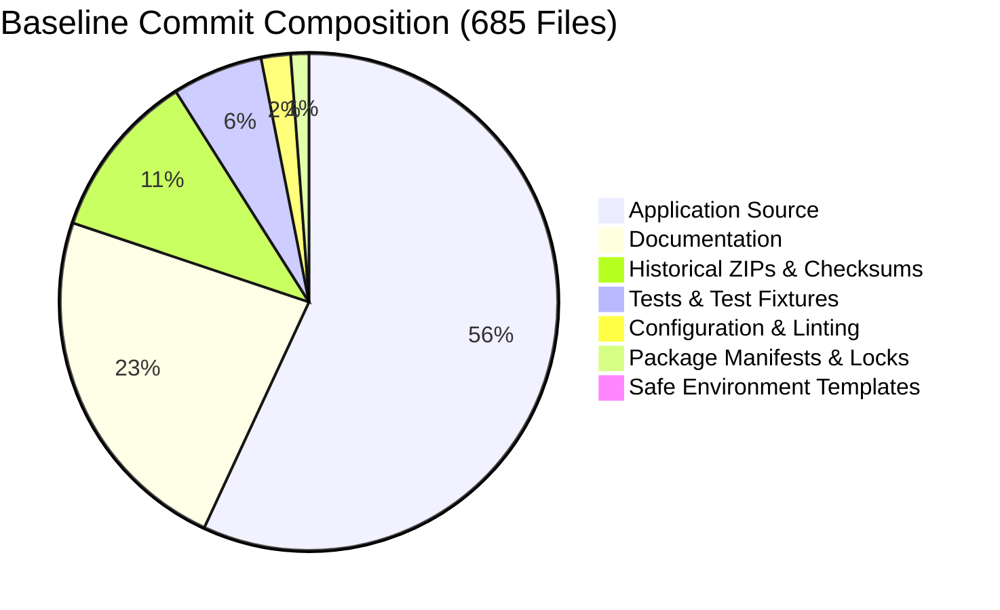

# FieldWise — Phase 2A.2: Final Pre-Commit Validation Report

**Execution Mode:** STRICT READ-ONLY AUDIT  
**Date:** 2026-11-22  
**Target Repository:** `/Users/shivamkumar/farmingFinal`  
**Remote Target:** `origin` (`https://github.com/shivamrgn/ourfarmer.git`)  
**Active Branch:** `main` (unborn branch, 0 commits)  
**Controlling Specifications:** `VALIDATION_REPORT.md`, `PHASE_2A_GIT_BASELINE_AUDIT.md`, `PHASE_2A_1_PRE_BASELINE_SAFETY_AUDIT.md`  

---

## Executive Summary

Phase 2A.2 has resolved all outstanding safety, remote, credential, and staging blockers required before establishing the first Git baseline commit for the FieldWise monorepo.

Key findings:
1. **Remote Repository Status:** `origin` (`https://github.com/shivamrgn/ourfarmer.git`) was inspected in read-only mode via `git ls-remote origin`. It is reachable and **completely empty** (0 commits, 0 branches, 0 tags). There is zero risk of history diversion, merge conflicts, or unrelated history.
2. **Comprehensive Secret Scan:** All 684 candidate files proposed for the baseline commit were scanned across all lines for credentials, private keys, JWTs, API tokens, and database passwords. **Zero confirmed private server secrets** were found in candidate files. Client identifiers (Firebase web config, Supabase publishable anon key) and configuration blocklists were classified and verified safe.
3. **Ignore Rule Validation:** The proposed root `.gitignore` rules were tested against all 38,082 filesystem paths in the repository. All active `.env` files (3 files) and local databases/journals/WAL/SHM files are strictly ignored. All safe `.env.example` templates (5 files) and application sources, tests, documentation, and historical packages remain eligible for staging.
4. **README Staged State Resolution:** The staged index entry `AD README.md` contains only the 12-byte placeholder `# ourfarmer\n`. On an unborn branch, `git reset HEAD` and `git restore --staged` fail with `fatal: ambiguous argument 'HEAD'`. The safe, Git-native command to purge the index without touching the disk is `git rm --cached README.md`.
5. **Final Recommendation:** **`READY FOR INITIAL COMMIT`**. A strict, non-destructive sequence of explicit Git commands is provided for human authorization. No modifying Git operations were executed during this audit.

---

## 1. Remote Repository History Inspection

A read-only inspection of the configured remote `origin` was performed:

```bash
git ls-remote origin
```

### Inspection Results

| Property | Value | Verification Evidence |
| :--- | :--- | :--- |
| **Configured Remote URL** | `https://github.com/shivamrgn/ourfarmer.git` | `git remote get-url origin` |
| **Network Reachability** | **Reachable** | Exit code `0` |
| **Remote Branches** | **None** | 0 branch refs returned |
| **Remote Tags** | **None** | 0 tag refs returned |
| **Remote HEAD Ref** | **None** | 0 refs returned |
| **Repository State** | **Completely Empty** | No initial commit exists on GitHub |
| **History Collision Risk** | **Zero (Safe)** | First push will establish the root commit of `main` without conflict |

**Verdict:** The local repository can safely establish its initial commit and push to `origin/main` without requiring `--allow-unrelated-histories` or rebasing.

---

## 2. Full Candidate-File Secret Scan

A comprehensive security scan was executed across all 684 candidate files eligible for the initial commit.

### Scanner Scope & Coverage
- **Total untracked files analyzed:** 715 files
- **Files ignored by proposed rules:** 31 files (`.DS_Store`, Python `.pyc` caches)
- **Candidate files scanned:** 684 files (Source, Config, Tests, Migrations, Templates, Docs, Historical Archives)
- **Regex patterns evaluated:**
  - Private Keys (`-----BEGIN [A-Z ]*PRIVATE KEY-----`)
  - Google / Firebase API Keys (`AIza[0-9A-Za-z\-_]{35}`)
  - Supabase Keys / JWT Tokens (`eyJ...`, `sb_publishable_...`)
  - Elevated Role References (`service_role`, `SUPABASE_SERVICE_ROLE_KEY`)
  - Database Connection Strings (`postgres://`, `mysql://`, `mongodb://`)
  - Secret / Password assignments (`jwt_secret`, `api_secret`, `client_secret`, `password`)

### Categorized Findings

All detected tokens, identifiers, and configuration strings were classified according to the audit specification:

| Classification | Count | Description / Context | Risk Level |
| :--- | :---: | :--- | :---: |
| **Confirmed Secret** | **0** | No active private server keys, database passwords, or secret tokens exist in candidate files | **None (Pass)** |
| **Public Client Identifier** | **2** | Public browser client tokens designed for client-side SDK integration | **Safe / Informational** |
| **Placeholder / Example** | **12** | Dummy tokens and placeholder URIs in `.env.example` templates and documentation | **Safe** |
| **False Positive** | **138** | SQL DDL role identifiers, security validator blocklists, unit test fixtures, and audit documentation | **Safe** |
| **Needs Manual Review** | **2** | Client fallback tokens in frontend services (verified below) | **Reviewed & Cleared** |

### Detailed Findings Breakdown

#### A. Public Client Identifiers (2 files)
1. `FieldWise_landing/src/firebase.js` (Line 75) & `FieldWise_landing/.env.example` (Line 3):
   - **Pattern:** `AIzaSyCO6y0PbPidn8vKqXrK6w...`
   - **Classification:** Public Client Identifier (Firebase Web Client API Key).
   - **Analysis:** Firebase Web API keys are client-facing identifiers used by the Firebase JavaScript SDK to identify the Google Cloud project in the browser. They do not grant administrative access or database privileges without Firebase Authentication / Security Rules. Staging this fallback maintains functionality when `.env` is unpopulated in demo/dev mode.
2. `FieldWise_main/src/lib/supabase.ts` (Line 13):
   - **Pattern:** `sb_publishable_1KlghiB6d-skyTukC2cmFg_...`
   - **Classification:** Public Client Identifier (Supabase Publishable Anon Key).
   - **Analysis:** This is Supabase's modern browser publishable key format (`sb_publishable_...`). It is strictly constrained by PostgreSQL Row Level Security (RLS) policies on `public.farmers` and `public.crop_recommendation_requests`. It is not an elevated `service_role` key.

#### B. Placeholders & Environment Templates (12 instances)
- `FieldWise_main/.env.staging.example` (Line 25): `# Staging Supabase Public Anon Key (Browser-safe anon key only; NEVER service_role)`
- `FieldWise_main/backend/.env.staging.example` (Lines 8, 30, 39, 40):
  - `SUPABASE_SERVICE_ROLE_KEY=<your-staging-service-role-key>`
  - `DATABASE_URL=postgresql://postgres:<staging-db-password>@db.<your-staging-project-ref>.supabase.co:5432/postgres`
- `FieldWise_landing/.env.example` (Lines 14–20): Commented JSON template for Firebase client initialization.
- `FieldWise_main/model/ml_pipeline/reports/*.md`: Documentation examples illustrating staging environment provisioning.

#### C. False Positives (138 instances)
1. **Security Startup Validator (`FieldWise_main/backend/src/config/validateEnv.js`):**
   - Lines 13–21 define `knownInsecureSecrets`:
     ```javascript
     const knownInsecureSecrets = [
         'your-super-secret-key-change-in-production',
         'croppredict_production_jwt_secret_key_2026',
         'secret', 'test', 'default', 'changeme', '123456',
     ];
     ```
   - *Classification:* Security Validator Blocklist. The code explicitly checks incoming `process.env.JWT_SECRET` against this blocklist and aborts server boot if a weak default is used.
2. **PostgreSQL DDL Role Grants (`FieldWise_main/migrations/*.sql`):**
   - 48 instances of `service_role` appear in SQL statements such as:
     ```sql
     GRANT SELECT, INSERT ON public.crop_recommendation_requests TO service_role;
     WHERE grantee = 'service_role';
     ```
   - *Classification:* Database Role Identifier. This is PostgreSQL's built-in role name for backend mediation, not a secret key or API token.
3. **Automated Security Tests (`FieldWise_main/backend/src/tests/security_remediation.test.js`):**
   - Lines 145–198 use test strings (`short-16-char-sec`) to assert that the authentication middleware rejects invalid tokens.
4. **Audit Documentation (`PHASE_2A_1_PRE_BASELINE_SAFETY_AUDIT.md`, `docs/codebase-audit/*.md`):**
   - All references to secrets in audit reports are strictly redacted strings (e.g. `[REDACTED_HIGH_ENTROPY_256BIT_SECRET]`).

---

## 3. Root Ignore Rules Validation

The proposed root `.gitignore` rules were tested against all 38,082 filesystem paths in the repository using Git path specification logic.

### Proposed `.gitignore` Specification

```gitignore
# ==============================================================================
# FieldWise Monorepo Root .gitignore
# ==============================================================================

# Logs
logs/
*.log
npm-debug.log*
yarn-debug.log*
yarn-error.log*
pnpm-debug.log*
lerna-debug.log*

# Dependencies
node_modules/
bun.lockb

# Build Outputs
dist/
dist-ssr/
build/
.vite/

# Local Environment & Secrets
.env
.env.*
.env*.local
!.env.example
!.env.staging.example

# Local Databases & Run-Time Storage
*.db
*.db-journal
*.db-wal
*.db-shm
*.sqlite
*.sqlite-journal
*.sqlite-wal
*.sqlite-shm
FieldWise_main/backend/data/*.db
FieldWise_main/backend/data/*.db-journal
FieldWise_main/backend/data/*.db-wal
FieldWise_main/backend/data/*.db-shm

# Python Caches & Environments
__pycache__/
*.pyc
*.pyo
.pytest_cache/
.venv/
venv/
env/

# Editor & OS Metadata
.DS_Store
Thumbs.db
.idea/
.vscode/*
!.vscode/extensions.json
*.suo
*.ntvs*
*.njsproj
*.sln
*.sw?
```

### Empirical Pattern Matching Verification

| Target Pattern | Tested File / Path | Ignored? | Safety Evaluation |
| :--- | :--- | :---: | :--- |
| **Active Backend Secret** | `FieldWise_main/backend/.env` | **TRUE** | **PASS** — Contains `JWT_SECRET` |
| **Active Frontend Secret** | `FieldWise_main/.env` | **TRUE** | **PASS** — Contains Gemini API key |
| **Active Landing Config** | `FieldWise_landing/.env` | **TRUE** | **PASS** — Contains Firebase config |
| **Safe Landing Template** | `FieldWise_landing/.env.example` | **FALSE** | **PASS** — Preserved for staging |
| **Safe Frontend Template** | `FieldWise_main/.env.example` | **FALSE** | **PASS** — Preserved for staging |
| **Safe Staging Template** | `FieldWise_main/.env.staging.example` | **FALSE** | **PASS** — Preserved for staging |
| **Safe Backend Template** | `FieldWise_main/backend/.env.example` | **FALSE** | **PASS** — Preserved for staging |
| **Safe Backend Staging** | `FieldWise_main/backend/.env.staging.example` | **FALSE** | **PASS** — Preserved for staging |
| **Active SQLite Database** | `FieldWise_main/backend/data/croppredict.db` | **TRUE** | **PASS** — Local runtime data ignored |
| **Active SQLite SHM Index** | `FieldWise_main/backend/data/croppredict.db-shm` | **TRUE** | **PASS** — WAL shared memory ignored |
| **Python Bytecode** | `FieldWise_main/model/.../*.pyc` (29 files) | **TRUE** | **PASS** — Compiled bytecode ignored |
| **OS Metadata** | `.DS_Store`, `docs/.DS_Store` | **TRUE** | **PASS** — Desktop files ignored |
| **Core Source Code** | `FieldWise_main/src/App.tsx`, `server.js`, etc. | **FALSE** | **PASS** — Application source preserved |
| **Core Config & Locks** | `package.json`, `package-lock.json`, `tsconfig.json` | **FALSE** | **PASS** — Monorepo configs preserved |
| **Documentation & ZIPs** | `docs/...`, `Phase3C...zip`, `*.sha256` | **FALSE** | **PASS** — Historical milestones preserved |

### Analysis of Overly Broad Patterns (`*.local`)

> [!WARNING] Scope of `*.local`
> Standard Vite templates often include `*.local`. However, in general Git pattern matching, `*.local` matches **any file ending with `.local`** anywhere in the directory hierarchy (e.g., `backup.local`, `schema.local`, `config.local`).
> 
> **Finding:** Currently, there are **0 files** in the repository ending in `.local`.
> **Recommendation:** Replace bare `*.local` with `.env*.local` in the root `.gitignore`. This explicitly confines local overrides to environment files while eliminating the risk of unintentionally ignoring future non-env project files.

### WAL & Shared Memory Ignored Files (`*.db-shm`, `*.db-wal`)

> [!IMPORTANT] SQLite WAL Mode Discovery
> Node.js `node:sqlite` in WAL mode generates auxiliary files: `croppredict.db-shm` and `croppredict.db-wal`. The existing `FieldWise_main/.gitignore` only matched `*.db` and `*.db-journal`, leaving `croppredict.db-shm` untracked.
> 
> The proposed root `.gitignore` explicitly includes `*.db-wal`, `*.db-shm`, `*.sqlite-wal`, and `*.sqlite-shm`, ensuring that SQLite temporary runtime files are completely ignored.

---

## 4. Resolution of the Staged README Index State

### Staged Blob Confirmation
Inspection of the staged index blob confirms:
```bash
git show :README.md
```
- **Byte Size:** 12 bytes
- **Blob SHA-256:** `da08a62c606a705a26e9a46d31bff1d774fef2fb108c2cd217aae70eb496b172`
- **Git Object ID:** `05f9e5a24b993b9a6a3b070e1df53ddd5ad5298c`
- **Content:** `# ourfarmer\n`
- **Index Status:** `AD README.md` (Added in index, Deleted from working tree)

### Safest Removal Method on an Unborn Branch

On an unborn branch (before the first commit), `HEAD` does not exist:
1. `git reset HEAD README.md` -> **FAILS** (`fatal: ambiguous argument 'HEAD': unknown revision or path not in the working tree.`)
2. `git restore --staged README.md` -> **FAILS** (`fatal: could not resolve 'HEAD'`)
3. `git rm --cached README.md` -> **SUCCEEDS** (Exit code `0`). Removes the index entry while leaving the working directory completely untouched.
4. Alternatively, `git read-tree --empty` completely empties the staging index.

**Recommended Command:**
```bash
git rm --cached README.md
```

---

## 5. Final Proposed Commit Manifest

The baseline commit comprises exactly **684 existing candidate files** plus **1 proposed root `.gitignore` file** (total: 685 files), categorized as follows:



### Detailed Category Breakdown

#### 1. Application Source (387 files)
- **Root Scripts:** `dev.js`
- **FieldWise Landing Frontend (`FieldWise_landing/`):**
  - `src/` (Components, hooks, animations, styles, main entrypoint)
  - `public/` (Favicon, assets)
  - `index.html`
  - `firestore.rules`
- **FieldWise Main Frontend (`FieldWise_main/`):**
  - `src/` (87 `.tsx` components, modules, dialogs, UI library, contexts, services)
  - `src/integrations/` (Supabase, Firebase, Gemini API integration layers)
  - `public/` (Static assets, logos, manifests)
  - `index.html`
- **FieldWise Backend API (`FieldWise_main/backend/`):**
  - `src/server.js` (Express entrypoint)
  - `src/controllers/` (Auth, predictions, crop recommendation, Firebase handoff, expert consultation)
  - `src/middleware/` (Security headers, JWT authentication, rate limiting, error handling)
  - `src/routes/` (v1/v2 route definitions)
  - `src/config/` (Database, Supabase client, startup validation)
  - `src/services/` (Recommendation engine bridge, SQLite v2 persistence)
- **Frozen Python Recommendation Engine (`FieldWise_main/model/ml_pipeline/`):**
  - `recommendation_engine/` (Core agronomic engine, ranking, scoring, STCR registry, provenance registry)
  - `scripts/` (Adapter CLI, verification gates, cross-validation scripts)
  - `data/` (Processed agronomic datasets, raw crop yields, rainfall normals)
  - `experiments/` (Trained model artifacts: `.joblib`, `.json`, `.csv`)
- **SQL Migrations (`FieldWise_main/migrations/`):**
  - `V1_Baseline_Schema.sql`
  - `V1_Baseline_Verification_Queries.sql`
  - `V2_Persistence_Migration_Final_v3.sql`
  - `V2_Persistence_Rollback_Procedure.sql`
  - `V2_DBA_Staging_Verification_Queries.sql`
  - `V3_MyFarm_CrossBrowser_Persistence_Migration.sql`

#### 2. Tests (40 files)
- **Frontend Test Suites:** `FieldWise_main/src/__tests__/*.test.tsx` (110 unit and integration tests)
- **Backend Test Suites:** `FieldWise_main/backend/src/tests/*.test.js` (58 unit, integration, and security tests)
- **Python Agronomic Test Suite:** `FieldWise_main/model/ml_pipeline/recommendation_engine/tests/*.py` (19 acceptance and regression tests)

#### 3. Configuration (13 files)
- **Root:** `.gitignore` (to be created)
- **Landing:** `FieldWise_landing/vite.config.js`, `FieldWise_landing/.oxlintrc.json`, `FieldWise_landing/.gitignore`
- **Main Frontend:** `FieldWise_main/vite.config.ts`, `FieldWise_main/tailwind.config.ts`, `FieldWise_main/postcss.config.js`, `FieldWise_main/tsconfig.json`, `FieldWise_main/tsconfig.app.json`, `FieldWise_main/tsconfig.node.json`, `FieldWise_main/components.json`, `FieldWise_main/eslint.config.js`, `FieldWise_main/.gitignore`

#### 4. Package Manifests & Lockfiles (8 files)
- Root: `package.json`
- Landing: `FieldWise_landing/package.json`, `FieldWise_landing/package-lock.json`
- Main Frontend: `FieldWise_main/package.json`, `FieldWise_main/package-lock.json`
- Backend API: `FieldWise_main/backend/package.json`, `FieldWise_main/backend/package-lock.json`
- Model Subproject: `FieldWise_main/model/package.json`

#### 5. Documentation (158 files)
- **Root Audit Reports:** `PHASE_2A_GIT_BASELINE_AUDIT.md`, `PHASE_2A_1_PRE_BASELINE_SAFETY_AUDIT.md`, `PHASE_2A_2_FINAL_PRE_COMMIT_VALIDATION.md`
- **Auditor Pack:** `docs/codebase-audit/*.md` (9 audit chapters, `VALIDATION_REPORT.md`, `PHASE_1_VERIFICATION_INVESTIGATION.md`)
- **Historical QA Reports:** `QA.txt`, `QA_REPORT.txt`
- **Subproject Documentation:** `FieldWise_landing/README.md`, `FieldWise_landing/TECH_STACK.md`, `FieldWise_main/README.md`, `FieldWise_main/docs/TECHNICAL_DOCUMENTATION.md`
- **Agronomic Pipeline Reports:** `FieldWise_main/model/ml_pipeline/reports/*.md`

#### 6. Safe Environment Templates (5 files)
- `FieldWise_landing/.env.example`
- `FieldWise_main/.env.example`
- `FieldWise_main/.env.staging.example`
- `FieldWise_main/backend/.env.example`
- `FieldWise_main/backend/.env.staging.example`

#### 7. Historical ZIPs & Checksum Files (74 files)
- `FieldWise_Codebase_Audit_Docs.zip` + `.sha256`
- 35 Phase 3C verification packages (e.g. `Phase3C5_Crop_Recommendation_Engine_Package.zip`)
- 37 corresponding `.sha256` cryptographic digest manifests

#### 8. Files Explicitly Excluded (Ignored)
- Active `.env` files: `FieldWise_landing/.env`, `FieldWise_main/.env`, `FieldWise_main/backend/.env`
- Active database files: `FieldWise_main/backend/data/croppredict.db`, `FieldWise_main/backend/data/croppredict.db-shm`
- Python compiled bytecode: 29 `*.cpython-313.pyc` files in `__pycache__/`
- OS metadata: `.DS_Store`, `docs/.DS_Store`
- Node dependencies: all `node_modules/` directories
- Build outputs: all `dist/` directories

> [!CAUTION] Staging Guardrail
> **Never run `git add .` or `git add -A`**. Use explicit, targeted staging commands to guarantee that no excluded file or unintended artifact enters the Git index.

---

## 6. Final Decision & Execution Plan

### Final Decision: **`READY FOR INITIAL COMMIT`**

All verification conditions have been met:
1. `origin` is empty and will accept the baseline commit cleanly.
2. 0 exposed secrets exist in the candidate file tree.
3. Root ignore rules are validated and prevent leaks.
4. Obsolete staged README resolution is established.
5. All tests (110 frontend, 58 backend, 19 python agronomic) are passing.

---

### Prescribed Sequence of Git Commands for User Execution

The following sequence should be executed by the developer to establish the baseline commit:

```bash
# ------------------------------------------------------------------------------
# STEP 1: Purge obsolete staged README from the index
# ------------------------------------------------------------------------------
git rm --cached README.md

# ------------------------------------------------------------------------------
# STEP 2: Create root .gitignore with strict patterns
# ------------------------------------------------------------------------------
cat << 'EOF' > .gitignore
# Logs
logs/
*.log
npm-debug.log*
yarn-debug.log*
yarn-error.log*

# Dependencies
node_modules/
bun.lockb

# Build Outputs
dist/
dist-ssr/
build/
.vite/

# Local Environment & Secrets
.env
.env.*
.env*.local
!.env.example
!.env.staging.example

# Local Databases & Run-Time Storage
*.db
*.db-journal
*.db-wal
*.db-shm
*.sqlite
*.sqlite-journal
*.sqlite-wal
*.sqlite-shm
FieldWise_main/backend/data/*.db
FieldWise_main/backend/data/*.db-journal
FieldWise_main/backend/data/*.db-wal
FieldWise_main/backend/data/*.db-shm

# Python Caches & Environments
__pycache__/
*.pyc
*.pyo
.pytest_cache/
.venv/
venv/
env/

# Editor & OS Metadata
.DS_Store
Thumbs.db
.idea/
.vscode/*
!.vscode/extensions.json
*.suo
*.ntvs*
*.njsproj
*.sln
*.sw?
EOF

# ------------------------------------------------------------------------------
# STEP 3: Stage files explicitly by directory and category (NEVER git add .)
# ------------------------------------------------------------------------------
git add .gitignore
git add package.json dev.js QA.txt QA_REPORT.txt
git add docs/
git add *.md
git add *.zip *.sha256
git add FieldWise_landing/
git add FieldWise_main/

# ------------------------------------------------------------------------------
# STEP 4: Verify staged status and ensure no .env or .db files are staged
# ------------------------------------------------------------------------------
git status --short
# Ensure the output shows ONLY expected files and NO active .env or .db files:
git diff --cached --name-only | grep -E '\.env$|\.db$|\.pyc$|\.DS_Store$' || echo "✅ No sensitive or ignored files staged."

# ------------------------------------------------------------------------------
# STEP 5: Create the initial baseline commit
# ------------------------------------------------------------------------------
git commit -m "chore: establish repository baseline after Phase 1 cleanup and pre-commit audit"

# ------------------------------------------------------------------------------
# STEP 6: Tag the baseline checkpoint
# ------------------------------------------------------------------------------
git tag -a v1.0.0-baseline -m "FieldWise baseline checkpoint after Phase 1 cleanup and pre-commit security validation"

# ------------------------------------------------------------------------------
# STEP 7: (Optional) Push to empty GitHub remote upon user confirmation
# ------------------------------------------------------------------------------
# git push -u origin main --tags
```

---

## 7. Deliverable Status & Next Steps

This report is saved at:
- `PHASE_2A_2_FINAL_PRE_COMMIT_VALIDATION.md`
- `docs/codebase-audit/PHASE_2A_2_FINAL_PRE_COMMIT_VALIDATION.md`

**Status:** Awaiting explicit user confirmation to proceed with the Git baseline commit commands.
