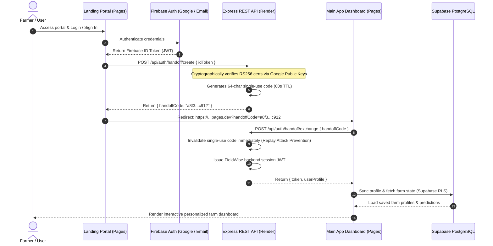

<div align="center">

# 🌾 FieldWise (Crops Wild)
### *Next-Generation Agricultural Decision Intelligence & Farm Management Platform*

[](https://github.com/shivamrgn/ourfarmer)
[-success?style=for-the-badge&logo=vitest)](https://github.com/shivamrgn/ourfarmer)
[](https://www.typescriptlang.org/)
[](https://react.dev/)
[](https://nodejs.org/)
[](https://www.python.org/)
[](https://supabase.com/)
[](https://firebase.google.com/)
[](https://opensource.org/licenses/MIT)

<p align="center">
  <b>Bridging the gap between cutting-edge AI and smallholder farming.</b><br>
  Dual-Engine Crop Recommendation • Multimodal Leaf Disease Diagnostics • Precision NPK Scheduling • APMC Mandi Intelligence • Zero-Trust Cloud Persistence
</p>

[🌐 Public Landing Portal](https://fieldwise-landing-staging.pages.dev) • [🚜 Farmer Dashboard](https://fieldwise-main-staging.pages.dev) • [⚡ REST API & ML Bridge](https://fieldwise-backend-staging.onrender.com) • [📖 Documentation](./docs/PROJECT_OVERVIEW.md)

</div>

---

## 📑 Table of Contents

- [Overview](#-overview)
- [Live Deployments](#-live-deployments)
- [Core Features & Modules](#-core-features--modules)
  - [1. Dual-Engine Crop Recommendation AI](#1--dual-engine-crop-recommendation-ai)
  - [2. Multimodal Plant Pathology Lab](#2--multimodal-plant-pathology-lab)
  - [3. Precision Fertilizer & Nutrient Calculator](#3--precision-fertilizer--nutrient-calculator)
  - [4. Real-Time APMC Mandi Market Intelligence](#4--real-time-apmc-mandi-market-intelligence)
  - [5. Agroclimatology & Satellite Weather Advisories](#5--agroclimatology--satellite-weather-advisories)
  - [6. Government Schemes & Subsidies Navigator](#6--government-schemes--subsidies-navigator)
  - [7. Equipment Rental & P2P Farm Marketplace](#7--equipment-rental--p2p-farm-marketplace)
- [System Architecture & Security](#-system-architecture--security)
  - [Ecosystem Topology](#ecosystem-topology)
  - [Zero-Trust Token Handoff Architecture](#zero-trust-token-handoff-architecture)
- [Repository Structure](#-repository-structure)
- [Quick Start Guide](#-quick-start-guide)
  - [Prerequisites](#prerequisites)
  - [Installation & Setup](#installation--setup)
  - [Running the Applications](#running-the-applications)
- [Testing & Quality Verification](#-testing--quality-verification)
- [Environment Configuration](#-environment-configuration)
- [Security & Compliance](#-security--compliance)
- [Contributing & License](#-contributing--license)

---

## 🌟 Overview

**FieldWise (Crops Wild)** is an enterprise-grade agricultural decision intelligence platform designed to empower farmers across India and global developing markets. By synthesizing real-time soil chemistry, hyper-localized satellite meteorology, multimodal computer vision, and agricultural commodity markets, FieldWise transitions farming from intuition-based practices to data-backed precision agronomy.

FieldWise is built as a modular multi-tier monorepo featuring an immersive public visitor landing portal, a feature-complete farmer dashboard suite, an Express REST API backend with native SQLite/PostgreSQL caching, and a Python-powered machine learning agronomy pipeline.

---

## 🚀 Live Deployments

| Component | Platform | Live Production / Staging URL | Status | Description |
|:---|:---|:---|:---:|:---|
| **Public Landing Portal** | Cloudflare Pages | [fieldwise-landing-staging.pages.dev](https://fieldwise-landing-staging.pages.dev) |  | High-speed presentation portal, instant auth modal, sample demo exploration |
| **Farmer Dashboard App** | Cloudflare Pages | [fieldwise-main-staging.pages.dev](https://fieldwise-main-staging.pages.dev) |  | Full-featured farmer multi-module workspace with cloud sync |
| **REST API & ML Bridge** | Render | [fieldwise-backend-staging.onrender.com](https://fieldwise-backend-staging.onrender.com) |  | Express backend, diagnostic vision engine, cryptographic handoff |
| **Cloud Database** | Supabase | `zsuunchmawamggaxlnfe.supabase.co` |  | PostgreSQL database with strict zero-trust Row Level Security |

---

## 🛠️ Core Features & Modules

### 1. 🌾 Dual-Engine Crop Recommendation AI
FieldWise provides an industry-first **Dual-Engine architecture** allowing farmers to toggle between instant mathematical heuristic agronomy and advanced statistical machine learning:

* **Engine V1 (7-Factor Gaussian Agronomy Model):**
  - Instant client-side and backend evaluation of Soil Nitrogen ($N$), Phosphorus ($P$), Potassium ($K$), Soil pH, Temperature, Relative Humidity, and Rainfall.
  - Continuous distance-decay scoring functions adhering to strict ICAR (Indian Council of Agricultural Research) benchmark intervals.
* **Engine V2 (Advanced Python Agronomic Engine):**
  - High-dimensional evaluation across 19 commercial Indian crops.
  - Incorporates the **Orthogonal 6-Domain DCI Model** ($DCI = 0.15 + 0.20 + 0.25 + 0.15 + 0.10 + 0.15 = 1.000$).
  - **Effective Rainfall & Residual Soil Moisture Reconciliation**: Monthly USDA-SCS non-linear rainfall transformation and deep Vertisol water storage ($AWC = 240.0\text{ mm}$) preventing false drought disqualifications.

### 2. 🔬 Multimodal Plant Pathology Lab
* Upload leaf photographs directly via mobile camera or desktop gallery.
* Powered by Google Gemini Vision AI combined with botanical pathology verification.
* Provides **instant diagnoses** with confidence ratings, severity classification, symptom timelines, organic bio-pesticide recipes (e.g., Neem seed kernel extract), and verified chemical control dosages.

### 3. 🧪 Precision Fertilizer & Nutrient Calculator
* Tailored stage-by-stage chemical and organic nutrient application schedules.
* Computes exact commercial bag quantities (Urea, DAP, MOP) based on farm acreage, basal sowing dosages, tillering top-dressings, and panicle initiation phases.
* Organic soil health remediation strategies (vermicompost, green manure, biofertilizers like *Azotobacter* and *Rhizobium*).

### 4. 📈 Real-Time APMC Mandi Market Intelligence
* Up-to-the-minute commodity spot rates across major Indian agricultural markets (APMC).
* Historical price curves, seasonal volatility trends, and profit forecasting.
* Profit calculator factoring seed cost, irrigation, labor, harvesting overhead, and expected yield in Quintals.

### 5. ⛅ Agroclimatology & Satellite Weather Advisories
* Localized meteorological tracking (temperature, relative humidity, wind velocity, precipitation probability).
* Automated agronomic risk alerts: frost warning, pest outbreak conditions, drought index, and optimal spray/irrigation windows.

### 6. 🏛️ Government Schemes & Subsidies Navigator
* Direct eligibility matching for key agricultural schemes:
  - **PM-KISAN** (Pradhan Mantri Kisan Samman Nidhi)
  - **PMFBY** (Pradhan Mantri Fasal Bima Yojana - Crop Insurance)
  - **KCC** (Kisan Credit Card)
  - Soil Health Card & Drip/Micro-Irrigation subsidies.

### 7. 🚜 Equipment Rental & P2P Farm Marketplace
* Marketplace connecting local farmers with verified tractor owners, combine harvesters, drone sprayers, laser land levelers, and rotavators.
* Flexible hourly/daily transparent pricing.

---

## 🔒 System Architecture & Security

### Ecosystem Topology

```
┌─────────────────────────────────────────────────────────────────────────────────┐
│                             FIELDWISE ECOSYSTEM                                 │
├──────────────────────────────────────┬──────────────────────────────────────────┤
│ Layer                                │ Technologies & Libraries                 │
├──────────────────────────────────────┼──────────────────────────────────────────┤
│ 1. Public Visitor Portal             │ Vite 8, React 19, Custom Responsive CSS, │
│    (FieldWise_landing)               │ Firebase Web SDK 12 (Auth, AuthModal)    │
├──────────────────────────────────────┼──────────────────────────────────────────┤
│ 2. Farmer Dashboard Application      │ Vite 5, React 18, TypeScript 5.8,        │
│    (FieldWise_main)                  │ Tailwind CSS 3.4, Radix UI, Recharts,    │
│                                      │ TanStack Query v5, Supabase JS           │
├──────────────────────────────────────┼──────────────────────────────────────────┤
│ 3. Core REST API & Security Bridge   │ Node.js 22 LTS, Express 4.18,            │
│    (FieldWise_main/backend)          │ Native node:sqlite, JSONWebToken, CORS,  │
│                                      │ Google Auth Public Certs (RS256)         │
├──────────────────────────────────────┼──────────────────────────────────────────┤
│ 4. Agronomic ML Engine & Pipeline    │ Python 3.10+, scikit-learn, XGBoost,     │
│    (FieldWise_main/model/ml_pipeline)│ NumPy, pandas, joblib, CLI Bridge        │
├──────────────────────────────────────┼──────────────────────────────────────────┤
│ 5. Enterprise Cloud Persistence      │ Supabase PostgreSQL (Strict RLS),        │
│    (FieldWise_main/migrations)       │ Firebase Auth, Cloudflare Pages CDN      │
└──────────────────────────────────────┴──────────────────────────────────────────┘
```

### Zero-Trust Token Handoff Architecture

To guarantee that unauthenticated public traffic on the landing portal remains physically isolated from the authenticated farmer dashboard, FieldWise implements a **Single-Use Cryptographic Handoff Protocol**:



---

## 📂 Repository Structure

```text
farmingFinal/
├── FieldWise_landing/              # Public Landing Portal (Vite 8, React 19)
│   ├── src/
│   │   ├── components/             # Hero, Navbar, AuthModal, DashboardPreview, etc.
│   │   ├── firebase.js             # High-speed Firebase Auth client
│   │   └── App.jsx                 # Smart routing, canonical redirect, session cache
│   ├── index.html                  # Includes canonical preview-hash redirect guard
│   └── package.json
│
├── FieldWise_main/                 # Farmer Dashboard Application (Vite 5, React 18, TS)
│   ├── src/
│   │   ├── components/             # Modules: CropRecommendation, DiseaseLab, Mandi, etc.
│   │   ├── context/AuthContext.tsx # Single-use handoff consumer, session lifecycle
│   │   ├── lib/                    # Supabase client, Axios API client, utils
│   │   └── services/               # Gemini AI service, farm intelligence service
│   ├── backend/                    # Express 4.18 REST API & ML Bridge
│   │   ├── src/controllers/        # firebaseVerifyController, diseaseController, etc.
│   │   ├── src/routes/             # /api/auth, /api/predict, /api/disease, /api/v2
│   │   ├── src/tests/              # 10 comprehensive backend test suites
│   │   └── server.js               # Express application entrypoint
│   ├── model/ml_pipeline/          # Python Agronomic ML Pipeline (Engine V2)
│   │   ├── agronomic_rules/        # USDA-SCS rainfall, temperature, soil heuristics
│   │   ├── scripts/                # Recommendation CLI bridge & validation
│   │   └── data/                   # Processed datasets, crop encyclopedia
│   ├── migrations/                 # Supabase PostgreSQL DDL & RLS Policies (V1, V2, V3)
│   └── package.json
│
└── docs/                           # Architecture specs, audit reports, deployment manuals
```

---

## 💻 Quick Start Guide

### Prerequisites
- **Node.js**: `v18.0.0` or higher (`v20+ LTS` recommended)
- **npm**: `v9.0.0` or higher
- **Python**: `v3.10` or higher (for Engine V2 Python ML Pipeline)

### Installation & Setup

1. **Clone the repository:**
   ```bash
   git clone https://github.com/shivamrgn/ourfarmer.git
   cd ourfarmer
   ```

2. **Install dependencies across modules:**
   ```bash
   # Install Landing dependencies
   (cd FieldWise_landing && npm install)

   # Install Main App dependencies
   (cd FieldWise_main && npm install)

   # Install Backend dependencies
   (cd FieldWise_main/backend && npm install)
   ```

### Running the Applications

#### Option 1: Full Suite Development (Terminal Multiplex)

In separate terminal tabs:

```bash
# Terminal 1: Backend API (Port 3001)
cd FieldWise_main/backend
npm run dev

# Terminal 2: Farmer Main Dashboard (Port 5174 or 8080)
cd FieldWise_main
npm run dev

# Terminal 3: Public Landing Portal (Port 5173)
cd FieldWise_landing
npm run dev
```

* Landing Portal: [http://localhost:5173](http://localhost:5173)
* Farmer Main App: [http://localhost:5174](http://localhost:5174)
* Backend API Health: [http://localhost:3001/api/health](http://localhost:3001/api/health)

---

## 🧪 Testing & Quality Verification

FieldWise maintains a strict **100% test passing mandate** across both frontend and backend before any deployment is promoted:

### 1. Backend Integration & Security Tests (10/10 Suites Passed)
Tests token verification, RS256 signature checking, handoff single-use replay attacks, rate limiting, and ML bridge process handling:
```bash
cd FieldWise_main/backend
npm test
```
```text
================================================================================
Backend Test Summary: 10/10 Suites Passed
================================================================================
✔ Legacy Auth & Predictor Smoke Tests: PASSED
✔ V2 Bridge Deterministic Unit Tests: PASSED
✔ Token Audience & Project ID Isolation: PASSED
✔ Single-Use Handoff Lifecycle (Consumption & Replay Rejection): PASSED
✔ Gemini Multimodal Plant Pathology Diagnostic Suite: PASSED
🎉 All backend tests executed cleanly and successfully!
```

### 2. Frontend Unit & Integration Tests (119/119 Tests Passed)
Tests authentication handoff exchange, Supabase sync, offline caching, and responsive UI rendering:
```bash
cd FieldWise_main
npm test
```
```text
Test Files  8 passed (8)
     Tests  119 passed (119)
  Duration  3.23s
```

---

## ⚙️ Environment Configuration

### Landing Portal (`FieldWise_landing/.env`)
```env
VITE_FIREBASE_API_KEY=your_firebase_api_key
VITE_FIREBASE_AUTH_DOMAIN=your_project.firebaseapp.com
VITE_FIREBASE_PROJECT_ID=your_project_id
VITE_FIREBASE_STORAGE_BUCKET=your_project.firebasestorage.app
VITE_FIREBASE_MESSAGING_SENDER_ID=your_sender_id
VITE_FIREBASE_APP_ID=your_app_id
VITE_MAIN_APP_URL=https://fieldwise-main-staging.pages.dev
VITE_API_URL=https://fieldwise-backend-staging.onrender.com
```

### Main Application (`FieldWise_main/.env`)
```env
VITE_GEMINI_API_KEY=your_gemini_api_key
VITE_GEMINI_MODEL=gemini-3.1-flash-lite
VITE_API_URL=https://fieldwise-backend-staging.onrender.com
VITE_LANDING_APP_URL=https://fieldwise-landing-staging.pages.dev
VITE_SUPABASE_URL=https://your-project.supabase.co
VITE_SUPABASE_ANON_KEY=your_supabase_anon_key
```

### Backend (`FieldWise_main/backend/.env`)
```env
PORT=10000
NODE_ENV=production
JWT_SECRET=your_super_secret_jwt_key
FIREBASE_PROJECT_ID=your_firebase_project_id
SUPABASE_URL=https://your-project.supabase.co
SUPABASE_SERVICE_ROLE_KEY=your_supabase_service_role_key
GEMINI_API_KEY=your_gemini_api_key
```

---

## 🛡️ Security & Compliance

1. **Zero-Trust Identity**: Single-use handoff codes are cryptographically generated using 32 bytes of system entropy (`crypto.randomBytes(32)`), valid for only 60 seconds, and immediately deleted upon first exchange.
2. **Never Exposed in URLs**: Real user Firebase tokens and JWTs are transmitted strictly inside `HTTPS POST` bodies and never exposed in URL query parameters, browser histories, or server access logs.
3. **Database RLS Policies**: Supabase PostgreSQL uses Row Level Security enforcing that farmers can only view and modify records matching their authenticated `farmer_id` (`auth.uid() = farmer_id`). Direct anonymous requests to the database are rejected with `42501 permission denied`.
4. **Canonical Host Guard**: Cloudflare Pages immutable preview subdomains (`*.pages.dev`) automatically forward to the canonical staging root, preventing users from becoming stuck on stale application bundles.

---

## 🤝 Contributing & License

Contributions, bug reports, and feature proposals are welcome! Please feel free to open an issue or submit a pull request.

This project is licensed under the **MIT License** — see the [LICENSE](LICENSE) file for details.

---

<div align="center">
  <sub>Developed with ❤️ for farmers worldwide. Empowering sustainable agriculture through intelligence.</sub>
</div>
