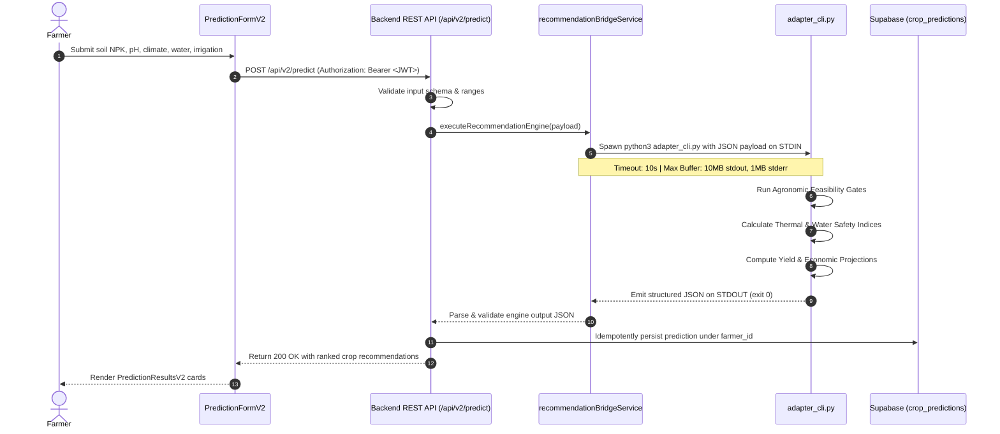
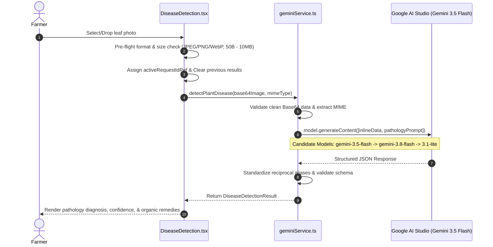
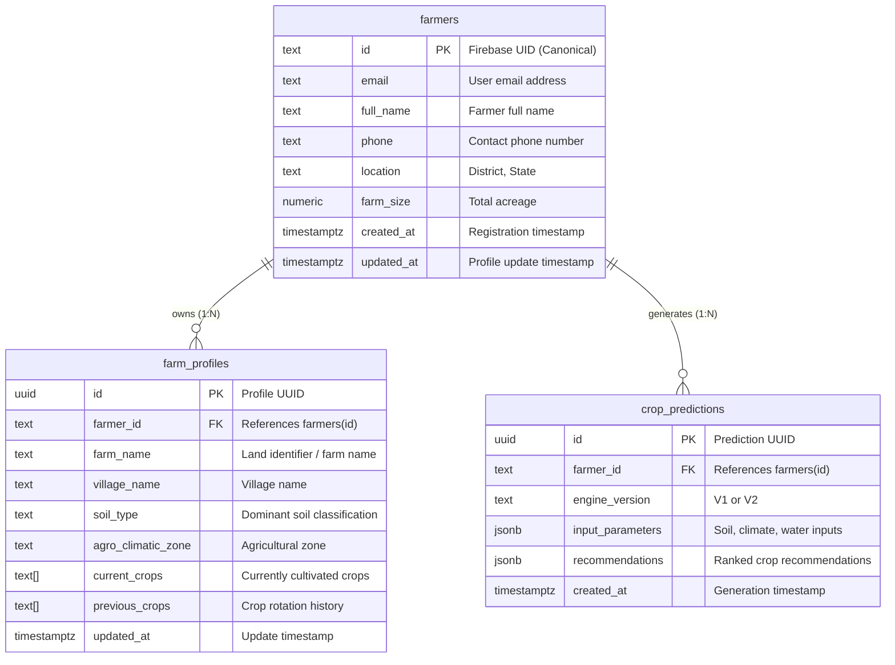

# FieldWise Platform — Technical Architecture

**Document Version:** 1.0.0  
**Audit Date:** 2026-11-22  

---

## 1. Architectural Overview

FieldWise is built on a **Decoupled Client-Service Architecture** designed to balance real-time user interactivity with heavy computational agronomic modeling and secure cross-browser cloud persistence.

```
┌────────────────────────────────────────────────────────────────────────────────────────┐
│                                 FIELDWISE ARCHITECTURE                                 │
└────────────────────────────────────────────────────────────────────────────────────────┘

    ┌───────────────────────────┐                     ┌───────────────────────────┐
    │    FieldWise_landing      │                     │      FieldWise_main       │
    │  (Public Visitor Portal)  │                     │    (Farmer Dashboard)     │
    │      React 19 / Vite 8    │                     │     React 18 / Vite 5     │
    │        Port: 5173         │                     │        Port: 5174         │
    └─────────────┬─────────────┘                     └─────────────▲─────────────┘
                  │                                                 │
                  │ 1. Firebase Auth (Google / Email)               │ 4. Exchange Handoff Code
                  │ 2. POST ID Token to Backend                     │    Receive Session JWT
                  ▼                                                 │
    ┌───────────────────────────────────────────────────────────────┴─────────────┐
    │                         FieldWise Backend REST API                          │
    │                         Node.js 22 + Express Server                         │
    │                                 Port: 3001                                  │
    ├─────────────────────────────────────────────────────────────────────────────┤
    │  • Auth Middleware (JWT HMAC-SHA256)                                        │
    │  • Single-Use Handoff Store (64-char crypto code, 60s TTL)                  │
    │  • CORS Origin Allowlist (:5173, :5174, :5175, :5176)                      │
    │  • Sliding-Window Rate Limiter (100 req / 15 min)                           │
    │  • SQLite User Database (Native node:sqlite)                                │
    │  • Supabase Service-Role Persistence Bridge                                 │
    │  • Python Child Process Bridge (10MB stdout, 1MB stderr buffer bounds)      │
    └───────────────────────┬───────────────────────────────┬─────────────────────┘
                            │                               │
                            │ Spawns Subprocess             │ Cloud Persistence
                            ▼                               ▼
    ┌───────────────────────────────────────┐   ┌─────────────────────────────────┐
    │          Agronomic ML Engine          │   │      Supabase PostgreSQL        │
    │           (Python Pipeline)           │   │         (Cloud Storage)         │
    ├───────────────────────────────────────┤   ├─────────────────────────────────┤
    │ • adapter_cli.py (STDIN / STDOUT JSON)│   │ • public.farmers (RLS)          │
    │ • Recommendation Engine               │   │ • public.farm_profiles (RLS)    │
    │ • Soil Chemistry Gate (pH bounds)     │   │ • public.crop_predictions (RLS) │
    │ • Thermal & Water Safety Bounds       │   └─────────────────────────────────┘
    │ • Economic Profitability Ranker       │
    │ • Serialized Models (Random Forest)   │
    └───────────────────────────────────────┘
```

---

## 2. Core Execution Flows

### 2.1. Zero-Trust Token Handoff Flow
To protect farmer authentication tokens from exposure in URL bars, browser history, or server access logs:
1. The user authenticates on `FieldWise_landing` using Firebase Auth (Email/Password or Google Sign-In).
2. The landing page calls `user.getIdToken()` to obtain a fresh Firebase ID token.
3. The ID token is sent **strictly within an HTTPS POST body** to `/api/auth/handoff/create`.
4. The Express backend verifies the token using the `firebase-admin` SDK, creates a 64-character cryptographically random code (`crypto.randomBytes(32)`), and stores it with a 60-second time-to-live (TTL).
5. The landing page receives the code and redirects the browser to `http://localhost:5174?code=<handoff_code>`.
6. `FieldWise_main` reads the code and immediately issues a POST request to `/api/auth/handoff/exchange`.
7. The backend verifies the code, **deletes it immediately (enforcing strict single-use)**, creates or updates the farmer record in Supabase, and returns a verified FieldWise session JWT.

### 2.2. Agronomic Recommendation Engine Execution Flow (V2)


### 2.3. Multimodal Vision Plant Pathology Flow


---

## 3. Database Schema Contract (Supabase PostgreSQL)

FieldWise maintains a strict relational data model secured by **Row Level Security (RLS)**:



---

## 4. Key Architectural Decisions (ADRs)

### ADR 1: Multi-Model Vision Candidate Fallback Pipeline
- **Decision:** spearhead vision analysis with `gemini-3.5-flash` with automatic failover to `gemini-3.8-flash`, `gemini-3.1-flash-lite`, and `gemini-2.5-flash`.
- **Rationale:** Google AI Studio deprecated `gemini-2.5-flash` for new users (returning 404), while `gemini-3.8-flash` experiences periodic high-demand 503 spikes. `gemini-3.5-flash` provides uninterrupted reliability with zero 503 drops and high visual diagnostic accuracy.

### ADR 2: Dedicated Separation of Landing and Main Applications
- **Decision:** Retain two distinct Vite applications (`FieldWise_landing` on port 5173 and `FieldWise_main` on port 5174) connected by single-use token exchange.
- **Rationale:** Preserves public SEO, ultra-fast initial landing page load times, and independent deployment lifecycles for public marketing vs authenticated farmer dashboards.

### ADR 3: Subprocess Python Bridge with Strict Resource Bounds
- **Decision:** Node.js executes Python recommendation models via `child_process.spawn` with fixed server-side paths, 10MB stdout buffer limits, and 10-second SIGTERM timeouts.
- **Rationale:** Prevents untrusted client path manipulation, protects Node.js event-loop threads from blocking ML calculations, and guarantees process termination on failure.
