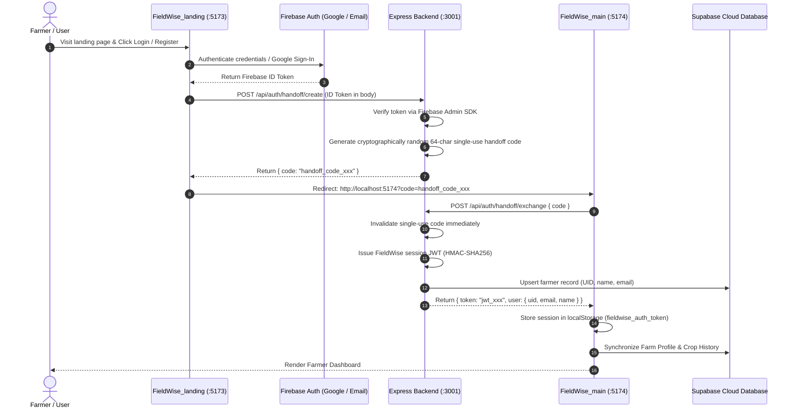

# FieldWise Platform — Project Overview

**Document Version:** 1.0.0  
**Audit Date:** 2026-11-22  
**Auditor:** Senior Software Architect, Principal Engineer & Code Quality Auditor  
**Platform Status:** Operational / Pre-Production Staging  

---

## 1. Project Purpose & Vision

**FieldWise** is a full-stack, AI-augmented agricultural decision intelligence platform designed to empower smallholder and commercial Indian farmers with hyper-localized, data-driven agronomic insights. The platform addresses critical challenges in modern agriculture:

1. **Crop Suitability & Recommendation**: Evaluating soil chemical properties (N, P, K, pH), agro-climatic conditions (temperature, humidity, rainfall, water availability), and market profitability to recommend optimal crop choices.
2. **Fertilizer & Soil Nutrition Advisory**: Generating precision soil nutrient remediation plans based on current soil health and targeted crop uptake requirements.
3. **Multimodal Plant Leaf Disease Detection**: Utilizing Google Gemini multimodal vision AI to analyze leaf photographs in real time, diagnose pathogens (fungal, bacterial, viral), provide severity ratings, and recommend actionable treatments.
4. **Mandi Market Price Intelligence**: Aggregating real-time commodity prices from Indian APMC mandis to forecast price trends and maximize farmer revenue.
5. **Government Scheme Discovery**: Recommending state and central agricultural subsidy schemes (e.g., PM-KISAN, PMFBY, Soil Health Card) based on farmer profile data.
6. **Agroclimatology & Weather Alerts**: Integrating satellite meteorology (NASA POWER and real-time weather APIs) to provide severe weather alerts, rainfall forecasts, and irrigation advice.

---

## 2. Technology Stack Across Tiers

The project operates as a hybrid multi-application repository composed of four main tiers:

```
┌──────────────────────────────────────────────────────────────────────────────────┐
│                             FIELDWISE ECOSYSTEM                                  │
├──────────────────────────────────────┬───────────────────────────────────────────┤
│ Tier                                 │ Core Technologies & Libraries             │
├──────────────────────────────────────┼───────────────────────────────────────────┤
│ 1. Public Visitor Portal             │ Vite 8, React 19, Vanilla CSS,            │
│    (FieldWise_landing)               │ Firebase Web SDK 12 (Auth, Firestore)     │
├──────────────────────────────────────┼───────────────────────────────────────────┤
│ 2. Farmer Dashboard Application      │ Vite 5, React 18, TypeScript 5.8,         │
│    (FieldWise_main)                  │ Tailwind CSS 3.4, Radix UI / Shadcn,      │
│                                      │ TanStack Query v5, Recharts, Lucide,      │
│                                      │ Google Generative AI SDK, Supabase JS     │
├──────────────────────────────────────┼───────────────────────────────────────────┤
│ 3. Core REST API & Security Bridge   │ Node.js 22 (ESM/CJS), Express 4.18,       │
│    (FieldWise_main/backend)          │ SQLite (native node:sqlite & fallback),   │
│                                      │ Supabase JS, Firebase Admin SDK, JWT,     │
│                                      │ CORS, Express Rate Limit, Child Process   │
├──────────────────────────────────────┼───────────────────────────────────────────┤
│ 4. Agronomic ML Engine & Pipeline    │ Python 3.10+, scikit-learn, XGBoost,      │
│    (FieldWise_main/model/ml_pipeline)│ pandas, NumPy, joblib, CLI Adapter        │
├──────────────────────────────────────┼───────────────────────────────────────────┤
│ 5. Persistence & Cloud Data          │ Supabase PostgreSQL (RLS, Foreign Keys),  │
│    (FieldWise_main/migrations)       │ Firebase Firestore, Local SQLite          │
└──────────────────────────────────────┴───────────────────────────────────────────┘
```

---

## 3. High-Level Architecture & Authentication Flow

FieldWise employs a **Zero-Trust Token Handoff Architecture** to separate unauthenticated public landing engagement from the authenticated farmer dashboard:



---

## 4. Application Entry Points

| Subsystem | Entry Point File | Port / Environment | Execution Command |
| :--- | :--- | :--- | :--- |
| **Monorepo Orchestrator** | `dev.js` | Root / Multi-process | `npm run dev` |
| **Landing Page** | `FieldWise_landing/src/main.jsx` | Port 5173 (Vite) | `cd FieldWise_landing && npm run dev` |
| **Main Dashboard** | `FieldWise_main/src/main.tsx` | Port 5174 (Vite) | `cd FieldWise_main && npm run dev` |
| **Backend REST API** | `FieldWise_main/backend/src/server.js` | Port 3001 (Node/Express) | `cd FieldWise_main/backend && npm run dev` |
| **Python ML Engine CLI**| `FieldWise_main/model/ml_pipeline/recommendation_engine/adapter_cli.py` | Subprocess (STDIN/STDOUT JSON) | Invoked by Node backend bridge |

---

## 5. Major Modules and Their Responsibilities

### Frontend Modules (`FieldWise_main/src/components/modules/`)
1. **CropRecommendation.tsx**: Engine Switcher supporting Legacy Engine V1 and Advanced Agronomic Engine V2. Accepts soil tests, temperature, rainfall, and irrigation type to generate ranked crop recommendations with yield and economic projections.
2. **DiseaseDetection.tsx**: Image upload and drag-and-drop interface for plant leaves; invokes Gemini 2.5/3.5 Flash vision analysis; validates format and size; renders diagnoses, confidence scores, symptoms, and organic/chemical remedies.
3. **FertilizerRecommendation.tsx**: Calculates NPK deficits based on current soil parameters and targeted crop uptake; generates commercial and organic fertilizer schedules.
4. **SoilEnvironmentIntelligence.tsx**: Visualizes real-time soil moisture, temperature, pH levels, and electrical conductivity across farm zones.
5. **MandiPriceIntelligence.tsx**: Displays APMC commodity market rates, daily price fluctuations, and nearest mandi arrival volumes.
6. **GovernmentSchemes.tsx**: Searchable catalog and eligibility assessment engine for Indian agricultural welfare schemes.
7. **ExpertConsultation.tsx**: Booking and question submission portal connecting farmers with certified agronomists and agricultural extension officers.
8. **WeatherAlerts.tsx**: Agroclimatology dashboard integrating NASA POWER and local weather stations for frost, rainfall, and drought alerts.
9. **EquipmentRental.tsx**: Community farm machinery sharing and rental marketplace.

### Backend Controllers & Services (`FieldWise_main/backend/src/`)
1. **firebaseVerifyController.js**: Secure token verification, handoff code generation, single-use validation, code consumption, and farmer JWT token issuance.
2. **predictController.js (v2)**: Bridge controller accepting structured farm parameters, executing the Python agronomic engine CLI with timeout and buffer bounds, and persisting results to Supabase.
3. **recommendationBridgeService.js**: Process manager for spawning Python child processes with strict STDOUT/STDERR isolation and SIGTERM/SIGKILL lifecycle controls.
4. **recommendationPersistenceService.js**: Idempotent cloud persistence service mapping V2 engine outputs into Supabase `crop_predictions` and `farmers` tables.
5. **auth.js & rateLimiter.js**: Middleware enforcing JWT validation, CORS origin allowlisting, and IP rate limiting (100 req/15 min).

### Agronomic ML Engine (`FieldWise_main/model/ml_pipeline/`)
1. **adapter_cli.py**: Python CLI interface accepting JSON payloads via STDIN or arguments, running validation gates, executing recommendation pipelines, and emitting JSON to STDOUT.
2. **recommendation_engine/**: Scientific Python modules enforcing agronomic safety gates (pH feasibility, thermal suitability, water deficit checks, NPK balance, and economic ROI ranking).
