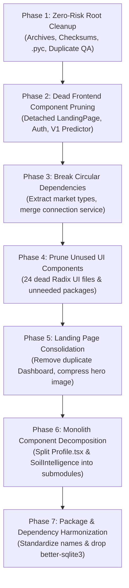

# FieldWise Platform — Step-by-Step Refactoring Plan

**Document Version:** 1.0.0  
**Audit Date:** 2026-11-22  
**Implementation Policy:** Strictly staged; **requires user authorization before executing any deletion, movement, or code modification**.  

---

## 1. Guiding Principles & Safety Rules

1. **Read-Only First:** No file deletions or movements will occur without explicit user approval.
2. **Zero Functional Regressions:** All existing API contracts, database schemas, and client features must remain 100% operational.
3. **Continuous Verification:** After every incremental phase, run the complete 110-test frontend suite (`npm test --prefix FieldWise_main`) and the 7-suite backend test runner (`npm test --prefix FieldWise_main/backend`).
4. **Git Safety:** Maintain atomic git commits per phase to enable immediate rollback if needed.

---

## 2. Refactoring Phases Breakdown

---

### Phase 1: Zero-Risk Root & File Archive Cleanup (Zero Risk)
**Objective:** Clean repository root, eliminate duplicate files, and remove compiled binaries.
1. Create directory `archive/milestones/` and move the 33 `.zip` files and 36 `.sha256` files into it.
2. Delete orphaned checksum files: `FieldWise_Phase3B_2_CV_Review.zip.sha256` and `Phase3B2_Independent_Review_Evidence.zip.sha256`.
3. Delete duplicate `QA.txt` (exact copy of `QA_REPORT.txt`); move `QA_REPORT.txt` to `docs/archive/`.
4. Delete 25 compiled `.pyc` files in `FieldWise_main/model/ml_pipeline/recommendation_engine/`.
5. Update root `.gitignore` to ignore `*.pyc`, `__pycache__/`, `*.zip`, and `.DS_Store`.
- **Verification:** Run `git status` to verify repository root cleanliness.

---

### Phase 2: Dead Frontend Pages & Components Removal (Low Risk)
**Objective:** Remove verified unreferenced components and orphaned authentication files.
1. Delete detached pages in `FieldWise_main/src/pages/`:
   - `pages/Auth.tsx`
   - `pages/Login.tsx`
2. Delete detached components in `FieldWise_main/src/components/`:
   - `components/LandingPage.tsx`
   - `components/LoginForm.tsx`
   - `components/LoginDemo.tsx`
   - `components/NavLink.tsx`
   - `components/ProtectedRoute.tsx`
   - `components/PredictionForm.tsx` (V1 form)
   - `components/PredictionResults.tsx` (V1 results)
3. Delete orphaned services in `FieldWise_main/src/services/`:
   - `services/authService.ts`
   - `services/localAuthService.ts`
4. In `FieldWise_main/src/components/modules/Marketplace.tsx`:
   - Replace `import EnhancedMarketPrices from "./EnhancedMarketPrices"` with `import MandiPriceIntelligence from "./MandiPriceIntelligence"`.
   - Replace `<EnhancedMarketPrices />` with `<MandiPriceIntelligence />`.
   - Delete `components/modules/EnhancedMarketPrices.tsx`.
- **Verification:** Run `npm test --prefix FieldWise_main` and `npm run build --prefix FieldWise_main`.

---

### Phase 3: Circular Dependency Resolution & Service Consolidation (Low-Medium Risk)
**Objective:** Break the mutual dependency cycle between `marketPricesService.ts` and `marketPricesConnectionService.ts`.
1. Create a dedicated type definition file: `FieldWise_main/src/types/marketPrices.ts`.
2. Move interfaces `MarketPrice`, `PriceTrend`, `MarketStats`, `MarketPriceParams` to `src/types/marketPrices.ts`.
3. Consolidate the transport methods from `marketPricesConnectionService.ts` directly into `marketPricesService.ts`.
4. Update imports in `FarmIntelligence.tsx`, `Marketplace.tsx`, and `MandiPriceIntelligence.tsx`.
5. Safely delete `marketPricesConnectionService.ts`.
- **Verification:** Run circular dependency detection script (verify 0 cycles) and execute frontend test suite.

---

### Phase 4: Prune Unused UI Components & Unused npm Packages (Medium Risk)
**Objective:** Eliminate 24 unused UI files and unneeded npm dependencies.
1. Delete the 24 dead UI components from `FieldWise_main/src/components/ui/`:
   `alert-dialog.tsx`, `aspect-ratio.tsx`, `breadcrumb.tsx`, `calendar.tsx`, `carousel.tsx`, `chart.tsx`, `collapsible.tsx`, `command.tsx`, `context-menu.tsx`, `drawer.tsx`, `form.tsx`, `hover-card.tsx`, `input-otp.tsx`, `menubar.tsx`, `navigation-menu.tsx`, `pagination.tsx`, `popover.tsx`, `radio-group.tsx`, `resizable.tsx`, `scroll-area.tsx`, `sidebar.tsx`, `table.tsx`, `toggle-group.tsx`, `use-toast.ts` (stub).
2. Remove unneeded npm dependencies from `FieldWise_main/package.json`:
   - `zod`
   - `@hookform/resolvers`
   - `date-fns`
   - `lovable-tagger`
   - `embla-carousel-react`, `cmdk`, `vaul`, `input-otp`, `react-resizable-panels`, `react-day-picker`
   - Unused `@radix-ui/*` packages (`@radix-ui/react-navigation-menu`, `@radix-ui/react-menubar`, `@radix-ui/react-context-menu`, `@radix-ui/react-radio-group`, `@radix-ui/react-scroll-area`, `@radix-ui/react-hover-card`).
- **Verification:** Execute `npm install` and verify clean build with `npm run build --prefix FieldWise_main` and `npm test --prefix FieldWise_main`.

---

### Phase 5: Visitor Portal Consolidation (`FieldWise_landing`) (Low Risk)
**Objective:** Eliminate redundant dashboard copies and optimize heavy static assets.
1. In `FieldWise_landing/src/App.jsx`:
   - Update `handleGoToDashboard()` to redirect authenticated users directly to `FieldWise_main` (`http://localhost:5174`).
   - Remove import and rendering of `components/Dashboard.jsx`.
2. Delete duplicate files:
   - `FieldWise_landing/src/components/Dashboard.jsx` and `Dashboard.css`
   - `FieldWise_landing/src/components/AIFeatures.jsx` and `AIFeatures.css`
   - `FieldWise_landing/src/components/SmartTools.jsx` and `SmartTools.css`
   - `FieldWise_landing/src/assets/hero.png`, `react.svg`, `vite.svg`
3. Compress `FieldWise_landing/public/hero-farm.jpg` (4.9 MB) into modern WebP format (target <400 KB), updating the image reference in `Hero.css`.
- **Verification:** Run `npm run build --prefix FieldWise_landing` and verify image loading.

---

### Phase 6: Monolithic Component Decomposition (Medium Risk)
**Objective:** Split monolithic files (>1,000 lines) into modular subcomponents.
1. **`pages/Profile.tsx` (1,622 lines):**
   - Extract `PersonalDetailsTab.tsx`
   - Extract `FarmSpecsTab.tsx` (Village, Land Identifier, Crops, Rotation, Zone)
   - Extract `SecuritySettingsTab.tsx`
   - Extract `NotificationPreferencesTab.tsx`
2. **`components/modules/SoilEnvironmentIntelligence.tsx` (1,463 lines):**
   - Extract `SoilSensorTelemetryCard.tsx`
   - Extract `SoilZoneTrendChart.tsx`
   - Extract `SoilMoistureHeatmap.tsx`
3. **`components/modules/CropRecommendation.tsx` (1,230 lines):**
   - Extract `EngineModeSwitcher.tsx`
   - Extract `PrefillBanner.tsx`
- **Verification:** Run all 110 tests in `v2_frontend_integration.test.tsx` and `my_farm_cloud_persistence.test.ts`.

---

### Phase 7: Backend & Package Manifest Harmonization (Low Risk)
**Objective:** Standardize naming conventions and clean up backend dependencies.
1. In `FieldWise_main/backend/package.json`:
   - Remove `better-sqlite3` from dependencies (Node 22 native `node:sqlite` is already functional).
   - In `src/config/database.js`, streamline initialization directly to `node:sqlite`.
   - Update `"name": "@fieldwise/api"`.
2. In `FieldWise_landing/package.json`:
   - Update `"name": "@fieldwise/landing"`.
3. In `FieldWise_main/package.json`:
   - Update `"name": "@fieldwise/dashboard"`.
4. Delete `FieldWise_main/model/package.json` (unnecessary stub).
- **Verification:** Run `npm test --prefix FieldWise_main/backend` (7/7 suites must pass).
