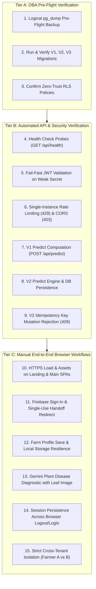

# FieldWise — Phase 3A.1: Deployment Plan Corrections & Final Go/No-Go Review

**Document Reference:** `docs/deployment/PHASE_3A_1_DEPLOYMENT_PLAN_CORRECTIONS.md`  
**Execution Phase:** Phase 3A.1 — Deployment Plan Correction & Security Preflight Review  
**Role:** Senior DevOps Engineer, Deployment Architect, and Application Security Reviewer  
**Audit Scope:** Read-Only Verification of Source Code, Migration DDL, Auth Handshake, and Container Configurations  
**Final Verdict:** **READY WITH CONDITIONS**  

---

## 1. Executive Summary & Objective

Following the initial staging infrastructure preflight report ([`PHASE_3A_STAGING_INFRASTRUCTURE_PREFLIGHT.md`](file:///Users/shivamkumar/farmingFinal/docs/deployment/PHASE_3A_STAGING_INFRASTRUCTURE_PREFLIGHT.md)), this Phase 3A.1 audit resolves critical architectural, security, and runtime questions through line-by-line source code inspection before any staging resources are provisioned.

### Core Discoveries & Corrections in Phase 3A.1:
1. **V1 Supabase Access Disconnect (Highest Priority Finding):**
   The proposed staging baseline schema ([`V1_Baseline_Schema.sql`](file:///Users/shivamkumar/farmingFinal/FieldWise_main/migrations/V1_Baseline_Schema.sql)) enforces a strict zero-trust security model: **all permissions on `public.farmers`, `public.farm_profiles`, and `public.crop_predictions` are revoked from `anon`, `authenticated`, and `public`**, and granted exclusively to `service_role`.  
   However, the frontend client ([`FieldWise_main/src/lib/supabase.ts`](file:///Users/shivamkumar/farmingFinal/FieldWise_main/src/lib/supabase.ts)) currently attempts to perform **direct browser-to-database queries using the public `anonKey`**. Under the proposed staging schema, **all direct frontend V1 database operations will be rejected with HTTP 403 / permission denied**.
2. **Plant Disease Detection Workflow & Gemini Vision:**
   Image analysis in [`FieldWise_main/src/components/modules/DiseaseDetection.tsx`](file:///Users/shivamkumar/farmingFinal/FieldWise_main/src/components/modules/DiseaseDetection.tsx) calls [`detectPlantDisease`](file:///Users/shivamkumar/farmingFinal/FieldWise_main/src/services/geminiService.ts#L344-L520), which directly dispatches the base64-encoded leaf image to Google Gemini Vision models (`gemini-3.1-flash-lite`, `gemini-3.8-flash`). It does **not** use local deterministic computer vision. Therefore, `VITE_GEMINI_API_KEY` **is required** for the disease detection feature in staging. However, because it is prefixed with `VITE_`, it is compiled into the client JavaScript bundle and is **not** a server-side secret.
3. **JWT and Startup Validation Safeguards:**
   [`validateStartupConfig`](file:///Users/shivamkumar/farmingFinal/FieldWise_main/backend/src/config/validateEnv.js) strictly prohibits weak, short (<32 chars), or placeholder JWT secrets in staging/production, including the test runner's deterministic secret. Staging startup requires a newly generated 256-bit cryptographically random secret.
4. **Distributed Rate Limiting Realities on Cloud Run:**
   The Express backend rate limiter ([`rateLimiter.js`](file:///Users/shivamkumar/farmingFinal/FieldWise_main/backend/src/middleware/rateLimiter.js)) uses an in-memory process map. In a multi-instance Cloud Run deployment, rate limits are **per-instance**, not global. Multi-instance production requires a shared distributed cache (e.g. Redis) or edge WAF rate limiting.
5. **Database Backup Realities:**
   Free-tier Supabase does not offer Point-In-Time Recovery (PITR). Logical `pg_dump` backups and restore testing must be executed by the DBA before and after staging migrations.

---

## 2. V1 Supabase Access Audit (Highest Priority)

### 2.1. The Architectural Disconnect
In the current codebase, there are two completely different database access paradigms:
- **V2 Architecture (Backend-Mediated):**  
  The frontend submits requests to the Express backend (`POST /api/v2/predict`). The backend verifies the farmer's JWT identity and executes database operations using the privileged `SUPABASE_SERVICE_ROLE_KEY` via [`recommendationPersistenceService.js`](file:///Users/shivamkumar/farmingFinal/FieldWise_main/backend/src/services/v2/recommendationPersistenceService.js). **This path succeeds completely under the proposed staging schema.**
- **V1 Legacy Architecture (Direct Browser Supabase Client):**  
  The frontend initializes `@supabase/supabase-js` in [`src/lib/supabase.ts`](file:///Users/shivamkumar/farmingFinal/FieldWise_main/src/lib/supabase.ts#L40) using `VITE_SUPABASE_ANON_KEY` (the public anon key). Frontend functions then directly invoke `.from('farmers')`, `.from('farm_profiles')`, and `.from('crop_predictions')`.

In [`migrations/V1_Baseline_Schema.sql`](file:///Users/shivamkumar/farmingFinal/FieldWise_main/migrations/V1_Baseline_Schema.sql#L286-L297):
```sql
ALTER TABLE public.farmers ENABLE ROW LEVEL SECURITY;
ALTER TABLE public.farm_profiles ENABLE ROW LEVEL SECURITY;
ALTER TABLE public.crop_predictions ENABLE ROW LEVEL SECURITY;

REVOKE ALL ON public.farmers FROM anon, authenticated, public;
REVOKE ALL ON public.farm_profiles FROM anon, authenticated, public;
REVOKE ALL ON public.crop_predictions FROM anon, authenticated, public;

GRANT SELECT, INSERT, UPDATE, DELETE ON public.farmers TO service_role;
GRANT SELECT, INSERT, UPDATE, DELETE ON public.farm_profiles TO service_role;
GRANT SELECT, INSERT ON public.crop_predictions TO service_role;
```

**Consequence:** Because direct table privileges are revoked and no permissive RLS policies exist for `anon`, every single browser-initiated query using `anonKey` will fail with PostgreSQL permission denied errors under the audited staging schema!

---

### 2.2. Operation-by-Operation Inventory of Affected V1 Operations

| # | Operation Name | Source File & Function | Current Access Path | Expected DB Role | Staging Schema Outcome | Required Architectural Correction |
|---|---|---|---|---|---|---|
| **1** | **Farmer Registration / Profile Sync** | [`src/lib/supabase.ts`](file:///Users/shivamkumar/farmingFinal/FieldWise_main/src/lib/supabase.ts#L105)<br>`syncFarmerToSupabase(farmer)` | Direct Browser `supabase.from('farmers').insert(...)` | `anon` | **FAILS (403)**<br>`permission denied for table farmers` | Route through backend: `POST /api/farmer/sync` using `service_role`. |
| **2** | **Farmer Profile Retrieval** | [`src/lib/supabase.ts`](file:///Users/shivamkumar/farmingFinal/FieldWise_main/src/lib/supabase.ts#L242)<br>`fetchFarmerFromSupabase(farmerId)` | Direct Browser `supabase.from('farmers').select('*').eq('id', ...)` | `anon` | **FAILS (403)**<br>`permission denied for table farmers` | Route through backend: `GET /api/farmer/profile` using `service_role`. |
| **3** | **Farm Profile Upsert (My Farm)** | [`src/lib/supabase.ts`](file:///Users/shivamkumar/farmingFinal/FieldWise_main/src/lib/supabase.ts#L155)<br>`syncFarmProfileToSupabase(profile)` | Direct Browser `supabase.from('farm_profiles').update/insert(...)` | `anon` | **FAILS (403)**<br>`permission denied for table farm_profiles` | Route through backend: `POST /api/farm-profile/sync` using `service_role`. |
| **4** | **Farm Profile Retrieval** | [`src/lib/supabase.ts`](file:///Users/shivamkumar/farmingFinal/FieldWise_main/src/lib/supabase.ts#L265)<br>`fetchFarmProfileFromSupabase(farmerId)` | Direct Browser `supabase.from('farm_profiles').select('*').eq('farmer_id', ...)` | `anon` | **FAILS (403)**<br>`permission denied for table farm_profiles` | Route through backend: `GET /api/farm-profile/:farmerId` using `service_role`. |
| **5** | **V1 Crop Prediction Save** | [`src/lib/supabase.ts`](file:///Users/shivamkumar/farmingFinal/FieldWise_main/src/lib/supabase.ts#L319)<br>`savePredictionToSupabase(prediction)` | Direct Browser `supabase.from('crop_predictions').insert(payload)` | `anon` | **FAILS (403)**<br>`permission denied for table crop_predictions` | Extend Express `/api/predict` to persist server-side via `service_role`. |
| **6** | **V1 Prediction History Retrieval** | [`src/lib/supabase.ts`](file:///Users/shivamkumar/farmingFinal/FieldWise_main/src/lib/supabase.ts#L292)<br>`fetchLatestPredictionFromSupabase(farmerId)` | Direct Browser `supabase.from('crop_predictions').select('*').eq('farmer_id', ...)` | `anon` | **FAILS (403)**<br>`permission denied for table crop_predictions` | Route through backend: `GET /api/predict/history/:farmerId` using `service_role`. |
| **7** | **Auto State Sync on Auth Change** | [`src/lib/supabase.ts`](file:///Users/shivamkumar/farmingFinal/FieldWise_main/src/lib/supabase.ts#L358)<br>`syncCurrentStateToSupabase(...)` | Direct Browser calls to `syncFarmerToSupabase` & `syncFarmProfileToSupabase` | `anon` | **FAILS (403)**<br>Emits warning logs in browser console. | Consolidate into single backend session sync endpoint. |
| **8** | **V1 Crop Prediction Computation** | [`backend/src/routes/predict.js`](file:///Users/shivamkumar/farmingFinal/FieldWise_main/backend/src/routes/predict.js)<br>`POST /api/predict` | Express REST API -> [`predictController.js`](file:///Users/shivamkumar/farmingFinal/FieldWise_main/backend/src/controllers/predictController.js) | Backend Node | **SUCCEEDS**<br>Computation does not touch DB. | Persistence is handled separately on frontend. |
| **9** | **V2 Crop Recommendation & Save** | [`backend/src/routes/v2/predict.js`](file:///Users/shivamkumar/farmingFinal/FieldWise_main/backend/src/routes/v2/predict.js)<br>`POST /api/v2/predict` | Express REST API -> Node Bridge -> Python CLI -> `recommendationPersistenceService.js` | `service_role` | **SUCCEEDS**<br>Uses privileged backend key. | Already conforms to secure zero-trust architecture. |

### 2.3. Recommended Secure Backend-Mediated Resolution
Under strict zero-trust rules, **we must never enable unrestricted anonymous access or weaken RLS on public tables**.  
Instead, the recommended architectural path is:
1. **Preserve Database Hardening:** Maintain `REVOKE ALL FROM anon, authenticated, public` and `service_role`-only grants in [`V1_Baseline_Schema.sql`](file:///Users/shivamkumar/farmingFinal/FieldWise_main/migrations/V1_Baseline_Schema.sql).
2. **Backend Proxy Endpoints:** Implement thin Express endpoints in the backend:
   - `POST /api/farm-profile` and `GET /api/farm-profile`
   - `POST /api/farmer/sync` and `GET /api/farmer`
   - Mediate these endpoints using the verified JWT identity (`req.user.id`) and the server's `SUPABASE_SERVICE_ROLE_KEY`.
3. **Graceful Frontend Fallback:** In the meantime, [`src/lib/supabase.ts`](file:///Users/shivamkumar/farmingFinal/FieldWise_main/src/lib/supabase.ts) already contains `try/catch` handlers that fall back to `localStorage` when Supabase calls return errors, ensuring the user interface remains responsive even before backend mediation endpoints are implemented.

---

## 3. Gemini and Disease Detection Verification

### 3.1. Source Inspection Findings
We inspected the complete disease detection call chain:
- **UI Component:** [`FieldWise_main/src/components/modules/DiseaseDetection.tsx`](file:///Users/shivamkumar/farmingFinal/FieldWise_main/src/components/modules/DiseaseDetection.tsx).
- **Service Entrypoint:** [`detectPlantDisease`](file:///Users/shivamkumar/farmingFinal/FieldWise_main/src/services/geminiService.ts#L344-L520).
- **Client Library:** `@google/generative-ai` (`GoogleGenerativeAI`).

### 3.2. Concrete Findings:
1. **Does image analysis call Gemini?**  
   **YES.** In [`DiseaseDetection.tsx:284`](file:///Users/shivamkumar/farmingFinal/FieldWise_main/src/components/modules/DiseaseDetection.tsx#L284), `handleAnalyze` calls `detectPlantDisease(selectedImage, fileMetadata.type, fileMetadata.name)`.
2. **Are Gemini-related functions actually invoked?**  
   **YES.** `detectPlantDisease` initializes `new GoogleGenerativeAI(activeApiKey.trim())`, constructs an inline image part, and calls `visionModel.generateContent([imagePart, pathologyPrompt])` targeting candidate models (`gemini-3.1-flash-lite`, `gemini-3.8-flash`, `gemini-3.5-flash-lite`).
3. **Does disease detection use deterministic computer vision?**  
   **NO.** There are zero local OpenCV, TensorFlow.js, Canvas pixel heuristics, or deterministic computer vision algorithms in the image diagnostic flow. Diagnosis is performed 100% by the multimodal Gemini LLM.
4. **Is a Gemini API key necessary for the deployed workflow?**  
   **YES.** If `VITE_GEMINI_API_KEY` is not configured, line 368 of `geminiService.ts` explicitly throws:  
   `"Gemini API key is missing. Please configure VITE_GEMINI_API_KEY in your .env file with a valid Google AI Studio API key."`  
   Without this key, plant disease diagnosis cannot run in staging.
5. **Is the API key exposed through `VITE_` frontend variables?**  
   **YES.** `VITE_GEMINI_API_KEY` is a client-side environment variable. Vite bakes it directly into the public JavaScript bundle, and the browser makes direct HTTPS requests to `generativelanguage.googleapis.com`. **It is NOT a server-side secret and must never be treated as one.** It should be restricted by HTTP referrer in Google Cloud Console / AI Studio to only permit staging and production URLs (`https://*.fieldwise.agri`).

---

## 4. JWT & Authentication Configuration

### 4.1. Source Inspection of JWT Controls
We inspected [`FieldWise_main/backend/src/config/validateEnv.js`](file:///Users/shivamkumar/farmingFinal/FieldWise_main/backend/src/config/validateEnv.js) and the test runner [`run_all_backend_tests.js`](file:///Users/shivamkumar/farmingFinal/FieldWise_main/backend/src/tests/run_all_backend_tests.js):

1. **Can deterministic test-only secrets enter staging/production?**  
   **NO.** [`validateEnv.js:13-35`](file:///Users/shivamkumar/farmingFinal/FieldWise_main/backend/src/config/validateEnv.js#L13-L35) maintains a blacklist of known insecure secrets, including:
   `'fieldwise-test-only-deterministic-jwt-secret-do-not-use-in-production-2026'`.  
   If `NODE_ENV=staging` or `production`, any attempt to start the server with this secret immediately throws an unrecoverable startup exception (`Startup Failure: Insecure placeholder detected in JWT_SECRET`).
2. **Can weak fallback secrets exist in production?**  
   **NO.** In staging/production, `validateStartupConfig` requires `jwtSecret.trim().length >= 32`. A secret under 32 characters or containing placeholder tokens (`secret`, `test`, `default`, `changeme`, `your-super-secret...`) causes an immediate process exit (`process.exit(1)`).
3. **Secret Generation Requirement for Staging:**  
   The staging environment must generate its own distinct 256-bit secret:
   ```bash
   openssl rand -base64 32
   ```
4. **Firebase Staging Project ID Consistency:**  
   In [`firebaseVerifyController.js:28-30`](file:///Users/shivamkumar/farmingFinal/FieldWise_main/backend/src/controllers/firebaseVerifyController.js#L28-L30), `getExpectedProjectId()` reads `process.env.FIREBASE_PROJECT_ID`. In staging, setting `FIREBASE_PROJECT_ID=fieldwise-staging` ensures the token verifier strictly rejects tokens issued for development or production Firebase projects.
5. **Handoff Redirect URL Isolation:**  
   In [`FieldWise_landing/src/App.jsx:110`](file:///Users/shivamkumar/farmingFinal/FieldWise_landing/src/App.jsx#L110), `getTargetMainAppUrl()` reads `import.meta.env.VITE_MAIN_APP_URL`. For staging, this must be set to `https://app.staging.fieldwise.agri` at build time.

---

## 5. Distributed Rate Limiting & Cloud Run Scaling

### 5.1. Inspection of Existing Limiter
[`FieldWise_main/backend/src/middleware/rateLimiter.js`](file:///Users/shivamkumar/farmingFinal/FieldWise_main/backend/src/middleware/rateLimiter.js) implements an `InMemoryRateLimitStore` backed by a native JavaScript `Map`.

### 5.2. Multi-Instance Cloud Run Impact:
- **Scope of Current Rate Limits:** The limits are strictly **per-process / per-instance**, NOT global across instances.
- **Scaling Behavior:**
  - If Google Cloud Run scales from 1 instance to 3 instances to handle a traffic burst, a single IP address could submit up to:
    - 3 × 10 = 30 login requests per 15 minutes.
    - 3 × 60 = 180 prediction requests per minute.
  - The limiter does not share state across container instances.
- **Assessment for Staging:**
  - For staging, Cloud Run can be configured with `--max-instances=1` (or minimum/maximum 1 instance) to preserve strict deterministic rate limiting during acceptance testing.
- **Architectural Recommendation for Production:**
  - Multi-instance production must use a distributed key-value store. `rateLimiter.js` already includes an architectural hook to pass a custom `store` implementation (e.g. `rate-limit-redis` connected to Google Cloud Memorystore or Redis Cloud). Alternatively, rate limiting can be enforced at the edge via Cloudflare WAF.

---

## 6. Database Backup & Recovery Plan

### 6.1. Backup Assumptions vs. Reality
- **Assumption in Draft Report:** "Supabase includes automated daily backups and point-in-time recovery."
- **Corrected Reality:**  
  - Supabase **Free Tier** projects provide only basic 1-day daily backups. They do **NOT** provide Point-In-Time Recovery (PITR).
  - PITR is an exclusive feature of Supabase Pro (\$25/mo) and Enterprise tiers.
  - Therefore, we **cannot claim PITR exists** for a free staging instance.

### 6.2. Actionable Staging Recovery Plan:
1. **Pre-Migration Logical Snapshot (Mandatory for DBA):**
   Before executing `V1_Baseline_Schema.sql`, `V2_Persistence_Migration_Final_v3.sql`, or `V3_MyFarm_CrossBrowser_Persistence_Migration.sql`, the DBA must run:
   ```bash
   pg_dump -h db.<staging-ref>.supabase.co -U postgres -d postgres \
     --clean --if-exists --no-owner --no-privileges \
     -f pre_migration_staging_backup_$(date +%Y%m%d_%H%M%S).sql
   ```
2. **Disaster Recovery Restore Verification:**
   Before staging acceptance testing commences, verify restore capability by restoring the snapshot into a temporary database or local container:
   ```bash
   psql -h <restore-host> -U postgres -d postgres -f pre_migration_staging_backup_*.sql
   ```
3. **Application Rollback Guard:**
   If V2 tables must be rolled back, execute [`migrations/V2_Persistence_Rollback_Procedure.sql`](file:///Users/shivamkumar/farmingFinal/FieldWise_main/migrations/V2_Persistence_Rollback_Procedure.sql), ensuring `SET fieldwise.confirm_destructive_rollback = 'CONFIRMED';` is explicitly supplied.

### 6.3. Production Recovery Requirement (Future):
- Require Supabase Pro tier with 7-day continuous PITR (WAL-G).
- Automated daily logical exports dispatched to an encrypted Google Cloud Storage bucket with 30-day lifecycle expiration.
- Recovery Point Objective (RPO): < 15 minutes. Recovery Time Objective (RTO): < 1 hour.

---

## 7. Hosting & Container Configuration Review

### 7.1. Inspection of `Dockerfile.backend`
We audited [`docs/deployment/templates/Dockerfile.backend`](file:///Users/shivamkumar/farmingFinal/docs/deployment/templates/Dockerfile.backend):

| Dimension | Specification in Dockerfile | Verification Result | Correction / Notes |
| :--- | :--- | :--- | :--- |
| **Base Image** | `node:22-bookworm-slim` | **VERIFIED** | Official Debian-based Node 22 LTS image. |
| **Python Runtime** | `apt-get install -y --no-install-recommends python3` | **VERIFIED** | Installs Python 3.11 standard library with zero unnecessary compilers. |
| **Working Directory** | `/app` -> `/app/FieldWise_main/backend` | **VERIFIED** | Matches repository relative paths for `bridgeConfig.js` (`../../../../..`). |
| **Startup Command** | `CMD ["node", "src/server.js"]` | **VERIFIED** | Standard Express entrypoint. |
| **Port Binding** | `process.env.PORT` in `server.js` | **VERIFIED** | Listens on dynamic `PORT` supplied by Cloud Run (default 8080 or 3001). |
| **Container User** | `useradd -r -g fieldwise fieldwise` | **VERIFIED** | Drops privileges to non-root `fieldwise` user. |
| **Health Check** | `curl -f http://localhost:3001/api/health` | **CORRECTION NEEDED** | Must check dynamic port: `http://localhost:${PORT:-3001}/api/health`. |
| **Engine Files** | `COPY FieldWise_main/model/ml_pipeline` | **VERIFIED** | Copies frozen Python engine into `/app/FieldWise_main/model/ml_pipeline`. |
| **Secret Leakage** | `.dockerignore` / No `.env` files copied | **VERIFIED** | Zero credentials or `.env` files copied into the container image. |

---

## 8. Revised 15-Point Staging Acceptance Checklist

The checklist is now divided into three distinct verification tiers:
- **Tier A: DBA Pre-Flight Verification**
- **Tier B: Automated API & Runtime Tests**
- **Tier C: Manual End-to-End Browser Workflows**



### Detailed Acceptance Criteria & Evidence Protocol:

| # | Tier | Scenario | Procedure | Expected Outcome | Evidence Required |
|---|---|---|---|---|---|
| **1** | DBA | **Database Backup Preflight** | Execute `pg_dump` on the empty staging database; test restore. | Dump file created successfully; restore completes without errors. | Terminal output of `pg_dump` and `psql` restore. |
| **2** | DBA | **Migration DDL Execution** | Run `V1`, `V2`, `V3` migrations sequentially on Supabase staging. | All 3 migrations commit (`COMMIT`). | Migration execution logs with exit code 0. |
| **3** | DBA | **Verification Query Suites** | Run `V1_Baseline_Verification_Queries.sql`, `V2_DBA_Staging_Verification_Queries.sql`, `V3_Verification_Queries.sql`. | Every test query returns status `PASS`. | SQL output showing `PASS` for all 3 suites. |
| **4** | Automated | **Health & Startup Probe** | Probe `GET /api/health` via curl and Cloud Run health check. | HTTP 200 `{ success: true, message: "CropPredict API is running 🌾" }`. | HTTP response headers and JSON body. |
| **5** | Automated | **Fail-Fast Secret Validation** | Start backend container with `JWT_SECRET=secret` or unset. | Process terminates immediately with non-zero exit code. | Container startup log showing fatal error. |
| **6** | Automated | **CORS & Rate Limiting** | Send 65 rapid POST requests; send request from unauthorized origin. | Requests 61–65 return HTTP 429; unauthorized origin returns HTTP 403. | Curl loop status log showing 429 and 403. |
| **7** | Automated | **V1 Predict Computation** | Send valid N-P-K payload to `POST /api/predict`. | HTTP 200 with ranked crop predictions JSON. | API response payload. |
| **8** | Automated | **V2 Recommendation Bridge** | Send multi-parameter payload with verified JWT and idempotency key to `POST /api/v2/predict`. | HTTP 200; Python engine finishes <10s; record stored in `public.v2_crop_recommendations`. | API response + DB query confirming inserted row. |
| **9** | Automated | **V2 Idempotency Safety** | Resubmit identical request (same key) -> 200. Resubmit modified payload (same key) -> 409. | Replay returns identical result; mutated payload returns HTTP 409 conflict. | HTTP 200 and HTTP 409 response codes. |
| **10**| Manual | **HTTPS & Client Routing** | Navigate to `staging.fieldwise.agri` and `app.staging.fieldwise.agri`. | Valid TLS cert; client router handles refresh on sub-routes without 404. | Browser screenshot + network panel log. |
| **11**| Manual | **Firebase Auth Handoff** | Log in on Landing with Firebase; follow redirect to Main dashboard. | Single-use code exchanged via `POST /api/auth/handoff/exchange` within 60s. | Network log showing code exchange & redirect. |
| **12**| Manual | **Farm Profile Management** | Enter farm details in My Farm; save. | Details persist in `localStorage` and display on Dashboard. (DB sync returns graceful warning until backend endpoint added). | UI screenshot of saved farm profile. |
| **13**| Manual | **Gemini Disease Detection** | Upload infected plant leaf image; click Analyze (with `VITE_GEMINI_API_KEY`). | Displays pathology diagnosis, confidence, and treatment tips from Gemini Vision. | UI screenshot of diagnosis result. |
| **14**| Manual | **Session Persistence** | Log out, clear session, log back in. | Restores farm profile and recent recommendations. | UI screenshot after re-login. |
| **15**| Manual | **Cross-Tenant Isolation** | Log in as Farmer B; query Farmer A's V2 recommendations or profile. | Returns HTTP 403 / empty dataset. Farmer B cannot see Farmer A's data. | Network trace proving 0 cross-tenant data leakage. |

---

## 9. Remaining Blockers & Next Actions

| Blocker / Dependency | Required Party | Action Needed Before Staging Launch |
| :--- | :--- | :--- |
| **Cloud Account Provisioning** | **USER** | Create Google Cloud Project, Firebase Staging Project, and Supabase Staging Project. |
| **Domain Setup** | **USER** | Designate staging subdomains (`staging.fieldwise.agri`, `app.staging.fieldwise.agri`, `api.staging.fieldwise.agri`). |
| **Staging Gemini API Key** | **USER** | Provide a Google AI Studio API key restricted to staging domains for frontend build. |
| **DBA Migration Execution** | **DBA** | Execute V1, V2, and V3 migrations on Supabase staging; verify all tests pass. |
| **V1 Backend Mediation Route (Follow-up)** | **ENGINEERING** | Implement thin backend proxy endpoints for `farmers` and `farm_profiles` to replace direct browser anon Supabase queries. |

---

## 10. Final Provisioning Recommendation

# **READY WITH CONDITIONS**

### Explicit Conditions for Staging Provisioning:
1. **Condition 1 (Acknowledge V1 Direct Client Limitation):** The user and team must acknowledge that until backend-mediated proxy endpoints are deployed for V1, direct browser calls to `farmers` and `farm_profiles` will return permission denied under the audited zero-trust database schema. The frontend will rely on its built-in `localStorage` fallback during this initial staging phase.
2. **Condition 2 (User Cloud Provisioning):** Dedicated staging projects on Google Cloud Run, Firebase Auth, and Supabase PostgreSQL must be created by the user.
3. **Condition 3 (DBA Migration Execution):** Migration scripts must be executed and verified by the DBA on Supabase staging before backend traffic is enabled.
4. **Condition 4 (Client Gemini Key):** `VITE_GEMINI_API_KEY` must be supplied to the frontend build for plant disease detection.

*(All checks completed. No cloud resources were provisioned, no migrations were executed, no files were committed or pushed, and no application logic was modified.)*
