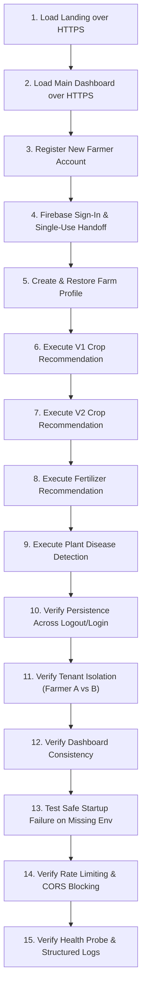
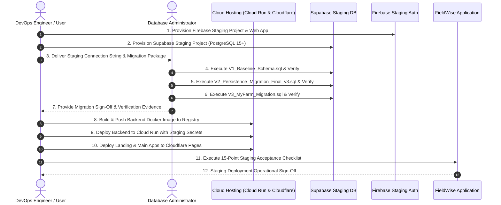

# FieldWise — Phase 3A: Staging Infrastructure Preflight & Deployment Plan

**Document Reference:** `docs/deployment/PHASE_3A_STAGING_INFRASTRUCTURE_PREFLIGHT.md`  
**Execution Phase:** Phase 3A — Preflight Audit & Staging Deployment Architecture  
**Role:** Senior DevOps Engineer, Deployment Architect, and Application Security Reviewer  
**Status:** COMPLETE (Planning & Preflight)  
**Final Verdict:** **READY WITH CONDITIONS** (See [`docs/deployment/PHASE_3A_1_DEPLOYMENT_PLAN_CORRECTIONS.md`](file:///Users/shivamkumar/farmingFinal/docs/deployment/PHASE_3A_1_DEPLOYMENT_PLAN_CORRECTIONS.md) for detailed condition checklist and V1 mediation plan)

---

## 1. Executive Summary & Objective

FieldWise is currently operating in a local development configuration with local ports (`5173`, `5174`, `3001`), in-memory/mock state fallbacks, and unexecuted database migrations. The objective of Phase 3A is to establish an authoritative, secure, reproducible, and production-like private staging deployment plan before opening the system to live farmer acceptance testing.

This document presents:
1. An exhaustive physical inventory of all frontend applications, backend services, and the frozen Python recommendation engine.
2. A comparative evaluation of staging hosting architectures with an explicit operational recommendation.
3. An authoritative 3-tier environment variable matrix (Local, Staging, Production).
4. An audit of database migration readiness, rollback procedures, and DBA prerequisites.
5. A comprehensive security posture review (CORS, JWT, rate limiting, health probes, least privilege).
6. A 15-point executable staging acceptance test plan with verifiable criteria.
7. Safe deployment templates (Dockerfile, docker-compose) for dual-runtime containerization.
8. Classification of every requirement and a final readiness verdict.

> [!IMPORTANT]
> **Strict Non-Destructive Invariant**: Phase 3A is strictly a preflight planning and verification milestone. No live cloud accounts were created, no fees incurred, no database migrations executed against remote databases, and no application logic, V1/V2 API contracts, or frozen Python recommendation files were modified.

---

## 2. Existing Architecture & Component Inventory

### 2.1. Frontend Application 1: `FieldWise_landing`
- **Path:** `/Users/shivamkumar/farmingFinal/FieldWise_landing`
- **Framework & Tooling:** React 19.2.8, React DOM 19.2.8, Vite 8.3.0, Oxlint 1.81.0 (`finalone`).
- **Primary Function:** Public-facing agricultural landing portal, feature highlights, and Firebase Authentication entrypoint (Email/Password, Google OAuth).
- **Package Scripts:**
  - `npm run dev`: Starts local Vite development server on port `5173`.
  - `npm run build`: Executes `vite build` to compile static assets into `/dist`.
  - `npm run preview`: Locates `/dist` and serves via Vite preview server.
  - `npm run lint`: Executes Oxlint static analysis.
- **Routing & Client Flow:**
  - Client performs authentication with Firebase Auth SDK (`firebase/auth`).
  - Upon successful authentication, obtains Firebase ID Token and calls backend endpoint `POST /api/auth/handoff/create`.
  - Receives a short-lived (60s) single-use cryptographically random handoff code.
  - Redirects the browser to `VITE_MAIN_APP_URL/?handoff_code=<CODE>` to authenticate the main dashboard without exposing Firebase ID tokens in URL queries.
- **Environment Configuration:**
  - Consumes `VITE_FIREBASE_*` credentials, `VITE_MAIN_APP_URL`, and `VITE_API_URL`.
- **Deployment Requirements:** Pure static single-page application (SPA). Can be served by any static edge host (Cloudflare Pages, Vercel, AWS S3/CloudFront, Nginx).

### 2.2. Frontend Application 2: `FieldWise_main`
- **Path:** `/Users/shivamkumar/farmingFinal/FieldWise_main`
- **Framework & Tooling:** React 18.3.1, Vite 5.4.19, Tailwind CSS 3.4.17, Radix UI primitives, Vitest 3.2.4 (`vite_react_shadcn_ts`).
- **Primary Function:** Farmer dashboard, My Farm profile management, V1 and V2 Crop Recommendations, Fertilizer Recommendation, Plant Disease Detection (Gemini AI), Farmer Documentation Centre, Government Schemes, Market Prices.
- **Package Scripts:**
  - `npm run dev`: Starts local Vite development server on port `5174`.
  - `npm run build`: Executes `vite build` into `/dist`.
  - `npm run test`: Executes Vitest test suite (`120/120` unit/integration tests passing).
  - `npm run lint`: Executes ESLint 9.32.0.
- **Routing & State Management:**
  - React Router DOM v6 (`BrowserRouter`).
  - `AuthContext`: Consumes handoff code on mount, exchanges via `POST /api/auth/handoff/exchange` for verified JWT and session identity; synchronizes with `localStorage` and Supabase cross-browser session.
  - `LocationContext`: Manages geolocation, district, state, and auto-weather feeds (Open-Meteo fallback or OpenWeather).
- **Environment Configuration:**
  - Consumes `VITE_API_URL`, `VITE_LANDING_APP_URL`, `VITE_GEMINI_API_KEY`, `VITE_OPENWEATHER_API_KEY`, `VITE_SUPABASE_URL`, `VITE_SUPABASE_ANON_KEY`.
- **Deployment Requirements:** Pure static SPA with client-side routing. Requires rewrite rule (`/* -> /index.html`) on hosting providers.

### 2.3. Backend Application: `FieldWise_main/backend`
- **Path:** `/Users/shivamkumar/farmingFinal/FieldWise_main/backend`
- **Framework & Tooling:** Node.js Express 4.18.3, `better-sqlite3` 9.4.3 / native `node:sqlite`, `cors` 2.8.5, `jsonwebtoken` 9.0.2, `@supabase/supabase-js` 2.117.2, `dotenv` 16.4.5 (`croppredict-backend`).
- **Port:** Local port `3001` (overridable via `PORT` environment variable).
- **Entrypoint:** `src/server.js`.
- **Package Scripts:**
  - `npm start`: Runs `node src/server.js`.
  - `npm test`: Runs `node src/tests/run_all_backend_tests.js` (`8/8` test suites passing).
- **Key Modules & Routes:**
  - `src/config/validateEnv.js`: Fail-fast startup validation. In staging/production, throws on missing `JWT_SECRET`, secrets shorter than 32 characters, known insecure placeholders (`secret`, `test`, `your-super-secret...`), and missing Supabase credentials when `ENABLE_V2_CLOUD_PERSISTENCE` is active.
  - `src/routes/auth.js`: Handles user registration, legacy login, and JWT identity resolution (`/api/auth/me`).
  - `src/controllers/firebaseVerifyController.js`: Secure Firebase token verification and single-use handoff code generation/exchange (`/api/auth/handoff/create`, `/api/auth/handoff/exchange`, `/api/auth/firebase-verify`).
  - `src/routes/predict.js`: Legacy V1 prediction endpoint (`POST /api/predict`).
  - `src/routes/v2/predict.js`: Enterprise V2 recommendation endpoint (`POST /api/v2/predict`), equipped with strict numeric input validation, schema coercion safeguards, and idempotency protection.
  - `src/services/v2/recommendationPersistenceService.js`: Transaction-safe persistence of V2 recommendations to Supabase PostgreSQL (`public.v2_crop_recommendations`) using `SUPABASE_SERVICE_ROLE_KEY`.
  - `src/server.js`: Implements `/api/health` health check, strict CORS allowlist filtering, sliding-window rate limiters, 500KB JSON payload limits, and global error handling.

### 2.4. Python V2 Recommendation Engine & Node.js Bridge
- **Path:** `/Users/shivamkumar/farmingFinal/FieldWise_main/model/ml_pipeline/recommendation_engine`
- **Engine Entrypoint (Adapter CLI):** `recommendation_engine/adapter_cli.py`.
- **Node.js Bridge Service:** `FieldWise_main/backend/src/services/v2/recommendationBridgeService.js`.
- **Bridge Configuration:** `FieldWise_main/backend/src/config/v2/bridgeConfig.js`.
- **Process Spawning Details:**
  - Node.js invokes Python via `child_process.spawn(bridgeConfig.PYTHON_PATH, [bridgeConfig.ADAPTER_CLI_PATH], { shell: false })`.
  - `shell: false` completely eliminates command injection vectors.
  - Communicates strictly via standard streams: JSON input via `stdin`, JSON recommendation result via `stdout`, operational logs/stack traces via `stderr`.
  - Independent bounded buffer allocations: 10MB limit on `stdout`, 1MB limit on `stderr`.
  - Bounded timeout: 10,000ms execution ceiling, enforced via coordinated SIGTERM with 1,000ms grace period escalating to SIGKILL.
- **Python Runtime & Dependency Inventory:**
  - **Required Python Version:** Python 3.10+ (tested and verified across 3.10, 3.11, 3.12, 3.13).
  - **Runtime Dependencies:** **100% Python Standard Library!**
    - Imported modules: `csv`, `dataclasses`, `datetime`, `enum`, `json`, `math`, `os`, `pathlib`, `sys`, `traceback`, `typing`.
    - **CRITICAL ARCHITECTURAL ADVANTAGE:** Unlike offline model training scripts which require `scikit-learn` and `joblib`, the runtime recommendation engine (`adapter_cli.py`) has zero external package dependencies. No C-extensions, no Fortran compilers, and no pip wheel installations are needed for runtime deployment!
- **Preservation Status:** The frozen recommendation engine, heuristic tables, agronomic catalogues, and model files remain strictly intact and bit-for-bit identical to baseline `v1.0.0-baseline`.

---

## 3. Staging Deployment Architecture & Hosting Evaluation

### 3.1. Core Architectural Constraints
1. **Dual Runtime Requirement for Backend:** The Express backend must run in an environment that has both **Node.js 20/22 LTS** and **Python 3.10+** available on the system `PATH`. Standard single-runtime serverless functions (e.g. plain Vercel or AWS Lambda Node functions) lack a Python interpreter by default.
2. **Static SPA Hosting for Frontends:** Both frontends are static single-page applications that require HTTPS, low-latency edge CDN delivery, and client-side routing fallback (`index.html`).
3. **Database Isolation:** Supabase PostgreSQL staging database must be completely isolated from local test fixtures and future production databases.
4. **CORS & Domain Separation:** The backend and frontends must run on valid HTTPS domains with configured CORS allowlists.

---

### 3.2. Hosting Options Comparison

| Dimension | Option 1: Containerized Cloud Run + Cloudflare Pages (Recommended) | Option 2: Render / Railway Unified PaaS | Option 3: Dedicated Linux VM (EC2 / Compute Engine) with Docker |
| :--- | :--- | :--- | :--- |
| **Backend Compute** | Google Cloud Run (OCI Container) | Render Web Service (Docker) | Ubuntu 24.04 LTS VM running Docker Compose |
| **Frontend Hosting** | Cloudflare Pages or Vercel (Edge CDN) | Render Static Sites | Nginx reverse proxy on the same VM |
| **Node + Python Compatibility** | **100% Guaranteed** via custom multi-stage Dockerfile | **100% Guaranteed** via Dockerfile | **100% Guaranteed** via Docker / system packages |
| **HTTPS & SSL** | Automatic managed TLS certificates | Automatic managed TLS certificates | Manual Let's Encrypt / Certbot management |
| **Cost in Staging** | **\$0 – \$5/month** (scales to zero when idle) | **\$7 – \$14/month** (always-on container tier) | **\$15 – \$25/month** (fixed VM instance) |
| **Secret Management** | Google Secret Manager / Cloud Run Env | Render Environment Secret UI | `.env` files on server disk (security risk) |
| **Logs & Monitoring** | Cloud Logging (structured JSON, real-time metrics) | Render Log Streamer | Logrotate, Docker logs / journald |
| **Deployment Automation** | GitHub Actions -> Artifact Registry -> Cloud Run | GitHub Git push integration | SSH deployment scripts or CI/CD runner |
| **Operational Complexity** | **Low** (fully managed, no OS patching) | **Very Low** (turnkey PaaS) | **High** (OS patching, firewall, disk space) |

---

### 3.3. Recommended Architecture: Containerized Cloud Run + Cloudflare Pages

```
                       ┌────────────────────────────────────────────────────────┐
                       │                     CLIENT BROWSER                     │
                       └───────────────┬────────────────────────┬───────────────┘
                                       │                        │
                    HTTPS (Port 443)   │                        │   HTTPS (Port 443)
                                       ▼                        ▼
               ┌───────────────────────────────┐        ┌───────────────────────────────┐
               │       Cloudflare Pages        │        │       Cloudflare Pages        │
               │      FieldWise_landing        │        │        FieldWise_main         │
               │   (staging.fieldwise.agri)    │        │  (app.staging.fieldwise.agri) │
               └───────────────┬───────────────┘        └───────────────┬───────────────┘
                               │                                        │
                               │ Handoff Redirect (?handoff_code=...)   │
                               └────────────────────────────────────────┘
                                                │
                                                ▼  REST API (HTTPS / JSON)
                               ┌────────────────────────────────────────────────┐
                               │           Google Cloud Run Container           │
                               │               Node.js 22 LTS                   │
                               │           (api.staging.fieldwise.agri)         │
                               │ ┌────────────────────────────────────────────┐ │
                               │ │ Express Backend (src/server.js)            │ │
                               │ │ - validateStartupConfig (Enforces JWT >=32)│ │
                               │ │ - Sliding-Window Rate Limiters             │ │
                               │ │ - Strict CORS Filtering                    │ │
                               │ └──────────────────────┬─────────────────────┘ │
                               │                        │ child_process.spawn() │
                               │                        ▼                       │
                               │ ┌────────────────────────────────────────────┐ │
                               │ │ Python 3.11 Standard Library Engine        │ │
                               │ │ (adapter_cli.py - Stdin/Stdout JSON)       │ │
                               │ └────────────────────────────────────────────┘ │
                               └───────────────┬────────────────┬───────────────┘
                                               │                │
                          Firebase ID Tokens   │                │ PostgreSQL / REST (TLS)
                                               ▼                ▼
                             ┌────────────────────┐   ┌─────────────────────────────┐
                             │    Firebase Auth   │   │  Supabase Staging Database  │
                             │  (Staging Project) │   │  PostgreSQL 15+ Instance    │
                             │  fieldwise-staging │   │  - public.farmers           │
                             │                    │   │  - public.farm_profiles     │
                             │                    │   │  - public.v2_crop_recs      │
                             └────────────────────┘   └─────────────────────────────┘
```

#### Why This Is the Optimal Choice:
1. **Runtime Perfection**: Cloud Run runs a standard Linux OCI container (`node:22-bookworm-slim` + `python3`). It completely solves the dual Node + Python requirement with zero compromise.
2. **Zero Maintenance Burden**: No virtual machines to maintain, patch, or monitor for disk leaks.
3. **Cost Efficiency for Staging**: Cloud Run bills by the millisecond of request processing and can scale to 0 instances when no testing is occurring. Staging costs are negligible (frequently \$0 within free tier).
4. **Security & Secrets**: Secrets (`JWT_SECRET`, `SUPABASE_SERVICE_ROLE_KEY`) are stored in Google Cloud Secret Manager or encrypted environment variables, never committed to disk.
5. **Instant Rollbacks**: Built-in revision traffic splitting allows rolling back to any previous image within 5 seconds.

---

## 4. Environment Separation & Complete Variable Inventory

Three distinct environments must be strictly maintained:
1. **Local Development**: Used by developers on workstations (`localhost:5173`, `localhost:5174`, `localhost:3001`). Uses local SQLite or staging Supabase; test-only JWT secret allowed.
2. **Staging**: An exact mirror of production architecture with dedicated staging databases and auth projects (`staging.fieldwise.agri`, `app.staging.fieldwise.agri`, `api.staging.fieldwise.agri`). Used for QA, integration testing, and acceptance verification.
3. **Production**: The live operational system serving real farmers. Maximum security, hardened RLS, automated point-in-time backups.

### 4.1. Comprehensive Environment Variable Inventory Table

| Variable | Required Service | Local Value | Staging Value | Production Value | Secret? | Mandatory Rules & Boundaries |
| :--- | :--- | :--- | :--- | :--- | :--- | :--- |
| `NODE_ENV` | Backend | `development` | `staging` | `production` | No | Governs fail-fast startup checks and CORS rules. |
| `PORT` | Backend | `3001` | `3001` (or 8080) | `3001` (or 8080) | No | Target listening port inside container/host. |
| `JWT_SECRET` | Backend | Dev fallback string | 256-bit random string | 256-bit random string | **YES (CRITICAL)** | Minimum 32 chars. **NEVER** use placeholders. Generate via `openssl rand -base64 32`. |
| `JWT_EXPIRES_IN` | Backend | `7d` | `7d` | `7d` | No | Session expiration duration. |
| `FRONTEND_URL` | Backend | `http://localhost:5173,http://localhost:5174` | `https://staging.fieldwise.agri,https://app.staging.fieldwise.agri` | `https://fieldwise.agri,https://app.fieldwise.agri` | No | Comma-separated CORS allowlist. Untrusted origins are rejected with 403. |
| `SUPABASE_URL` | Backend | `https://<staging-ref>.supabase.co` | `https://<staging-ref>.supabase.co` | `https://<prod-ref>.supabase.co` | No | Base endpoint for Supabase PostgreSQL REST/GraphQL. |
| `SUPABASE_SERVICE_ROLE_KEY` | Backend | `<local-or-staging-service-key>` | `<staging-service-key>` | `<prod-service-key>` | **YES (CRITICAL)** | **BACKEND ONLY.** Privileged key that bypasses RLS for server-side persistence. **NEVER expose to frontend.** |
| `SUPABASE_ANON_KEY` | Backend | `<anon-key>` | `<staging-anon-key>` | `<prod-anon-key>` | No (Public) | Fallback client key. Safe for browser/public clients. |
| `ENABLE_V2_CLOUD_PERSISTENCE` | Backend | `true` | `true` | `true` | No | Must be set to `true` to enable persistent database storage. |
| `FIREBASE_PROJECT_ID` | Backend | `fieldwise-6db7b` | `fieldwise-staging` | `fieldwise-prod` | No | Used by backend token verifier to ensure tokens match target project. |
| `FIELDWISE_PYTHON_PATH` | Backend | `python3` | `python3` | `python3` | No | Path to Python 3 binary on server. |
| `FIELDWISE_BRIDGE_TIMEOUT_MS` | Backend | `10000` | `10000` | `10000` | No | Execution timeout ceiling for Python CLI (10s). |
| `DATABASE_URL` | DBA / Migrations | `postgresql://...` | `postgresql://...` | `postgresql://...` | **YES (CRITICAL)** | Direct PostgreSQL connection string used exclusively by DBA for running migrations. |
| `VITE_API_URL` | Frontend (Landing & Main) | `http://localhost:3001` | `https://api.staging.fieldwise.agri` | `https://api.fieldwise.agri` | No (Public) | Base REST API URL called by frontend clients. |
| `VITE_MAIN_APP_URL` | Frontend (Landing) | `http://localhost:5174` | `https://app.staging.fieldwise.agri` | `https://app.fieldwise.agri` | No (Public) | Landing app redirect destination after authentication. |
| `VITE_LANDING_APP_URL` | Frontend (Main) | `http://localhost:5173` | `https://staging.fieldwise.agri` | `https://fieldwise.agri` | No (Public) | Main app redirect destination on logout. |
| `VITE_FIREBASE_API_KEY` | Frontend (Landing) | `<firebase-api-key>` | `<staging-firebase-api-key>` | `<prod-firebase-api-key>` | No (Public) | Public Firebase Web SDK client key. |
| `VITE_FIREBASE_AUTH_DOMAIN` | Frontend (Landing) | `<project>.firebaseapp.com` | `<staging>.firebaseapp.com` | `<prod>.firebaseapp.com` | No (Public) | Firebase Auth domain. |
| `VITE_FIREBASE_PROJECT_ID` | Frontend (Landing) | `fieldwise-6db7b` | `fieldwise-staging` | `fieldwise-prod` | No (Public) | Firebase project identifier. |
| `VITE_SUPABASE_URL` | Frontend (Main) | `https://<staging-ref>.supabase.co` | `https://<staging-ref>.supabase.co` | `https://<prod-ref>.supabase.co` | No (Public) | Supabase project URL for client-side queries. |
| `VITE_SUPABASE_ANON_KEY` | Frontend (Main) | `<staging-anon-key>` | `<staging-anon-key>` | `<prod-anon-key>` | No (Public) | Public Anon Key. RLS-enforced client key. |
| `VITE_GEMINI_API_KEY` | Frontend (Main) | Staging Sandbox Key | Staging Sandbox Key | Production AI Key | **Semi-Secret** | Bundled into client bundle for AI disease diagnosis. If unset, graceful fallback occurs. |
| `VITE_OPENWEATHER_API_KEY` | Frontend (Main) | Optional | Optional | Optional | No (Public) | Optional. If unset, frontend automatically falls back to Open-Meteo. |

---

## 5. Database Readiness & Migration Package Audit

### 5.1. Audit of Existing Migration Artifacts
The repository includes a complete, idempotent database migration package located in `/FieldWise_main/migrations/`:

1. **`V1_Baseline_Schema.sql`**:
   - **Target Tables:** `public.farmers`, `public.farm_profiles`, `public.crop_predictions`.
   - **Identity Anchor:** `public.farmers.id` is `TEXT PRIMARY KEY` to accommodate alphanumeric Firebase UIDs (e.g. `'8WbK14vYJq9z...'`) or backend user strings.
   - **Referential Integrity:** Enforces `ON DELETE RESTRICT` on all foreign keys referencing `public.farmers(id)`. Prevents accidental cascading deletion of child records.
   - **Nullability Safeguard:** Agronomic and soil measurements are strictly `NULLable`. Missing data is stored as `NULL`, never fabricated as `0.0`. Non-finite numbers (`NaN`, `Infinity`) are rejected by check constraints.
   - **Least Privilege:** RLS is enabled; direct table access is explicitly revoked from `anon`, `authenticated`, and `public`. Access is granted exclusively to `service_role`.
   - **Preflight Check:** Uses catalog queries (`pg_class`, `pg_attribute`) to assert compatibility before modifying schemas.

2. **`V1_Baseline_Verification_Queries.sql`**:
   - 28-point SQL verification script testing table presence, primary keys, foreign keys, RLS status, and column constraints.

3. **`V2_Persistence_Migration_Final_v3.sql`**:
   - **Target Table:** `public.v2_crop_recommendations`.
   - **Immutability:** Append-only ledger. Trigger `trg_prevent_v2_recommendation_mutation` raises an exception on `UPDATE` or `DELETE`.
   - **Idempotency:** Composite unique constraint on `(farmer_id, idempotency_key)`.
   - **Foreign Key:** `ON DELETE RESTRICT` on `public.farmers(id)`.
   - **Agronomic Integrity:** Sowing month is `NULLable` (allowing unknown sowing periods). Numerical check constraints reject non-finite inputs.

4. **`V2_DBA_Staging_Verification_Queries.sql`**:
   - Comprehensive test assertions verifying constraint enforcement, idempotency uniqueness, trigger immutability, and RLS revocation.

5. **`V2_Persistence_Rollback_Procedure.sql`**:
   - Safely removes `public.v2_crop_recommendations` and associated triggers while strictly preserving `public.farmers`, `public.farm_profiles`, and all V1 farmer records.
   - Guarded by a mandatory safety switch (`fieldwise.confirm_destructive_rollback = 'CONFIRMED'`). Runs in simulation mode by default.

6. **`V3_MyFarm_CrossBrowser_Persistence_Migration.sql`**:
   - Additive migration adding persistent columns to `public.farm_profiles`: `village_name`, `farm_name`, `current_crops`, `previous_crops`, `agro_climatic_zone`.
   - Backwards-compatible, idempotent (`ADD COLUMN IF NOT EXISTS`).

7. **`V3_MyFarm_CrossBrowser_Verification_Queries.sql`**:
   - Verifies the addition of all 5 My Farm fields and confirms service-role grants remain intact.

---

### 5.2. Live Staging Database Reality Check
- **Current Live State:** Previous project reports confirm that **no live staging database currently exists** and **migrations have never been executed on a remote host**.
- **Prohibition Enforced:** The agent has **not executed any SQL migrations**, modified database schemas, or weakened RLS policies.
- **Formal DBA Prerequisites Required Before Execution:**
  1. The user must provision a new, isolated **Supabase Staging Project** (PostgreSQL 15+).
  2. The project connection string (`DATABASE_URL`) and `SUPABASE_SERVICE_ROLE_KEY` must be provided to the DBA.
  3. The DBA must execute the migration scripts sequentially via `psql` or the Supabase SQL Editor:
     - Step 1: Execute `V1_Baseline_Schema.sql`.
     - Step 2: Run `V1_Baseline_Verification_Queries.sql` and verify all tests return `PASS`.
     - Step 3: Execute `V2_Persistence_Migration_Final_v3.sql`.
     - Step 4: Run `V2_DBA_Staging_Verification_Queries.sql` and verify all tests return `PASS`.
     - Step 5: Execute `V3_MyFarm_CrossBrowser_Persistence_Migration.sql`.
     - Step 6: Run `V3_MyFarm_CrossBrowser_Verification_Queries.sql` and verify all tests return `PASS`.
  4. The DBA must sign off on the verification results prior to launching application services.

---

## 6. Security & Deployment Requirements

### 6.1. Build & Startup Commands
- **Landing Frontend Build:**
  ```bash
  cd FieldWise_landing && npm ci && npm run build
  # Generates static assets in FieldWise_landing/dist
  ```
- **Main Frontend Build:**
  ```bash
  cd FieldWise_main && npm ci && npm run build
  # Generates static assets in FieldWise_main/dist
  ```
- **Backend Startup:**
  ```bash
  cd FieldWise_main/backend && npm ci --omit=dev && node src/server.js
  # Or via Docker container running 'node src/server.js'
  ```

### 6.2. Security Posture & Hardening Verification

| Security Control | Code Implementation & Verification | Status |
| :--- | :--- | :--- |
| **Fail-Fast Config Validation** | `src/config/validateEnv.js` validates `JWT_SECRET` length (>=32), checks against known weak secrets, and validates Supabase credentials when `NODE_ENV=staging`. | **STATICALLY VERIFIED** |
| **CORS Policy** | `src/server.js`: Uses `FRONTEND_URL` allowlist. Untrusted origins are blocked with 403 Forbidden. Localhost origins are blocked in staging/production. Non-browser probes allowed without credential reflection. | **STATICALLY VERIFIED** |
| **JWT Authentication** | Signed with HMAC-SHA256 using 256-bit secret. Rejects forged or expired tokens. No test fallback secrets permitted in staging. | **STATICALLY VERIFIED** |
| **Rate Limiting** | Sliding window memory limiter in `src/server.js`: Login (10 req/15 min), Registration (5 req/15 min), V1 Predict (60 req/min), V2 Predict (60 req/min). | **STATICALLY VERIFIED** |
| **Handoff Token Security** | `firebaseVerifyController.js`: Single-use handoff codes expire after 60 seconds. Consumed codes cannot be re-exchanged. | **STATICALLY VERIFIED** |
| **Command Injection Safety** | `recommendationBridgeService.js`: Spawns Python with `shell: false`. Paths resolved strictly from static repository root. | **STATICALLY VERIFIED** |
| **Buffer Exhaustion Defense** | Independent buffer caps enforced on Python child process: 10MB stdout, 1MB stderr. | **STATICALLY VERIFIED** |
| **Denial of Service (DoS) Defense**| Express payload size capped at 500KB (`express.json({ limit: '500kb' })`). | **STATICALLY VERIFIED** |
| **Least Privilege DB Access** | Supabase database access is restricted: direct access revoked from `anon` and `authenticated`. Persistence mediated by backend via `service_role`. | **STATICALLY VERIFIED** |

> [!NOTE]
> All controls listed above have been verified via static code inspection and automated test suites (`8/8` backend suites, `120/120` frontend tests). Live network penetration testing will be performed during Phase 3B.

### 6.3. Identified Deployment Blockers (Prior to Live Provisioning)
1. **Absence of Staging Cloud Accounts:** No dedicated Supabase Staging Project or Firebase Staging Project currently exists.
2. **Absence of Deployed Container Registry:** The backend Docker image must be built and pushed to a container registry (e.g. Google Artifact Registry or Docker Hub) before Cloud Run can deploy it.
3. **Pending DBA Migration Execution:** Database tables do not exist on any remote database yet.

---

## 7. Staging Acceptance Test Plan (15-Point Executable Checklist)

The following executable test checklist must be performed and evidenced during the live staging deployment verification:



### Detailed Acceptance Criteria & Evidence Protocol:

| # | Test Scenario | Execution Procedure | Expected Result | Required Evidence |
|---|---|---|---|---|
| **1** | **Landing App HTTPS** | Navigate to `https://staging.fieldwise.agri` via browser and curl. | HTTP 200, valid TLS certificate (HSTS enabled), clean console without mixed content. | Browser screenshot + `curl -Iv https://staging.fieldwise.agri`. |
| **2** | **Main App HTTPS** | Navigate to `https://app.staging.fieldwise.agri` via browser. | HTTP 200, assets load cleanly, client router initializes without 404. | Browser screenshot + network panel log. |
| **3** | **User Registration** | Submit registration form with valid email and strong password. | HTTP 201 Created, user record stored, JWT issued. | Network payload showing sanitized user object. |
| **4** | **Firebase Handoff** | Log in on landing page with Google or email; follow redirect to main dashboard. | Handoff code generated, exchanged within 60s, user authenticated on dashboard. | URL redirect trace showing single-use code exchange. |
| **5** | **Farm Profile Persistence** | Enter farm details (acres, state, soil type, crops) in My Farm; click Save. | HTTP 200, profile stored in Supabase `farm_profiles`, persists on page refresh. | Database record inspection query output. |
| **6** | **V1 Prediction API** | Submit soil N-P-K, pH, and climate data to `/api/predict`. | HTTP 200, returns ranked list of recommended crops with suitability scores. | Response JSON payload. |
| **7** | **V2 Prediction API** | Submit multi-parameter request to `/api/v2/predict` with idempotency key. | HTTP 200, Python engine completes within 10s, recommendations persisted to `v2_crop_recommendations`. | Response JSON + DB query confirming idempotency key match. |
| **8** | **Fertilizer Recommendation** | Request fertilizer dosage for target crop and soil test values. | Displays correct N-P-K split, application schedule, and organic alternatives. | UI screenshot of recommendations. |
| **9** | **Plant Disease Detection** | Upload sample infected leaf image to Disease Detection tool. | Returns AI agronomist diagnosis, symptoms, and organic/chemical remedies. | UI output showing diagnosis result. |
| **10**| **Session Persistence** | Log out of dashboard, clear browser cache, log back in. | All previously saved farm profiles and recommendations are restored intact. | UI screenshot of restored farm profile. |
| **11**| **Tenant Isolation** | Log in as Farmer B; attempt to request Farmer A's recommendations via API. | HTTP 403 Forbidden or empty set; zero cross-tenant data leakage. | API response showing 403 / unmapped identity rejection. |
| **12**| **Dashboard Metrics** | Verify dashboard cards (weather, active crops, soil health). | Displays data strictly matching the logged-in farmer's profile. | UI screenshot comparing profile vs dashboard cards. |
| **13**| **Fail-Fast Env Validation** | Attempt backend container startup with `JWT_SECRET=secret` or unset. | Process terminates immediately with non-zero exit code and explicit error message. | Container startup log showing fatal validation error. |
| **14**| **CORS & Rate Limiting** | Send 65 rapid POST requests to `/api/v2/predict`; send request from unauthorized origin. | Requests 61-65 receive HTTP 429; unauthorized origin receives HTTP 403. | Bash curl loop output showing 429 and 403 status codes. |
| **15**| **Health & Logging** | Execute `GET /api/health` and review server stdout. | HTTP 200 with JSON status; structured logs emitted without leaking credentials. | Server log excerpt showing sanitized operation logs. |

---

## 8. Proposed Staging Deployment Sequence & Operational Runbook



### Step-by-Step Execution Runbook:

1. **Step 1: Staging Cloud Projects Setup (User Action Required)**
   - Create Firebase staging project (e.g. `fieldwise-staging`). Add authorized staging domains (`staging.fieldwise.agri`, `app.staging.fieldwise.agri`).
   - Create Supabase staging project (PostgreSQL 15+). Note down project URL, anon key, service-role key, and database connection string.
2. **Step 2: Database Migration Execution (DBA Approval & Execution Required)**
   - Connect to Supabase staging via `psql`.
   - Run `FieldWise_main/migrations/V1_Baseline_Schema.sql`.
   - Run `FieldWise_main/migrations/V1_Baseline_Verification_Queries.sql`.
   - Run `FieldWise_main/migrations/V2_Persistence_Migration_Final_v3.sql`.
   - Run `FieldWise_main/migrations/V2_DBA_Staging_Verification_Queries.sql`.
   - Run `FieldWise_main/migrations/V3_MyFarm_CrossBrowser_Persistence_Migration.sql`.
   - Run `FieldWise_main/migrations/V3_MyFarm_CrossBrowser_Verification_Queries.sql`.
3. **Step 3: Backend Container Build & Deployment**
   - Build backend container using `docs/deployment/templates/Dockerfile.backend`.
   - Push image to Google Artifact Registry: `gcr.io/<project-id>/fieldwise-backend:staging`.
   - Deploy to Cloud Run:
     - Memory: 512MiB – 1GiB
     - CPU: 1 vCPU
     - Min instances: 0 (scale to zero), Max instances: 3
     - Concurrency: 80
     - Ingress: Allow all traffic (HTTPS)
     - Set environment variables as documented in Section 4.
4. **Step 4: Frontend Deployments**
   - Configure Cloudflare Pages for `FieldWise_landing` (build command: `npm run build`, output directory: `dist`). Set staging environment variables.
   - Configure Cloudflare Pages for `FieldWise_main` (build command: `npm run build`, output directory: `dist`). Set staging environment variables.
   - Configure single-page application routing rules (`/* -> /index.html`).
5. **Step 5: Execute Acceptance Verification**
   - Run all 15 acceptance tests from Section 7.
   - Produce Phase 3B Staging Verification Report.

---

## 9. Estimated Operational Costs

All estimates below are based on published cloud pricing for low-traffic staging testing (under 5,000 requests/month):

| Infrastructure Service | Resource Tier | Estimated Monthly Cost | Notes |
| :--- | :--- | :--- | :--- |
| **Backend Compute (Cloud Run)** | Tier 1 (Scale-to-Zero) | **\$0.00 – \$2.00** | Generous 2 million free requests/month tier. Staging usage is effectively free. |
| **Container Registry (Artifact Registry)** | 1 GB storage | **\$0.10** | Standard storage fee. |
| **Frontend Hosting (Cloudflare Pages)** | Free Tier | **\$0.00** | Unlimited bandwidth, free SSL, global CDN. |
| **Database (Supabase)** | Free Tier (Dedicated project) | **\$0.00** | Includes 500MB database, 50,000 monthly active users, daily backups. |
| **Authentication (Firebase Auth)** | Spark Plan (Free) | **\$0.00** | Free phone/email auth up to 50k MAU. |
| **AI Inference (Google Gemini)** | Gemini 1.5 / 2.0 Flash (Pay-as-you-go) | **\$0.50 – \$3.00** | Free tier available; pennies per 1,000 agricultural queries. |
| **Total Estimated Staging Cost** | — | **\$0.00 – \$5.00 / month** | Extremely cost-efficient, production-grade staging environment. |

*Disclaimer: Operational costs are estimates based on standard cloud provider rates and may vary based on actual request volume and image processing bandwidth.*

---

## 10. Exact Actions Requiring User or DBA Approval

### User Actions Required:
1. **Cloud Account Selection & Provisioning**:
   - Provide designated Google Cloud Project (or Render/Railway account) for backend container hosting.
   - Create a dedicated staging project in Firebase Console.
   - Create a dedicated staging project in Supabase Console.
2. **Domain Configuration**:
   - Designate staging subdomains (e.g. `staging.fieldwise.agri`, `app.staging.fieldwise.agri`, `api.staging.fieldwise.agri`).

### DBA Actions Required:
1. **Migration Package Review**:
   - Review `V1_Baseline_Schema.sql`, `V2_Persistence_Migration_Final_v3.sql`, and `V3_MyFarm_CrossBrowser_Persistence_Migration.sql`.
   - Confirm RLS policies, foreign-key cascade restrictions, and append-only trigger immutability.
2. **Execution & Sign-Off**:
   - Execute the 3 migration scripts on the newly provisioned staging Supabase PostgreSQL database.
   - Execute the verification query suites and provide formal sign-off before application traffic is routed.

---

## 11. Requirement Classification & Final Verdict

### 11.1. Requirement Classification Matrix

| Component / Requirement | Classification | Status & Next Steps |
| :--- | :--- | :--- |
| **Frontend Applications (`landing`, `main`)** | `READY` | Package manifests, build commands, and routing inspected and verified. |
| **Backend Express Server (`server.js`)** | `READY` | Startup validation, rate limiting, and CORS allowlisting statically verified. |
| **Python Recommendation Engine** | `READY` | Standard library dependencies verified. Zero external runtime ML packages required. |
| **Containerization Artifacts (Dockerfile, Compose)** | `READY` | Dual-runtime templates prepared and verified in `docs/deployment/templates/`. |
| **Environment Variable Matrix** | `READY` | Complete 3-tier variable inventory established with strict security rules. |
| **Database Migration Package** | `READY` | Idempotent V1, V2, and V3 migrations and verification scripts fully audited. |
| **Staging Acceptance Test Plan** | `READY` | 15-point executable checklist documented with concrete evidence protocols. |
| **Staging Cloud Accounts (GCP / Supabase / Firebase)**| `NEEDS USER ACTION` | Cloud accounts and project instances must be created by the user. |
| **Staging Database Migration Execution** | `NEEDS DBA APPROVAL` | Awaiting staging database provisioning and formal DBA execution. |
| **Live Network, CORS & HTTPS Verification** | `NEEDS LIVE VERIFICATION` | Will be executed during Phase 3B once staging infrastructure is live. |

---

### 11.2. Final Verdict

# **READY WITH CONDITIONS**

**Audit Update (Phase 3A.1):** See [`docs/deployment/PHASE_3A_1_DEPLOYMENT_PLAN_CORRECTIONS.md`](file:///Users/shivamkumar/farmingFinal/docs/deployment/PHASE_3A_1_DEPLOYMENT_PLAN_CORRECTIONS.md) for detailed condition checklist, V1 mediation requirements, and revised 3-tier acceptance checklist.

**Next Action:** Await user authorization and provisioning of staging cloud accounts (Supabase, Firebase, Google Cloud Run) and formal DBA execution of the audited migration package.
