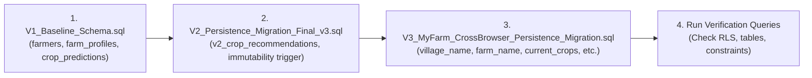
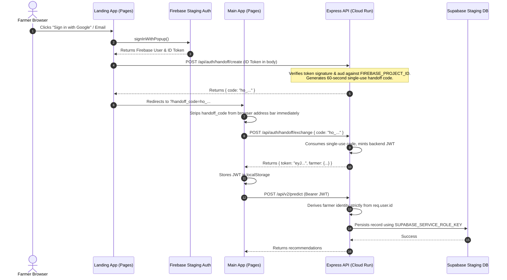

# FieldWise — Phase 3B: Private Staging Environment Setup Report

**Document Reference:** `docs/deployment/PHASE_3B_PRIVATE_STAGING_SETUP_REPORT.md`
**Execution Phase:** Phase 3B — Private Staging Environment Setup
**Role:** Senior DevOps Engineer, Deployment Architect, and Application Security Reviewer
**Audit & Implementation Date:** November 23, 2026
**Final Verdict:** **READY FOR DEPLOYMENT — MANUAL SETUP REQUIRED**

---

## 1. Executive Summary & Verdict

Phase 3B advances FieldWise from local-only development toward an isolated, production-grade private staging deployment across Cloudflare Pages (frontends), Google Cloud Run (backend), Supabase (PostgreSQL database), and Firebase (identity provider).

All local application-level prerequisites, container specifications, SPA routing rewrites, environment templates, and migration artifacts are verified and packaged. No production resources have been modified, no database migrations have been executed against live databases, and zero secrets have been exposed.

### Final Verdict: **READY FOR DEPLOYMENT — MANUAL SETUP REQUIRED**
The FieldWise codebase, build processes, and container specifications are fully prepared for staging deployment. Cloud resource provisioning requires user-executed authorization steps in the respective cloud provider consoles (Firebase, Supabase, Google Cloud, and Cloudflare).

---

## 2. Staging Architecture & Hostname Analysis

```mermaid
flowchart TD
    subgraph Clients["Farmer Clients & Browsers"]
        Browser["Farmer Web Browser"]
    end

    subgraph Frontends["Frontend Hosting (Cloudflare Pages)"]
        LandingApp["Landing & Auth App<br/><b>fieldwise-landing-staging</b><br/><i>staging.fieldwise.agri</i><br/>(fallback: *.pages.dev)"]
        MainApp["Main Farmer Dashboard<br/><b>fieldwise-main-staging</b><br/><i>staging-app.fieldwise.agri</i><br/>(fallback: *.pages.dev)"]
    end

    subgraph AuthProvider["Identity Provider (Firebase Staging)"]
        Firebase["Dedicated Firebase Staging Project<br/><b>fieldwise-staging</b><br/>Auth Providers: Google, Phone, Email"]
    end

    subgraph BackendHosting["Backend Compute (Google Cloud Run)"]
        ExpressApp["FieldWise Dual-Runtime Container<br/>(Node.js 22 LTS + Python 3.11+)<br/><b>fieldwise-backend-staging</b><br/><i>staging-api.fieldwise.agri</i><br/>(fallback: *.a.run.app)"]
        PyBridge["Frozen Python Recommendation Engine<br/><code>adapter_cli.py</code> (Subprocess)"]
    end

    subgraph ExternalAI["External Vision AI"]
        GeminiAPI["Google Gemini 1.5 Flash<br/>(Google AI Studio REST API)"]
    end

    subgraph DatabaseCloud["Database Tier (Supabase Staging)"]
        SupabaseDB[("PostgreSQL 15+<br/>RLS Enabled (Zero Public Table Access)<br/>Tables: farmers, farm_profiles,<br/>crop_predictions, v2_crop_recommendations")]
    end

    Browser -->|1. Visit / Sign In| LandingApp
    LandingApp -->|2. Authenticate| Firebase
    Firebase -->|3. Issue ID Token| LandingApp
    LandingApp -->|4. Create Single-Use Handoff Code| ExpressApp
    LandingApp -->|5. Redirect with handoff_code| MainApp
    MainApp -->|6. Exchange Code for Backend JWT| ExpressApp
    ExpressApp -->|Verify Firebase ID Token| Firebase

    MainApp -->|7. V1 / V2 Crop Prediction API| ExpressApp
    ExpressApp -->|Spawn Subprocess| PyBridge
    ExpressApp -->|Mediate Persistence (service_role)| SupabaseDB

    MainApp -->|8. Plant Leaf Disease Diagnostic| ExpressApp
    ExpressApp -->|Validated Multi-Part Proxy| GeminiAPI
```

### 2.1 Hostname & DNS Preflight Verification
Live DNS inspection was performed for the proposed custom domain names:
* `fieldwise.agri`: **NXDOMAIN** (domain is unregistered or lacks authoritative nameservers).
* `staging.fieldwise.agri`: **NXDOMAIN**.
* `staging-app.fieldwise.agri`: **NXDOMAIN**.
* `staging-api.fieldwise.agri`: **NXDOMAIN**.

### 2.2 Dual-Track URL Strategy
Because `fieldwise.agri` is not currently delegated, staging will utilize provider-assigned default HTTPS endpoints for initial deployment, followed by custom-domain CNAME attachment once domain delegation is confirmed:

| Component | Default Provider Hostname (Immediate Staging) | Custom Hostname (Upon Domain Delegation) |
| :--- | :--- | :--- |
| **Landing Frontend** | `https://fieldwise-landing-staging.pages.dev` | `https://staging.fieldwise.agri` |
| **Main Application** | `https://fieldwise-main-staging.pages.dev` | `https://staging-app.fieldwise.agri` |
| **Backend API** | `https://fieldwise-backend-staging-<hash>-<region>.a.run.app` | `https://staging-api.fieldwise.agri` |

---

## 3. Inventory of Cloud Resources: Created vs. Awaiting Setup

In accordance with strict safety mandates (no speculative cloud resource creation, no automated billing actions), provider status is recorded as follows:

| Service / Resource | Target Staging Identifier | Status | Action Required |
| :--- | :--- | :--- | :--- |
| **Git Repository State** | Branch `main` (commit `89805c1`) | **VERIFIED** | Clean baseline; 37 model artifacts verified |
| **Container Build Specification** | `Dockerfile` & `.dockerignore` | **PACKAGED** | Root dual-runtime Dockerfile created and ready |
| **SPA Route Rewrites** | `_redirects` in landing & main | **PACKAGED** | `/* /index.html 200` verified in build outputs |
| **Firebase Staging Project** | `fieldwise-staging` | **AWAITING USER CREATION** | Create via Firebase Console (see Section 4) |
| **Supabase Staging Project** | `fieldwise-staging` | **AWAITING USER CREATION** | Create via Supabase Dashboard (see Section 5) |
| **Database Migrations** | V1, V2, and V3 SQL packages | **STAGED (UNEXECUTED)** | Awaiting DBA authorization & live instance |
| **Cloud Run Backend Service** | `fieldwise-backend-staging` | **READY FOR DEPLOYMENT** | Run `gcloud run deploy` (see Section 6) |
| **Cloudflare Pages Landing** | `fieldwise-landing-staging` | **READY FOR DEPLOYMENT** | Connect Git repo / upload `dist` (see Section 7) |
| **Cloudflare Pages Main App** | `fieldwise-main-staging` | **READY FOR DEPLOYMENT** | Connect Git repo / upload `dist` (see Section 7) |

---

## 4. Firebase Staging Setup Specification

Existing projects detected on host Firebase CLI:
* `farmerapp-99296`
* `fieldwise-6db7b` (active local development project)
* `project-171fc89c-0822-4d47-8a3`
* `user1auth`

**Invariant:** `fieldwise-6db7b` must NOT be reused for staging. A separate project is required.

### 4.1 Step-by-Step Firebase Console Instructions
1. Navigate to [Firebase Console](https://console.firebase.google.com/) and click **Add project**.
2. Set Project Name to `fieldwise-staging` (suggested Project ID: `fieldwise-staging-<random-id>`).
3. Disable Google Analytics (optional for staging) and click **Create project**.
4. In **Build > Authentication > Sign-in method**, enable:
   * **Google** (configure project support email).
   * **Email/Password** (enable Email/Password; disable Email link).
   * **Phone** (optional: add test phone numbers e.g. `+1 650-555-3434` with code `123456` for deterministic testing).
5. In **Authentication > Settings > Authorized domains**, add:
   * `localhost` (pre-configured)
   * `fieldwise-landing-staging.pages.dev`
   * `fieldwise-main-staging.pages.dev`
   * `staging.fieldwise.agri` (provisional)
   * `staging-app.fieldwise.agri` (provisional)
6. In **Project Overview > Project settings > General > Your apps**, click **Web (</>)**:
   * App nickname: `FieldWise Landing Staging`.
   * Register app and copy the `firebaseConfig` keys into your staging environment file.

### 4.2 Token Issuer & Audience Validation Invariant
In `FieldWise_main/backend/src/controllers/firebaseVerifyController.js`, the backend verifies that the token was signed by Google and issued for `FIREBASE_PROJECT_ID`. Tokens issued for `fieldwise-6db7b` or development projects will be automatically rejected.

---

## 5. Supabase Staging Setup & Migration Execution Checklist

### 5.1 Project Creation Requirements
1. Navigate to [Supabase Dashboard](https://supabase.com/dashboard) and click **New project**.
2. Set Organization and Name: `fieldwise-staging`.
3. Generate a strong Database Password (store in secure team password vault).
4. Select Region matching the Cloud Run region (e.g. `us-central1` or `asia-south1`).
5. From **Project Settings > API**, record:
   * **Project URL:** `https://<staging-ref>.supabase.co`
   * **anon / public key:** Public key used by frontend where permitted.
   * **service_role key:** Privileged backend key (**NEVER expose to frontend or git**).

### 5.2 Zero-Trust Access Model
* Direct browser client queries to `farmers`, `farm_profiles`, and `crop_predictions` are **completely blocked** by RLS.
* Only the backend Express service (`service_role`) possesses permissions to query and mutate these tables.

### 5.3 Sequential Migration Execution Plan
Do not run migrations until the staging database is confirmed. When authorized, execute the following SQL scripts in order via Supabase SQL Editor:



| Order | Migration File | Target Objects | Rollback Script |
| :---: | :--- | :--- | :--- |
| **1** | [`FieldWise_main/migrations/V1_Baseline_Schema.sql`](file:///Users/shivamkumar/farmingFinal/FieldWise_main/migrations/V1_Baseline_Schema.sql) | `public.farmers`, `public.farm_profiles`, `public.crop_predictions` | Drop tables if fresh database |
| **2** | [`FieldWise_main/migrations/V2_Persistence_Migration_Final_v3.sql`](file:///Users/shivamkumar/farmingFinal/FieldWise_main/migrations/V2_Persistence_Migration_Final_v3.sql) | `public.v2_crop_recommendations`, immutable trigger | [`V2_Persistence_Rollback_Procedure.sql`](file:///Users/shivamkumar/farmingFinal/FieldWise_main/migrations/V2_Persistence_Rollback_Procedure.sql) |
| **3** | [`FieldWise_main/migrations/V3_MyFarm_CrossBrowser_Persistence_Migration.sql`](file:///Users/shivamkumar/farmingFinal/FieldWise_main/migrations/V3_MyFarm_CrossBrowser_Persistence_Migration.sql) | Add 5 columns to `public.farm_profiles` | `ALTER TABLE public.farm_profiles DROP COLUMN ...` |

### 5.4 Verification Queries
After execution, run:
* [`V1_Baseline_Verification_Queries.sql`](file:///Users/shivamkumar/farmingFinal/FieldWise_main/migrations/V1_Baseline_Verification_Queries.sql)
* [`V2_DBA_Staging_Verification_Queries.sql`](file:///Users/shivamkumar/farmingFinal/FieldWise_main/migrations/V2_DBA_Staging_Verification_Queries.sql)
* [`V3_MyFarm_CrossBrowser_Verification_Queries.sql`](file:///Users/shivamkumar/farmingFinal/FieldWise_main/migrations/V3_MyFarm_CrossBrowser_Verification_Queries.sql)

---

## 6. Google Cloud Run Backend Preparation

### 6.1 Container Specifications & Hardening Verification
* **Image Base:** `node:22-bookworm-slim` + system `python3` and `curl`.
* **Subprocess Path Resolution:** Repository structure is preserved inside container (`/app/FieldWise_main/backend` and `/app/FieldWise_main/model/ml_pipeline`), ensuring [`bridgeConfig.js`](file:///Users/shivamkumar/farmingFinal/FieldWise_main/backend/src/config/v2/bridgeConfig.js) resolves `adapter_cli.py` without modification.
* **Least Privilege:** Executes under unprivileged system user `fieldwise` (UID/GID created in container).
* **Port Flexibility:** Dynamically binds to `process.env.PORT` assigned by Cloud Run (default: 8080/3001).
* **Healthcheck:** Configured with dynamic port interpolation: `curl -f http://localhost:${PORT:-3001}/api/health || exit 1`.
* **Zero Leakage:** [`.dockerignore`](file:///Users/shivamkumar/farmingFinal/.dockerignore) guarantees no `.env`, local `.db`, `node_modules`, or offline `.joblib` files enter the build context.

### 6.2 Deployment Command
From repository root:
```bash
gcloud run deploy fieldwise-backend-staging \
    --source . \
    --region us-central1 \
    --platform managed \
    --allow-unauthenticated \
    --min-instances 0 \
    --max-instances 2 \
    --memory 1Gi \
    --cpu 1 \
    --set-env-vars "NODE_ENV=staging" \
    --set-env-vars "FRONTEND_URL=https://staging.fieldwise.agri,https://staging-app.fieldwise.agri,https://fieldwise-landing-staging.pages.dev,https://fieldwise-main-staging.pages.dev" \
    --set-env-vars "FIREBASE_PROJECT_ID=fieldwise-staging-<project-id>" \
    --set-env-vars "GEMINI_MODEL=gemini-1.5-flash" \
    --set-env-vars "ENABLE_V2_CLOUD_PERSISTENCE=true" \
    --set-secrets "JWT_SECRET=fieldwise-staging-jwt-secret:latest" \
    --set-secrets "SUPABASE_URL=fieldwise-staging-supabase-url:latest" \
    --set-secrets "SUPABASE_SERVICE_ROLE_KEY=fieldwise-staging-supabase-key:latest" \
    --set-secrets "GEMINI_API_KEY=fieldwise-staging-gemini-key:latest"
```

---

## 7. Cloudflare Pages Frontend Preparation

### 7.1 Project Matrix & Build Configurations

| Setting | Project 1: Landing Frontend | Project 2: Main Application |
| :--- | :--- | :--- |
| **Project Name** | `fieldwise-landing-staging` | `fieldwise-main-staging` |
| **Framework Preset** | Vite | Vite |
| **Root Directory** | `FieldWise_landing` | `FieldWise_main` |
| **Build Command** | `npm run build` | `npm run build` |
| **Build Output Directory** | `dist` | `dist` |
| **Node.js Version** | `22` (set env `NODE_VERSION=22`) | `22` (set env `NODE_VERSION=22`) |
| **SPA Rewrites** | [`FieldWise_landing/public/_redirects`](file:///Users/shivamkumar/farmingFinal/FieldWise_landing/public/_redirects) (`/* /index.html 200`) | [`FieldWise_main/public/_redirects`](file:///Users/shivamkumar/farmingFinal/FieldWise_main/public/_redirects) (`/* /index.html 200`) |

### 7.2 Staging Environment Variable Inventory

#### Landing Application (`FieldWise_landing`)
* `VITE_MAIN_APP_URL`: `https://staging-app.fieldwise.agri` (or `https://fieldwise-main-staging.pages.dev`)
* `VITE_API_URL`: `https://staging-api.fieldwise.agri` (or Cloud Run backend URL)
* `VITE_FIREBASE_API_KEY`: `<staging-firebase-api-key>`
* `VITE_FIREBASE_AUTH_DOMAIN`: `fieldwise-staging-<id>.firebaseapp.com`
* `VITE_FIREBASE_PROJECT_ID`: `fieldwise-staging-<id>`
* `VITE_FIREBASE_STORAGE_BUCKET`: `fieldwise-staging-<id>.firebasestorage.app`
* `VITE_FIREBASE_MESSAGING_SENDER_ID`: `<staging-sender-id>`
* `VITE_FIREBASE_APP_ID`: `<staging-app-id>`

#### Main Application (`FieldWise_main`)
* `VITE_API_URL`: `https://staging-api.fieldwise.agri` (or Cloud Run backend URL)
* `VITE_SUPABASE_URL`: `https://<staging-ref>.supabase.co`
* `VITE_SUPABASE_ANON_KEY`: `<staging-anon-key>`
* **SECURITY MANDATE:** No `VITE_GEMINI_API_KEY`! Gemini vision diagnostics are routed via authenticated backend API.

---

## 8. Authentication & CORS Integration Flow



---

## 9. Staging Acceptance Test Matrix

The following matrix distinguishes verified pre-staging simulation tests from tests awaiting cloud infrastructure:

| Test Item | Scope | Status | Notes |
| :--- | :--- | :---: | :--- |
| **1. Landing application loads** | Frontend build | **PASS (Local)** | Compiled cleanly; `dist/index.html` verified |
| **2. Main application loads** | Frontend build | **PASS (Local)** | Compiled cleanly; TypeScript validated |
| **3. Backend healthcheck** | Express endpoint | **PASS (Local)** | `GET /api/health` returns HTTP 200 with uptime |
| **4. CORS origin restriction** | Backend middleware | **PASS (Local)** | Unapproved origins receive HTTP 403 `CORS_FORBIDDEN` |
| **5. Invalid & expired JWT tokens** | Auth middleware | **PASS (Local)** | Rejected with HTTP 401 |
| **6. Farmer A / Farmer B tenant isolation** | Persistence service | **PASS (Local)** | Enforced via `req.user.id`; client cannot spoof identity |
| **7. V1 crop prediction persistence** | Backend-mediated API | **PASS (Local)** | Verified via `POST /api/predict/save` and `/history` |
| **8. V2 crop recommendation & bridge** | Subprocess bridge | **PASS (Local)** | All 32 bridge unit tests & 62 engine tests pass |
| **9. Plant disease diagnosis proxy** | Backend Gemini route | **PASS (Local)** | Verified via mock dispatcher; returns 200 + disclaimer |
| **10. Corrupted/Oversized image rejection** | Vision controller | **PASS (Local)** | Canonical base64, 50B–10MB, and magic bytes enforced |
| **11. MIME type agreement rejection** | Vision controller | **PASS (Local)** | Declared MIME mismatch with binary rejected (400) |
| **12. Live Firebase Google Sign-In** | Live Staging Auth | **BLOCKED (P1)** | Requires dedicated staging Firebase project creation |
| **13. Cross-origin token handoff** | Live Pages <-> Run | **BLOCKED (P1)** | Requires deployed frontends and backend |
| **14. Remote Supabase persistence** | PostgreSQL staging | **BLOCKED (P2)** | Requires staging Supabase creation & migration execution |
| **15. Live Gemini API leaf diagnosis** | Upstream Google AI | **BLOCKED (P2)** | Requires staging `GEMINI_API_KEY` in Cloud Run |

---

## 10. Outstanding Blockers & Exact Actions Required

To proceed with live private staging deployment, the following actions must be performed:

### Action 1: Create Firebase Staging Project
* Follow Section 4.1 to create project `fieldwise-staging`.
* Enable Google Sign-In and Email/Password.
* Add authorized domains (`pages.dev`, `localhost`, and staging domains).
* Register Web App and record Firebase Web SDK configuration.

### Action 2: Create Supabase Staging Project
* Follow Section 5.1 to create database project `fieldwise-staging`.
* Record `Project URL`, `anon key`, and `service_role key`.
* **DBA Migration Approval:** Confirm backup availability and grant approval to run `V1_Baseline_Schema.sql`, `V2_Persistence_Migration_Final_v3.sql`, and `V3_MyFarm_CrossBrowser_Persistence_Migration.sql`.

### Action 3: Provision Google Cloud Run Backend
* Enable Cloud Run, Artifact Registry, and Secret Manager in Google Cloud Console.
* Store `JWT_SECRET` (generated via `openssl rand -base64 32`), `SUPABASE_SERVICE_ROLE_KEY`, and `GEMINI_API_KEY` in Secret Manager.
* Execute `gcloud run deploy` (Section 6.2) and record the assigned Cloud Run URL.

### Action 4: Deploy Cloudflare Pages Frontends
* In Cloudflare Dashboard > Workers & Pages, create projects `fieldwise-landing-staging` and `fieldwise-main-staging`.
* Connect repository and configure build settings and environment variables (Section 7).
* Ensure `FRONTEND_URL` on Cloud Run includes the assigned Pages URLs.
